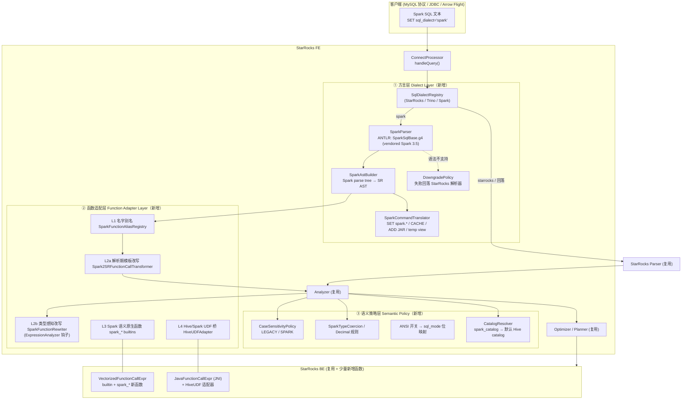
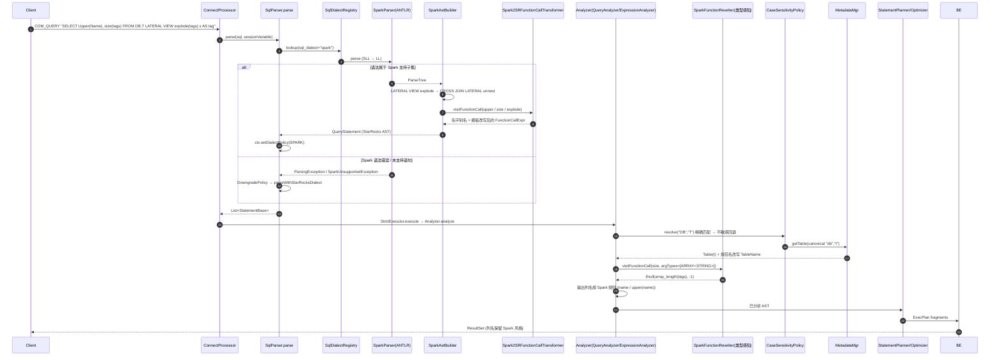
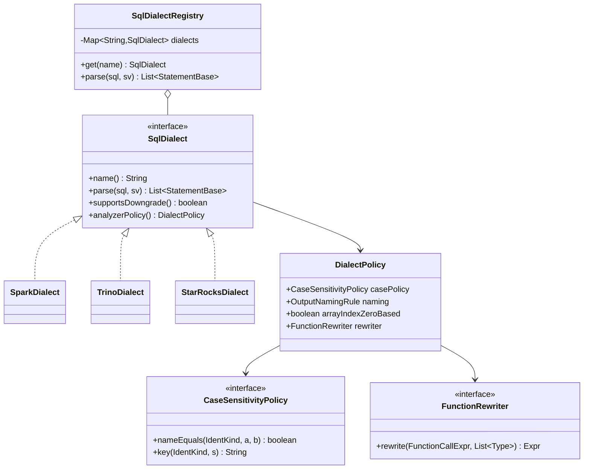

# 01 · 总体架构设计

> 目标：在 StarRocks 中以 `SET sql_dialect = 'spark'` 打开 Spark SQL 兼容模式，使绝大部分 Spark SQL（Spark 3.5 语义为基线，兼顾 4.0）无需修改即可运行，结果与 Spark 一致；无法保证一致的语义 **显式报错**，绝不静默返回不同结果。

## 1. 设计原则

| # | 原则 | 说明 |
|---|---|---|
| P1 | **只在 FE 前端做“翻译”，复用 StarRocks 全部 Analyzer/Optimizer/BE** | Spark AST → StarRocks AST（与现有 Trino 方言同构），方言只影响解析与少量 Analyzer 策略，执行引擎不分叉。 |
| P2 | **方言隔离、零回归** | 所有新行为由 `sql_dialect='spark'` 或 `spark_*` 会话变量门控；默认 StarRocks 方言的行为与输出字节级不变。 |
| P3 | **语义优先于语法** | 名字相同但语义不同的函数（`split`、`date_format`、`size`…）必须改写或用 Spark 语义实现；不能只做名字映射。 |
| P4 | **类型感知改写放 Analyzer，纯语法改写放 Parser** | 解析期看不到类型（如 `size(array)` vs `size(map)`），类型相关改写放在 `ExpressionAnalyzer` 钩子。 |
| P5 | **失败可回退** | 沿用 Trino 方言的 `enable_dialect_downgrade`：Spark 解析器不支持的语句（SHOW/ADMIN 等）回落 StarRocks 解析器。 |
| P6 | **持久化对象只存 StarRocks SQL** | View/MV 定义保存改写后的 StarRocks SQL（`AstToSQLBuilder`），保证跨方言、跨版本可重放。 |
| P7 | **测试驱动兼容度** | 以 Spark 官方 `sql-tests` golden 文件 + TPC-DS 差分测试的通过率作为里程碑指标。 |

## 2. 分层架构



### 2.1 三大子系统与用户目标映射

| 用户目标 | 子系统 | 主要文档 |
|---|---|---|
| 1. UDF 适配器层（名称、入参与 Spark/Hive 对齐） | ② 函数适配层 L1–L4 | [03-function-adapter.md](03-function-adapter.md) |
| 2. 新增 Spark SQL Dialect 方言 | ① 方言层 + ③ 部分语义策略 | [02-spark-dialect-parser.md](02-spark-dialect-parser.md)、[05-semantics-session-catalog.md](05-semantics-session-catalog.md) |
| 3. SQL 大小写行为与 Spark 相同 | ③ CaseSensitivityPolicy | [04-case-sensitivity.md](04-case-sensitivity.md) |

## 3. 端到端时序（一条 Spark 查询的生命周期）



## 4. 组件职责

| 组件 | 新增/修改 | 职责 | 关键接口 |
|---|---|---|---|
| `SqlDialect` / `SqlDialectRegistry` | 新增 | 把 `SqlParser.parse` 中硬编码的 `if trino` 抽象为可注册方言；统一 downgrade 与错误合并 | `List<StatementBase> parse(String sql, SessionVariable sv)` |
| `SparkParser` | 新增 | 包装 ANTLR 生成的 `SparkSqlBaseLexer/Parser`，复用 `CaseInsensitiveStream`、SLL→LL 两阶段、token/expr 限制 | `ParseTree parse(String)` |
| `SparkAstBuilder` | 新增 | Spark parse tree → `com.starrocks.sql.ast.*`；语句级白名单；语法糖展开 | `ParseNode visitXxx(...)` |
| `Spark2SRFunctionCallTransformer` | 新增 | 声明式模板改写（复用 `FunctionCallTransformer`/`PlaceholderExpr`） | `Expr convert(String fn, List<Expr> args)` |
| `SparkFunctionRewriter` | 新增 | Analyzer 期类型感知改写，挂在 `ExpressionAnalyzer.visitFunctionCall` 开头（与 `date_part` 同级） | `FunctionCallExpr rewrite(FunctionCallExpr, List<Type>)` |
| `spark_*` builtins | 新增 | BE C++ 实现 Spark 语义函数（`spark_date_format`、`spark_hash`、`months_between`…） | `gensrc/script/functions.py` |
| `HiveUDFAdapter` | 新增 | 在 JNI UDF 框架内托管 Hive `UDF`/`GenericUDF`/`GenericUDAFResolver2`、Spark Java UDF | `CREATE FUNCTION ... PROPERTIES("type"="HiveUDF")` |
| `CaseSensitivityPolicy` | 新增 | 统一库/表/catalog/别名/CTE 的比较；精确优先、不敏感回退、歧义报错 | `nameEquals(kind,a,b)` / `key(kind,s)` |
| `SparkCommandTranslator` | 新增 | `SET spark.*`、`CACHE TABLE`、`REFRESH TABLE`、`ADD JAR`、`CREATE TEMP VIEW` 等命令语义 | — |
| `SparkSessionCatalog` | 新增 | 会话级 temp view 注册表、`spark_catalog` 映射 | — |
| `SessionVariable` | 修改 | 新增 `spark_*` 变量（见 05） | — |
| `SqlParser` | 修改 | 委托 `SqlDialectRegistry` | — |
| `Field` / `Scope` / `QueryAnalyzer` / `SelectAnalyzer` | 修改 | 接入 `CaseSensitivityPolicy`、Spark 输出列名规则 | — |

## 5. 代码组织

```text
fe/
├── fe-grammar/src/main/antlr/com/starrocks/grammar/
│   ├── StarRocks.g4 / StarRocksLex.g4                (不变)
│   └── spark/                                        ★新增 (package com.starrocks.sql.parser.spark.gen)
│       ├── SparkSqlBaseLexer.g4                      vendored from apache/spark branch-3.5 (Apache-2.0, 保留 NOTICE)
│       └── SparkSqlBaseParser.g4                     去掉/固定 legacy_* 语义谓词
├── fe-core/src/main/java/com/starrocks/
│   ├── sql/parser/
│   │   ├── SqlParser.java                            ✎ 委托 SqlDialectRegistry
│   │   └── dialect/                                  ★新增
│   │       ├── SqlDialect.java                       interface
│   │       ├── SqlDialectRegistry.java
│   │       ├── StarRocksDialect.java / TrinoDialect.java (从 SqlParser 抽出)
│   │       └── DialectDowngradePolicy.java
│   ├── connector/parser/
│   │   ├── common/                                   ★从 trino/ 上移: FunctionCallTransformer, PlaceholderExpr
│   │   ├── trino/                                    (仅调整 import)
│   │   └── spark/                                    ★新增
│   │       ├── SparkDialect.java
│   │       ├── SparkParser.java / SparkParserUtils.java
│   │       ├── SparkAstBuilder.java                  (查询/DML/DDL 子 visitor 拆分)
│   │       ├── SparkDdlTranslator.java               CREATE TABLE USING/STORED AS/PARTITIONED BY
│   │       ├── SparkCommandTranslator.java           SET/CACHE/REFRESH/ADD JAR/USE
│   │       ├── SparkHintTranslator.java              BROADCAST/SHUFFLE_HASH/REPARTITION
│   │       ├── SparkIntervalParser.java
│   │       ├── SparkUnsupportedException.java
│   │       └── function/
│   │           ├── SparkFunctionAliasRegistry.java   L1
│   │           ├── Spark2SRFunctionCallTransformer.java  L2a
│   │           ├── SparkComplexFunctionTransformer.java  L2a (命令式)
│   │           ├── SparkFunctionRewriter.java        L2b (Analyzer 钩子)
│   │           ├── JavaDateTimePatternTranslator.java
│   │           └── SparkFunctionCatalog.java         函数覆盖矩阵/不支持清单 (由 CSV 生成)
│   ├── sql/analyzer/
│   │   ├── policy/CaseSensitivityPolicy.java         ★新增 (LEGACY/SPARK)
│   │   ├── policy/SparkOutputNaming.java             ★Spark 列命名规则
│   │   ├── ExpressionAnalyzer.java                   ✎ 增加 SparkFunctionRewriter 钩子
│   │   ├── Field.java / Scope.java / QueryAnalyzer.java / SelectAnalyzer.java  ✎ 接入 policy
│   │   └── CreateFunctionAnalyzer.java               ✎ type=HiveUDF / SparkUDF
│   ├── qe/
│   │   ├── SessionVariable.java                      ✎ spark_* 变量
│   │   ├── SparkConfMapper.java                      ★SET spark.sql.* → SR 变量映射表
│   │   └── SparkTempViewRegistry.java                ★会话级临时视图
│   └── server/ MetadataMgr.java / LocalMetastore.java / CatalogMgr.java  ✎ 不敏感回退查找
├── fe-core/src/test/java/com/starrocks/connector/parser/spark/   ★FE UT (参照 TrinoTestBase)
gensrc/script/functions.py                            ✎ spark_* 新 builtin (独立 fn_id 段，如 400000+)
be/src/exprs/spark/                                   ★新增 Spark 语义函数实现 (spark_string/time/hash/math)
be/test/exprs/spark/                                  ★BE UT
java-extensions/
├── hive-udf-bridge/                                  ★新增模块: HiveUDFAdapter / HiveUDAFAdapter / ObjectInspector 转换
test/sql/test_spark_dialect/                          ★SQL 集成测试 (T/ R/)
tools/spark-compat/                                   ★Spark golden 测试 harness + 差分测试脚本
```

## 6. 关键数据结构



`DialectPolicy` 在解析成功后挂到 `ConnectContext`（替代现有零散的 `relationAliasCaseInsensitive` 布尔位），Analyzer 通过 `ConnectContext.get().getDialectPolicy()` 读取。**注意**：policy 必须按“语句”而不是按“会话”生效——若某条语句回落到 StarRocks 解析器，仍使用 Spark 的大小写策略（用户感知的是会话方言），但不应用 Spark 专属的函数语义改写（因为该语句是按 StarRocks 语法写的）。

## 7. 部署与兼容性

- **无新进程、无外部服务**：全部在 FE/BE 进程内；Hive UDF 桥运行在 BE 现有 JVM（JNI）中。
- **滚动升级**：新增 `spark_*` builtin 的 fn_id 在旧 BE 不存在 → FE 侧按 BE 最低版本门控，混部期间 `sql_dialect='spark'` 下调用这些函数报“需升级 BE”。
- **元数据兼容**：不改 EditLog 格式；临时视图仅存会话内存；Hive UDF 复用现有 `CREATE FUNCTION` 持久化（新增 `type` 取值，旧 FE 回放需忽略未知 type → 需版本门控）。
- **可观测性**：沿用 `ProfileManager.SQL_DIALECT`；新增指标 `spark_dialect_parse_total{result=ok|downgrade|error}`、`spark_function_rewrite_total{fn}`、审计日志字段 `dialect`、`rewritten_sql`（可选，便于排查）。
