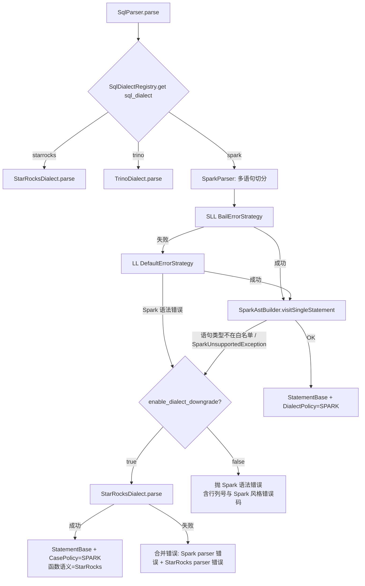

# 02 · Spark SQL 方言（Parser / AST 翻译）设计

## 1. 现状（已核对源码）

- `sql_dialect` 是 `SessionVariable` 中的普通 String（`qe/SessionVariable.java` L1027/L3271，默认 `"StarRocks"`，无校验），`enable_dialect_downgrade` 默认 `true`（L3274）。
- 唯一分发点：`sql/parser/SqlParser.java` L80-91 `parse()` 中 `equalsIgnoreCase("trino")`。
- Trino 方言：`connector/parser/trino/`（2564 LOC），使用 `io.trino:trino-parser:385` jar，自写 `AstBuilder` 把 Trino AST 翻译为 StarRocks AST，函数用 `Trino2SRFunctionCallTransformer`（~101 条模板）+ `ComplexFunctionCallTransformer`。只支持 Query/EXPLAIN/CTAS/INSERT/DROP TABLE，其余语句 **回落** StarRocks 解析器；解析成功后 `ConnectContext.setRelationAliasCaseInSensitive(true)`。
- StarRocks 语法：`fe-grammar/.../StarRocks.g4`（3448 行）+ `StarRocksLex.g4`（649 行），ANTLR **4.9.3**（与 Spark 3.5 相同版本）。
- 详细调用链与源码行号见 [research/r1_parser.md](research/r1_parser.md)。

## 2. 方案选择

| 方案 | 描述 | 优点 | 缺点 | 结论 |
|---|---|---|---|---|
| A | **Vendor Spark 3.5 的 `SqlBaseLexer.g4`/`SqlBaseParser.g4`** → 生成独立 parser → 自写 `SparkAstBuilder` 翻译为 SR AST | 语法覆盖 = Spark 原生；与 Trino 方言模式一致；默认方言零影响；ANTLR 版本一致；可逐语句渐进 | 需写较大的 visitor（估 6–9k LOC）；Spark 升级需同步语法 | **✅ 推荐（主路径）** |
| B | 在 `StarRocks.g4` 中加 Spark 语法（dialect 谓词守卫） | 复用 10k 行 `AstBuilder` | Lexer 与方言无关、关键字冲突（`CLUSTER/SORT/DISTRIBUTE/PARTITIONED/USING/LATERAL VIEW`）；语义谓词破坏 SLL 预测、拖慢默认方言；与上游 merge 冲突大 | ❌ 仅用于少量**两种方言都受益**的补丁（如 `INSERT OVERWRITE TABLE`） |
| C | 外部 sqlglot 转写服务（Doris 模式） | 上线快 | Python sidecar、HA/延迟、文本级无类型、错误位置丢失、语义只能“尽量” | ❌ 仅作离线对照/测试 oracle |

> 调研中存在分歧：先行实践调研 ([research/r5](research/r5_priorart_semantics.md)) 倾向 B（“Spark 语法是 SR 的小补丁”），解析器调研 ([research/r1](research/r1_parser.md)) 倾向 A。**最终选 A**，理由：① 用户目标是“绝大部分 Spark SQL 无需修改”，长尾语法（`LATERAL VIEW OUTER`、`WINDOW` 子句、多单位 `INTERVAL`、`TRANSFORM`、`PARTITIONED BY`、`CLUSTER BY`、`INSERT ... PARTITION(p='x')`、`TABLESAMPLE`、Spark 关键字非保留规则）累积起来远超“小补丁”；② 方案 B 会让默认方言承担风险，违背 P2 零回归；③ Fork 需长期跟进上游 StarRocks，独立文件比改 `StarRocks.g4` 冲突少得多。

## 3. 语法引入与裁剪

1. 从 `apache/spark@branch-3.5` 复制 `sql/api/src/main/antlr4/org/apache/spark/sql/catalyst/parser/SqlBase{Lexer,Parser}.g4`，改名 `SparkSqlBase*`，`@header` package 改为 `com.starrocks.sql.parser.spark.gen`，保留 Apache-2.0 头并在 `NOTICE.txt` 登记。
2. Spark 语法中的语义谓词（`legacy_setops_precedence_enabled`、`legacy_exponent_literal_as_decimal_enabled`、`SQL_standard_keyword_behavior`、`double_quoted_identifiers`）改为 parser 成员字段，由 `SparkParser` 根据会话变量注入（默认值 = Spark 3.5 默认）。
3. Spark Lexer 依赖大写字符流（`UpperCaseCharStream`）：复用 SR 的 `CaseInsensitiveStream`。
4. 构建：`fe-grammar/build.gradle.kts` 的 antlr 任务追加 `spark/` 目录（独立 package，避免与 `StarRocksParser` 类名冲突）；Maven `pom.xml` 同步。
5. 后续升级 Spark 4.0 语法：以 diff 方式合入，`SparkAstBuilder` 对新增规则默认抛 `SparkUnsupportedException`（→ 回落）。

## 4. 解析流程与回落



要点：
- `DialectDowngradePolicy` 从 `SqlParser.rollbackStarRocksDialect` 抽出并泛化（当前错误文案写死 `"Trino parser"`）。
- 回落时 **必须** 打标记（`StatementBase.setParsedDialect(STARROCKS)`），Analyzer 据此决定是否启用 Spark 函数改写（L2b）与数组 0 基改写。
- 内部生成的 SQL（`StmtExecutor` L3225 等 SHOW 改写、MV/View 刷新、统计信息收集）一律使用 `parseOneWithStarRocksDialect`，审计所有 `SqlParser.parse(..., sessionVariable)` 调用点。
- Follower 转发 `proxyExecute`（`ConnectProcessor` L1436-1445）：SET 语句用 SR 方言解析；Spark 方言下的 `SET spark.x=y` 需在转发前已被 `SparkCommandTranslator` 规范化为 SR 的 `SET` 或 no-op。

## 5. 语句覆盖矩阵（SparkAstBuilder 白名单）

| 类别 | Spark 语句 | 翻译目标 | 阶段 |
|---|---|---|---|
| 查询 | `SELECT/WITH/VALUES/TABLE t/FROM t SELECT ...` | `QueryStatement` | P1 |
| 查询 | `EXPLAIN [EXTENDED|FORMATTED|COST]` | `ExplainStmt`（映射级别） | P1 |
| DML | `INSERT INTO|OVERWRITE [TABLE] t [PARTITION(p='x', q)] [(cols)] query` | `InsertStmt`（静态分区值 → 谓词/目标分区；Hive catalog 走外表写入） | P1 |
| DML | `INSERT OVERWRITE [LOCAL] DIRECTORY` | `INSERT INTO FILES()` | P3 |
| DML | `MERGE INTO / UPDATE / DELETE` | 主键表 `UPDATE/DELETE`；Iceberg 走 connector；其余报 unsupported | P2/P3 |
| DDL | `CREATE TABLE [IF NOT EXISTS] t (...) USING parquet|orc|delta|iceberg [PARTITIONED BY] [LOCATION] [TBLPROPERTIES]` / `STORED AS` | 目标 catalog = Hive/Iceberg → 外表 DDL；目标 = 内表 → 补默认 `DUPLICATE KEY` + `DISTRIBUTED BY RANDOM` + `PARTITION BY` | P2 |
| DDL | CTAS / `CREATE TABLE LIKE` | `CreateTableAsSelectStmt` / `CreateTableLikeStmt` | P1/P2 |
| DDL | `CREATE [OR REPLACE] [GLOBAL] TEMP VIEW` | `SparkTempViewRegistry`（会话级） | P2 |
| DDL | `CREATE [OR REPLACE] VIEW`、`DROP TABLE|VIEW [IF EXISTS] [PURGE]`、`ALTER TABLE ADD COLUMNS|RENAME|SET TBLPROPERTIES` | 对应 SR 语句 | P2 |
| DDL | `CREATE [TEMPORARY] FUNCTION f AS 'cls' [USING JAR 'x']`、`DROP FUNCTION` | `CreateFunctionStmt(type=HiveUDF)` | P2 |
| 命令 | `SET k=v` / `SET` / `RESET` | `SparkConfMapper`：映射或 no-op + warning | P1 |
| 命令 | `USE db` / `USE catalog.db` | `UseDbStmt`（经 catalog 映射） | P1 |
| 命令 | `CACHE [LAZY] TABLE` / `UNCACHE` / `CLEAR CACHE` | no-op（可选：映射 DataCache warmup） | P1 |
| 命令 | `REFRESH TABLE t` / `MSCK REPAIR TABLE` | `REFRESH EXTERNAL TABLE` | P2 |
| 命令 | `ANALYZE TABLE t COMPUTE STATISTICS [FOR COLUMNS]` | `AnalyzeStmt` | P2 |
| 命令 | `ADD JAR/FILE`、`LIST JAR` | 会话 jar 列表（供 TEMP FUNCTION 使用） | P2 |
| 命令 | `SHOW TABLES/DATABASES/COLUMNS/PARTITIONS/FUNCTIONS/CREATE TABLE`、`DESCRIBE [EXTENDED]` | SR SHOW + **结果集形状适配**（列名改为 Spark 风格） | P2 |
| 其它 | 不在表中的语句 | 抛 `SparkUnsupportedException` → 回落 | — |

## 6. 表达式与查询子句翻译规则（核心）

| Spark 语法 | StarRocks AST 翻译 | 说明 |
|---|---|---|
| `LATERAL VIEW [OUTER] explode(a) t AS c` | `CROSS JOIN LATERAL unnest(a) t(c)`；OUTER → `LEFT JOIN LATERAL unnest(a) t(c) ON true` | posexplode → `unnest(a)` + `generate_series` 或 `array_generate` 并行 unnest，pos 需 **-1**（Spark 0 基）；`inline(arr<struct>)` → unnest + struct 字段展开 |
| SELECT 列表中的 `explode(a)` | 提升为 lateral join（Spark 只允许一个 generator/select） | `SparkGeneratorExtractor` |
| `arr[i]` | `element_at(arr, i + 1)`（i 为常量时直接 +1 折叠） | Spark 下标 0 基、SR 1 基；`map[k]` 不变 |
| `a || b` | `concat(a, b)` | Spark 方言强制 `MODE_PIPES_AS_CONCAT` |
| `x DIV y` / `x % y` / `<=>` / `RLIKE` / `ILIKE` | SR 现有表达式；`ILIKE` → `like(lower(a), lower(b))`（`SyntaxSugars`） | |
| `INTERVAL '1' DAY`、`INTERVAL 1 DAY 2 HOURS`、`INTERVAL '1-2' YEAR TO MONTH` | 拆分为多个 `TimestampArithmeticExpr` 链 | `SparkIntervalParser`；interval 作为列类型 → unsupported |
| `TIMESTAMP '...'`、`TIMESTAMP_NTZ '...'`、`DECIMAL '1.2'`、`1.2BD`、`1L`、`1S`、`1Y`、`1D` 字面量 | `DateLiteral` / `DecimalLiteral` / 带类型 `IntLiteral` | 后缀字面量 SR 不支持，需翻译 |
| `CAST(x AS STRING)` / `BINARY` / `TIMESTAMP` | `VARCHAR(65533)`/`STRING`、`VARBINARY`、`DATETIME` | 类型别名表 `SparkTypeMapper` |
| `named_struct/struct/map/array` 构造 | `named_struct`、`row`、`map{}`(MapExpr)、`array[]`(ArrayExpr) | `map(k1,v1,k2,v2)` 变参需重组 |
| `x -> x+1` lambda | `LambdaFunctionExpr` | 高阶函数名映射见 03 |
| `GROUP BY ... WITH ROLLUP|CUBE`、`GROUPING SETS`、`grouping_id()` | SR `GroupByClause` | grouping_id 位序需验证 |
| `GROUP BY ALL`（3.4+）/ 序号 / 别名 | 展开为非聚合 select 项 / 打开 `enable_groupby_use_output_alias` | |
| `WINDOW w AS (...)` + `OVER w` | 内联展开为 `AnalyticWindow` | SR 无命名窗口 |
| `DISTRIBUTE BY` / `CLUSTER BY` / `SORT BY` | 忽略 DISTRIBUTE；`SORT BY`/`CLUSTER BY` 在最外层 → `ORDER BY`，子查询内 → 丢弃（语义允许） | 打 warning |
| `/*+ BROADCAST(t) / MERGE / SHUFFLE_HASH / REPARTITION(n) / COALESCE */` | BROADCAST/SHUFFLE → SR join hint `[BROADCAST]/[SHUFFLE]`；其余忽略 | `SparkHintTranslator` |
| `TABLESAMPLE (n PERCENT | n ROWS | BUCKET x OUT OF y)` | ROWS → `LIMIT`；PERCENT → SR `SAMPLE` 或 `rand() < p` 谓词 | 结果随机，不纳入 golden 比对 |
| `PIVOT` / `UNPIVOT` | SR `pivotClause`；UNPIVOT → `UNION ALL` 展开 / unnest | |
| `TRANSFORM(...) USING 'script'` | unsupported | |
| `SELECT * EXCEPT(c)`（Databricks） | SR `excludeClause` | |
| `LEFT SEMI/ANTI JOIN`、`NATURAL JOIN`、`USING (c)` | SR join 类型 | 校验无 ON 条件的 SEMI JOIN |
| `catalog.db.t` / `spark_catalog.db.t` / `db.t` | `TableName` + `CatalogResolver` | 见 05 |
| 时间旅行 `VERSION AS OF` / `TIMESTAMP AS OF` | SR `FOR VERSION AS OF` | Iceberg/Paimon |

## 7. SparkAstBuilder 代码骨架

```java
package com.starrocks.connector.parser.spark;

public class SparkAstBuilder extends SparkSqlBaseParserBaseVisitor<ParseNode> {
    private final long sqlMode;              // 已强制 MODE_PIPES_AS_CONCAT
    private final SparkParseOptions options; // ansi、legacy 开关
    private final FunctionTranslator fnTranslator = SparkFunctionTranslator.INSTANCE;

    @Override
    public ParseNode visitSingleStatement(SparkSqlBaseParser.SingleStatementContext ctx) {
        ParseNode node = visit(ctx.statement());
        if (!(node instanceof StatementBase)) {
            throw new SparkUnsupportedException(ctx.getText());
        }
        return node;
    }

    @Override
    public ParseNode visitQuery(SparkSqlBaseParser.QueryContext ctx) { ... }   // CTE + queryTerm + ORDER/LIMIT

    @Override
    public ParseNode visitLateralView(SparkSqlBaseParser.LateralViewContext ctx) {
        // explode/posexplode/inline/json_tuple/stack → TableFunctionRelation(unnest/json_each/...)
        return generatorTranslator.toLateralJoin(ctx, outer(ctx));
    }

    @Override
    public ParseNode visitFunctionCall(SparkSqlBaseParser.FunctionCallContext ctx) {
        String name = normalize(ctx.functionName());
        List<Expr> args = visit(ctx.argument, Expr.class);
        FunctionCallExpr raw = buildCall(name, args, ctx.setQuantifier(), ctx.where, ctx.windowSpec());
        return fnTranslator.translate(raw, pos(ctx));   // L1 + L2a，见 03
    }

    @Override
    public ParseNode visitSubscript(SparkSqlBaseParser.SubscriptContext ctx) {
        Expr base = (Expr) visit(ctx.value);
        Expr idx = (Expr) visit(ctx.index);
        // map 下标在解析期无法确定类型 → 生成 SparkSubscriptExpr，Analyzer 期按类型决定 +1
        return new SparkSubscriptExpr(base, idx, pos(ctx));
    }
}
```

> `SparkSubscriptExpr` 是一个仅在 Spark 方言产生的 AST 节点，`ExpressionAnalyzer` 遇到它时：base 为 ARRAY → `CollectionElementExpr(base, idx+1)`；为 MAP → `CollectionElementExpr(base, idx)`；不放到解析期判断。

## 8. 工作量估算（方言层）

| 模块 | 预估 LOC | 人周 |
|---|---|---|
| 方言抽象 `SqlDialectRegistry` + downgrade 泛化 + Trino 迁移 | 600 | 1.5 |
| Spark grammar vendor + 构建 + 谓词处理 | 200 + 2 个 g4 | 1 |
| `SparkAstBuilder` 查询部分（含 lateral view、interval、字面量、hint、window 子句） | 4,000 | 6 |
| DML/DDL/命令翻译 | 2,500 | 4 |
| FE 单测（参照 Trino 3.6k LOC） | 6,000 | 4 |
| **合计** | ~13k | **~16.5 人周** |
