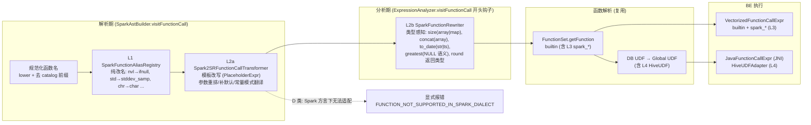
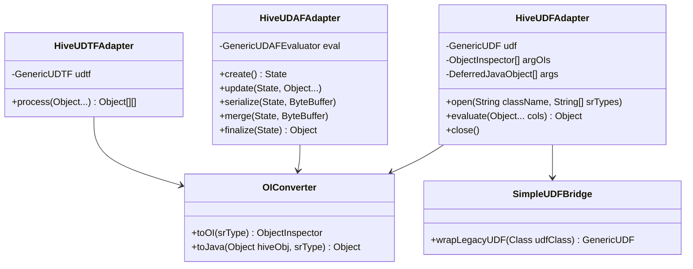
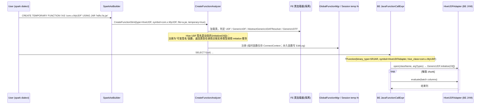

# 03 · UDF / 函数适配器层设计（与 Spark / Hive 函数名称与入参对齐）

## 1. 差距概览（Spark 3.5 内置 430 个注册名）

| 类 | 含义 | 数量 | 占比 | 处理层 |
|---|---|---|---|---|
| A | 同名且语义兼容 | 142 | 33% | 无需处理（但须差分测试确认） |
| **B** | **同名但语义/参数不同（静默错结果风险）** | **89** | **21%** | L2 改写 / L3 Spark 语义实现 |
| C | 不同名、语义相同 | 66 | 15% | L1 别名 / L2a 参数重排 |
| D | StarRocks 缺失 | 128 | 30% | S=59 FE 表达式改写；M=38 少量 BE；L=31 大工程 |
| E | Spark 运行时概念 | 5 | 1% | 模拟（见 §7） |

逐函数分类、StarRocks 对应、差异、策略、难度：**[func_mapping.csv](func_mapping.csv)**（479 行，含 49 行 Spark 4.0/4.1 补充，低置信度）。完整分析：[research/r4_func_gap.md](research/r4_func_gap.md)。

### 1.1 必须首先修复的“静默错结果”陷阱（已核实源码/文档）

| # | 函数 | Spark | StarRocks | 处理 |
|---|---|---|---|---|
| 1 | `stddev`/`std`/`variance` | **样本** | **总体** | 改写为 `stddev_samp`/`var_samp` |
| 2 | `||` | 字符串拼接 | 逻辑 OR（默认） | 方言强制 `PIPES_AS_CONCAT` |
| 3 | `date_add/date_sub/add_months` | 返回 DATE | 返回 DATETIME | 外包 `CAST(... AS DATE)` |
| 4 | `date_format/from_unixtime/unix_timestamp/to_date/to_timestamp` | Java 模式 `yyyy-MM-dd` | MySQL `%Y-%m-%d`（BE 仅特判 3–5 种） | 常量模式 FE 翻译；非常量 → `spark_date_format` (L3) |
| 5 | `greatest/least` | 跳过 NULL | 任一 NULL → NULL | 改写或 L3 |
| 6 | `collect_list/collect_set` | 丢弃 NULL | SR 无此名；`array_agg` 保留 NULL | `array_agg(x) FILTER(WHERE x IS NOT NULL)` / `array_unique_agg` |
| 7 | `arr[i]` | 0 基 | 1 基 | `SparkSubscriptExpr`（见 02） |
| 8 | `element_at(arr, -1)` | 负数从尾 | 仅正数 | CASE 改写 |
| 9 | `size(NULL)` | -1 | NULL | `ifnull(cardinality(x), -1)` |
| 10 | `split(s, re, limit)` | 正则 + limit | 字面量，无 limit | `regexp_split` + `array_slice` |
| 11 | `regexp_extract/replace` | idx 默认 1；`$1`；Java regex | idx 必填；`\1`；RE2 | 补默认参数、替换串翻译；RE2 不支持的语法 → 报错 |
| 12 | `substring(s, 0, n)` | 0 视为 1 | 返回空串 | `if(pos=0,1,pos)` |
| 13 | `length` | 字符数 | **字节数** | → `char_length` |
| 14 | `hash/xxhash64` | Murmur3 seed 42 / XXH64 seed 42 | seed 104729 / 0 | 新增 BE `spark_hash`/`spark_xxhash64` (L3) |
| 15 | `array_sort/sort_array` | NULL 在后 / desc 规则 | NULL 在前 | 改写 |
| 16 | `round(double)` | 返回 DOUBLE | 返回 BIGINT | 返回类型 cast |
| 17 | `trunc(date, fmt)` | 参数顺序/单位集 | `date_trunc(fmt, d)` | 改写 + 单位映射 |
| 18 | `transform/filter/exists` | `f(arr, lambda)` | `array_map(lambda, arr)` | 参数重排 |
| 19 | `rand(seed)` | 可复现 | 忽略 seed | 文档声明 / L3 |

## 2. 四层适配架构



### 层次职责与落点

| 层 | 适用类 | 生效范围 | 代码位置 | 机制 |
|---|---|---|---|---|
| **L1 名字别名** | C（纯改名）、B 中仅名字不同语义者（`stddev`→`stddev_samp`, `length`→`char_length`） | 仅 Spark 方言 | `connector/parser/spark/function/SparkFunctionAliasRegistry` | `Map<String,String>`，可由 CSV 生成 |
| **L2a 解析期模板改写** | B/C/D-S 中**与参数类型无关**的：参数重排、补默认参数、常量格式串翻译、结果外包 cast | 仅 Spark 方言 | `Spark2SRFunctionCallTransformer` + `SparkComplexFunctionTransformer`（复用上移到 `connector/parser/common/` 的 `FunctionCallTransformer`/`PlaceholderExpr`） | Trino 同构，约 250–300 条注册 |
| **L2b 分析期类型感知改写** | 依赖参数类型的：`size`、`concat(array)`、`to_date(str vs ts)`、`greatest/least`、`round`、`element_at` 负下标、`sum(decimal)` | 仅 Spark 方言语句（回落语句不启用） | `SparkFunctionRewriter`，挂在 `ExpressionAnalyzer.visitFunctionCall`（:1053）开头，与 `date_part` 改写同级 | 改写后重新 `visitFunctionCall` |
| **L3 Spark 语义原生函数** | B/D 中无法用表达式等价表达或性能关键的 | 全局可见，`spark_` 前缀 | `gensrc/script/functions.py` 新 fn_id 段 + `be/src/exprs/spark/*`；聚合在 `FunctionSet` + `be/src/exprs/agg/` | L2 的改写目标；EXPLAIN 中可见 |
| **L4 Hive/Spark UDF 桥** | 用户自定义 Hive UDF、长尾函数（xpath、`reflect`） | 用户 `CREATE FUNCTION` | `java-extensions/hive-udf-bridge` + `CreateFunctionAnalyzer` | JNI 现有 UDF 框架 |

> **为什么 L3 用 `spark_` 前缀而不是直接覆盖同名 builtin**：直接改 `split`、`date_format` 等会破坏默认方言用户；前缀函数只作为 L2 的改写目标，默认方言零影响（P2）。这与 Velox `functions/sparksql` vs `functions/prestosql`、DataFusion `datafusion-spark` 的“语义分离”做法一致。

## 3. L1 / L2a 实现示例

```java
public final class Spark2SRFunctionCallTransformer {
    private static final Map<String, List<FunctionCallTransformer>> MAP = new HashMap<>();

    static {
        // ---- L1 纯别名 ----
        alias("nvl", "ifnull");
        alias("std", "stddev_samp");  alias("stddev", "stddev_samp");  alias("variance", "var_samp");
        alias("length", "char_length"); alias("char_length", "char_length");
        alias("chr", "char"); alias("base64", "to_base64"); alias("unbase64", "from_base64");
        alias("shiftleft", "bit_shift_left"); alias("shiftright", "bit_shift_right");
        alias("collect_set", "array_unique_agg");

        // ---- L2a 模板 ----
        // nvl2(a,b,c) -> if(a IS NOT NULL, b, c)
        register("nvl2", 3, new FunctionCallExpr("if", List.of(
                new IsNullPredicate(ph(1), true), ph(2), ph(3))));
        // date_add(d, n) -> CAST(days_add(d, n) AS DATE)
        register("date_add", 2, cast(fn("days_add", ph(1), ph(2)), DATE));
        // transform(arr, f) -> array_map(f, arr)
        register("transform", 2, fn("array_map", ph(2), ph(1)));
        // regexp_extract(s, p) -> regexp_extract(s, p, 1)
        register("regexp_extract", 2, fn("regexp_extract", ph(1), ph(2), new IntLiteral(1)));
        // collect_list(x) -> array_agg(x) FILTER (WHERE x IS NOT NULL)
        register("collect_list", 1, aggFilter("array_agg", ph(1), new IsNullPredicate(ph(1), true)));
        // trunc(d, 'MM') -> CAST(date_trunc('month', d) AS DATE)   单位映射在 Complex 中
    }

    public static Expr convert(String fnName, List<Expr> args, NodePosition pos) {
        Expr r = convertRegistered(fnName, args);
        if (r == null) r = SparkComplexFunctionTransformer.transform(fnName, args);  // 模式串翻译等
        if (r == null && SparkFunctionCatalog.isUnsupported(fnName)) {
            throw new SemanticException("Function %s is not supported in spark dialect", fnName);
        }
        return r;   // null → 原名透传 (A 类)
    }
}
```

### 3.1 Java 日期模式翻译器（L2a 核心组件）

`JavaDateTimePatternTranslator.translate("yyyy-MM-dd HH:mm:ss.SSS")` → `"%Y-%m-%d %H:%i:%s.%f"`

| Java/Spark | MySQL/SR | 备注 |
|---|---|---|
| `yyyy`/`yy` | `%Y`/`%y` | |
| `MM`/`M`/`MMM`/`MMMM` | `%m`/`%c`/`%b`/`%M` | |
| `dd`/`d` | `%d`/`%e` | |
| `HH`/`H`/`hh`/`h` | `%H`/`%k`/`%h`/`%l` | |
| `mm` | `%i` | |
| `ss` | `%s` | |
| `SSS`/`SSSSSS` | `%f`（截断处理） | 精度差异 |
| `EEE`/`EEEE` | `%a`/`%W` | |
| `a` | `%p` | |
| `D` | `%j` | |
| `'literal'` | 原样（转义 `%`） | |
| `u`、`w`、`Q`、`VV`、`XXX`、`Z` 等 | **无对应** | → 改写到 L3 `spark_date_format(ts, pattern)` |

- 模式为**常量**：FE 翻译，零运行期开销；
- 模式为**列/表达式**或含无对应符号：改写为 `spark_date_format`（BE 用 C++ 实现 Java `DateTimeFormatter` 子集，`spark.sql.legacy.timeParserPolicy` 语义）。

## 4. L2b 分析期改写示例

```java
// ExpressionAnalyzer.visitFunctionCall 开头
if (node.isSparkDialect()) {                                   // 由 SparkAstBuilder 打标
    Expr rewritten = SparkFunctionRewriter.rewrite(node, scope, this::analyzeChildTypes);
    if (rewritten != node) { replaceInParent(node, rewritten); return visit(rewritten, scope); }
}

// SparkFunctionRewriter
case "size":   // Spark: array 或 map；sizeOfNull=true 时 NULL → -1
    Type t = argTypes.get(0);
    Expr len = t.isMapType() ? fn("map_size", a0) : fn("array_length", a0);
    return sv.isSparkLegacySizeOfNull() ? fn("ifnull", len, lit(-1)) : len;
case "concat": // 任一参数为 ARRAY → array_concat
    return argTypes.stream().anyMatch(Type::isArrayType) ? fn("array_concat", args) : node;
case "greatest": case "least":   // Spark 跳过 NULL
    return fn("spark_" + name, args);   // L3 实现，或 array_max(array_filter(...))
case "round":  // round(DOUBLE) 返回 DOUBLE
    return argTypes.get(0).isFloatingPointType() ? cast(node, DOUBLE) : node;
```

## 5. L3 新增 Spark 语义 BE 函数（首批）

| 函数 | 类型 | 说明 | 难度 |
|---|---|---|---|
| `spark_date_format(ts, pattern)` / `spark_to_timestamp(str, pattern)` / `spark_unix_timestamp` | 标量 | Java DateTimeFormatter 子集，非常量模式 | M |
| `spark_hash(...)` / `spark_xxhash64(...)` | 标量变参 | Murmur3_x86_32 / XXH64 seed=42，按 Spark 类型规则逐列链式 | M |
| `spark_greatest/least` | 标量 | 跳过 NULL | S |
| `months_between(a,b[,roundOff])` | 标量 | 31 天月规则 | S |
| `bround`、`rint`、`isnan`、`nanvl`、`sha1`、`bit_count`、`levenshtein`、`soundex`、`format_number`、`format_string/printf`、`mask` | 标量 | 缺失函数 | S–M |
| `spark_split(str, regex, limit)` | 标量 | Java regex 语义（RE2 不支持时报错） | M |
| `skewness`、`kurtosis`、`mode`、`median`、`bool_and/every`、`bit_and/or/xor`、`regr_*`、`nth_value` | 聚合/窗口 | `FunctionSet` + `be/src/exprs/agg/` | M |
| `from_json(str, schema)` | 标量 | schema 字符串 → STRUCT 类型，BE 解析 | L |

**fn_id 分配**：在 `functions.py` 预留新段（如 `400000–409999`），避免与上游 merge 冲突。**版本门控**：FE 检查集群内 BE 最低版本，混部期 Spark 方言改写不选择 L3 目标。

## 6. L4 Hive / Spark UDF 桥

Spark 作业里常见 `CREATE TEMPORARY FUNCTION my_udf AS 'com.x.MyUDF' USING JAR 'hdfs://.../udf.jar'`。StarRocks 当前**不支持**运行 Hive UDF（`TFunctionBinaryType.HIVE` 为 Impala 遗留，未实现；`fe/hive-udf` 是给 Hive 用的 bitmap UDF，方向相反）。

### 6.1 组件



### 6.2 注册时序



要点与风险：
- **动态签名**：Hive GenericUDF 的返回类型在 `initialize(ObjectInspector[])` 时决定。FE 在 analyzer 阶段用隔离类加载器实例化并调用 `initialize` 推导返回类型（需 `enable_udf` 与安全沙箱）。
- **依赖**：hive-exec 体积大且与 BE 现有 Hadoop 依赖冲突 → 新模块 `hive-udf-bridge` 使用 shaded `hive-exec-core` 最小依赖并在 `UDFClassLoader` 隔离加载。
- **性能**：逐行 ObjectInspector 转换开销大（通常比 SR Java UDF 慢 2–5×），文档声明“仅用于长尾兼容”。
- **Spark Scala/Java UDF**（`spark.udf.register`）属于 DataFrame API，不在 SQL 文本里，超出范围。

## 7. E 类模拟

| 函数 | 模拟 |
|---|---|
| `spark_partition_id()` | 常量 0（或 BE driver 序号），文档声明 |
| `input_file_name()` | 外表可映射到隐藏文件路径列（需确认 connector 支持），否则空串 |
| `input_file_block_start/length()` | -1 |
| `monotonically_increasing_id()` | 新增 BE 函数：`(fragment_instance_seq << 33) + 行号`，与 Spark 语义（唯一、单调、不连续）一致 |
| `current_user()` / `current_catalog()` / `current_database()` | 映射 SR 对应函数 |

## 8. 函数注册表的工程化

- `func_mapping.csv` 为**单一事实来源**：脚本 `tools/spark-compat/gen_function_registry.py` 生成 L1 别名表、L2a 注册骨架、`SparkFunctionCatalog`（不支持清单、来源说明）与 FE 单测骨架。
- `SHOW FUNCTIONS`（Spark 方言）返回 Spark 函数名视图，并提供 `spark_function_compat` 系统表（`information_schema.spark_function_compat`：name/class/status/notes），方便用户自查。

## 9. 工作量估算（函数层）

| 工作项 | 函数数 | 人周 |
|---|---|---|
| 框架：公共 Transformer 上移、Registry、L2b 钩子、生成脚本、`spark_function_compat` | — | 2 |
| 静默错误 B 项（§1.1 共 19 项） | 19 | 3 |
| 其余 B 项 + C 项（FE 改写） | ~135 | 4 |
| D-S（FE 表达式改写） | 59 | 3 |
| 日期模式翻译器 + `spark_date_format` 系列 BE 实现 | 5 | 3 |
| D-M + L3 BE 新函数（含 hash、聚合、months_between…） | ~40 | 8 |
| D-L 选做（from_json、sketch、xpath 走 L4） | ~10 | 6 |
| L4 Hive UDF 桥（UDF/GenericUDF/UDAF/UDTF + 临时函数 + USING JAR） | — | 6 |
| 测试（FE 改写 UT + BE UT + 对拍） | — | 6 |
| **合计** | | **~41 人周** |
