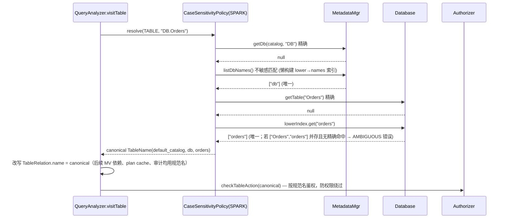

# 04 · SQL 大小写行为与 Spark 对齐

## 1. 目标语义（Spark 默认 `spark.sql.caseSensitive=false`）

**“标识符解析不敏感 + 输出保留原大小写 + 数据比较敏感”**

| 维度 | Spark 行为 |
|---|---|
| 列名、struct 字段、CTE 名、表别名、子查询别名 | 不敏感（`caseInsensitiveResolution`） |
| 库名、表名、临时视图名 | 不敏感（`SessionCatalog.format` 小写；Hive metastore 本身小写） |
| 函数名 | 永远不敏感 |
| Map key、字符串 `=`/`<`/GROUP BY/DISTINCT/JOIN | 永远敏感（二进制，UTF8_BINARY） |
| `LIKE` / `RLIKE` | 敏感；`ILIKE` 不敏感 |
| 输出列名 | 未加别名的列引用取 **表定义中的列名**；别名取写法；表达式取规范化文本（函数名小写） |
| 重复列（大小写不同）建表 | 报 `COLUMN_ALREADY_EXISTS` |
| 4.0 Collation (`UTF8_LCASE`) | 改变比较语义（需显式 COLLATE） |

## 2. StarRocks 现状与差距（已核对源码）

| 维度 | StarRocks 现状 | 代码位置 | 差距 |
|---|---|---|---|
| 列名 | 不敏感，保留定义大小写 | `RelationFields.java:56,100`、`Field.canResolve:108`、`Table.java:564`（CASE_INSENSITIVE TreeMap） | 无 |
| struct 字段 | 不敏感 | `StructType.java:56,160` | 无 |
| 函数名 | 不敏感 | `FunctionNameAnalyzer.java:44` | 无 |
| 字符串比较/LIKE | 二进制敏感；`ILIKE` → `like(lower,lower)` | `SyntaxSugars.java:37,65` | 无（Unicode casefold 细节差异，低） |
| 表别名前缀 | **敏感**，仅 Trino 方言下不敏感 | `Field.matchesPrefix:228`，`SqlParser.java:111` | **需改** |
| catalog/db 前缀 | **敏感**（`equals`） | `Field.matchesPrefix:219-226` | **需改** |
| CTE 名 | **敏感**（LinkedHashMap 精确） | `Scope.java:39,130-141`、`QueryAnalyzer.java:500-506` | **需改** |
| 内部库/表查找 | **敏感** | `LocalMetastore.getDb:3080`、`Database.getTable:250,416` | **需改** |
| catalog 名 | 敏感（`default_catalog` 例外） | `CatalogMgr.java:251,274` | **需改** |
| 外部 Hive/Iceberg 表名 | 连接器内已小写 | `HiveMetastoreApiConverter.java:154`、`IcebergMetadata.java:841` | 入口统一 lower（检查 JDBC/Paimon/Delta/Hudi） |
| 输出列名 | 取 **用户写法**（`select ID from t(id)` → `ID`） | `SelectAnalyzer.java:315` | **需改**（Spark → `id`） |
| `lower_case_table_names` | 空壳，无作用 | `GlobalVariable.java:55,124` | 不复用 |
| `enable_table_name_case_insensitive` | **集群级、初始化时一次性、不可逆**；在解析期把名字 lower | `Config.java:5665`、`Util.normalizeName:514` | 不可作为会话级方案 |
| COLLATE | 不支持 | — | Phase 3+ |

完整分析见 [research/r3_case.md](research/r3_case.md)。

## 3. 设计：`CaseSensitivityPolicy`

### 3.1 接口

```java
package com.starrocks.sql.analyzer.policy;

public enum IdentKind { CATALOG, DATABASE, TABLE, RELATION_ALIAS, CTE, COLUMN, STRUCT_FIELD, TEMP_VIEW }

public interface CaseSensitivityPolicy {
    boolean nameEquals(IdentKind kind, String a, String b);
    /** 用作 Map key 的规范化形式 */
    String key(IdentKind kind, String name);
    /** 元数据查找：精确优先，不敏感回退；多个候选报歧义 */
    default <T> T resolve(IdentKind kind, String name, Function<String, T> exact,
                          Supplier<Collection<String>> candidates) { ... }

    CaseSensitivityPolicy LEGACY = new LegacyPolicy();          // 精确复刻现状，含 enableTableNameCaseInsensitive / relationAliasCaseInsensitive
    CaseSensitivityPolicy SPARK_INSENSITIVE = new SparkPolicy();

    static CaseSensitivityPolicy current() {
        ConnectContext ctx = ConnectContext.get();
        return ctx == null ? LEGACY : ctx.getDialectPolicy().casePolicy();
    }
}
```

### 3.2 开关

| 会话变量 | 默认 | 说明 |
|---|---|---|
| `sql_dialect` | `StarRocks` | 设为 `spark` 时 policy 默认 `SPARK_INSENSITIVE` |
| `spark_case_sensitive` | `false` | 对应 `spark.sql.caseSensitive`；设为 `true` 时 **报不支持**（StarRocks 列名天然不敏感，实现敏感模式代价高、收益低） |
| `SET spark.sql.caseSensitive=false` | — | `SparkConfMapper` 映射到上一项 |

现有 Trino 的 `relationAliasCaseInsensitive` 布尔位并入 `DialectPolicy`（Trino 使用 `LEGACY + aliasInsensitive` 组合），消除特殊分支。

### 3.3 解析流程（表名）



关键约束：
1. **绝不在 parser 里 lower**（区别于 `enable_table_name_case_insensitive`），否则混合大小写创建的内表不可达。
2. **精确优先**：保证现有混合大小写对象行为不变；仅 miss 时走回退。
3. **歧义报错**：`T` 与 `t` 同库并存且无精确命中 → `AMBIGUOUS_REFERENCE`，不静默选一个。
4. **规范名回写**：analyzer 解析后立即把 `TableName` 改为元数据中的真名，后续授权/MV/视图存储全部用规范名。
5. **性能**：`Database` 内维护 `volatile Map<String lower, List<String>>` 懒索引，DDL（create/drop/rename）时失效；只有 miss 路径付出开销。
6. **外部 catalog**：入口统一 `toLowerCase(Locale.ROOT)` 后再查 metastore（Hive 语义），Iceberg REST/JDBC catalog 等区分大小写的 catalog 先精确再回退。
7. **DDL**：Spark 方言下 `CREATE TABLE Foo` 保留写法存储（内表），创建前做不敏感冲突检测；`CREATE TABLE` 到 Hive catalog 则 lower（与 Spark+HMS 一致）。

### 3.4 其它替换点

| 位置 | 改动 |
|---|---|
| `Field.matchesPrefix` / `Field.tryToMatch` | catalog/db/table 比较统一调用 `policy.nameEquals` |
| `Scope` CTE map、`QueryAnalyzer` 重复 CTE 检测 | key 用 `policy.key(CTE, name)` |
| `QueryAnalyzer` L1692-1713 子查询 save/restore | 改为保存/恢复 `DialectPolicy` |
| `CatalogMgr.getCatalog` | 精确 → 不敏感回退 |
| `SparkTempViewRegistry` | key 用 `policy.key(TEMP_VIEW, name)`；临时视图优先于同名表（Spark 语义） |

### 3.5 输出列名（Spark 命名规则）

`SparkOutputNaming`（仅 Spark 方言语句生效），在 `SelectAnalyzer` L315 处分派：

| 选择项 | Spark 输出名 | 现 StarRocks 输出名 |
|---|---|---|
| `ID`（表列 `id`） | `id`（取 `Field.getName()`） | `ID` |
| `ID AS Foo` | `Foo` | `Foo` |
| `Upper(name)` | `upper(name)` | `upper(name)` |
| `a + 1` | `(a + 1)` | `a + 1` |
| `count(*)` | `count(1)` | `count(*)` |
| `cast(a as string)` | `CAST(a AS STRING)` | `CAST(a AS VARCHAR(65533))` 类 |
| `s.f`（struct） | `f` | `s.f` |
| 常量 `1` / `'x'` | `1` / `x` | `1` / `'x'` |

> 列名差异会影响 BI/ETL 读取结果集、CTAS/视图列名。规则较多，Phase 1 只做 “列引用取定义名 + 别名”，表达式文本规则 Phase 2 按 Spark `toPrettySQL` 逐步对齐，并以 golden 测试锁定。

### 3.6 Collation（Spark 4.0）

- Phase 1–2：解析 `COLLATE UTF8_BINARY`（忽略），其它 collation **明确报 unsupported**。
- Phase 4（可选，独立立项）：类型系统 `StringType` 携带 collation id，BE 比较/hash/排序/join 支持 `UTF8_LCASE`，工程量大（估 10+ 人周）。

## 4. 测试

1. 参数化 FE 单测：`LEGACY` vs `SPARK` 两套 policy，覆盖 `SELECT T.A FROM DB.T`、CTE `WITH X ... FROM x`、别名前缀、struct `s.F`、`T`/`t` 并存歧义、`information_schema`。
2. 回归：默认方言下全量现有 analyzer/planner UT 不变（LEGACY 精确复刻）。
3. 权限：只有 `db.t` 权限的用户用 `DB.T` 可以访问；无权限时被拒；审计日志记录规范名。
4. 结果集列名断言（MySQL 协议 ResultSetMetaData）。
5. Hive/Iceberg mock：混合大小写输入。
6. 性能：miss 路径微基准；DDL 并发下懒索引一致性。

## 5. 工作量

| 项 | 人周 |
|---|---|
| Policy 抽象 + Field/Scope/CTE/alias 接入 | 1.5 |
| 元数据不敏感回退（内表 + catalog + 外部 catalog 入口）+ 规范名回写 + 鉴权 | 2.5 |
| 输出列名 Phase 1 / Phase 2 | 1 + 2 |
| 测试 | 2 |
| **合计** | **~9 人周**（不含 Collation） |
