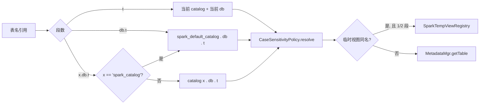

# 05 · 语义对齐：类型 / ANSI / 会话配置 / Catalog / 临时视图

> 函数之外，决定“能否无修改运行且结果一致”的非函数语义。严重度：**blocker** = 大量 SQL 无法运行或静默错结果。标注 [待验证] 的项需在 Phase 0 用差分测试实测确认。详细来源见 [research/r5_priorart_semantics.md](research/r5_priorart_semantics.md)。

## 1. 会话配置：`SET spark.*` 映射（blocker）

Spark 作业脚本几乎都以 `SET spark.sql.xxx=...` 开头；StarRocks 对未知变量报错 → 必须处理。

`SparkConfMapper`（`qe/SparkConfMapper.java`）三类规则：

| 类别 | 示例 | 处理 |
|---|---|---|
| 映射 | `spark.sql.caseSensitive` → `spark_case_sensitive`；`spark.sql.ansi.enabled` → `spark_ansi_enabled`；`spark.sql.session.timeZone` → `time_zone`；`spark.sql.shuffle.partitions` → `pipeline_dop`/忽略；`spark.sql.autoBroadcastJoinThreshold` → `broadcast_row_limit`（-1 → 禁用广播）；`spark.sql.legacy.sizeOfNull` → `spark_legacy_size_of_null`；`spark.sql.sources.partitionOverwriteMode` → `spark_partition_overwrite_mode`；`spark.sql.parser.escapedStringLiterals`；`spark.sql.legacy.timeParserPolicy`；`spark.sql.mapKeyDedupPolicy` | 写入对应 SR/新增会话变量 |
| 吸收 | `spark.executor.*`、`spark.sql.adaptive.*`、`spark.sql.files.*`、`hive.exec.dynamic.partition*`、`mapreduce.*` | no-op，返回 OK + warning（`SHOW WARNINGS` 可见） |
| 拒绝 | 改变语义且不支持的（如 `spark.sql.caseSensitive=true`、`spark.sql.legacy.*` 中我们未实现的） | 报错（`spark_strict_conf=true` 时）或 warning |

`SET` / `SET -v` 无参：返回 Spark 风格的 `key, value` 两列结果集（含映射后的值）。

## 2. 新增会话变量一览

| 变量 | 默认 | 含义 |
|---|---|---|
| `sql_dialect` | `StarRocks` | `spark` 打开兼容模式 |
| `spark_version` | `3.5` | 语义基线（3.5 / 4.0），决定 ANSI 默认值等 |
| `spark_ansi_enabled` | `false`（3.5）/ `true`（4.0） | 映射到 sql_mode 位 + 严格 cast |
| `spark_case_sensitive` | `false` | 见 04 |
| `spark_legacy_size_of_null` | `true` | `size(NULL)` 返回 -1 |
| `spark_default_catalog` | `default_catalog` | `spark_catalog` 与无前缀 `db.t` 映射到的 catalog（典型：用户的 Hive catalog） |
| `spark_partition_overwrite_mode` | `static` | INSERT OVERWRITE 语义 |
| `spark_strict_conf` | `false` | 未知 spark.* 配置报错还是忽略 |
| `spark_unsupported_behavior` | `error` | 遇到不支持的语义：`error` / `downgrade`（回落 SR 语义并 warning） |

`spark_*` 变量在 `sql_dialect != spark` 时不生效。

## 3. Catalog 与命名解析（blocker）

Spark SQL 默认 session catalog = Hive Metastore，SQL 通常写 `db.t` 或 `spark_catalog.db.t`；StarRocks 默认 `default_catalog`（内表）。

- 进入 Spark 方言时（`SET sql_dialect='spark'`），若 `spark_default_catalog` 非 `default_catalog`，`USE db` 等价于 `SET CATALOG x; USE db`。
- Hive 表分区列位于 `SELECT *` 末尾、`__HIVE_DEFAULT_PARTITION__` 处理需与 Spark 核对。
- Spark 创建的 Hive View（文本为 Spark SQL）：`catalog/HiveView.java` 现有 Trino 翻译路径，扩展为用 Spark 方言解析（`spark.sql.create.version` 表属性识别）。**这是一个高价值附带收益**：即使不切换方言，StarRocks 也能读 Spark 建的 Hive 视图。

## 4. 临时视图（high）

Spark ETL 大量使用 `CREATE OR REPLACE TEMP VIEW v AS ...` 串联步骤。

- `SparkTempViewRegistry`：挂在 `ConnectContext`，`Map<key, ViewDef(QueryStatement 已翻译的 SR SQL, columns)>`；连接断开即清空。
- 解析时：1/2 段名先查临时视图（Spark 语义：临时视图遮蔽同名表），命中则作为 inline view（类似 CTE）展开。
- `GLOBAL TEMP VIEW`（`global_temp.v`）：FE 进程级 registry（非持久化），P3。
- 限制：临时视图不能被持久化 View/MV 引用（与 Spark 一致）。

## 5. 类型系统

| 项 | Spark | StarRocks | 严重度 | 处理 |
|---|---|---|---|---|
| `STRING` | 无长度上限 | `STRING` = `VARCHAR(65533)`（字节计）[待验证版本差异] | med | 类型映射；建表默认最大长度；文档声明 |
| `DECIMAL` | 默认 (10,0)；运算精度 `DecimalPrecision` 规则；溢出非 ANSI 返回 NULL | DECIMAL32/64/128；精度推导规则不同 | **high** | `SparkDecimalTypeRule`：Spark 方言下 analyzer 采用 Spark 的 `adjustPrecisionScale`（+/-/*//、avg、sum） |
| `TIMESTAMP` | 会话时区的瞬时（LTZ） | `DATETIME` 墙钟，无时区 | **high** | 映射 DATETIME；`current_timestamp`、`from/to_utc_timestamp`、`unix_timestamp` 以 `time_zone` 语义实现；外部 Parquet/Iceberg timestamptz 读取已按会话时区转换 [待验证]；文档声明限制 |
| `TIMESTAMP_NTZ` | 无时区 | = DATETIME | low | 映射 |
| `BINARY` | 有 | `VARBINARY` | med | 别名 |
| 复杂类型下标 | `arr[0]` 0 基；`element_at` 1 基 | 1 基 | **high** | 见 02 `SparkSubscriptExpr` |
| INTERVAL 类型 | 列类型/表达式 | 仅表达式 | med | 字面量翻译；列类型 unsupported |
| `CHAR(n)` | 读时补空格 | 有 | low | |

## 6. 算术 / Cast / ANSI

| 项 | Spark 3.5（ansi=false） | Spark 4.0（ansi=true） | StarRocks | 处理 |
|---|---|---|---|---|
| 整数溢出 | 回绕 | 报错 | 默认? [待验证]；`ERROR_IF_OVERFLOW` 位 | ANSI → sql_mode 位；非 ANSI 回绕需 BE 支持 `spark_` 算术或确认现有行为 |
| 除零 | NULL | 报错 | NULL；`ERROR_FOR_DIVISION_BY_ZERO` 位 | 映射 |
| `int / int` | DOUBLE | DOUBLE | DOUBLE | 一致 |
| 非法 cast `'abc'→int` | NULL | 报错 | NULL | ANSI 时严格 cast（新增 `cast_strict` 语义） |
| string vs number 比较 | 隐式转 double | 更严格 | 规则不同 [待验证] | `SparkTypeCoercion` 规则（analyzer flag） |
| `round(2.5)` | HALF_UP | HALF_UP | [待验证] | 函数层（03） |
| NaN | NaN = NaN，且大于一切 | 同 | [待验证] | 差分测试后决定 |
| NULL 排序 | ASC NULLS FIRST | 同 | 同（确保无 `SORT_NULLS_LAST` 位） | 方言强制 |

`SqlModeHelper.java` 已有 `ERROR_IF_OVERFLOW`、`ERROR_FOR_DIVISION_BY_ZERO`、`SORT_NULLS_LAST`、`PIPES_AS_CONCAT` 位：Spark 方言在会话层自动设置对应组合，ANSI 开关切换时联动。

## 7. 查询语法语义

| 项 | 处理 |
|---|---|
| GROUP BY 别名 | Spark 方言默认打开 `enable_groupby_use_output_alias` |
| `INTERSECT ALL` / `EXCEPT ALL` | SR 若不支持 → 窗口函数改写（`row_number` 计数法）[待验证] |
| `UNION` 默认 DISTINCT | 一致 |
| `HAVING` 无 GROUP BY | [待验证] |
| 窗口默认 frame | 有 ORDER BY 时 `RANGE UNBOUNDED PRECEDING ~ CURRENT ROW`，一致 [待验证] |

## 8. DML 语义

| 项 | Spark | 处理 |
|---|---|---|
| `INSERT OVERWRITE t SELECT`（非分区表） | 清表后写 | SR `INSERT OVERWRITE` 一致 |
| `INSERT OVERWRITE t PARTITION(p='x') SELECT` | 覆盖分区 x | Hive catalog → 外表静态分区写；内表 → 目标分区（按值定位分区名） |
| 动态分区 + `partitionOverwriteMode=static` | **清空整表所有分区**后写 | 与 SR 分区级覆盖不同 → 默认 `static` 时执行“全表覆盖”；`dynamic` 时用 SR 的分区级覆盖 |
| `INSERT INTO t(cols)` 列名不敏感 | 是 | 由 04 保证 |
| 写 Hive 表的文件格式/压缩 | 按表属性 | SR Hive sink 已支持 parquet/orc [待验证 textfile] |
