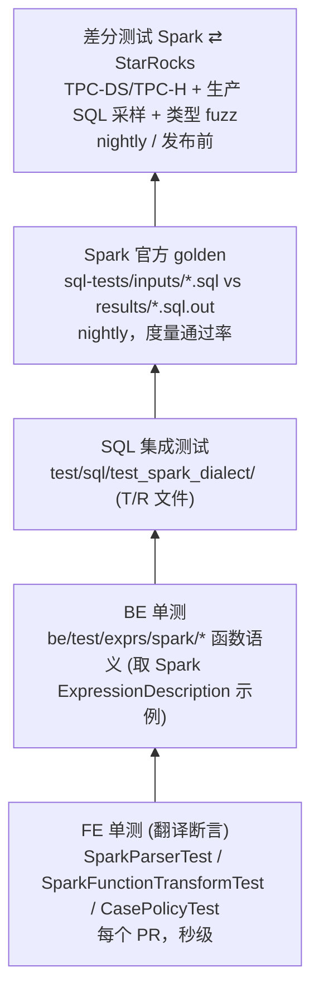

# 06 · 兼容性测试与质量度量

## 1. 测试金字塔

## 2. 各层说明

### 2.1 FE 单测（参照 Trino 套件 3.6k LOC 结构）
- `SparkTestBase`：`UtFrameUtils.createMinStarRocksCluster` + 建表 t0/t1/含 array/map/struct 列的表 + `analyzeSuccess/getFragmentPlan/assertTranslated(sparkSql, expectedSrSql)`。
- `SparkQueryTest`、`SparkLateralViewTest`、`SparkFunctionTransformTest`（每条映射一个用例，由 `func_mapping.csv` 生成骨架）、`SparkDdlTest`、`SparkCommandTest`、`SparkDowngradeTest`、`SparkNotSupportTest`、`SparkTPCDSTest`（Spark 版 99 条 query 能翻译 + 出计划）、`CaseSensitivityPolicyTest`（LEGACY vs SPARK 参数化）。
- **回归门禁**：默认方言下所有现有 FE UT 必须不变。

### 2.2 BE 单测
- 每个 `spark_*` 函数：用 Spark `ExpressionDescription` 的 `examples` 作为第一批断言（自带期望值），再补 NULL/空串/负数/溢出/Unicode/NaN 边界。

### 2.3 SQL 集成测试
- `test/sql/test_spark_dialect/{T,R}/test_*`：每个 case 先 `set sql_dialect='spark';`，覆盖语法、函数、大小写、SET、temp view、Hive catalog 读写。

### 2.4 Spark 官方 golden（核心度量）
- 来源：`apache/spark/sql/core/src/test/resources/sql-tests/inputs/**.sql` 与 `results/**.sql.out`（含 `ansi/`、`typeCoercion/`、`subquery/`、`udf/`、`postgreSQL/`）。
- `tools/spark-compat/golden_runner.py`：
  1. 解析 `.sql` 文件（处理 `--SET`、`--IMPORT`、`--CONFIG_DIM`、`--QUERY-DELIMITER`）；
  2. 在 StarRocks（`sql_dialect=spark`）执行，测试数据用 `CREATE TEMP VIEW ... VALUES` 自带；
  3. 对比 `.sql.out` 的 schema 与结果（浮点容差、错误只比较类别）；
  4. 输出 `PARSE_ERROR / UNSUPPORTED / WRONG_RESULT / ERROR_MISMATCH / PASS` 分类与通过率；
  5. 维护 `known_failures.yaml`，CI 只对“新增失败”报警。
- **WRONG_RESULT 是最高优先级缺陷**（违背“不静默给错结果”原则）。

### 2.5 差分测试
- 环境：Spark 3.5（或 4.0）+ 同一 Hive Metastore + 同一 Parquet 数据；StarRocks 通过 Hive catalog 读同一份数据。
- SQL 来源：TPC-DS/TPC-H Spark 版本、生产 Spark SQL 日志采样（用户提供，脱敏）、基于类型的表达式 fuzz（参考 Comet/Gluten 的 expression fuzz）。
- 两套配置：ANSI on / off。
- 比较：结果集排序后比对、DOUBLE 相对误差 1e-9、DECIMAL 精确、列名与类型映射比对。

### 2.6 sqlglot 反向基线
- 用 `sqlglot.transpile(sql, read='spark', write='starrocks')` 处理同一批 SQL，作为“语法覆盖”参照，找出我们 parser 漏掉的语法。

## 3. CI 分层

| 层级 | 触发 | 内容 | 时长 |
|---|---|---|---|
| PR | 每次提交 | FE/BE UT + `test_spark_dialect` 冒烟 + golden allowlist 子集 | < 20 min |
| Nightly | 每日 | 全量 golden + TPC-DS SF1 差分 + fuzz 1 小时 | ~3 h |
| Release | 发布前 | TPC-DS SF100 差分 + 生产 SQL 回放 + 性能对比 | ~1 d |

## 4. 度量指标（里程碑验收用）

| 指标 | 定义 | P1 目标 | P2 目标 | P3 目标 |
|---|---|---|---|---|
| Parse 通过率 | golden 输入中能被 Spark 方言翻译的语句占比 | 70% | 90% | 95% |
| 结果一致率 | 可执行语句中结果与 `.sql.out` 一致占比 | 60% | 85% | 93% |
| 函数覆盖率 | Spark 内置函数中 A+B+C 类已可用（见 03） | 60% | 85% | 92% |
| TPC-DS | 99 条 Spark 版查询无修改运行且结果一致 | 90/99 | 99/99 | 99/99 |
| WRONG_RESULT | 静默错结果数 | 已知且有 issue | ≤ 10 | 0（不能修复的改为显式报错） |
| 默认方言回归 | 现有测试 | 0 | 0 | 0 |
