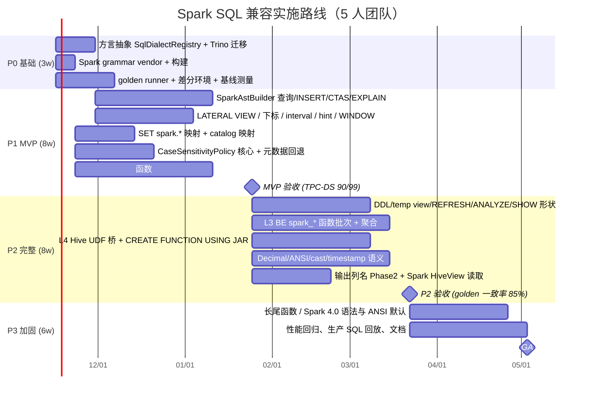

# 07 · 实施方案推荐、里程碑与成本/收益分析

## 1. 方案对比

| 维度 | 方案 A：FE 内置 Spark 方言 + 函数适配四层（**推荐**） | 方案 B：外部 sqlglot 转写网关（Doris 模式） | 方案 C：仅函数包（UDF/别名），不做方言 |
|---|---|---|---|
| 架构 | Spark grammar → SR AST；Analyzer 策略；L1–L4 函数层 | 客户端 ⇄ 网关(sqlglot) ⇄ StarRocks | `CREATE GLOBAL FUNCTION` / 别名 builtin |
| 语法覆盖 | 高（Spark 原生语法） | 中（sqlglot spark→starrocks 已知 LATERAL VIEW/UNNEST、类型映射缺陷） | 低（不解决 LATERAL VIEW、SET、DDL、`||`、下标） |
| 语义正确性 | 高（类型感知改写、Spark 语义函数、显式报错） | **低**（文本级，无类型；同名异义函数静默出错） | 中（只覆盖函数） |
| 大小写行为 | 完整（policy） | 无法解决表名/输出列名 | 无法解决 |
| 运维 | 无新组件 | 新增 Python 服务、HA、延迟 +5–30ms | 无 |
| 默认方言风险 | 零（门控） | 零 | 中（全局函数名污染） |
| 首版周期 | ~3 个月 MVP | ~1 个月 | ~1 个月 |
| 总成本 | ~90 人周 | ~10–15 人周 + 长期运维 | ~10 人周 |
| 可达目标 | 绝大部分 Spark SQL 无修改运行（golden 结果一致率 ≥90%） | 60–70% 语句可运行，结果一致率不可控 | 无法达成“无修改运行” |

**推荐方案 A**，并把方案 B 中的 sqlglot 用作**离线测试 oracle**（语法覆盖对照），而非运行期组件。

## 2. 分阶段路线图

| 阶段 | 周期 | 范围 | 验收（见 06 §4） |
|---|---|---|---|
| **P0 基础** | 3 周 | 方言抽象、Spark grammar 引入、测试 harness、**基线**（用 sqlglot+现有 SR 跑 golden，量化真实缺口，校正 [待验证] 项） | harness 可出报告；默认方言 UT 全绿 |
| **P1 MVP** | 8 周 | 查询/INSERT/CTAS/EXPLAIN；`LATERAL VIEW`；`SET spark.*`；catalog 映射；大小写 policy（库/表/别名/CTE + 规范名 + 鉴权）；19 个静默错误函数 + Top80；日期模式翻译 | TPC-DS 90/99；golden parse 70%/结果 60%；**无已知未报告的 WRONG_RESULT** |
| **P2 完整** | 8 周 | DDL、temp view、命令、SHOW 形状；L3 BE 函数；Hive UDF 桥；Decimal/ANSI/cast；输出列名 | TPC-DS 99/99；golden 90%/85%；函数覆盖 85% |
| **P3 加固 / GA** | 6 周 | 长尾、Spark 4.0、性能、文档、生产 SQL 回放 | golden 95%/93%；WRONG_RESULT=0 |
| P4 可选 | 10+ 周 | Collation（UTF8_LCASE）、GLOBAL TEMP VIEW、`TRANSFORM`、MERGE INTO 全量 | 独立立项 |

## 3. 成本估算

### 3.1 人力（人周）

| 模块 | 人周 | 文档 |
|---|---|---|
| 方言层（parser/AST/命令） | 16.5 | 02 |
| 函数适配层 L1–L4 | 41 | 03 |
| 大小写策略 | 9 | 04 |
| 语义：SET 映射 1.5、catalog 1.5、temp view 2、Decimal 3、ANSI/cast 4、timestamp 2、INSERT OVERWRITE 分区 2、SHOW 形状 1.5 | 17.5 | 05 |
| 测试基础设施（golden runner、差分、CI、fuzz） | 6 | 06 |
| **小计** | **90** | |
| 风险缓冲 20% | 18 | |
| **合计** | **~108 人周** | |

团队建议：**5 人**（FE 解析 2、FE 分析/元数据 1、BE 函数 1、测试/工具 1）≈ **5.5 个月到 GA**；3 人团队 ≈ 9 个月。

### 3.2 其它成本

| 项 | 说明 |
|---|---|
| 持续维护 | Spark 每个大版本同步语法 + 新函数：约 2–4 人周/版本；上游 StarRocks rebase：通过“独立包 + 少量钩子”控制冲突，估 1–2 人天/月 |
| 测试资源 | Spark 3.5/4.0 + HMS + 对象存储差分环境；nightly ~3 机时 |
| 性能 | 解析期：Spark grammar 冷启动 ATN 增加 FE 内存约 20–50MB [待验证]；查询期改写开销 < 1ms；Hive UDF 桥比原生慢 2–5× |
| 第三方许可 | Spark grammar 为 Apache-2.0，与 StarRocks 兼容；需更新 NOTICE |

## 4. 收益分析

### 4.1 定量（迁移成本模型）

> 设某组织有 `N` 个 Spark SQL 作业/报表，人工改写 SQL + 验证平均 `h` 小时/个，工程师成本 `c` 元/小时。

- 免改写节省 ≈ `N × h × c × 兼容率`。例：N=3000、h=2、c=500、兼容率 90% → **约 270 万元**，对比本项目 ~108 人周 ≈ 4320 小时 × 500 ≈ **216 万元**。**N≥2500 左右即可回本**，且收益随作业数线性增长、对后续新作业持续有效（无需团队学习 StarRocks 方言）。
- 双写/双维护消除：Spark 与 StarRocks 共用同一份 SQL，避免语义漂移导致的数据口径问题。
- 查询加速：交互式/报表类 Spark SQL 直接在 StarRocks 上运行（向量化 + CBO + 缓存），典型交互查询延迟从分钟级降至秒级（以 TPC-DS 差分环境实测为准）。

### 4.2 定性

| 收益 | 说明 |
|---|---|
| 降低迁移门槛 | “改一行 `SET sql_dialect='spark'`” 即可接入；BI/ETL 工具不需二次适配 |
| 读取 Spark 创建的 Hive View | 附带收益：扩展 `HiveView` 解析，默认方言也能查询 Spark 视图 |
| 统一湖仓 | Spark 负责批 ETL、StarRocks 负责交互分析，SQL 资产统一 |
| 社区价值 | 方案与 Trino 方言同构，可贡献上游，降低 fork 维护成本 |

### 4.3 风险与缓解

| 风险 | 等级 | 缓解 |
|---|---|---|
| 静默错结果（类型/decimal/cast/时区） | 高 | 差分测试 + “不能保证即报错”原则；`spark_unsupported_behavior=error` 默认 |
| 大小写回退导致歧义或权限绕过 | 高 | 精确优先、歧义报错、规范名鉴权、专项权限测试 |
| Spark grammar 与 SR AST 能力不匹配（如 INTERVAL 类型、TRANSFORM） | 中 | 白名单 + downgrade + 明确 unsupported |
| Fork 与上游分叉 | 中 | 新代码放独立包，侵入点限定为 ~10 个钩子；尽早向上游提 RFC |
| Hive UDF 依赖冲突/安全 | 中 | 隔离类加载器、shaded 依赖、`enable_udf` 与沙箱 |
| 性能回退（默认方言） | 低 | 全部门控；PR 级性能基准 |
| 估算偏差（[待验证] 项） | 中 | P0 用基线测量校准，P1 结束重估 |

## 5. 决策建议

1. **立即启动 P0（3 周）**：完成方言抽象与测试 harness，并用 Spark golden + TPC-DS 跑出**真实基线**，校正本报告中所有 [待验证] 项与工作量。
2. **P1 以“TPC-DS 90/99 + 零未报告错结果”为 MVP 门槛**，优先修复 19 个静默错误函数与大小写/SET/LATERAL VIEW 等 blocker。
3. 在 P1 结束时根据通过率数据决定 P2 投入（尤其 L4 Hive UDF 桥与 Decimal/ANSI 的优先级取决于真实作业画像）。
4. 与 StarRocks 社区沟通 RFC（`sql_dialect=spark`），争取上游合并，降低长期维护成本。
