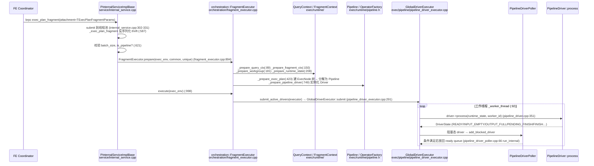
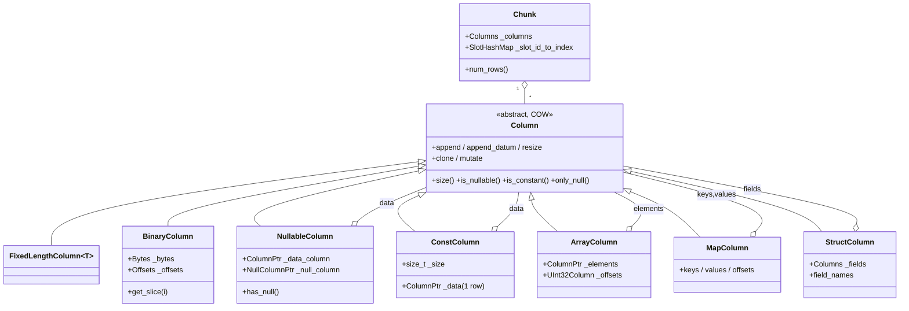

# BE 执行层与函数开发交接指南（Spark SQL 兼容项目）

> 读者：接手 Spark 兼容项目 BE（C++）部分的开发者。范围：BE 新增 Spark 语义内置函数（L3）、可能的 cast/溢出语义、Hive UDF 桥（L4）的 BE 侧。
> 依据：`/home/user/starrocks` 当前工作树的真实代码；路径均相对仓库根，`文件:行号` 为撰写时的行号（会漂移，以符号名为准）。
> 标记 **[未验证]** = 未在代码中亲自确认，或需要与 Spark 源码/真实集群对拍后才能下结论。
>
> 不重复的文档（请先读）：
> - 设计：[03-function-adapter.md](../03-function-adapter.md)（L1–L4 分层、L3 函数清单、fn_id 预留段、L4 桥设计）
> - BE 操作契约：[be/AGENTS.md](../../../../../be/AGENTS.md)（格式化、`Status/StatusOr`、模块 harness 命令）
> - 域地图：[handbook/domains/backend.md](../../../../domains/backend.md)
> - 边界 harness：[handbook/architecture/be-boundary-harness.md](../../../../architecture/be-boundary-harness.md)
> - 函数差距明细：[func_mapping.csv](../func_mapping.csv)、[research/r4_func_gap.md](../research/r4_func_gap.md)

## 0. 十分钟速览（先看这个）

| 你要做的事 | 落点 | 本文章节 |
|---|---|---|
| 加一个标量函数 `spark_xxx` | `gensrc/script/functions.py` + `be/src/exprs/spark/*`（新文件，需入 CMake、需加进 gen_functions 的 module 列表）+ `be/test/exprs/*` | §3.7 |
| 加聚合 `skewness/kurtosis/mode/bit_and/regr_*` | `be/src/exprs/agg/*.h` + `agg/factory/aggregate_resolver_*.cpp` + FE `FunctionSet.java` | §4 |
| 加窗口 `nth_value` | `agg/window.h` + `aggregate_resolver_window.cpp` + `exec/analytor.cpp` + FE `FunctionSet`（analytic） | §4.5 |
| 复用 date_format / hash / months_diff | `exprs/time_functions.cpp`、`exprs/hash_functions.cpp`、`base/hash/hash_util.hpp` | §5 |
| Hive UDF 桥 | `exprs/java_function_call_expr.cpp` + `exprs/udf/java/*` + `java-extensions/udf-extensions` | §6 |
| 编译/跑单测 | `./build.sh --be`、`./run-be-ut.sh --build-target expr_test ...` | §7 |

三个最容易踩的坑（后文有展开）：

1. **`gen_functions.py` 的 module 列表是硬编码的**（`gensrc/script/gen_functions.py:526-552`）。函数 symbol 里必须包含列表中某个 module 名（如 `TimeFunctions`），否则生成时会落到 `Unknown` 分类。新建 `SparkFunctions` 类必须把 `"SparkFunctions"` 加进该列表，并在 `.cpp` 末尾 `#include "gen_cpp/opcode/SparkFunctions.inc"`（§3.5）。
2. **BE 源文件是显式列表，不是 glob**（`be/src/exprs/CMakeLists.txt:17` 的 `EXPR_FILES`；测试在 `be/test/exprs/CMakeLists.txt` 的 `EXPR_TEST_FILES` 或 `be/test/CMakeLists.txt`）。新文件不加进去不会编译，也不会报错。
3. **`Expr` 模块的依赖白名单很窄**（§1.3）：`be/src/exprs/` 下的代码不得 include `exec/`、`storage/`、`compute_env/`。需要这些能力的函数放 `exprs_ext/`。

---

## 1. be/src 目录地图与分层规则

### 1.1 顶层目录（共 39 个，按依赖由低到高大致排序）

| 目录 | 文件数 | 一句话说明 | harness 模块 |
|---|---|---|---|
| `base/` | 271 | 最底层原语：容器、字符串/Slice/StringParser、哈希（`base/hash/hash_util.hpp`）、位操作、metrics 原语、brpc 封装 | Base |
| `gutil/` | 89 | 从 Google 移植的独立工具库（atomicops、strings/split 等） | Gutil |
| `common/` | 165 | `Status/StatusOr`、`config.h`、`ObjectPool`、日志、线程；见 `common/AGENTS.md`（config 前向头工作流） | Common |
| `gen_cpp/` | 3 | thrift/protobuf 生成物落点，`gen_cpp/opcode/*.inc` 也在构建目录下的这里 | StarRocksGen |
| `types/` | 63 | 逻辑类型：`LogicalType`、`TypeDescriptor`、decimal（`decimalv3.h`）、`DateValue/TimestampValue`、`DateTimeValue`、bitmap/hll | Types |
| `column/` | 149 | 向量化列 `Column` 家族、`Chunk`、`ColumnHelper/ColumnViewer/ColumnBuilder` | ColumnCore / ChunkCore |
| `io/` `fs/` `fs_ext/` | 32/44/7 | IO 流抽象 / 文件系统实现（S3、HDFS、Azure…）/ HDFS 扩展 | IO / FileSystem / HdfsFileSystem |
| `platform/` | 90 | 平台能力：broker、下载、AWS、用户函数缓存（`UserFunctionCache`）等 | Platform |
| `geo/` | 25 | 地理计算 | Geo |
| `runtime/` | 111 | `RuntimeState`、`MemTracker`、Java 运行时（`runtime/java/`）、`ChunkAccumulator`、MemPool | Runtime |
| `exprs/` | 308 | **表达式框架与全部内置函数**、聚合/窗口函数（`exprs/agg/`）、UDF（`exprs/udf/`）、表函数核心 | Expr |
| `exprs_ext/` | 20 | 需要依赖更高层模块的表达式扩展（`dict/`、`table_function/`、`utility/`），见 `exprs_ext/AGENTS.md` | ExprDict / ExprTableFunction / ExprUtility |
| `exec_primitive/` | 60 | 执行原语：`ExecNode`、pipeline 的 `Operator/SourceOperator/OperatorFactory`、DriverState、morsel 队列 | ExecPrimitive |
| `storage_primitive/` | 100 | 存储原语（聚合迭代器、列聚合函数等，被 exprs 之外的层复用） | StoragePrimitive |
| `compute_env/` | 199 | 计算环境：排序/spill、data_stream、字典缓存、AI、线程池等 | ComputeEnv |
| `formats/` | 456 | Parquet/ORC/CSV/JSON/Avro 读写 | Format* |
| `cache/` | 39 | DataCache / StarCache | Cache |
| `storage/` | 621 | 存储引擎（tablet、rowset、compaction、lake…） | Storage |
| `connector_primitive/` `connector/` | 10/145 | 连接器抽象 / Hive、Iceberg、File、JDBC、ES、MySQL 等实现 | Connector* |
| `data_sink/` | 68 | 数据下沉（exchange、result、tablet、file、external） | DataSink* |
| `exec/` | 529 | 老 ExecNode 实现 + pipeline 引擎（`exec/pipeline/`、`exec/runtime/`）+ `Analytor`/`Aggregator`/join/sort | Exec / ExecRuntime / ExecJoinCore |
| `schema_scanner/` | 121 | information_schema 实现 | SchemaScanners |
| `data_workflows/` | 58 | 导入、compaction、clone、migration 等后台工作流 | DataWorkflows |
| `agent/` | 27 | FE→BE 任务 agent | AgentServer |
| `orchestration/` | 26 | **FragmentExecutor / FragmentMgr / QueryOrchestrator**：把 fragment 实例化成 pipeline 并提交 | Orchestration |
| `http/` | 63 | BE HTTP 端口与 actions（`pprof_actions`、`update_config_action`、`pipeline_blocking_drivers_action`…） | HttpService |
| `script/` | 5 | 内嵌脚本（wren）命令执行 | Script |
| `service/` | 39 | **进程入口与 RPC**：`starrocks_main.cpp`、`internal_service.cpp`（brpc）、`backend_base.cpp`（thrift）、daemon | Service |
| `module/` | 5 | 连接器/文件系统的启动期装配（bootstrap） | ModuleBootstrap |
| `retrieval/` | 6 | 向量检索接口 | - |
| `starrocks_format/` | 3 | 对外 format 动态库入口 | - |
| `bench/` `tools/` | 52/4 | 微基准 / `meta_tool`、`mock_jvm`（无 JVM 链接用） | - |
| `pch/` `macos_compat/` `thirdparty/` | 1/7/28 | 预编译头 / macOS 兼容垫片 / 内置第三方（wren） | - |

### 1.2 分层口诀

```
Base/Gutil → Common → Types → ColumnCore → ChunkCore → ColumnSortCore
   → Runtime(+Platform) → Expr → ExecPrimitive → {ExecRuntime, ComputeEnv, StoragePrimitive}
   → {Storage, Exec, Connector*, DataSink*, Formats} → Orchestration → Service
```

- 规则的唯一来源是 `be/module_boundary_manifest.json`，由 `build-support/check_be_module_boundaries.py` 强制；`be/AGENTS.md` 的 “Module Harness” 段是由它生成的（不要手改，用 `render_be_agents.py --write`）。详见 [be-boundary-harness.md](../../../../architecture/be-boundary-harness.md)，本文不复述命令。
- 存量违规冻结在 `build-support/be_module_boundary_baseline.json`，**只能缩不能增**。

### 1.3 对本项目最关键的三条边界（取自 manifest，已核对）

| 模块 | 允许依赖的 target |
|---|---|
| `Expr`（`be/src/exprs/`） | Platform, Geo, Runtime, ColumnSortCore, ChunkCore, ColumnCore, Types, Common, Base, Gutil, StarRocksGen |
| `ExprUtility` / `ExprTableFunction` / `ExprDict`（`exprs_ext/*`） | 在 Expr 之上额外允许 ExecRuntime/StoragePrimitive、Storage、ComputeEnv/Exec 等（各自不同） |
| `ExecPrimitive`（`exec_primitive/`） | Expr, Runtime, ChunkCore, ColumnCore, Types, Common, Base, Gutil, StarRocksGen |

落到开发上：

- Spark 标量/聚合/窗口函数全部放 `be/src/exprs/`（新增 `be/src/exprs/spark/` 子目录属于 `Expr` 模块，**不要**在其中 include `exec/…`、`storage/…`、`exec/exec_env.h`）。
- `monotonically_increasing_id` / `spark_partition_id` 若需要 fragment/driver 信息，只能通过 `FunctionContext` 持有的 `RuntimeState`（`runtime/runtime_state.h`，Runtime 层）拿；不要去 include `exec/pipeline/fragment_context.h`（只有 `ExprUtility` 例外，见 `exprs_ext/utility/AGENTS.md`）。
- 新增文件后跑：`python3 build-support/check_be_module_boundaries.py --mode full`。

---

## 2. 查询执行：从 RPC 到 Chunk

### 2.1 Fragment 到达与调度（时序）



要点：

- 入口是 brpc `exec_plan_fragment`；**非 pipeline 引擎已被拒绝**（`internal_service.cpp:628-651`），仅 `SCHEMA_TABLE_SINK` 还走 `FragmentMgr::exec_plan_fragment`（`orchestration/fragment_mgr.cpp:423`）。所有新函数都只需考虑 pipeline 引擎。
- `FragmentExecutor::prepare` 在 `:894` 起，按顺序打了 5 个耗时计数（query_ctx / fragment_ctx / runtime_state / pipeline_driver），profile 里能看到 `FragmentInstancePrepareTime`。
- 表达式的 `prepare/open` 发生在 driver 的 `prepare`（`PipelineDriver::prepare`）里，对每个 Operator 持有的 `ExprContext` 调用；这也是 `FunctionContext` 的 prepare 回调（§3.3）触发的时机。**[未验证具体到哪一行]**

### 2.2 Pipeline 引擎要点

| 概念 | 类 / 位置 | 说明 |
|---|---|---|
| Pipeline | `exec/runtime/pipeline.h:33` `class Pipeline`；`create_operators(dop, i)` 从一串 `OperatorFactory` 实例化出 Operator | 一条线性算子链，按 dop 复制成多个 Driver |
| Operator | `exec_primitive/pipeline/operator.h:48` `class Operator` | 关键虚函数：`prepare`(:62) `has_output`(:105) `need_input`(:111) `is_finished`(:115) `pull_chunk`(:141) `push_chunk`(:144) `set_finishing`(:76) `set_finished`(:88) `close`(:102) |
| OperatorFactory | `exec_primitive/pipeline/operator_factory.h` | 持有只读状态，`create(dop, i)` 生成 Operator；源算子见 `source_operator.h:39/173` |
| Driver | `exec/runtime/pipeline_driver.h:65` `class PipelineDriver` | 一个线程可调度的单元，`process()`(:112) 在循环里把 chunk 从前一个算子 `pull_chunk` 推给后一个 `push_chunk`，按时间片 yield |
| DriverState | `exec_primitive/pipeline/primitives/driver_state.h:26` | `READY/RUNNING/INPUT_EMPTY/OUTPUT_FULL/PRECONDITION_BLOCK/PENDING_FINISH/LOCAL_WAITING/FINISH/CANCELED/INTERNAL_ERROR` |
| 执行器 | `exec/pipeline/pipeline_driver_executor.h:42` `GlobalDriverExecutor` | 固定数量工作线程，`_worker_thread` 取 ready driver 跑 `process` |
| Poller | `exec/pipeline/pipeline_driver_poller.h:39` `PipelineDriverPoller` | 独立线程轮询被阻塞（输入空/输出满/等依赖）的 driver，条件满足后重新入 ready 队列 |
| Morsel | `exec_primitive/pipeline/scan/scan_morsel.h:37` `ScanMorselX`（`MorselPtr` 在 :98）；`morsel_queue.h:33` `MorselQueue::try_get`(:54) | scan 的工作单元（一个 tablet/rowset 片段或一个文件 split），scan 算子按需从队列取 |
| Scan | `exec/pipeline/scan/scan_operator.h:40` | I/O 在独立线程池，`pull_chunk` 只取已就绪的 chunk |
| Project | `exec/pipeline/project_operator.cpp` | **标量函数最终被调用的地方**：对每个 chunk 对每个表达式 `ExprContext::evaluate` |
| Analytic/Agg | `exec/analytor.cpp`、`exec/aggregator.cpp` | 聚合/窗口函数的宿主，调用 `get_aggregate_function / get_window_function` |

可观测性：driver 的阻塞状态可通过 BE HTTP `pipeline_blocking_drivers_action`（`http/action/`）查看；profile 计数器是 `FragmentExecutor` + Operator 的 `RuntimeProfile`（遵循 [backend.md](../../../../domains/backend.md) 的 Observability Awareness）。

### 2.3 数据结构图



| 类 | 位置 | 要点 |
|---|---|---|
| `Chunk` | `column/chunk.h:66`；`_columns` :346，`_slot_id_to_index` :350 | 一批行（默认 `batch_size`=4096，上限 `MAX_CHUNK_SIZE`，见 `internal_service.cpp` 校验）。列按 SlotId 索引 |
| `Column` | `column/column.h:53`；`ColumnPtr/Columns/MutableColumnPtr` 别名 :532-534 | **Copy-on-Write**（`Cow<Column>`）。想修改入参列必须先 `mutate()`/`as_mutable_raw_ptr()`；`ColumnPtr` 是不可变视图。这是写函数时最常见的编译/语义坑 |
| `NullableColumn` | `column/nullable_column.h:34` | 数据列 + `NullColumn`（`uint8`，1=NULL）。被 NULL 掩盖的行的 data 值**未定义**（见 `unary_function.h:105` 注释），不能对其做会抛异常的计算 |
| `ConstColumn` | `column/const_column.h:27` | 只存 1 行 + 逻辑行数。常量折叠不彻底时，函数入参常常是 Const，要用 `ColumnViewer` 屏蔽或显式判断 `is_constant()` |
| `BinaryColumn` | `column/binary_column.h:123` | VARCHAR/VARBINARY：连续 `Bytes` + offsets（`uint32` 或 `uint64` 的 `LargeBinaryColumn`）。`get_slice(i)` 取 `Slice` |
| `ArrayColumn` | `column/array_column.h:35` | elements 列 + offsets 列（元素列通常是 Nullable） |
| `MapColumn` / `StructColumn` | `column/map_column.h:25` / `column/struct_column.h:21` | map = keys/values/offsets；struct = 多个字段列 |
| `FixedLengthColumn<T>` | `column/fixed_length_column.h:20` | 数值/日期/decimal（`DecimalV3Column` 带 precision/scale） |
| `ColumnHelper` | `column/column_helper.h:38` | `cast_to_raw<Type>`、`create_const_column<Type>`、`is_all_const`、`get_const_value`、`create_column(TypeDescriptor, nullable)` |

### 2.4 RuntimeState 与内存追踪

- `RuntimeState`（`runtime/runtime_state.h:97`）：每个 fragment 实例一个；持有 `query_options`、`ObjectPool`、profile、`fragment_instance_id()`(:176)、mem tracker 等。表达式通过 `FunctionContext::_state`（`function_context.h:202`）间接引用。
- `MemTracker`（`runtime/mem_tracker.h:54`）：树形，类型含 `PROCESS/QUERY/…`（:83）。`init_mem_trackers`(`runtime_state.h:131`)，`instance_mem_tracker()`(:183)，`query_mem_tracker_ptr()`(:195)。内存超限用 `RETURN_IF_LIMIT_EXCEEDED` / `set_mem_limit_exceeded`(:261)。
- 线程内内存归属依赖 `CurrentThread`/`SCOPED_SET_TRACE_INFO` 等 TLS（`PipelineDriver::process` 与 `_worker_thread` 在每次调度前后重置）。在函数里**直接 `new` 大块内存**不会出错，但会算在当前线程绑定的 tracker 上；超大 per-row 结构要关注 `ctx->mem_pool()`（仅聚合场景可用，见 `expr_context.cpp:114` 注释）。

---

## 3. 表达式框架与标量函数

### 3.1 从 TExpr 创建 Expr 树

- 入口：`ExprFactory::create_expr_tree(pool, TExpr, &ctx, state, ...)`（`exprs/expr_factory.cpp:329/375`）→ `create_tree_from_thrift`(:275) 递归按 `TExprNode` 先序数组还原树 → 每个节点走 `create_vectorized_expr`(:90) 的 `switch (texpr_node.node_type)`。
- `FUNCTION_CALL`（:147-198）分派顺序（**注意**，这决定你的函数用哪个 Expr 类）：
  1. `fn.binary_type == SRJAR` → `JavaFunctionCallExpr`（`input_type=="arrow"` 则 `ArrowFunctionCallExpr`）；`PYTHON` → `ArrowFunctionCallExpr`；`AI` → `AIFunctionCallExpr`
  2. 按函数名特判：`if/nullif/ifnull/coalesce/is_null_pred/array_map/array_sort_lambda/map_apply` 等有专用 Expr
  3. `try_non_core_create_post_hook`（扩展模块钩子）
  4. 默认 `VectorizedFunctionCallExpr`（`exprs/function_call_expr.h:26`）←**所有 builtin 标量函数走这里**
- `CAST_EXPR` → `VectorizedCastExprFactory::from_thrift`（`cast_expr.cpp:626`），`ARITHMETIC_EXPR` → `arithmetic_expr.cpp`。

### 3.2 VectorizedFunctionCallExpr 执行流程

`exprs/function_call_expr.cpp`：

| 阶段 | 行 | 做了什么 |
|---|---|---|
| 查表 | `_get_function_by_fid`(:43) `_get_function`(:70) | 用 `TFunction.fid` 到 `BuiltinFunctions::find_builtin_function(fid)`（`builtin_functions.h`，`unordered_map<uint64_t, FunctionDescriptor>`）取描述符。:43-66 有历史 fid 兼容补丁，别学 |
| `prepare` | :97 | 收集子表达式类型与可空性；`context->register_func(...)`(:114 → `expr_context.cpp:114`) 创建本表达式的 `FunctionContext`；`_is_returning_random_value` 按硬编码 fid 判定（:132，rand/uuid/http_request…） |
| `open` | :142 | `FRAGMENT_LOCAL` 作用域：把常量参数列放进 `FunctionContext`（`is_constant_column/get_constant_column`），然后调用 `_fn_desc->prepare_function`(:158-162) |
| `evaluate_checked` | :190 | 先递归算出所有子列 → 调 `scalar_function(fn_ctx, args)`；`exception_safe=false` 时包 `SCOPED_SET_CATCHED(false)`(:219-224)；`check_overflow=true` 时调用 `capacity_limit_reached()`(:226)；结果若是 Const 且 chunk 有行则 `resize`(:231)；最后 `unfold_const_children` |
| `close` | :169 | 调 `close_function` |

关键结论：
- **函数收到的是原始子列**：可能是 `Const`、`Nullable`、`Nullable(Const)`、纯 `Only-NULL const`。框架**不做** NULL 短路，NULL 语义完全由函数自己负责——这正是 Spark `greatest/least` 能“跳过 NULL”的实现空间（现有 `MathFunctions::greatest`（`math_functions.h:496`）是“任一 NULL → NULL”，且 `RETURN_IF_COLUMNS_ONLY_NULL`(`function_helper.h:116`) 在**任一**列为 only_null 时就整体返回 NULL，Spark 版不能用这个宏）。
- 无参函数（`pi/e`）返回 1 行 Const，框架负责扩展到 chunk 行数。

### 3.3 FunctionContext

`exprs/function_context.h:49`（实现 `function_context.cpp`）。

| 能力 | API | 说明 |
|---|---|---|
| 类型 | `get_return_type()`(:98) `get_arg_type(i)`(:118) `get_arg_types()` `get_num_args()` | decimal 的 precision/scale 从这里取（见 `DEFINE_MATH_UNARY_FN` 对 decimal 的处理 `math_functions.cpp:99-107`） |
| 常量参数 | `is_constant_column(i)`(:122) `is_notnull_constant_column(i)` `get_constant_column(i)`(:127) | 在 `prepare_function` 里一次性解析常量参数（正则、格式串、模式串）。**Spark 日期模式的“常量模式预编译”就应该放这里** |
| 函数状态 | `set_function_state(FRAGMENT_LOCAL, ptr)` `get_function_state(...)` (:92/94) | **作用域目前只有 `FRAGMENT_LOCAL`**（:56-58）：状态由 `prepare_function` 创建，被该表达式所有 `ExprContext::clone` 共享（`expr_context.cpp:123-137`，clone 只拷贝指针，且只有原件在 `close` 时释放，:98-111）→ **必须只读/线程安全** |
| 线程私有状态 | `get_or_create_thread_state<T>(factory)`(:184)，`T` 继承 `FunctionThreadState`(:37)，按 `current_worker_id()` 分桶 | 需要可变 scratch（RE2 对象，hyperscan scratch）时用。示例：`string_functions.cpp:3457` 的 `StringRe2ThreadState`。注意是**按工作线程**，不是按 driver |
| 错误 | `set_error(msg)`(:79) `has_error()`; `add_warning` | `set_error` 会让查询失败；函数应同时返回 NULL（导入场景） |
| 溢出模式 | `error_if_overflow()`(:169) | 来自 `RuntimeState`（SQL mode/session 变量），决定 decimal 等是报错还是 NULL |
| 测试 | `FunctionContext::create_test_context()`(:134) / `create_test_context(arg_types, return_type)` | UT 里构造 |

### 3.4 内置函数注册链路（functions.py → FE+BE）

```
gensrc/script/functions.py      vectorized_functions = [ [fid, name, exception_safe, check_overflow, ret, [args], "Class::fn", (prepare, close)?], ... ]
        │  python gen_functions.py (gensrc/Makefile 调用；产物在 build 目录)
        ├─ FE:  VectorizedBuiltinFunctions.java  → functionSet.addVectorizedScalarBuiltin(id, name, hasVarArgs, ret, args...)   (gen_functions.py:379-436)
        └─ BE:  gen_cpp/opcode/<Module>.inc      → BuiltinFunctions::emplace_builtin_function(fid, name, argc, &fn, [&prepare,&close], exception_safe, check_overflow, ret, {args})   (:491-615)
                每个 <Module>Functions.cpp 末尾  #include "gen_cpp/opcode/<Module>.inc"  （__attribute__((constructor)) 静态初始化时注册）
```

字段含义（`functions.py:17-33` 文件头注释 + `gen_functions.py:168-246`）：

| 位置 | 含义 |
|---|---|
| `[0] fid` | 全局唯一 `uint64`，**重复会直接 `exit(1)`**（`add_function`）。id 规则 `{模块}{函数组}0{子函数}`，如 `10130`=数学/round 组/子0。现有最大 `15028315`；设计文档预留 `400000–409999`，我已核对该段当前**未被占用** |
| `[1] name` | SQL 函数名 |
| `[2] exception_safe` | `True`：函数内部不会抛 C++ 异常；`False`：框架在调用处用 `SCOPED_SET_CATCHED(false)` 包住（`function_call_expr.cpp:222`），把异常转成查询错误。用到 `std::stoi`、`fmt` 抛异常、`RuntimeException` 的函数设 `False`（如 `ds_theta_*` 用 `False`，`functions.py:~886`） |
| `[3] check_overflow` | `True`：返回后检查 `capacity_limit_reached()`（BinaryColumn 超过 4GB offset 等）。返回 VARCHAR 且可能很大的函数（`concat/repeat/lpad`）应设 `True` |
| `[4] ret` / `[5] args` | **字符串必须是 FE 生成的 Java 里能解析的类型名**（`VARCHAR`、`BIGINT`、`DATETIME`、`DECIMAL128`、`ARRAY_...`、`ANY_ARRAY`…）。变参：末尾加 `'...'`，BE 的 `args_nums` 为不含 `...` 的个数（`gen_functions.py:196-212`）；同 `ret#name#(args)` 签名重复也会 `exit(1)` |
| `[6] symbol` | `"Class::function"`，**生成脚本靠子串匹配 module 名分类**（`gen_functions.py:555-570`）→ 必须含 `modules` 列表里的名字（`MathFunctions`、`StringFunctions`、`TimeFunctions`、`HashFunctions`、`ArrayFunctions`、`UtilityFunctions` …共 25 个，列表在 :526-552）。**新增 `SparkFunctions` 要加进该列表** |
| `[7][8]` | 可选 prepare/close，例如 `date_format`（`functions.py:601-604`）的 `TimeFunctions::format_prepare/format_close` |

要点：
- FE 侧 **标量函数无需手改 `FunctionSet.java`**（自动生成）；聚合/窗口函数则**必须**手写（§4.4）。
- 重载靠 fid + 签名区分，FE 的重载解析按参数类型最接近匹配（隐式 cast），所以同名多个类型重载（如 `greatest` 有 13 个 fid，`functions.py:162-188`）是常态，每个重载对应 `Class::fn<TYPE_X>` 模板实例。
- 非确定性函数（`rand/uuid/...`）FE 要登记到 `FunctionSet.nonDeterministicFunctions`（`FunctionSet.java:832`），否则会被常量折叠/公共子表达式消除；BE 侧 `_is_returning_random_value`（`function_call_expr.cpp:132`）按 fid 硬编码并为其追加一个“行数”常量参数，让 `rand` 在无列输入时也能产出 N 行。`monotonically_increasing_id` 要同时改这两处（§5.8）。

### 3.5 常用辅助与 NULL 处理

| 工具 | 位置 | 用法 |
|---|---|---|
| `ColumnViewer<Type>` | `column/column_viewer.h:40` | 把 Const/Nullable/普通列统一成 `value(i)` + `is_null(i)`，常量行用 mask 避免分支。**写复杂/变参逻辑首选** |
| `ColumnBuilder<Type>` | `column/column_builder.h:27` | `append(v)` / `append(v, is_null)` / `append_null()`；`build(is_const)`；decimal 用带 precision/scale 的构造（:41）；VARCHAR 别用字节级 builder 之外的捷径 |
| `ColumnHelper::is_all_const(columns)` | `column_helper.h` | `build(is_all_const)` → 全是常量输入时把结果压成 Const 列 |
| `DEFINE_VECTORIZED_FN(NAME)` | `function_helper.h:107` | 声明 `static StatusOr<ColumnPtr> NAME(FunctionContext*, const Columns&)`；模板版 `DEFINE_VECTORIZED_FN_TEMPLATE` |
| `VectorizedStrictUnaryFunction<OP>` | `unary_function.h:344` | 严格语义（任一输入 NULL → 输出 NULL，且自动处理 Const/Nullable）。`OP` 用 `DEFINE_UNARY_FN_WITH_IMPL(NAME, v)`(:403) 定义 `apply` |
| `VectorizedStringStrictUnaryFunction<OP>` | :359 | 结果是 VARCHAR 的一元函数（`OP::apply` 返回 `std::string`，宏 `DEFINE_STRING_UNARY_FN_WITH_IMPL` :417） |
| `VectorizedInputCheckUnaryFunction` / `VectorizedOutputCheckUnaryFunction` | :365/:369 | 输入/输出满足条件时产生 NULL（如 `log(<=0)`→NULL） |
| `VectorizedStrictBinaryFunction<OP>` | `binary_function.h:592`；宏 `DEFINE_BINARY_FUNCTION_WITH_IMPL` :641 | 二元严格函数（例 `months_diff_v2Impl`，`time_functions.cpp:1334`） |
| `VectorizedUnstrictBinaryFunction` / `VectorizedOuputCheckBinaryFunction` | :608 / :595 | 非严格 / 输出带 NULL 检查 |
| `DEFINE_MATH_UNARY_FN` 等 | `math_functions.cpp:99` | 把 Impl 绑到类型对的成员函数；decimal 自动传 precision/scale |
| NULL 约定 | - | 严格函数：输入 NULL→输出 NULL（框架包装）。非严格/变参：自己用 `ColumnViewer::is_null` + `ColumnBuilder::append_null`。**Spark 与 SR 在 NULL 上的差异（greatest/least、concat、size(NULL)）必须逐函数用自写循环实现** |

### 3.6 现有可参照的最小函数

1. **一元数值**：`radians`。声明 `math_functions.h:278`（`DEFINE_VECTORIZED_FN(radians);`），实现 `math_functions.cpp:253-258`：
   ```cpp
   DEFINE_UNARY_FN_WITH_IMPL(radiansImpl, v) { return (double)(v * M_PI / 180.0); }
   DEFINE_MATH_UNARY_FN(radians, TYPE_DOUBLE, TYPE_DOUBLE);
   ```
   注册：`functions.py:115` `[10190, "radians", True, False, "DOUBLE", ["DOUBLE"], "MathFunctions::radians"]`。
2. **变参 + 自写 NULL 逻辑**：`HashFunctions::murmur_hash3_32`（`hash_functions.cpp:24-51`，注册 `functions.py:893` `[100010, 'murmur_hash3_32', True, False, 'INT', ['VARCHAR','...'], ...]`）：`ColumnViewer` 列表 + `ColumnBuilder<TYPE_INT>` + 逐行链式 seed。`spark_hash` 与它最像。
3. **带 prepare/close 的常量参数函数**：`date_format`（`time_functions.cpp:2606 format_prepare`、`:2879 datetime_format`）。

### 3.7 新增标量函数：逐步配方（以 `spark_greatest` 为例）

目标：`spark_greatest(BIGINT, ...)`，Spark 语义：跳过 NULL，全 NULL 才返回 NULL。

**Step 1 — functions.py 加条目**（`gensrc/script/functions.py` 文件末尾、`vectorized_functions` 列表内，使用新 fid 段并写注释说明归属）：

```python
    # 4000xx: spark compatible functions (see handbook/plans/active/2026-11-05-spark-sql-compat/03-function-adapter.md)
    [400010, "spark_greatest", True, False, "BIGINT", ["BIGINT", "..."], "SparkFunctions::greatest<TYPE_BIGINT>"],
    [400011, "spark_greatest", True, False, "DOUBLE", ["DOUBLE", "..."], "SparkFunctions::greatest<TYPE_DOUBLE>"],
    # 其它类型照 MathFunctions::greatest 的 13 个重载补全（INT/LARGEINT/DECIMAL32/64/128/VARCHAR/DATETIME…）
```
注意：同签名重复、fid 重复都会让生成脚本 `exit(1)`，可在本地直接跑 `cd gensrc/script && python3 gen_functions.py --cpp /tmp/x --java /tmp/y` 先验证（`--cpp/--java` 是输出目录，见 :622-639）。

**Step 2 — 把 module 加进生成脚本**：`gensrc/script/gen_functions.py:526` 的 `modules = [...]` 追加 `"SparkFunctions"`（既用于分类，也决定生成 `SparkFunctions.inc`）。

**Step 3 — 头文件** `be/src/exprs/spark/spark_functions.h`：

```cpp
#pragma once
#include "exprs/function_helper.h"

namespace starrocks {
class SparkFunctions {
public:
    // @param columns: [TypeColumn, ...]  @return TypeColumn；跳过 NULL，全 NULL 才 NULL
    template <LogicalType Type>
    static StatusOr<ColumnPtr> greatest(FunctionContext* context, const Columns& columns);
};
} // namespace starrocks
```

**Step 4 — 实现** `be/src/exprs/spark/spark_functions.cpp`（模板函数放头里或在 cpp 里显式实例化；这里把定义放头文件末尾更简单。下面是核心逻辑，建模于 `math_functions.h:496`）：

```cpp
template <LogicalType Type>
StatusOr<ColumnPtr> SparkFunctions::greatest(FunctionContext* context, const Columns& columns) {
    const auto& type = context->get_return_type();
    std::vector<ColumnViewer<Type>> viewers;
    viewers.reserve(columns.size());
    for (const auto& col : columns) viewers.emplace_back(col);   // 自动处理 Const / Nullable / Only-NULL

    const size_t size = columns[0]->size();
    ColumnBuilder<Type> result(size, type.precision, type.scale);
    for (size_t row = 0; row < size; ++row) {
        bool has_value = false;
        RunTimeCppType<Type> best{};
        for (auto& v : viewers) {
            if (v.is_null(row)) continue;                         // Spark：跳过 NULL
            if (!has_value || best < v.value(row)) { best = v.value(row); has_value = true; }
        }
        result.append(best, /*is_null=*/!has_value);
    }
    return result.build(ColumnHelper::is_all_const(columns));
}
// 文件末尾：
#include "gen_cpp/opcode/SparkFunctions.inc"
```
陷阱：不要用 `RETURN_IF_COLUMNS_ONLY_NULL`（会在任一列全 NULL 时整体返回 NULL）；float/double 需按 Spark 语义处理 NaN（NaN 视为最大）**[未验证 Spark 细节，对拍]**；VARCHAR 比较是字节序，Spark 是 UTF8String 字节序 → 一致。

**Step 5 — CMake**：`be/src/exprs/CMakeLists.txt` 的 `EXPR_FILES` 加 `spark/spark_functions.cpp`（该文件是显式列表）。

**Step 6 — 单测**：在 `be/test/exprs/` 新建 `spark_functions_test.cpp` 并加进 `be/test/exprs/CMakeLists.txt` 的 `EXPR_TEST_FILES`（该列表编进 `expr_test` 目标，`:81`）。参照 `hash_functions_test.cpp`：

```cpp
TEST_F(SparkFunctionsTest, greatest_skip_null) {
    auto c1 = ColumnTestHelper::build_nullable_column<int64_t>({1, 5, 0}, {0, 1, 1});   // 1, NULL, NULL
    auto c2 = ColumnTestHelper::build_nullable_column<int64_t>({3, 2, 0}, {0, 0, 1});   // 3, 2,    NULL
    std::unique_ptr<FunctionContext> ctx(FunctionContext::create_test_context(
            {TypeDescriptor(TYPE_BIGINT), TypeDescriptor(TYPE_BIGINT)}, TypeDescriptor(TYPE_BIGINT)));
    Columns cols{std::move(c1), std::move(c2)};
    auto r = SparkFunctions::greatest<TYPE_BIGINT>(ctx.get(), cols).value();
    auto viewer = ColumnViewer<TYPE_BIGINT>(r);
    ASSERT_EQ(3, viewer.value(0)); ASSERT_EQ(2, viewer.value(1)); ASSERT_TRUE(viewer.is_null(2));
}
```
还要覆盖：Const 参数、Only-NULL 常量、全 Const 输入（结果是否压缩为 Const）、decimal（precision/scale）。

**Step 7 — FE 配套**：L2b 改写（`SparkFunctionRewriter`）把 `greatest` 改写成 `spark_greatest`（设计文档 §4）。FE 生成物含新 fid，BE/FE 要同时升级；混部期 FE 不得选择 L3 目标（设计文档 §5 “版本门控”）。

**Step 8 — 本地验证顺序**：跑 `gen_functions.py` → 边界检查 → `./run-be-ut.sh --build-target expr_test --module expr_test --gtest_filter 'SparkFunctionsTest*' --without-java-ext`（§7）→ 起集群做 SQL 回归（`test/` 目录下的 SQL-tester，**[未验证]** 具体用例组织方式请参考项目 testing 文档与 [06-testing-strategy.md](../06-testing-strategy.md)）。

---

## 4. 聚合与窗口函数

### 4.1 AggregateFunction 接口

`exprs/agg/aggregate.h:136`（609 行）。核心虚函数（按职责）：

| 类别 | 方法 | 说明 |
|---|---|---|
| 生命周期 | `create/destroy(ctx, ptr)` (:228-229)，`size()/alignof_size()`(:225-226)，`is_pod_state()`(:227)，`reset`(:143) | 状态是**定长内存块**，由聚合器在 arena/hash map 里按 `size()` 分配，函数用 `placement new` 构造 |
| 更新 | `update(ctx, columns, state, row)`(:148)；批量 `update_batch`(:272) / `update_batch_selectively`(:281) / `update_batch_single_state`(:291) / `…_with_frame`(:303,窗口) | 一般只实现行级 `update`，基类 `AggregateFunctionBatchHelper`（:476）会生成批量版本 |
| 合并 | `merge(ctx, column, state, row)`(:158) 及批量版(:348-373) | 二阶段/多级聚合时合并 `serialize` 出来的中间态 |
| 序列化 | `serialize_to_column(ctx, state, to)`(:164)、`convert_to_serialize_format`(:178，聚合前置“直通”模式用) | 中间态**固定序列化成 BinaryColumn**（FE 里的 intermediate type 就是 `VARBINARY`） |
| 最终结果 | `finalize_to_column(ctx, state, to)`(:171)；窗口取值 `get_values(ctx, state, dst, start, end)`(:183) | 窗口场景一个 frame 一次 `update_batch_single_state_with_frame` 然后 `get_values` |
| 空值策略 | `support_nullable_immediate_input`(:333) `is_result_non_nullable`(:339) | 配合 `NullableAggregateFunction*` 包装器 |
| 基类助手 | `AggregateFunctionStateHelper<State>`(:456) 提供 `data(state)`；`AggregateFunctionBatchHelper<State, Derived>`(:476) 生成批量方法 | 新函数继承后者 |

### 4.2 工厂/解析器注册（按 name + 参数类型 + 返回类型）

- 注册表：`AggregateFuncResolver`（单例，`exprs/agg/factory/aggregate_resolver.hpp:60`）。key = `(name, arg LogicalType, return LogicalType, is_window, is_nullable)`（`AggregateFuncKey` :35）。构造时依次调用 `register_avg/…/register_variance/register_window/register_utility/register_approx/register_others/…/register_boolean`（`aggregate_factory.cpp` 构造函数，约 :52-72）。
- 添加映射的 API（`aggregate_resolver.hpp`）：
  - `add_aggregate_mapping<ArgLT, RetLT, State>(name, kWithWindow|kWithoutWindow, fun, null_pred)`（:163）：同时登记“非 nullable 输入”和“nullable 输入”两个版本；nullable 版本由 `MakeNullableAggregateFunctionUnary<State>` 包装，`null_pred` 决定“状态为何种情况下输出 NULL”（例：样本方差 `count<=1` → NULL，`variance.h:201`）。
  - `add_aggregate_mapping_variadic`（:194）：多参数（`covar_*`、`corr`；`regr_*` 应参考它）。
  - `add_aggregate_mapping_notnull`（:148）：不需要 nullable 包装的（窗口排名类、`bool_or`）。
  - `add_general_mapping`：与类型无关的通用函数。
- 按类型展开的惯用法：写一个 `struct XxxDispatcher { template<LogicalType lt> void operator()(AggregateFuncResolver*) {...} }`，然后 `for (auto type : aggregate_types()) type_dispatch_all(type, XxxDispatcher(), this);`（例 `aggregate_resolver_variance.cpp:15-80`）。`aggregate_types()` 列表在 `aggregate_resolver.hpp:87`。
- 运行期查找：`get_aggregate_function(name, arg_type, return_type, is_null, binary_type, func_version)`（`aggregate_factory.cpp:203`），聚合器调用点 `exec/aggregator.cpp:652`；**入参类型取 `arg_types[0]`**，个别函数有特判（`max_by` 取第 2 个参数、`window_funnel`、`intersect_count`，:228-262）——**多参数聚合（`regr_*`）的 key 用哪个参数类型，要么靠 FE 把所有参数 cast 成同一类型（推荐，同 `covar_*`），要么在这里加特判**。
- 为减少编译时间，每类函数一个 `aggregate_resolver_*.cpp`（`factory/README`）。**新文件必须加进 `be/src/exprs/CMakeLists.txt` 的 `EXPR_FILES`，并在 `AggregateFuncResolver` 增加 `register_xxx()` 声明（:67-85）和构造函数里的调用。**
- Java UDAF 走另一条：`resolve_non_builtin_aggregate_function`（`aggregate_factory.cpp:~34`，`binary_type==SRJAR`），实现在 `exprs/agg/java_udaf_function.cpp`、`java_window_function.cpp`。

### 4.3 状态布局与序列化范例：方差（建议先读 `exprs/agg/variance.h`）

```
DevFromAveAggregateState<T> { T mean; T m2; int64_t count; }        (variance.h:35-44)
update : Welford 在线更新                                           (:61-90)
merge  : 并行合并公式 (delta^2 * n1*n2/(n1+n2))                      (:101-135)
serialize_to_column : memcpy 三个字段到 BinaryColumn 尾部并追加 offset (:137-153)
convert_to_serialize_format : 单行输入直接序列化为 (mean=x, m2=0, count=1) (:155-190)
finalize_to_column : m2/count 或 m2/(count-1)；AggNullPred 决定 NULL  (:214 起)
```
结论：**现有 `stddev/std/variance` 在 BE 是总体统计量**（`aggregate_resolver_variance.cpp:25-52`：`variance/var_pop/stddev/std` → population；`var_samp/stddev_samp` → sample）。这与设计文档 §1.1 #1 一致：Spark 的 `stddev/variance` 是样本统计量，应在 FE 层改写，而**不是**改 BE。

### 4.4 FE `FunctionSet` 必须与 BE 对齐

BE 只看 `(name, arg_type, return_type)`；FE 通过 `AggregateFunction.createBuiltin(name, argTypes, retType, intermediateType, ignoresDistinct, isAnalyticFn, returnsNonNullOnEmpty)`（`catalog/AggregateFunction.java:155/165`）登记。以方差为例（`FunctionSet.java:1966-2005`）：`createBuiltin(VAR_SAMP, [t], DOUBLE, VARBINARY, false, true, false)`，对 `STDDEV_ARG_TYPE` 的每个 `t` 登记一份。对齐规则：

1. FE `retType` 的 LogicalType == BE `add_aggregate_mapping<ArgLT, RetLT, …>` 的 `RetLT`（方差在 BE 内部对 decimal 返回 `DecimalV3`，数值类返回 DOUBLE，见 `DevFromAveResultLT`，`variance.h:~28-32`）。FE 与 BE 的 ret 不一致时，BE 的 `get_aggregate_function` 返回 `nullptr`，查询在 `aggregator.cpp` 处失败。
2. `intermediateType` 一律 `VARBINARY`（BinaryColumn）。
3. FE 名字集合（如 `VARIANCE_FUNCTIONS`、`STATISTIC_FUNCTIONS`，`FunctionSet.java:~893-922`）影响统计信息、优化器规则（两阶段聚合拆分等）；新聚合是否要加入要评估。
4. 每个 FE 参数类型一个注册；BE 侧 `aggregate_types()` 已覆盖常用类型，缺的类型 BE 查不到会报错。

### 4.5 新增聚合配方（以 `skewness` 为例）

Spark `skewness(x)` = `sqrt(n) * m3 / m2^1.5`，`kurtosis` = `n * m4 / m2^2 - 3`（样本为 0 方差时 Spark 返回 NaN/NULL，随 `spark.sql.legacy.statisticalAggregate`，**[未验证 默认值]**，对拍确认）。

1. **状态**（新文件 `be/src/exprs/agg/skewness.h`）：`struct MomentState { int64_t n; double mean, m2, m3, m4; }`（使用 Pébay 在线/并行公式便于 `merge`）。
2. **函数类**：继承 `AggregateFunctionBatchHelper<MomentState, SkewnessAggregateFunction<LT>>`，实现 `reset/update/merge/serialize_to_column/convert_to_serialize_format/finalize_to_column/get_values/get_name`，照 `variance.h`；`update` 里先 `double x = column->immutable_data()[row]`（decimal 输入先转 double，规避 decimal 128 算术）。
3. **null_pred**：`count==0` → NULL（基础由 Nullable 包装处理）；`m2==0`（Spark 返回 NaN 或 NULL 取决配置）可在 `finalize` 里写 NaN 或在 `AggNullPred` 里返回 NULL。
4. **工厂**：`aggregate_factory.hpp` 里加 `MakeSkewnessAggregateFunction<LT>()`（模板声明 + 定义，参考 `MakeVarianceAggregateFunction` :167/386）。
5. **解析器**：新增 `aggregate_resolver_moments.cpp`（或加入 `aggregate_resolver_variance.cpp`）：
   ```cpp
   struct SkewDispatcher { template <LogicalType lt> void operator()(AggregateFuncResolver* r) {
       if constexpr (lt_is_numeric<lt> && lt != TYPE_DECIMAL256)
           r->add_aggregate_mapping<lt, TYPE_DOUBLE, MomentState>("skewness", kWithWindow,
                   AggregateFactory::MakeSkewnessAggregateFunction<lt>(), typename SkewnessAggregateFunction<lt>::AggNullPred());
   } };
   void AggregateFuncResolver::register_moments() { for (auto t : aggregate_types()) type_dispatch_all(t, SkewDispatcher(), this); }
   ```
   并在 `aggregate_resolver.hpp` 声明 `register_moments()`、构造函数调用、`EXPR_FILES` 加文件。
6. **FE**：`FunctionSet.java` 增 `SKEWNESS` 常量 + 在 `registerBuiltinStddevAggFunction` 同类位置对每个数值 `t` 登记 `createBuiltin(SKEWNESS, [t], DOUBLE, VARBINARY, false, true, false)`；视情况加入 `STATISTIC_FUNCTIONS`。
7. **UT**：`be/test/exprs/agg/aggregate_test.cpp`（注意它编进**单体 `starrocks_test`**，`be/test/CMakeLists.txt:82`，不是 `expr_test`）。照 `test_variance`（:187）：`get_aggregate_function("skewness", TYPE_DOUBLE, TYPE_DOUBLE, false)` → `create/update/serialize/merge/finalize`，并测二阶段 `merge` 与单阶段结果一致。
8. 其它聚合：`bit_and/bit_or/bit_xor`、`bool_and/every` 可抄 `aggregate_resolver_boolean.cpp`（`bool_or`，:25）；`mode` 需要变长状态（哈希表计数，参考 `distinct.h`/`array_agg.h` 里状态析构与 `is_pod_state()==false`）；`regr_*` 抄 `covariance.h` 的 `add_aggregate_mapping_variadic` 方式（`aggregate_resolver_variance.cpp:57-73`）。当前 BE 与 FE `FunctionSet` 均**没有** `skewness/kurtosis/mode/bit_and/regr_*/nth_value`（已 grep 确认，仅有 `bool_or`）。

### 4.6 窗口函数（`nth_value`）

- 窗口函数也是 `AggregateFunction`，继承 `WindowFunction<State>`（`exprs/agg/window.h:25`，禁用 merge/serialize），实现 `reset/update_batch_single_state_with_frame/get_values/finalize_to_column`。范例：`NtileWindowFunction`（`window.h:365`）、`FirstValueWindowFunction`（:417）、lead/lag（:558 附近，支持 `IGNORE NULLS`）。
- 注册：`aggregate_resolver_window.cpp`（`WindowDispatcher` 对所有类型登记 `first_value/last_value/lead/lag` 及 `_in` 后缀的 IGNORE NULLS 变体；`ntile/rank/...` 用 `add_aggregate_mapping_notnull`）。**`IGNORE NULLS` 是靠名字加 `_in` 后缀实现的**（`exec/analytor.cpp:306-323`），`nth_value(x, n) IGNORE NULLS` 要仿此约定。
- `Analytor`（`exec/analytor.cpp`）对少数函数名有硬编码特判：`ntile` 需要分区物化（:230）、`_require_partition_size(...)`、`is_input_nullable` 对排名类特殊处理（:249-262）。`nth_value` 的第二个参数 n 通常是常量：在 `reset(ctx, args, state)` 里从 `args[1]->get(0)` 取（如 `ntile` 的 `reset`，`window.h:366`）。
- FE：`FunctionSet.java` 用 `AggregateFunction.createAnalyticBuiltin(name, argTypes, ret, intermediate)` 登记（见 `FIRST_VALUE/LAG/LEAD` 约 `:1690-1712`）；仅窗口可用的函数加入 `onlyAnalyticUsedFunctions`（`FunctionSet.java:~874`）。WindowTransformer 也会特判函数名（`sql/optimizer/transformer/WindowTransformer.java`）。**[未验证 nth_value 需要的 FE 分析器改动清单]**

---

## 5. 可复用的现有实现

### 5.1 时间函数 `exprs/time_functions.cpp`（4090+ 行）

| 主题 | 位置 | 复用/注意 |
|---|---|---|
| `date_format` 注册 | `functions.py:601-604`：fid 50241（DATETIME）/50242（DATE）+ `format_prepare/format_close` | `spark_date_format` 应新增独立 fid，别改这两个 |
| `convert_format` | `time_functions.cpp:1745-1769` | **Java→MySQL 格式的“特判三种”**：仅识别整串恰为 `yyyyMMdd`(8 字符) / `yyyy-MM-dd`(10) / `yyyy-MM-dd HH:mm:ss`(19)，其余原样返回。被 `from_unixtime`/`unix_timestamp` 等调用（:1792/1823/1877/1968）。设计文档所说“BE 仅特判 3–5 种”指此处 + 下一条 |
| `format_prepare` | `:2606-2650` | 常量格式串时预判 `fmt_type`：`%Y%m%d|yyyyMMdd`、`%Y-%m-%d|yyyy-MM-dd`、`%Y-%m-%d %H:%i:%s|yyyy-MM-dd HH:mm:ss`、`%Y-%m`、`%Y%m`、`%Y`（`FormatCtx`，`fc->len>=128` 视为无效）。这是 6 个**快速路径**（`date_format_func<...Impl>` :2667-2840）；其余走通用 `DateTimeValue::to_format_string` |
| `datetime_format / date_format` | `:2879` / `:2905` | 常量格式走 `do_format`（快路径），否则逐行 `common_format_process` |
| **Joda 格式化（Java 风格 pattern！）** | `parse_jodatime :2534`（`ParseJodaState :2504`，`joda::JodaFormat`）、`jodatime_format_prepare :2931`、`joda_standard_format_one_row :2991`（`DateTimeValue::to_joda_format_string`，`types/datetime_value.cpp`）、`jodadatetime_format :3078` | **已有一套 Java/Joda 风格 pattern（`yyyy-MM-dd HH:mm:ss`）的 format/parse**（fid 50244/50260/50261，`functions.py:612-621`）。`spark_date_format` 的第一步应评估能否直接基于 `JodaFormat` 扩展（缺的符号：`u`、`w`、`Q`、`VV`、`XXX` 等），**比从零写 DateTimeFormatter 子集省很多**。差异（`SSS` 精度、`E` 文本、`a`）需逐符号对拍 **[未验证]** |
| 月份差 | `months_diff :1309`（语义 MySQL 式整月）、`months_diff_v2 :1334-1391`（按“较小者的日/时间”补偿的整月差，`DEFINE_TIME_BINARY_FN(months_diff_v2, DATETIME, DATETIME, BIGINT)`） | `months_between` 的骨架：拆年月日时分秒 + `DAYS_IN_MONTH[date::is_leap(year)][month]`（:1339-1342）+ 末日处理；Spark 返回 **double**，按 31 天/月：`(m1-m2) + (d1-d2 + 时间差)/31`，两个日期同为月末或同日时返回整数，默认 `roundOff=true` 保留 8 位。需要自己写 `Impl` 与 `VectorizedStrictBinaryFunction` |
| 加减月 | `months_add/months_sub` 约 `:986` | `add_months` 的 DATE 返回类型问题由 FE `CAST(... AS DATE)` 解决 |
| UT | `be/test/exprs/time_functions_test.cpp`（`TimeFunctionsTest.date_format` :1930） | 属于单体 `starrocks_test` |

### 5.2 Hash 函数

- 现有：`exprs/hash_functions.cpp`：`murmur_hash3_32`(:24，`HashUtil::MURMUR3_32_SEED=104729`，把**每个参数当 VARCHAR 字节**、前一个结果作为下一个的 seed)、`xx_hash32/xx_hash64`(:53/:92，seed 0)、`xx_hash3_64/128`、`crc32_hash`。常量定义 `base/hash/hash_util.hpp:57-59`。
- 底层：`HashUtil::murmur_hash3_32(key,len,seed)`（`hash_util.hpp:74`）是 smhasher 的**标准 Murmur3_x86_32**；`HashUtil::xx_hash64(key,len,seed)` 直接转调 `XXH64`（`hash_util.cpp:118`）。
- `spark_hash` / `spark_xxhash64`（seed 42）要点：
  1. Spark 的 `hash(a,b,c)` 是对**每列按其 Spark 类型**逐列链式：上一列的结果作为下一列的 seed，初始 seed=42；NULL 列**跳过**（seed 不变）。所以 BE 实现不能像 `murmur_hash3_32` 那样把参数强转 VARCHAR——需要对各 `LogicalType` 分别实现（int/short/byte/bool → 按 4 字节 int；long/date/timestamp → 8 字节；float/double → 对应 bits，`-0.0` 归一化；decimal（precision≤18 按 long，否则按字节数组）；string/binary → 字节；array/map/struct → 递归元素）。**[未验证 逐项规则，必须对照 Spark 3.5 `Murmur3Hash`/`XxHash64` 源码与真实 Spark 对拍]**
  2. **字符串/字节的尾部处理差异**：Spark `Murmur3_x86_32.hashUnsafeBytes` 对不足 4 字节的尾部是**逐字节**混入（与标准 smhasher 的 tail 合并方式不同），而 `HashUtil::murmur_hash3_32` 是标准 tail。所以 string 不能直接复用，需要自写 Spark 变体；int/long 路径可复用标准实现（hashInt = 4 字节块）。**[未验证 此结论来自对 Spark 源码的记忆，请先用已知向量对拍]**
  3. 签名可参考 `functions.py:893` 的变参写法，但参数类型需要列举多个重载或用 `ANY` 类型占位 **[未验证 FE 是否支持任意类型变参，`crc32_hash` 用 `ANY_ARRAY`]**。
  4. UT 放 `be/test/exprs/hash_functions_test.cpp`（`expr_test`），用 Spark 官方向量（如 `hash('Spark')`）做黄金值。

### 5.3 Cast 与溢出

| 内容 | 位置 |
|---|---|
| 工厂入口 | `cast_expr.cpp:530 create_cast_expr`、`:626 from_thrift(pool,node,allow_throw_exception)`、`:641` 重载；分派实现分在 `cast_expr_g1/g2/g3.cpp`（按类型组拆编译单元）+ `cast_expr_array/map/struct/json.cpp` |
| 模板核心 | `cast_expr_tpl.hpp`：`CastFn<From,To,AllowThrowException>`（:87）；`AllowThrowException` 是 **strict/ANSI 开关**——为 true 时失败抛 `RuntimeException`（`THROW_RUNTIME_ERROR_WITH_TYPES_AND_VALUE` :80），false 时置 NULL |
| string→整数 | `cast_int_from_string_fn`（:516-575），注册 `CUSTOMIZE_FN_CAST(TYPE_VARCHAR, TYPE_TINYINT…LARGEINT, …)`（:622-711）；解析器 `StringParser::string_to_int<T>`（`base/string/string_parser.hpp:90`，`ParseResult` 枚举 :73：SUCCESS/FAILURE/OVERFLOW/UNDERFLOW），float :127，bool :133，decimal :144 |
| decimal | `exprs/decimal_cast_expr.h`：`DecimalNonDecimalCast<overflow_mode, DecimalType, X>`（:142/:146/:373 string→decimal，调 `DecimalV3Cast::from_string`，`types/decimalv3.h:134`） |
| 溢出模式 | `exprs/overflow.h:21` `OverflowMode { IGNORE, OUTPUT_NULL, REPORT_ERROR }`；一元溢出检查包装 `NullAwareInputCheckUnaryFunction`（`unary_function.h:105`，对 NULL 行不抛异常） |
| 差异提示（均 **[未验证]**，要对拍） | Spark 非 ANSI 下 `cast('1.5' as int)=1`、`cast('abc' as int)=NULL`、整数溢出回绕（`cast(300 as tinyint)`=44）、`cast(x as decimal)` 溢出→NULL；SR 的 string→int 对小数串/空白/溢出的表现需逐项核对（`string_parser.hpp:176-190` 注释：前导空白失败、尾随空白允许）。若项目最终需要“Spark 语义 cast”，建议做成**新 Expr 或 session 变量控制的 `CastFn` 变体**，不要改默认行为 |

### 5.4 Decimal 算术

`exprs/decimal_binary_function.h`：`DecimalBinaryFunction<overflow_mode, Op>`(:26)、`UnpackConstColumnDecimalBinaryFunction`(:250)、`NullAwareReportErrorDecimalBinaryFunction`(:283)；运算标签在 `arithmetic_operation.h:32-51`；表达式入口 `arithmetic_expr.cpp`；精度/规模推导在 FE。Spark 的 decimal 结果精度规则（`adjustPrecisionScale`、超 38 位的截断 scale）与 SR 不同，属 FE 类型推导问题，BE 只需保证 `OutputNull` 模式下溢出→NULL（`overflow.h:45` 说明 `null_if_overflow`）。

### 5.5 正则（RE2 / Hyperscan）与 split

- `StringFunctions::regexp_extract`(`string_functions.cpp:3650`，准备 `regexp_extract_prepare :3465`)、`regexp_extract_all`(:3863)、`regexp_replace`(:4208，准备 `:3499`，另有 hyperscan 向量化路径 `regexp_replace_use_hyperscan(_vec)` :4115)、`regexp_split`(:4415，分词器 `exprs/regexp_split.cpp:23-68` `RegexpSplit`，基于 `re2::RE2`)。
- 常量 pattern：`prepare` 里编译 RE2 放进 `StringFunctionsState`（`string_functions.h:~64-74`），**每个工作线程各持一份 RE2**（`get_or_create_thread_state`，`string_functions.cpp:3457`），避免 RE2 DFA 缓存锁竞争——写 `spark_split`/`regexp_extract` 变体时沿用此模式。
- 不同于 Java 的点：RE2 不支持回溯构造（反向引用、环视），替换串用 `\1` 而非 `$1`；Spark 默认 idx=1。这些在设计文档 §1.1 #11 中处理，BE 需要：编译失败给出明确错误（而非 NULL）。
- `split`：`exprs/split.cpp:99`（`split_prepare :56`，字面量分隔符，常量 haystack 预切分 `const_split_strings`）；无 `limit`，且**空分隔符按 UTF-8 字符切**（`split_utf8_characters :43`）。`spark_split(str, regex, limit)` = 在 `regexp_split` 基础上加 limit 语义（Spark：limit>0 最多 limit 段，limit≤0 不限且保留尾部空串）。

### 5.6 数组函数与 unnest

- 数组：`exprs/array_functions.{h,cpp,tpp}`（如 `array_slice` :70、`array_distinct` :61、`array_concat_ws` :115），lambda 类 `array_map_expr.cpp`/`array_sort_lambda_expr.cpp`（走 `expr_factory.cpp` 特判分派）。`ArrayColumn` 的 elements 通常是 `NullableColumn`，遍历要同时看 offsets + null。
- unnest：`exprs/table_function/unnest.h:29`（`process(...)` 返回“展开后的元素列 + copy_count 列”，`UnnestState` 空状态），多参数 `multi_unnest.h:192`，注册在 `table_function_factory.cpp`；宿主算子 `exec/pipeline/table_function_operator.cpp`。`explode/posexplode/inline` 的 Spark 语义（posexplode 带下标列、outer 版保留空数组行）可参考 `multi_unnest` 与 `TableFunctionState::set_is_left_join`（`unnest.h:~120`）。

### 5.7 字符串 `length/substring` 备忘

`StringFunctions::length`（`string_functions.cpp:1960`）返回**字节数**，`char_length` 返回字符数 → L1 别名已处理；`substring`(:758) 对 pos=0 返回空串（Spark 视为 1）→ FE 改写。

### 5.8 `monotonically_increasing_id` / `spark_partition_id` 的特殊点

- 无参、非确定、有跨 chunk 状态。三处必须一起改：`functions.py` 条目；FE `FunctionSet.nonDeterministicFunctions`（:832）；BE `VectorizedFunctionCallExpr` 里的 `_is_returning_random_value`（`function_call_expr.cpp:132`，按 fid 硬编码）以阻止常量折叠并让框架追加“行数”参数（:200-206）。
- 状态：`FRAGMENT_LOCAL` 状态被所有 driver 共享 → 用 `std::atomic<int64_t>` 计数器（`fetch_add(num_rows)`）保证唯一且单调；高位拼 `fragment_instance` 序号（设计文档给的是 `(seq<<33)+行号`）。`FunctionContext` 能拿到的是 `RuntimeState::fragment_instance_id()`（UUID，`runtime_state.h:176`），**把它映射成小整数序号需要 FE 传参或使用 `backend_num`**，**[未验证 RuntimeState 里 instance 序号的可用字段]**。
- `get_or_create_thread_state` 是按 worker 线程分桶，不是按 driver，不能当作 per-driver 计数器。

---

## 6. Java UDF 路径与 Hive GenericUDF 桥

### 6.1 BE 侧调用链

```
FE: TFunction { binary_type=SRJAR, hdfs_location(jar), checksum, scalar_fn.symbol(类名), isolated, input_type("arrow"?) }
 → expr_factory.cpp:148-156            JavaFunctionCallExpr  (input_type=="arrow" → ArrowFunctionCallExpr, 另一条列式 Arrow 路径 arrow_function_call.cpp)
 → JavaFunctionCallExpr::prepare       (exprs/java_function_call_expr.cpp:149)  register_func + set_is_udf(true)
 → JavaFunctionCallExpr::open          (:268)  detect_java_runtime(); UserFunctionCache 下载/缓存 jar (platform 层)
        └ _build_udf_func_desc         (:184)  JavaUdfClassLoader(libpath)→ getClass(symbol) → 反射找 "evaluate" 方法
                                               → build_method_udf_type_descs（STRUCT 类型描述）→ newInstance
                                               → genCallStub(BATCH_EVALUATE) 动态生成字节码 stub → BatchEvaluateStub
 → JavaFunctionCallExpr::evaluate_checked (:122) 子列求值 → 提交到 JavaEnv::submit_java_udf_call (udf_call_pool, config udf_thread_pool_size) 同步等待
        └ UDFFunctionCallHelper::call    (:50-77)
             1) JavaDataTypeConverter::convert_to_boxed_array（C++ Column → Java 装箱数组 Integer[]/String[]…，exprs/udf/java/java_data_converter.cpp, 1633 行）
             2) JVMFunctionHelper::batch_call(stub, input_cols, rows)   (java_udf.cpp:335)  一次 JNI 调用处理整个 chunk
             3) get_boxed_result → JVMFunctionHelper::get_result_from_boxed_array / write_result(:252) 回填 C++ Column
 → close (:315)  释放 JavaUDFContext
```

关键类/文件：

| 项 | 位置 | 说明 |
|---|---|---|
| JVM 初始化 | `runtime/java/jni_env.h:26` `extern "C" JNIEnv* getJNIEnv()`（由 libhdfs 提供，惰性创建 JVM）；`JVMHelper::getInstance()`（`jvm_helper.cpp:61`）`CHECK(_env)`；`runtime/java/java_runtime.cpp` `detect_java_runtime()`（要求 `JAVA_HOME`） | JVM 参数来自 `JAVA_OPTS` → `bin/start_backend.sh:132-161` 导出为 `LIBHDFS_OPTS`（`conf/be.conf:59-65`）。无 JVM 的构建/测试用 `tools/mock_jvm.c` |
| 线程模型 | `runtime/java/java_env.h:33` `JavaEnv`：`jvm_call_pool`（`jvm_call_thread_pool_size=4`）、`udf_call_pool`（`udf_thread_pool_size=1`，`config.h:343-345`）；`call_function_in_pthread`、`submit_java_udf_call(state, fn)` | **所有 UDF 调用被串行投递到 udf_call_pool**（默认 1 线程！），Hive UDF 桥的吞吐上限受此约束，需要评估调大 |
| 类加载 | `exprs/udf/java/java_udf_reflection.{h,cpp}`：`JavaUdfClassLoader::init(:46)/getClass(:95)/genCallStub(:118)`、`JavaUdfClassAnalyzer`（`has_method/get_signature/get_method_desc/get_method_object`） | 每个 UDF 实例一个 `com.starrocks.udf.UDFClassLoader`（隔离静态变量）；`isolated=false` 时缓存（`UserFunctionCache::load_cacheable_java_udf`） |
| Java 侧 | `java-extensions/udf-extensions/src/main/java/com/starrocks/udf/`：`UDFClassLoader`（`URLClassLoader`，`generateCallStubV(name, clazz, method, genType, numVarArgs)`）、`CallStubGenerator`（ASM 生成 `com.starrocks.udf.gen.CallStub`，`generateScalarCallStub :540`，批量 `RetType[] batchCallV(int rows, UDF obj, A[] col0, B[] col1…)` :305-313）、`UDFClassAnalyzer`（按名字取**第一个同名成员方法**及签名）、`UDFHelper`（1788 行，C++ 列地址 ⇄ Java 数组的读写，`writeResult`）、`FunctionStates`（UDAF 状态表）、`UDFSecurityManager`、`ArrowUDFHelper` | 约束：UDF 类必须有实例方法 **`evaluate`**（不支持 prepare/close，`java_function_call_expr.cpp:~222` 注释），参数/返回类型由 Java 反射签名映射为 SR 类型；变参靠 `has_var_args` + 动态 stub |
| UDAF/窗口/UDTF | `exprs/agg/java_udaf_function.cpp`、`java_window_function.cpp`、`exprs/table_function/java_udtf_function.cpp` | 状态用 `FunctionStates` 句柄；要求 `create/update/merge/serialize/finalize` 方法 |
| 类型映射 | `exprs/udf/java/type_traits.h`、`java_data_converter.cpp` | 日期 `LocalDate/LocalDateTime`、decimal `BigDecimal`、array/map、`UdfTypeDesc`（STRUCT/record） |

### 6.2 要托管 Hive `GenericUDF` 需要变什么

Hive UDF 的契约与现有 SR Java UDF 不同：`initialize(ObjectInspector[]) → ObjectInspector`（动态签名）、`evaluate(DeferredObject[]) → Object`、逐行调用、数据通过 `ObjectInspector` 访问而非直接 Java 装箱类型。设计文档 §6 的方案是引入 `HiveUDFAdapter`（Java 类，实现 SR 约定的 `evaluate(Object[]...)`）。结合现有实现，BE 侧的**最小改动面**如下：

| 改动 | 说明 | 难度 |
|---|---|---|
| **A. 不改 BE 调用链**（推荐起步） | 做一个 Java 适配类 `HiveUDFAdapter`，用户注册时 `symbol=HiveUDFAdapter`，另带 `hive_class=com.x.MyUDF` 配置。BE 仍走 `evaluate` + 动态 stub。适配类内部：`open()` 里实例化 `GenericUDF`、按 SR 参数类型构造 `ObjectInspector[]` 调 `initialize`，`evaluate` 里逐行 `DeferredJavaObject` → 调 `GenericUDF.evaluate` → 经 OI 转回 Java 装箱类型。**问题**：现有链路要求 `evaluate` 的**静态 Java 签名**决定参数/返回类型，而 Hive 的类型是动态的 → 需要 B | M |
| **B. 让参数/返回类型取自 SQL 类型而不是反射签名** | 目前 `_build_udf_func_desc`（:184）用反射得到 `method_desc`，`CallStubGenerator` 按方法签名生成 stub。对 Hive 适配器可固定为 `Object[] evaluate(Object[] a0, Object[] a1…)` 或逐列 `Object` 数组，由 SR 类型（`FunctionContext::get_arg_type`）驱动 `convert_to_boxed_array`。需在 `JavaDataTypeConverter` 增加“目标 Java 类型 = Object”的分支，并让 `get_boxed_result`（:79）按 `ctx->get_return_type()` 回填（已是这样做的）。FE 在 `CreateFunctionAnalyzer` 侧用隔离类加载器实例化并调 `initialize` 推导返回类型（设计 §6.2） | M |
| **C. 构造期状态（open/close）** | 现有链路**不支持 prepare/close**（见上），但 Hive 的 `initialize/configure/close` 与 `UDFContext` 需要生命周期；适配器可在首次 `evaluate` 懒初始化（简单），或扩展 `JavaUDFContext` 支持 `prepare`（`java_function_call_expr.cpp:~252` 有 TODO）。每个 `ExprContext::clone` 共享 fragment-local 的 `_func_desc`（线程安全问题：Hive UDF 往往非线程安全，而 `udf_call_pool` 默认单线程串行反而安全；调大线程数必须每线程独立实例）**[未验证 并发语义]** | M |
| **D. 依赖隔离** | `hive-exec` 体积大且与 BE 自带 Hadoop 类冲突；`UDFClassLoader` 是 `URLClassLoader`，父加载器是 BE 的系统类加载器，需验证 jar 内/外 Hive 类如何避免冲突（shade 或自定义 parent）。`UserFunctionCache` 负责下载 `USING JAR`（`platform/`）| M-L |
| **E. UDAF/UDTF** | 类似，但 UDAF 需要状态序列化（`GenericUDAFEvaluator` 的 partial 聚合 buffer ⇄ BinaryColumn），现有 `java_udaf_function.cpp` 通过 `FunctionStates` 管理 Java 对象句柄，序列化依赖用户实现 `serialize/merge` 方法 → 适配器自己实现 | L |
| **F. 性能** | 每行 OI 转换 + 装箱；调用在 `udf_call_pool` 串行。设计文档已声明“仅长尾兼容”。可复用 Arrow 路径（`ArrowFunctionCallExpr`、`jni_arrow_func_call_stub.cpp`）做列式传输，但 OI 访问仍是逐行 **[未验证 收益]** | - |

FE/BE 协议：`TFunction.binary_type` 现有 `SRJAR`；Impala 遗留的 `HIVE` 枚举值未实现。若新增 `binary_type`，要改 thrift（`gensrc/thrift/Types.thrift` **[未验证 路径]**）、`expr_factory.cpp:148` 分派、`aggregate_factory.cpp` 的 `resolve_non_builtin_aggregate_function`、`table_function_factory.cpp`。**建议复用 `SRJAR` + 约定 symbol，避免 thrift 变更与滚动升级兼容问题。**

---

## 7. 构建与测试

### 7.1 构建（`build.sh`）

| 项 | 说明 |
|---|---|
| 构建 BE | `./build.sh --be -j <N>`；产物输出 `output/be`。构建目录 `be/build_<BUILD_TYPE>`（`build.sh:587-589`） |
| 构建类型 | 环境变量 `BUILD_TYPE=Release(默认)|Debug|ASAN`（`build.sh:30,56`）；`BUILD_TYPE=Debug ./build.sh --be` |
| 跳过 Java 扩展 | `--without-java-ext`（`build.sh:163`）；开发 C++ 时强烈建议加，大幅缩短时间（Hive UDF 桥要测 JNI 时再开） |
| 其它常用开关 | `--without-starcache`、`--without-tenann`、`--without-paimon-cpp`、`--without-connector-*`、`--without-pch`（关预编译头）、`--with-gcov`（不能与 ASAN 同开，`:444`）、`--with-clang-tidy`、`--configure-only`（只跑 CMake）、`--output-compile-time`（输出编译耗时，**会自动禁用 ccache**） |
| ccache | 若检测到 `ccache` 命令自动启用（`build.sh:347-349`，设置了 `CCACHE_SLOPPINESS=pch_defines,include_file_mtime,time_macros,include_file_ctime`）；也可手动 `CCACHE=/path/ccache`。CMake 通过 `CXX_COMPILER_LAUNCHER`（:619）。大量并行时务必配置 `CCACHE_DIR`/`CCACHE_MAXSIZE` **[未验证 团队约定]** |
| 只编译某个 target | `build.sh` 本身没有 target 参数；做法：进入 CMake 构建目录 `cd be/build_Release && ninja <target>`（或 `make <target>`，取决于 generator）。常用 target：`Expr`（exprs 库）、`expr_test`、`starrocks_be`。**[未验证 generator 是 Ninja 还是 Make，以 `be/build_*/` 里实际文件为准]** |
| 生成物 | `gensrc/` 下 thrift/proto/函数表由 `build.sh` 先行生成（`gensrc/Makefile`）。**改了 `functions.py` 后直接重新 `./build.sh --be` 即会重新生成 `gen_cpp/opcode/*.inc` 与 FE 的 `VectorizedBuiltinFunctions.java`** |
| 格式化 | 用仓库 `.clang-format`（`be/AGENTS.md`）；PR 前跑 `clang-format` 对改动文件 |

### 7.2 单测（`run-be-ut.sh`）

关键参数（`run-be-ut.sh:52-92`）：`--test NAME`（前缀匹配）、`--gtest_filter FILTER`（gtest 过滤，如 `'HashFunctionsTest*:SparkFunctionsTest*'`）、`--module MODULE`（只跑某个测试二进制）、`--build-target TARGET`（只编译指定 target）、`--dry-run`、`--clean`、`--without-java-ext`、`-j N`、`--with-gcov`。默认 `CMAKE_BUILD_TYPE=ASAN`（`run-be-ut.sh:283`）；构建目录 `be/ut_build_<type>`（:298），测试二进制目录 `…/test`（:380）。

**测试二进制归属**（别找错目标）：

| 被测内容 | 测试文件 | 二进制 |
|---|---|---|
| 大部分表达式/函数：hash、math、string_fn_*、array、map、cast、decimal、json | `be/test/exprs/*.cpp`，列于 `be/test/exprs/CMakeLists.txt` 的 `EXPR_TEST_FILES` | `expr_test`（`:81`），另有 `expr_java_test`（:88，需要 JVM 的用例） |
| **time_functions、聚合 `agg/aggregate_test.cpp`、`agg/window_test.cpp`**、dict_expr、flat_json | `be/test/CMakeLists.txt:79-95` | 单体 `starrocks_test`（编译很重） |

推荐循环：

```bash
# 1. 单模块（Expr 侧函数），不带 Java 扩展 —— 最快
./run-be-ut.sh --build-target expr_test --module expr_test \
    --gtest_filter 'HashFunctionsTest*:SparkFunctionsTest*' --without-java-ext -j 16

# 2. 聚合/窗口/时间函数（在 starrocks_test 里）
./run-be-ut.sh --build-target starrocks_test --module starrocks_test \
    --gtest_filter 'AggregateTest.test_variance*:TimeFunctionsTest.date_format*' --without-java-ext

# 3. 提交前：边界检查 + 格式化
python3 build-support/check_be_module_boundaries.py --mode full
```
- 想用 Release 跑快一点：`BUILD_TYPE=Release ./run-be-ut.sh ...`（UT 默认 ASAN，慢但抓内存问题，**新函数务必至少在 ASAN 下跑一次**）。
- JNI 相关 UT 需要 `JAVA_HOME`（`run-be-ut.sh:551-557` 设置 `JAVA_LIBRARY_PATH`）；Hive UDF 桥的 Java 部分在 `java-extensions/udf-extensions` 用 Maven 测（`java-extensions/AGENTS.md`），C++ 侧 UDF UT 在 `expr_java_test`。
- gtest 并行：若装了 `gtest-parallel`（`GTEST_PARALLEL` 变量）脚本会用它（`run-be-ut.sh:~523`）。

### 7.3 ASAN 与调试

- ASAN 构建：`BUILD_TYPE=ASAN ./build.sh --be`；运行时选项在 `run-be-ut.sh:489`（`abort_on_error=1:disable_coredump=0:detect_stack_use_after_return=1`），LSAN 抑制文件 `conf/asan_suppressions.conf`（:412）。
- 日志：`log/be.INFO / be.WARNING / be.ERROR`（`sys_log_dir` 默认 `${STARROCKS_HOME}/log`，`config.h:282`；级别 `sys_log_level`，`:289`）。表达式调试可临时 `VLOG_ROW`（`function_call_expr.cpp:124` 即如此用）+ 配 `sys_log_verbose_modules`/`sys_log_verbose_level` **[未验证 实际配置名]**。
- 崩溃：be.out 里会有 stack；`pstack <be_pid>` / `gdb -p <pid>` 看线程栈。pipeline 的 worker 线程名可在 gdb 中按 `bthread/pip_exec` 搜索 **[未验证 线程名]**。BE 带 `FAIL_POINT`（`function_call_expr.cpp:37-39,127`）可注入失败。
- HTTP 运维接口（BE `be_http_port`，默认 8040 **[未验证默认端口]**）：`/api/update_config`（`update_config_action`）、`/pprof/...`（`pprof_actions.cpp`）、`/metrics`、`/api/pipeline_blocking_drivers/…`（`pipeline_blocking_drivers_action`）、`/memory`（`memory_metrics_action`）。
- Query profile：SQL 里 `SET enable_profile=true`（FE 会话变量，**[未验证 当前变量名]**），然后 `show profile`/FE Web `/query_profile`。Project 算子的表达式耗时有 `ExprComputeTime` 之类计数 **[未验证]**。
- 想验证某个函数是否真走到了：`EXPLAIN VERBOSE` 看函数名与 fid；BE 日志里 `VectorizedFunctionCallExpr::prepare` 的 `VLOG_ROW`。
- 对拍原则（Spark 语义最大风险）：每个 L3 函数的 UT 都要有“Spark 实测值”黄金向量（NULL、空串、边界、负数、NaN、闰年/月末、时区），来源于 `research/` 与 [06-testing-strategy.md](../06-testing-strategy.md)；不要仅用 SR 自己的行为当预期值。

---

## 8. 交接清单与风险

| # | 事项 | 说明 / 下一步 |
|---|---|---|
| 1 | `SparkFunctions` module 脚手架 | 一次性完成：`be/src/exprs/spark/`、`EXPR_FILES`、`gen_functions.py` modules 列表、`.inc` include、`expr_test` 文件。建议第一个 PR 只含脚手架 + `spark_greatest/least`，验证全链路（FE 生成、BE 注册、UT、边界检查） |
| 2 | fid 段 `400000–409999` | 已确认空闲；仍建议在 `functions.py` 内用注释划段并写 README，避免与上游 merge 冲突（设计 §5） |
| 3 | `spark_date_format` | 先评估 `joda::JodaFormat` 复用（§5.1），补足缺失符号；常量 pattern 在 `prepare_function` 预编译到 `FRAGMENT_LOCAL` 只读状态 |
| 4 | `spark_hash/xxhash64` | 逐类型实现；string/binary 的 Spark 尾部处理差异必须用 Spark 向量验证（§5.2） |
| 5 | 聚合 / 窗口 | `skewness/kurtosis` 先做，沉淀 `register_moments` 模板；`mode` 是变长状态，单独评审；`nth_value` 需 FE 分析器配合 |
| 6 | 非确定函数 | `monotonically_increasing_id` 需 FE nonDeterministic + BE `_is_returning_random_value` 双改（§5.8） |
| 7 | cast/溢出语义 | 先出差异矩阵（§5.3），再决定是否做“Spark cast 变体”；不要动默认 cast |
| 8 | Hive UDF 桥 | 路线 A+B+C（复用 SRJAR、适配类、懒初始化）；先验证 `udf_call_pool` 单线程对吞吐的影响与类加载隔离（§6.2） |
| 9 | 混部/滚动升级 | 新 fid 在旧 BE 上不存在 → 查询失败；FE 需 BE 最低版本门控后才可改写到 `spark_*`（设计 §5） |
| 10 | 观测性 | 新算子/路径需遵循 [backend.md](../../../../domains/backend.md) Observability Awareness；纯标量函数一般只需保证错误信息含函数名与值 |

[未验证] 汇总（接手后第一周优先消化）：`FragmentExecutor` 内表达式 prepare/open 的确切调用点；Spark hash 的逐类型规则与字符串尾部差异；`nth_value` 的 FE 改动清单；`RuntimeState` 的 instance 序号字段；Hive 依赖的类加载隔离；各 HTTP 端口/变量名的当前默认值；`ninja` vs `make`。
