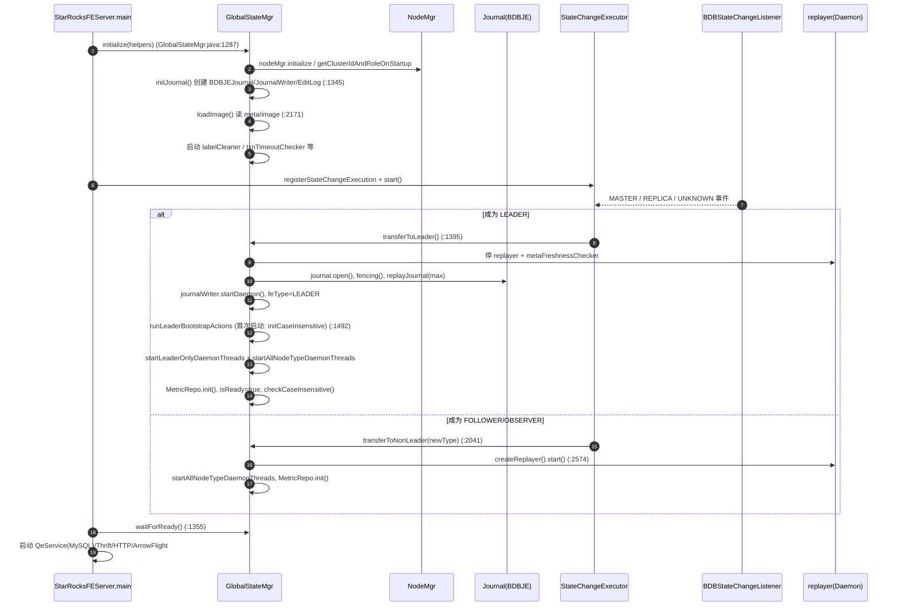
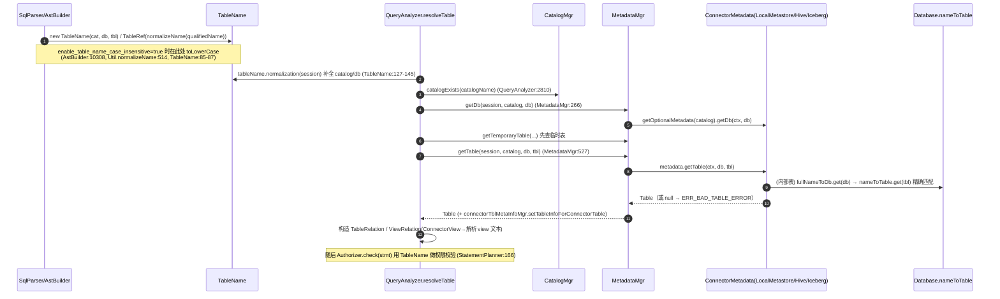
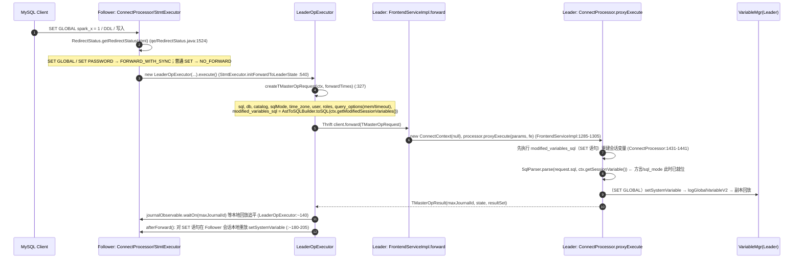

# FE 元数据 / 会话 / 平台服务 — 开发者交接指南

- Status: active
- 适用范围：Spark SQL 兼容项目（Spark 方言、函数/UDF 适配层、Spark 大小写）接手团队
- 代码基线：`/home/user/starrocks`（fork），行号为撰写时（2026-11-05）快照，改动后请用符号名重新定位
- 约定：路径均相对 `fe/fe-core/src/main/java/com/starrocks/`（下文简称 `FE/`），除非另写；标 **[未验证]** 的是推断或未做运行验证的条目
- 不重复的文档（请先读）：
  - [`fe/AGENTS.md`](../../../../../fe/AGENTS.md)（构建、checkstyle、锁规范、Config/Metric 增改规则）
  - [`handbook/domains/frontend.md`](../../../../domains/frontend.md)（FE 域入口与守则）
  - 本项目设计：[`README.md`](../README.md)、[`04-case-sensitivity.md`](../04-case-sensitivity.md)、[`05-semantics-session-catalog.md`](../05-semantics-session-catalog.md)、[`03-function-adapter.md`](../03-function-adapter.md)

> 重要提示（文档与代码不一致处，已核实）
> 1. `fe/AGENTS.md` 的 Config 示例里出现 `varType = VariableAnnotation.EXPERIMENTAL`，但当前 `ConfigBase.ConfField`（`FE/common/ConfigBase.java:85-105`）只有 `mutable/comment/aliases/sensitive` 四个属性，**没有 `varType`**。
> 2. AGENTS.md 的指标示例写 `public static final LongCounterMetric`；实际 `MetricRepo` 中绝大多数计数器是 `public static` 非 final，在 `MetricRepo.init()` 里赋值并注册（见 §7.4）。`init()` 之前这些字段是 `null`。
> 3. AGENTS.md 指向的 `docs/en/administration/management/FE_configuration.md` 与 `.../monitoring/metrics.md` 在本仓库 `docs/en/` 下**未找到**（只有 `metrics-materialized_view.md`、`metrics-shared-data.md`）。改 Config/Metric 前先 `grep -rl "<已有同类配置名>" docs/` 定位真实文档文件 **[未验证：真实路径]**。

---

## 目录

1. GlobalStateMgr、HA 与 EditLog
2. Catalog 模型与表名解析（含大小写）
3. 函数元数据与 UDF
4. 会话：ConnectContext / SessionVariable / VariableMgr / Config / sql_mode
5. 权限（Authorizer）与大小写
6. Follower 转发与可观测性
7. 配方（Recipes）a–e
8. 对 Spark 项目的风险清单与建议

---

## 1. GlobalStateMgr、角色与启动序列

### 1.1 角色

`ha/FrontendNodeType.java:37-43`：`LEADER / FOLLOWER / OBSERVER / INIT / UNKNOWN`。

| 角色 | 是否参与选举 | 是否可写 | 备注 |
|---|---|---|---|
| LEADER | 是（BDB-JE master） | 是，经 `EditLog` → `JournalWriter` | 仅 Leader 运行 `startLeaderOnlyDaemonThreads()`（`server/GlobalStateMgr.java:1716`） |
| FOLLOWER | 是（electable replica） | 否，靠 `replayer` 回放 | 可读（`canRead`），写类语句转发 Leader |
| OBSERVER | 否 | 否 | 同 Follower 回放，不投票 |
| INIT/UNKNOWN | — | — | 启动中 / 失去 master 的瞬态；UNKNOWN 仍对外提供读（`transferToNonLeader` 的 `UNKNOWN` 分支，`GlobalStateMgr.java:2041-2056`） |

关键类：

- `StarRocksFEServer.main`（`FE/StarRocksFEServer.java:120-190`）：总编排。
- `ha/BDBStateChangeListener`（`:59-74`，BDB 状态 `MASTER/REPLICA/UNKNOWN` → `FrontendNodeType`）→ `ha/StateChangeExecutor.notifyNewFETypeTransfer(...)`（`:60`）→ 单线程状态机（`:110-170` 注释列出了转移表）→ `StateChangeExecution`（`GlobalStateMgr` 构造函数里的匿名类，`GlobalStateMgr.java:869-884`）→ `transferToLeader()`（`:1395`）/ `transferToNonLeader()`（`:2041`）。
- `ha/BDBHA`：fencing（`haProtocol.fencing()`，`GlobalStateMgr.java:1442`）。

### 1.2 启动与 HA 流程



要点：

1. **首次启动才写入的"集群级不可变状态"**放在 `runLeaderBootstrapActions()`（`GlobalStateMgr.java:1492-1507`），条件是 `nodeMgr.isFirstTimeStartUp()`。`enable_table_name_case_insensitive` 就在这里经 `initCaseInsensitive()`（`:3792`）写成 GlobalVariable（并走 `OP_GLOBAL_VARIABLE_V2` 持久化），之后每次 Leader 激活用 `checkCaseInsensitive()`（`:3813`）比对，不一致直接 `System.exit(-1)`。
2. Leader 激活失败**不回滚而是退出进程**（`:1449-1456`、`:1496-1502` 注释）。新增的 Leader 初始化逻辑要幂等，且不要在 `transferToLeader` 里做可能长时间阻塞的外部调用。
3. Leader 降级走 `executeLeaderDemotionStages`（`:2085`），各阶段失败即 `System.exit`。
4. 所有后台线程基类 `FrontendDaemon` 在 `runAfterCatalogReady()` 前等待 `isReady`；新 Daemon 必须区分"所有节点跑"还是"只 Leader 跑"（`startAllNodeTypeDaemonThreads` vs `startLeaderOnlyDaemonThreads`）。
5. 角色判断：`GlobalStateMgr.isLeader()`（`:3314`）、`canRead()`、`isReady()`。**不要用 `feType` 字段直接判断**，激活过程中有 `ACTIVATING` 状态（`LeaderRoleState`）。

### 1.3 Journal / EditLog / Image

| 组件 | 位置 | 说明 |
|---|---|---|
| `Journal` 接口 + `bdbje/*` | `FE/journal/Journal.java`、`journal/bdbje/` | 目前仅 BDB-JE；`Config.edit_log_type="BDB"`（`Config.java:731`），`initialize()` 里非 BDB 直接退出（`GlobalStateMgr.java:1303`） |
| `JournalWriter` | `journal/JournalWriter.java` | 单线程批量写，`Config.metadata_journal_queue_size` 的队列 |
| `EditLog` | `persist/EditLog.java`（2554 行） | 写入口 `logXxx(...)`；回放入口 `loadJournal(...)`（`:163`，巨型 `switch(opCode)`） |
| `OperationType` | `persist/OperationType.java` | `short` 常量；新增类型从 10000 起、**必须 < `OP_TYPE_EOF=20000`**（`:723`、校验在 `:774-798`，违规直接 `System.exit`） |
| `EditLogDeserializer` | `persist/EditLogDeserializer.java:84-300` | `OPTYPE_TO_DESER_CLASS`：opCode → JSON 反序列化类；`deserialize()`（`:303`） |
| `WALApplier` | `persist/WALApplier.java` | "写日志成功后再改内存"回调；`apply can not fail` |
| Image | `GlobalStateMgr.saveImage`（`:2442`）/`loadImage`（`:2171`）+ `persist/metablock/*` | 每个 Mgr 一个 `SRMetaBlockID`；`ImageFormatVersion.v2` |
| Checkpoint | `leader/CheckpointController.java`、`journal/GlobalStateCheckpointWorker.java` | Leader 驱动，选 Follower（或 `checkpoint_only_on_leader`）重放到某 journal id 后 `saveImage` |

**写路径约定（Leader）**：`EditLog.logJsonObject(op, obj, walApplier)`（`:1654`）→ 入队 → 等待提交（`waitForCommit`，`:1664` 附近）→ **提交成功后**才执行 `walApplier`。因此 Manager 的典型写法：

```java
// 参考 catalog/GlobalFunctionMgr.java:106-112
GlobalStateMgr.getCurrentState().getEditLog().logAddFunction(f, wal -> replayAddFunction(f));
```

即"改内存的逻辑与 replay 逻辑复用同一个 `replayXxx`"，保证 Leader/Follower 一致。

**回放路径**：`replayer` 线程（`GlobalStateMgr.java:2574`）→ `replayJournalInner`（`:2997`）→ `editLog.loadJournal`。失败处理 `canSkipBadReplayedJournal`（`:3084`）：
- `metadata_enable_recovery_mode`、`metadata_journal_skip_bad_journal_ids`、`metadata_ignore_unknown_subtype`（Gson 子类型找不到）可跳过；
- 带 `@IgnorableOnReplayFailed` 的 opCode 且 `metadata_journal_ignore_replay_failure=true`（默认 true，`Config.java:4388`）可跳过；
- 其余 → `JournalInconsistentException` → **进程退出**（`:2590-2597`）。

### 1.4 如何安全地新增一个 journal op（详见 §7.3 配方）

安全原则（来自上面的代码）：

1. **新增 opCode，不改旧 opCode 的语义**；旧 opCode 的 payload 字段只能加、不能删改类型（Gson 以 `@SerializedName` 为准）。
2. 新 op 的 payload 用 **Gson JSON**（`logJsonObject`）而非 `Writable.write` 手写二进制 —— 旧的二进制格式只为兼容保留（`EditLogDeserializer.deserialize` 的 `case` 分支注释 "Do not delete the read code"）。
3. **混合版本滚动升级**：旧版本 Follower 遇到未知 opCode 会抛 `IOException("UNKNOWN Operation Type")`（`EditLog.java:1415-1420`、`EditLogDeserializer.java:340-347`）→ 包成 `JournalInconsistentException` → 回放线程 `System.exit(-1)`；仅当 `Config.metadata_ignore_unknown_operation_type=true`（mutable，`Config.java:4404`）才跳过。因此：**Spark 项目引入的新 op 只能在"全集群升级完毕"后才能被触发**（例如由一个新 session/config 开关门控，默认关闭）[降级场景的实际行为 **[未验证]**]。
4. 回放逻辑必须**幂等且不依赖会话/ConnectContext**（Follower 回放时没有用户上下文）。
5. 若 op 是可丢弃的统计/辅助信息，加 `@IgnorableOnReplayFailed`（`OperationType.java` 各常量上方）；核心元数据不要加。
6. 需要入 Image 的新 Manager：新增 `SRMetaBlockID`（`persist/metablock/SRMetaBlockID.java`，当前普通块到 `GTID_GENERATOR=40`，`WAREHOUSE_MGR=20001` 是特例）并在 `saveImage`（`GlobalStateMgr.java:2442-2500`）与 `loadImage`（`:2171-`的 `ImmutableMap<SRMetaBlockID, SRMetaBlockLoader>`）**两处**注册。漏一处 → 重启后数据丢失。

### 1.5 版本兼容规则

- `FeConstants.STARROCKS_META_VERSION = StarRocksFEMetaVersion.VERSION_CURRENT = VERSION_4`（`common/StarRocksFEMetaVersion.java:32`，`FeConstants.java:56`）。image 头写入该值（`GlobalStateMgr.saveHeader`，`:2512`）。**"change all serialize format to json" 之后元数据版本基本冻结**，兼容性靠 Gson 字段加法与 opCode 加法，而不是 bump 版本号 [此结论来自代码注释推断，**[未验证]**，向社区/owner 确认]。
- `SessionVariable`/`GlobalVariable` 的持久化是 JSON key→value（`GlobalVarPersistInfo`），回放时未知变量只打 error 日志并跳过（`VariableMgr.replayGlobalVariableV2`，`qe/VariableMgr.java:518-533`）；值被本版本拒绝时保留当前值（`setPersistedValue`，`:539-549` 的注释解释了回滚/前滚行为）。→ 新增 session 变量对升降级**天然友好**。
- 降级后新建对象（如 Spark 引入的新 Function 属性、新 Table 属性）：Gson 对未知字段忽略；但**未知 `RuntimeTypeAdapterFactory` 子类型**会失败，需 `metadata_ignore_unknown_subtype`（`Config.java:4413`）。因此**不要为 Spark 新增 `Table`/`Function` 的持久化子类**，用已有类 + properties 表达。
- 单测护栏：`persist/OperationTypeTest`（重复/越界检查）、`persist/EditLogDeserializerTest`、`catalog/GlobalFunctionMgrEditLogTest`（模板：写日志→replay→断言）。

---

## 2. Catalog 模型

### 2.1 层次

```
CatalogMgr (server/CatalogMgr.java:74)         catalogs: Map<name, Catalog>
 ├─ default_catalog  (InternalCatalog, 名称常量 InternalCatalog.DEFAULT_INTERNAL_CATALOG_NAME)
 │     └─ LocalMetastore (server/LocalMetastore.java:306, implements ConnectorMetadata)
 │           idToDb / fullNameToDb : ConcurrentHashMap<..., Database>   (:309-310)
 │           Database (catalog/Database.java:89)  nameToTable: ConcurrentHashMap<String,Table> (:108)
 │              Table → OlapTable / MaterializedView / View / ...
 └─ 外部 catalog (ExternalCatalog)  ←→ ConnectorMgr → CatalogConnector → ConnectorMetadata (hive/iceberg/hudi/jdbc/...)
MetadataMgr (server/MetadataMgr.java:115) —— 统一门面，按 catalogName 路由到 ConnectorMetadata
```

- `CatalogMgr.createCatalog`（`:101-150`）：创建 connector → 写 `logCreateCatalog`（`EditLog.java:2295`，具体 opCode 见该方法）→ 回调里 `catalogs.put + connectorMgr.addConnector`。回放 `replayCreateCatalog`（`:286`）。Image 块 `CATALOG_MGR`（`catalogMgr.save`，`GlobalStateMgr.java:2477`）。
- `CatalogMgr.isInternalCatalog(name)` 用 `equalsIgnoreCase`（`:273-275`）——**catalog 名判断内部 catalog 时已大小写不敏感**，但外部 catalog 在 `catalogs` map 里是精确 key（`catalogExists` `:250`）。
- `MetadataMgr.getOptionalMetadata(queryId, catalogName)`（`:201-218`）：空或内部 catalog → `localMetastore`；否则 `connectorMgr.getConnector(name)`；**查询内有 query 级 `ConnectorMetadata` 缓存**（`metadataCacheByQueryId`，用完 `removeQueryMetadata()` 清理）。
- `ConnectorMetadata` SPI：`connector/ConnectorMetadata.java`（接口，`LocalMetastore` 也实现它）。常用方法：`listDbNames / getDb / listTableNames / getTable(ctx, db, tbl) / tableExists`；`CatalogConnector`（`connector/CatalogConnector.java:41`）把 normal / information_schema / table-meta 三个 connector 合成一个 metadata。
- 新 connector 的步骤见 `fe/AGENTS.md` “Adding New Connector”（不重复）。

### 2.2 表名解析端到端（含大小写）



代码锚点：

- 解析入口：`sql/analyzer/QueryAnalyzer.java` — `resolveTableRef`（`:779`）、`visitTable` 内逻辑（`:876-1000`）、`resolveTable(TableRelation)`（`:2799-2900`）。
- `MetadataMgr.getTable(ctx, TableName)`（`:523`）→ 四参版本（`:527-548`）。
- 内表实际查找：`LocalMetastore.getDb(String)`（`:3080-3098`）`fullNameToDb.get(name)` **精确匹配**，仅对 `information_schema` / `sys` 做了 `equalsIgnoreCase` 兜底；`LocalMetastore.getTable(db, tbl)`（`:3151`）→ `Database.getTable(String)`（`Database.java:415`）`nameToTable.get(tableName)` **精确匹配**。
- information_schema 内表：`InfoSchemaDb.getTable(name)` 内部 `name.toLowerCase()`（`catalog/system/information/InfoSchemaDb.java:~120`）；`SysDb.getTable` 同理（`catalog/system/sys/SysDb.java`）。→ 新增系统表天然大小写不敏感。

### 2.3 大小写现状汇总（Spark 项目的核心背景）

| 对象 | 现状 | 位置 |
|---|---|---|
| catalog/db/table 名（默认配置） | **大小写敏感**，精确 Map key | `LocalMetastore.fullNameToDb`、`Database.nameToTable` |
| 开启 `enable_table_name_case_insensitive` | 在**解析期**（AstBuilder + TableName 构造器）统一转小写，存储也是小写；集群级、首次启动固化、不可逆；Leader 激活时校验 | `Config.java:5665-5667`、`GlobalVariable.java:175-176`（`READ_ONLY`）、`GlobalStateMgr.java:3792/3813`、`Util.normalizeName`（`common/util/Util.java:514`）、`SqlParser.java:182/201/249/258/270`（把 `GlobalVariable.enableTableNameCaseInsensitive` 传给 AstBuilder） |
| `lower_case_table_names` | 只读空壳，不影响行为 | `GlobalVariable.java:123-124` |
| 列名 | 不敏感：`Table.nameToColumn` 是 `TreeMap(CASE_INSENSITIVE_ORDER)` | `catalog/Table.java:564-570` |
| 函数名 | `FunctionName` 构造时 `toLowerCase()` | `catalog/FunctionName.java:38-46` |
| 变量名 | `VariableMgr` 的 ctx map 是 `CASE_INSENSITIVE_ORDER` | `qe/VariableMgr.java:160-162` |
| 关键字 | 词法 `CaseInsensitiveStream` | `SqlParser.java:341` |
| `SqlMode` 名 | 不敏感 | `SqlModeHelper.java:117` |

**对 Spark 方案的含义**（与 [04](../04-case-sensitivity.md) 一致）：
- `Util.normalizeName` 读的是**全局** `GlobalVariable`，且 `TableName` 构造器（调用点遍布 FE，不止 parser）都会走它。Spark 的"会话级、不 lower、元数据回退匹配"必须是**在 `QueryAnalyzer.resolveTable`/`MetadataMgr` 一侧加策略**，而不能复用/修改 `normalizeName`，否则影响所有方言。
- 内表 `getDb/getTable` 是精确匹配 → 回退查找需要新增"遍历 `fullNameToDb`/`nameToTable` 做 `equalsIgnoreCase`"的路径，并处理**同名异大小写冲突**（敏感集群里 `T1` 与 `t1` 可共存 → Spark 方言下需歧义报错）。
- 回退命中后，**后续所有使用 `TableName`/`Table.getName()` 的地方应使用规范名**（见 §5）。

### 2.4 Hive / Iceberg 外部 catalog 的大小写与视图

**Hive**
- FE 侧没有统一的"表名转小写"层；依赖 HMS 本身大小写不敏感（HMS 存小写）。FE 显式做的只有：`HiveMetastoreApiConverter.toDatabase(...)` 里 `dbName.toLowerCase()`（`connector/hive/HiveMetastoreApiConverter.java:154`），列名的 Hudi 路径 `toLowerCase(Locale.ROOT)`（`:571`），DLF 代理客户端（`DLFProxyMetaStoreClient.java:1002/1945`）。表名是否在 `HiveMetaClient/CachingHiveMetastore` 缓存 key 里归一 **[未验证]**（grep 未见 `toLowerCase`，缓存 key 可能区分大小写，需实测 `SELECT * FROM hive.DB.TBL`）。
- HiveView：`catalog/HiveView.java`（`Type{Trino,Hive}`）。`HiveMetastoreApiConverter.toHiveView`（`:301-325`）按 `viewOriginalText` 是否 `/* Presto View: ` 前缀 + Base64 JSON 判定 Trino 视图，取 `originalSql`；否则取 `viewExpandedText` 当 Hive 视图。**视图文本方言处理机制**：`ConnectorView.getQueryStatement()`（`catalog/ConnectorView.java:~50-62`）临时把 `sessionVariable.sqlDialect` 改成视图方言（`HiveView.doGetQueryStatement` 把 Trino 视图设为 `"trino"`），解析完恢复；解析失败走 `rollback()`（Trino 视图回退用 StarRocks 方言再试）；解析后 `formatRelations`（`HiveView.java`）给视图内无前缀表名补上视图所在 catalog/db，且 **CTE 名不补**。
  - **Spark 项目直接相关**：Spark 在 HMS 创建的视图，`viewOriginalText` 是 Spark SQL、`viewExpandedText` 常被 Spark 重写成带反引号全限定名文本；当前会被当作 `Type.Hive` 用 StarRocks 方言解析。若要正确支持，需新增 `HiveView.Type.Spark`（判定依据可能是 table 参数 `spark.sql.create.version` / `view.*` 属性 **[未验证]**），并让 `doGetQueryStatement` 切 `sql_dialect=spark`。
  - **坑**：该机制**原地修改并还原 SessionVariable**（非线程安全于同一 session 的并发；且还原前若抛异常需 finally——现状 `:54-55` 未用 finally，**[未验证]** 是否有异常路径泄漏），Spark 方言实现时建议改成传参的 `SqlParser.parse(text, dialect)`，避免会话变量被改写后经 `modifiedSessionVariables` 误转发。
- `toHiveView` 里构造完立刻 `hiveView.getQueryStatement()` 校验可解析（`:324`），失败抛 `StarRocksConnectorException("failed to parse hive view text")` → 注意：开了 Spark 方言后，加载 HMS 元数据时就要解析视图，**会话方言此时不一定是 Spark**，且结果会进 FE 缓存（`CachingHiveMetastore`）。

**Iceberg**
- `IcebergMetadata.getTable`（`connector/iceberg/IcebergMetadata.java:869-880`）：对 `HIVE_CATALOG`/`GLUE_CATALOG` 类型把 db/tbl `toLowerCase()`（注释："Hive/Glue catalog table name is case-insensitive"）；REST/JDBC/Hadoop 等 catalog 精确匹配。`dropNameKeyedStatistics`（`:838-843`）同理。其他 `toLowerCase(Locale.ROOT)` 用于内部队列/锁 key（`:2668-2669`、`CachingIcebergCatalog.java:407,676-682`）。
- 因此"外部 catalog 先精确再回退"在 Iceberg REST 上需要 `listTableNames` + `equalsIgnoreCase`（可能是远程调用）——注意 `Authorizer` 的注释已警告外部 catalog 的 `getTable` 是网络往返（`sql/analyzer/Authorizer.java:~208-222`）。

---

## 3. 函数元数据

### 3.1 内置函数：`FunctionSet`

- `catalog/FunctionSet.java`（2111 行）。核心结构：`Map<String, List<Function>> vectorizedFunctions`（`:773`），key 为小写函数名。
- 初始化：`FunctionSet.init()`（`:1070`）依次 `initAritheticFunctions` / `TableFunction.initBuiltins` / `VectorizedBuiltinFunctions.initBuiltins` / `initAggregateBuiltins` …；函数的 `fid` 与 BE 的函数表一一对应（`ScalarFunction.createVectorizedBuiltin(fid, ...)`，`addVectorizedScalarBuiltin` `:1281`）。
- 查找：`FunctionSet.getFunction(desc, CompareMode)`（`:1235`）：先非多态 `matchStrictFunction` → 多态 → `matchCastFunction`（受 `isCastMatchAllowed` 限制，`:1013`）。`GlobalStateMgr.getFunction`（`:3453`）是入口。
- 新增内置函数的基本步骤已在 AGENTS.md “Adding New Function”；补充：`fid` 必须与 BE `be/src/exprs/...` 的函数表同步（`VectorizedBuiltinFunctions`），**别名（Spark 项目的 L1）若只是名字不同，可在 FE 侧用一个"别名表→目标 FunctionName"在 `FunctionAnalyzer` 解析前替换，避免重复注册**。设计见 [03](../03-function-adapter.md)。

### 3.2 解析顺序（分析期）

`sql/analyzer/FunctionAnalyzer.getAnalyzedFunctionImpl`（`:986-1022`）：
1. 已知变体 `getAdjustedAnalyzedFunction`；
2. 聚合规范化 `getAdjustedAnalyzedAggregateFunction`；
3. SPM 函数；
4. **内置** `getAnalyzedBuiltInFunction`；
5. **UDF** `AnalyzerUtils.getUdfFunction`（`sql/analyzer/AnalyzerUtils.java:318`）= 先 `getDBUdfFunction`（`:270`，当前库/限定库，**内部做 `Authorizer.checkFunctionAction(USAGE)`**）→ 再 `getGlobalUdfFunction`（`:299`，`checkGlobalFunctionAction`）；且 `Config.enable_udf=false`（默认，`Config.java:2005`）时命中 UDF 直接报错；
6. meta 函数 `ScalarOperatorEvaluator.getMetaFunction`。
表函数另走 `QueryAnalyzer.java:2002-2023`（内置→UDF）。

> 含义：**内置函数优先于 UDF**。Spark 项目若想让 Spark 语义的同名函数覆盖内置（例如 `stddev`），必须在第 4 步之前（方言钩子）介入，而不是靠注册同名 UDF。

### 3.3 持久化与 UDF 注册

| 类型 | 存储 | EditLog | 回放 | Image |
|---|---|---|---|---|
| 全局 UDF | `GlobalFunctionMgr.name2Function`（`catalog/GlobalFunctionMgr.java:41`，`synchronized`） | `OP_ADD_FUNCTION_V2=13050` / `OP_DROP_FUNCTION_V2=13051`（`OperationType.java:564-567`，`EditLog.logAddFunction` `:2033`） | `EditLog.loadJournal` `:650-667`：`isGlobalFunction()` 决定走 `GlobalFunctionMgr.replayAddFunction` 或 `Database.replayCreateFunctionLog` | `SRMetaBlockID.GLOBAL_FUNCTION_MGR`（`GlobalFunctionMgr.save/load`） |
| 库级 UDF | `Database.name2Function`（`catalog/Database.java:101`，`addFunction` `:499`） | 同一个 op | 同上 | 随 Database 的 Gson 序列化 **[未验证具体字段]** |

- 函数 id：UDF 用负数（`GlobalFunctionMgr.assignIdToUserDefinedFunction`，`:101-104`），避免与内置 fid 冲突。
- DDL 入口：`DDLStmtExecutor.visitCreateFunctionStatement`（`qe/DDLStmtExecutor.java:280-300`）→ `GlobalFunctionMgr.userAddFunction` / `Database.addFunction`；`allowExists`/`createIfNotExists` 来自 `CREATE OR REPLACE` / `IF NOT EXISTS`。`GLOBAL_UDF_DB="__global_udf_db__"`（`FunctionName.java:28`）。
- 分析：`sql/analyzer/CreateFunctionAnalyzer.analyze`（`:85-110`）：三种模式 — **SQL 表达式 UDF**（`analyzeExpression`，用 `ExpressionAnalyzer.analyzeExpressionResolveSlot`）、**Java UDF**（`TYPE_STARROCKS_JAR` → `analyzeJavaUDFClass` → `analyzeStarrocksJarUdf/Udaf/Udtf`，反射校验签名；类型校验见 `:674-1100`，含 STRUCT/Arrow 输入）、**Python UDF**（`TYPE_STARROCKS_PYTHON` → `analyzePython` `:1153`，支持 inline `content` 与 `file`/`input_type=scalar|arrow`/`SERVICE_URL`）。JAR 会下载并 MD5 校验（`computeMd5`）。
- 执行期：FE 把 `Function.toThrift()`（`catalog/Function.java:794`）带到 BE（`TFunctionBinaryType` JAVA/PYTHON/…），BE 侧加载 jar / 调 Python worker。FE 不执行 UDF。
- 注意 `Function` 以 Gson 持久化 —— 新增字段必须有默认值并带 `@SerializedName`；Spark 的"Hive UDF 桥"（L4）如果需要在 `Function` 上加属性（如 `hive_class`），遵循 §1.5 的"字段只增不删"。

### 3.4 Spark 项目要点

- 函数名不敏感已具备（`FunctionName` lower）。但**库名**部分（`db.fn`）不会 lower（`new FunctionName(db, fn)` 只 lower `fn`，`FunctionName.java:38-41`）→ 大小写策略要覆盖 `db.fn` 形式。
- `SHOW FUNCTIONS`、`information_schema.spark_function_compat` 的数据来源可以直接遍历 `GlobalStateMgr.getBuiltinFunctions()`（`GlobalStateMgr.java:3465`）与 Spark 适配注册表，见 §7.5。

---

## 4. 会话

### 4.1 ConnectContext 生命周期

1. `mysql/nio/AcceptListener`（`:57`）接受连接 → `new ConnectContext(connection)`（`:74`）。构造器（`qe/ConnectContext.java:411-430`）：`sessionVariable = variableMgr.newSessionVariable()`（= 复制 `defaultSessionVariable` 的 clone，即**含 SET GLOBAL 后的默认值**）、`sessionId = UUID`。
2. `MysqlProto.negotiate` → `ConnectScheduler.registerConnection(ctx)`（`qe/ConnectScheduler.java:146`，检查 `max_connections` 与用户级上限）→ `MysqlProto.authenticate`；认证后会把用户属性里的 session 变量应用上去（`ConnectContext.java:1190-1230` 附近：`applySessionVariable(userProperty)` → `applyModifiedVariable(modifiedSessionVariables)`）。
3. `context.startAcceptQuery(new ConnectProcessor(ctx))` → 每个包 `ConnectProcessor.processOnce()`（`qe/ConnectProcessor.java:1584`）→ `dispatch()`（`:1134`；每条命令开头 `ctx.setStartTime()/resetErrorCode()`）→ `handleQuery()`（`:718`）→ `StmtExecutor.execute()`。
4. 连接关闭 → `unregisterConnection` + `ctx.cleanup()`（`ConnectContext.java:998`）。
5. `COM_CHANGE_USER` / reset：`ctx.resetSessionVariable()`（`:788`）重新 clone 默认值并清空 `modifiedSessionVariables`。
6. Follower→Leader 转发时，Leader 侧用**临时** `ConnectContext(null)` 承接（`FrontendServiceImpl.forward`，`service/FrontendServiceImpl.java:1285-1305`），会话状态通过 `TMasterOpRequest` 重建（见 §6.1）。

线程局部：`ConnectContext.get()` / `setThreadLocalInfo()`（`:516`）。**子线程/异步任务（如 profile 异步收集 `StmtExecutor.java:1720` 注释）不要持有 ctx 引用**，因为同一连接的下一条语句会复用它。

### 4.2 SessionVariable / VariableMgr

- `qe/SessionVariable.java`（7329 行）：字段 + `@VariableMgr.VarAttr(name=..., alias=..., show=..., flag=...)`；常量名 `public static final String XXX = "xxx"` 放在文件前部。`DEPRECATED_VARIABLES`（`:1325`）：仍可 SET 但无效。
- `VarAttr.flag`（`qe/VariableMgr.java:131-141`）：

| flag | 含义 |
|---|---|
| `SESSION`(1)（自动加） | 每个 session 有副本 |
| `GLOBAL`(2) | 进程唯一（`GlobalVariable` 字段自动加） |
| `SESSION_ONLY`(4) | 仅会话；`replayFromJson` 不恢复，不能 SET GLOBAL 意义上持久化 |
| `READ_ONLY`(8) | 只读 |
| `INVISIBLE`(16) | `SHOW VARIABLES` 不展示 |
| `DISABLE_FORWARD_TO_LEADER`(32) | 不记入 `modifiedSessionVariables`，不随转发带给 Leader（如 `follower_query_forward_mode`，`SessionVariable.java:3795`） |

- `VariableMgr()` 构造（`:158-203`）用**反射**扫描 `SessionVariable` / `GlobalVariable` 的 `@VarAttr` 字段，生成 `ctxByVarName`（大小写不敏感 `ImmutableSortedMap`）；`show` 必须等于 name 或 alias（`:171`）。
- `SET [GLOBAL] x = v`：`SetExecutor` → `ConnectContext.modifySystemVariable`（`ConnectContext.java:663-672`）→ `VariableMgr.setSystemVariable`（`qe/VariableMgr.java:372-410`）：校验 → `parseValue` → 若 `SetType.GLOBAL`：`setGlobalVariableAndWriteEditLog`（`:411-427`）写 `OP_GLOBAL_VARIABLE_V2`（并通过 `WALApplier` 修改 `defaultSessionVariable`/`GlobalVariable`）→ 再设置当前 session。非 GLOBAL 且 `shouldForwardToLeader(name)`（`:913`）时记入 `modifiedSessionVariables`。
- SET GLOBAL 持久化：写 EditLog（`GlobalVarPersistInfo`），Image 里 `variableMgr.save/load`（`:434/:501`，块 `VARIABLE_MGR`）。回放 `replayGlobalVariableV2`（`:518`）。
- **类型限制（坑）**：`SessionVariable.getJsonString()/replayFromJson()`（`:7195-7270`）只支持 `boolean/int/long/float/double/String` 字段，其他类型（enum、`List`）抛 `IOException("invalid type")`。新增变量请用这几种基础类型（枚举用 String + 校验，参照 `spillMode`、`sqlDialect`）。
- `SessionVariable.toThrift()`（`:6991`）→ `TQueryOptions`，见 §7.1。
- 现有相关变量：`sql_dialect`（`:1027,3271`，默认 `"StarRocks"`，字符串；`toThrift` 里 `sql_dialect.toLowerCase()`）、`enable_dialect_downgrade`（`:3274`）、`sql_mode_v2`（别名 `sql_mode`，`:1551`，默认 32）。
- 其他入口：`information_schema.session_variables / global_variables / verbose_session_variables`（`catalog/system/information/*VariablesSystemTable`），`getNonDefaultVariables()`（`SessionVariable.java:7270`）用于审计/dump。

### 4.3 sql_mode（SqlModeHelper）

`qe/SqlModeHelper.java`：64 位 `long` 位图；`MODE_DEFAULT=32`（`ONLY_FULL_GROUP_BY`）。已用位：0–9、17–27、29–38（见 `:52-92`）。**位 28 空缺**（`MODE_TRADITIONAL=1<<27`、`MODE_HIGH_NOT_PRECEDENCE=1<<29`）及 10–16、39+ 可用 **[未验证：28、10–16 是否被历史语义占用，新增前 grep `1L << N` 与 BE/thrift 使用]**。

新增 mode 步骤：加常量 → 加入 `MODE_ALLOWED_MASK`（`:108-114`，**漏了 SET 会被拒**）→ `SQL_MODE_SET.put("NAME", ..)`（`:121-150`）→（可选）组合模式 `COMBINE_MODE_SET`。`encode/decode/expand`（`:161/181/206`）负责字符串与位图互转；`SqlModeHelper.check(mask, mode)`（`:245`）判断。

sql_mode 的流向：parser（`SqlParser.parse(sql, sqlMode)` 影响 `PIPES_AS_CONCAT`/`ANSI_QUOTES` 等词法/语法行为）、`toThrift`（`MODE_ERROR_IF_OVERFLOW`→`overflow_mode`，`MODE_ERROR_FOR_DIVISION_BY_ZERO`→`error_for_division_by_zero`，`SessionVariable.java:7016-7022`）、转发（`TMasterOpRequest.sqlMode`，`LeaderOpExecutor.java:333`）。Spark 的 `||`（拼接）、除零语义（ANSI 关闭返回 NULL）可借用这些位 [映射表见 05 文档 §6]。

### 4.4 Config（fe.conf）

- `common/Config.java`（超大静态字段类，继承 `ConfigBase`）。`@ConfField`（`ConfigBase.java:85-105`）：`mutable`（运行时可改）、`comment`、`aliases`（改名兼容）、`sensitive`（`ADMIN SHOW FRONTEND CONFIG` 脱敏）。
- 加载：`ConfigBase.init(propFile)`（`:133`）读 `fe.conf` → `replacedByEnv()` → `setFields()`；`initAllMutableConfigs()`（`:154`）建 mutable 表。
- 运行时修改：`ADMIN SET FRONTEND CONFIG ("k"="v")` → `ConfigBase.setConfig`（`:680`）→ `setMutableConfig`（`:515`）；**仅 mutable**；持久化到文件需要 `fe.conf` 可写且非容器（`isPersisted`，`:143-146`），否则报错。**不写 EditLog**：每个 FE 独立，改动只在当前 FE（`setFrontendConfig` `:726` 负责对其它 FE 转发 **[未验证细节]**）。
- 与 session 变量的选择：集群级、运维型、不需要用户 per-session 切换 → Config；影响单条 SQL 语义/需要 per-session 或 `SET_VAR` hint → SessionVariable。**Spark 兼容开关属于后者**。
- 与本项目相关的现有 Config：`enable_table_name_case_insensitive`（`Config.java:5665`，immutable）、`enable_udf`（`:2005`）、`metadata_*`（`:4382-4413`）、`enable_qe_slow_log`/`qe_slow_log_ms`/`audit_log_modules`/`audit_log_json_format`（`:193-207`）。

---

## 5. 权限与大小写

### 5.1 调用位置

- 语句级入口：`StatementPlanner.plan(...)`（`sql/StatementPlanner.java:166`）在 **分析完成之后**（`analyzeStatement`）调 `Authorizer.check(stmt, session)`；`StmtExecutor` 对非 plan 语句在 `:868` 同样调用。`bypassAuthorizerCheck` 可跳过（内部语句）。
- `Authorizer`（`sql/analyzer/Authorizer.java`）静态门面 → `AccessControlProvider.getAccessControlOrDefault(catalog)` 按 catalog 选 `AccessController`：内部 catalog → `NativeAccessController`；外部 catalog 可配 Ranger / `ExternalAccessController`。
- 表：`checkTableAction(ctx, TableName, PrivilegeType)` / `checkResolvedTableAction`（`Authorizer.java:154-225`）；查询走 `AuthorizerStmtVisitor.checkSelectTableAction`（`sql/analyzer/AuthorizerStmtVisitor.java:~480-500`）→ `ColumnPrivilege.check`（`authorization/ColumnPrivilege.java:63-210`），**对每个解析出的 `TableName→Table` 做校验**；视图走 `checkViewPrivilege`（`:212`）。
- 函数：**不在 `AuthorizerStmtVisitor` 里，而在函数解析期内联校验**：`AnalyzerUtils.getDBUdfFunction`（`:288`，`USAGE`）/ `getGlobalUdfFunction`（`:306`）；DROP FUNCTION 在 `AuthorizerStmtVisitor.visitDropFunctionStatement`（`:3205-3250`）。**内置函数不做权限校验**。→ 若 Spark 适配层通过"改写成 UDF/内部函数"实现，要确认不会意外触发或绕过 `USAGE` 检查。
- Native 校验：`NativeAccessController.checkTableAction`（`authorization/NativeAccessController.java:133-140`）用 `[catalog, db, tbl]` **名称 token** 去查 `TablePEntryObject`/权限集合（`TablePEntryObject.generate(tokens)` `:65`）——**名字是 key**。

### 5.2 大小写含义（必读）

1. 权限判定以**名称字符串**为输入，且 `PEntryObject` 内部以 id/uuid 存授权对象（授权时由名称解析为 id；`GRANT` 阶段 `Util.normalizeNames(...)` 在 `enable_table_name_case_insensitive` 下把对象名 lower，`Util.java:518-529`）。
2. 因此如果 Spark 方言用"忽略大小写回退"把 `SELECT * FROM DB1.T1` 解析到真实表 `db1.t1`，**传给 Authorizer 的必须是规范名（`Table.getName()` / `Database.getFullName()`），不能是用户输入的名字**；否则：(a) Native 控制器按名称解析授权对象会找不到 → 误拒；(b) Ranger（外部策略以真实名匹配）可能被大小写绕过或误拒。现有代码已有一处样板：`ColumnPrivilege.java:178` 使用 `table.getName()`；而 `Authorizer.checkTableAction(ctx, catalog, db, table, ...)`（`:164-176`）的注释专门说明**选择 AccessController 时用调用者给的原始 catalog 名，而 `TableName` 构造器会 lower**——这是大小写踩过的坑，改动时参照。
3. 回退实现完成后，应在 `QueryAnalyzer.resolveTable` 里把 `tableRelation.getName()` **回写为规范名**（catalog/db/tbl 三段），让后续 `TableCollector`、`Authorizer`、`SecurityPolicyRewriteRule.buildView`（行/列策略，`QueryAnalyzer.java:~960`）、审计 `QueriedRelations`、MV 改写缓存键都一致。**[未验证]**：`TableName` 是可变对象还是别处缓存了旧值（`aliasSet` 用的是 `resolveTableName` 副本，`:887`），需 grep `getResolveTableName` 全部调用点。
4. 歧义：敏感集群中 `T1` 与 `t1` 同在时，回退层必须按"精确优先，否则多于一个候选则报错"，并确保**用户只对其中一个有权限时不泄露另一个的存在**（错误信息只说 "ambiguous"，不列出名字）。
5. 列级：`ColumnPrivilege` 用 `Column.getName()` 做列权限；列名已不敏感，但授权存的是定义时的大小写，比较处需确认用 `equalsIgnoreCase` **[未验证]**。
6. 外部 catalog 且开启 Ranger：`ColumnPrivilege.check` 会触发完整 RBO（`StatementPlanner.java:154-160` 注释），回退解析额外的 `listTableNames` 远程调用要考虑与之叠加的延迟。

---

## 6. Follower 转发与可观测性

### 6.1 转发（Follower → Leader）



要点：

- 是否转发：`StmtExecutor.initForwardToLeaderState()`（`:540-607`）：Leader 自己不转发；正在转 Leader 时等待；事务内读语句转发；Follower 上 `QueryStatement` 若 `!canRead()` 或 session `follower_query_forward_mode` 指定则转发；否则看 `RedirectStatus`（DDL/DML/写类语句 `FORWARD_*`）。`MAX_FORWARD_TIMES=30`（`LeaderOpExecutor.java:82`）。
- **会话变量转发**：只转发 `ConnectContext.modifiedSessionVariables` 里的变量（`modifySystemVariable` 在非 GLOBAL 且 `shouldForwardToLeader` 时才记录，`ConnectContext.java:667-669`）与非 hint 的用户变量（`getModifiedSessionVariables` `:752`），序列化为 SQL 文本放入 `modified_variables_sql`；Leader 先执行它。**所以任何"改了 SessionVariable 字段但没经过 `modifySystemVariable`"的路径（例如 `SparkConfMapper` 直接 `sessionVariable.setXxx()`）不会被转发**——Leader 上方言/大小写策略会不一致。映射必须构造等价的 `SystemVariable` 并走 `ctx.modifySystemVariable(...)`。
- `sql_mode` 与 `time_zone`、`mem_limit/query_timeout/load_mem_limit` 另有专用字段（`LeaderOpExecutor.java:333-359`）。
- `TMasterOpRequest` 里不含 `sql_dialect` 专门字段，依赖 `modified_variables_sql`；因此**`sql_dialect` 若被设为 `DISABLE_FORWARD_TO_LEADER` 或通过非 SET 路径设置，转发后 Leader 用默认方言解析会失败/错解析**。
- 视图/connector 内部临时改 `sqlDialect`（见 §2.4）不进 `modifiedSessionVariables`（直接 setter），不会被转发 —— 这是正确的，但解析发生在哪个 FE 要意识到。
- 回读一致性：转发后 Follower 用 `journalObservable.waitOn(maxJournalId)` 等回放（`LeaderOpExecutor.execute :140-152`），新增 op 回放慢会拉长这条路径。

### 6.2 可观测性

**Metrics**（`metric/MetricRepo.java`，2159 行）
- 指标类：`LongCounterMetric`、`GaugeMetric<T>`、`Histogram`（Dropwizard/`HistogramMetric`）、`MetricWithLabelGroup<T>`（按 label 值动态建子指标，如 `COUNTER_SPM_REWRITE_TOTAL`，`:172-175`，使用见 `sql/spm/SPMMetrics.java:36`）。单位 `Metric.MetricUnit`。
- 注册：`MetricRepo.init()`（`:571`）`synchronized`、`hasInit` 保护；Leader 与非 Leader 激活时都会调（`GlobalStateMgr.java:1493/2075`）。**`init()` 之前静态字段为 null**：在可能早于 init 执行的路径（如 `replayJournalInner`）必须 `if (MetricRepo.hasInit)` 判断（`GlobalStateMgr.java:3043`、`EditLog.java:1697` 为范例）。
- 暴露：HTTP `/metrics`（`http/rest/MetricsAction.java:63`，`?type=core|json`，Prometheus 文本）。可视化访问器 `PrometheusMetricVisitor`/`JsonMetricVisitor`。
- 查询类计数的现有埋点：`COUNTER_QUERY_ALL/ERR/TIMEOUT/SUCCESS`（`MetricRepo.java:1028-1034`）在 `ConnectProcessor.java:302-314` 增加。Spark 方言可加：`spark_dialect_query_total{result=parsed|fallback|failed}`（见 §7.4）。

**Query profile**
- 顶层 `StmtExecutor.buildTopLevelProfile()`（`qe/StmtExecutor.java:437`）建 `RuntimeProfile("Query")` + `Summary`（含 QueryId、Start/End/TotalTime、User、DefaultDb、**`SQL_DIALECT`**（`:482`，已有！）、Sql Statement、变量非默认值等）；`coord.buildQueryProfile(needMerge)`（`qe/scheduler/QueryRuntimeProfile.java`，聚合 BE 上报的 `TRuntimeProfileTree` → `RuntimeProfile.update`，`common/util/RuntimeProfile.java:265`，`mergeIsomorphicProfiles`）；最后 `ProfileManager.getInstance().pushProfile(...)`（`StmtExecutor.java:1755`）存入内存/并可经 `SHOW PROFILELIST`/`get_query_profile()` 读取。profile 异步收集（`:1720-1760`），**任务里不得使用 `context`**。
- Spark 项目建议在 Summary 增加：`SparkTranslation`（命中方言翻译/回落原因）、`SparkCaseFallbackTable`（做过大小写回退的表）。位置：`buildTopLevelProfile` 里 `addInfoString(...)`；常量放 `ProfileManager`（`common/util/ProfileManager.java`）。
- 相关开关：`enable_profile`、`big_query_profile_threshold`、`pipeline_profile_level`（`SessionVariable.java:269,1024,507`）。

**审计日志**
- `plugin/AuditEvent.java`：`@AuditField("Name")` 注解字段（`:83-223`，如 `Timestamp, Client, User, AuthorizedUser, ResourceGroup, Catalog, Db, State, ErrorCode, Time, ScanBytes, ScanRows, ReturnRows, CpuCostNs, MemCostBytes, StmtId, QueryId, IsQuery, feIp, Stmt, Digest, PlanCpuCost, PlanMemCost, PendingTimeMs, Warehouse, CandidateMVs, HitMvs, Features, IsForwardToLeader, SessionId, QuerySource, Command, QueriedRelations, CacheHitRatio, AI*…`），`ignore_zero/ignore_empty` 控制是否输出。构建：`AuditEventBuilder`（`:296`），在 `ConnectProcessor.auditAfterExec`（`:272-`）/`auditBeforeExec`（`:248`，受 `audit_stmt_before_execute`）填充，经 `AuditEventProcessor`（`qe/AuditEventProcessor.java`）异步分发到插件，内置落盘 `qe/AuditLogBuilder`（`:167-169`）。
- **当前审计事件没有 `sql_dialect` 字段** → 排障"某条 SQL 是 Spark 方言还是原生"困难。建议新增 `@AuditField(value = "SqlDialect", ignore_empty = true)` 与 builder `setSqlDialect`，在 `auditAfterExec` 填 `ctx.getSessionVariable().getSqlDialect()`；注意 `AuditEvent` 字段顺序影响日志列顺序，新字段追加在末尾，且下游解析（audit loader 表结构）可能需同步 **[未验证：`fe_plugins/auditloader` 是否按名取值]**。
- 慢查询日志：`AuditLog.SLOW_AUDIT`（`common/AuditLog.java:26`，logger `audit.slow_query`）；`AuditLogBuilder` 在 `Config.enable_qe_slow_log && Time > qe_slow_log_ms` 且 `audit_log_modules` 含 `slow_query` 时写入（`Config.java:193-197`）。大查询日志 `big_query.query`（`AuditLog.BIG_QUERY_AUDIT`，阈值 `big_query_log_*`）。
- 脱敏：`Config.enable_sql_desensitize_in_log`、`SqlCredentialRedactor`，Spark 方言翻译产生的 SQL 文本（若记录翻译后 SQL）要走同一路径。

---

## 7. 配方（Recipes）

### 7.1 (a) 新增 session 变量（含 BE 传播与文档）

以 `spark_case_sensitive`（String/boolean）为例：

1. **常量与字段**（`qe/SessionVariable.java`）
   ```java
   public static final String SPARK_CASE_SENSITIVE = "spark_case_sensitive";   // 与其它常量放一起
   @VarAttr(name = SPARK_CASE_SENSITIVE)            // 仅 FE 使用；需转发 Leader 则不要加 DISABLE_FORWARD_TO_LEADER
   private boolean sparkCaseSensitive = false;
   public boolean isSparkCaseSensitive() {...}  public void setSparkCaseSensitive(boolean v) {...}
   ```
   - 字段类型限 `boolean/int/long/float/double/String`（§4.2）。
   - 若需 `SET GLOBAL` 与默认值设置：无需额外代码，反射自动注册；`flag` 可选 `INVISIBLE`（内部变量）、`SESSION_ONLY`（不持久化）。
   - 取值校验/联动：在 setter 里校验；或在 `VariableMgr.setSystemVariable` 前的 `checkUpdate`（`:337`）路径。枚举型字符串请在 setter 中校验并抛 `IllegalArgumentException`（参考现有 `spillMode`、`sqlDialect` 的 setter，`:6077`）。
2. **传到 BE**（仅当 BE 需要）
   - thrift：`gensrc/thrift/InternalService.thrift` 的 `struct TQueryOptions`（`:197`）新增 `optional` 字段，**用新的 field id**（当前最大为 **227**，实施前再确认；永不复用）。例：`228: optional bool spark_case_sensitive;`
   - FE：`SessionVariable.toThrift()`（`:6991`）里 `tResult.setSpark_case_sensitive(sparkCaseSensitive)`。`toThrift` 在 `qe/scheduler/dag/JobSpec.java:115/212/271/296` 调用 → `Deployer`/`TFragmentInstanceFactory` 下发（`TFragmentInstanceFactory.java:174`）。
   - BE：`be/src/runtime/runtime_state.{h,cpp}` 读 `_query_options.spark_case_sensitive` 并暴露 getter；算子/表达式通过 `RuntimeState` 取值 **[未验证：BE 具体文件名，参照现有 `error_for_division_by_zero` 的读取方式 grep]**。
   - 老 BE + 新 FE：optional 字段被忽略；新 BE + 老 FE：用默认值——**BE 逻辑默认值必须等价于旧行为**。
   - 若需只在 FE 使用（本项目大部分大小写/方言变量属此类），**不要**改 thrift。
3. **转发 Leader**：自动，只要经 `modifySystemVariable`（§6.1）；仅 `DISABLE_FORWARD_TO_LEADER` 例外。依赖该变量的**分析逻辑发生在 Leader 上**（DDL/INSERT 的 SELECT 部分被转发后在 Leader 解析），所以变量必须能被 `AstToSQLBuilder.toSQL(SetStmt)` 正确序列化（布尔/字符串/数值均可）。
4. **SET 语义映射**（Spark 项目）：`SET spark.sql.caseSensitive=false` 由 `SparkConfMapper` 转成 `SystemVariable` 并调用 `ctx.modifySystemVariable(var, false)`（不要直接 setter）。
5. **文档（必须）**：`docs/en/sql-reference/System_variable.md`（及 `docs/zh/...`，变量条目格式参考 `enable_spill` 段，`:1170`）。规则见 `docs/AGENTS.md`；翻译走 `/translate` 工作流（`docs/translation/`）。
6. **测试**：`fe/fe-core/src/test/java/com/starrocks/qe/SessionVariableTest`、`VariableMgrTest`（模板）；若涉及 toThrift，加断言 `sv.toThrift().isSetXxx()`；SQL 级回归 `test/sql/...`。
7. **升降级**：新增变量对 SET GLOBAL 持久化兼容（§1.5）；删除/改名变量用 `DEPRECATED_VARIABLES` 或 `alias`。

### 7.2 (b) 新增 FE 配置

1. `common/Config.java` 加字段：
   ```java
   @ConfField(mutable = true, comment = "Enable Spark SQL dialect (sql_dialect='spark').")
   public static boolean enable_spark_dialect = true;
   ```
   - `mutable=true`：可 `ADMIN SET FRONTEND CONFIG` 热改；否则需重启。需要在改动后执行动作（重建线程池等）→ 在 `GlobalStateMgr` 构造函数里 `getConfigRefreshDaemon().registerListener(...)`（范例 `GlobalStateMgr.java:886`）。
   - 改名保留旧名：`aliases = {"old_name"}`；敏感值：`sensitive = true`。
   - 命名：`enable_xxx` 布尔、`xxx_ms/second` 带单位；校验靠类型（`ConfigBase.parseAndValidateConfigField`），复杂校验在使用点做。
2. 读取：`Config.enable_spark_dialect`（直接静态读，**不要缓存到 final 字段**，否则丧失热改）。
3. 文档：按 AGENTS.md 要求更新 FE 配置文档（真实路径见本文开头提示 3），写明：名称、默认值、类型/范围、描述、是否 mutable、是否需重启。
4. 测试：`common/ConfigTest.java` 模板；mutable 路径测 `ConfigBase.setMutableConfig`。
5. 注意：Config **不入 EditLog、不入 Image**，多 FE 需各自配置一致（或运维统一下发）。需要"集群一致且持久"的开关应做成 GlobalVariable / SET GLOBAL 变量。

### 7.3 (c) 新增 EditLog op

示例：持久化“Spark 兼容函数映射覆盖”`SparkFunctionOverrideLog`（假想）。

1. **payload 类**（`persist/` 或所属模块包）：POJO + `@SerializedName`，实现 `Writable`（旧接口要求；JSON 写法参考任一 `*Log`，如 `persist/DropCatalogLog.java`）。字段全部带默认值/可空，**只增不改**。
2. **opCode**：`persist/OperationType.java` 新增 `public static final short OP_XXX = 13xxx;`
   - 先 `grep -n "= 13[5-9][0-9][0-9]" OperationType.java` 找未用号；新号 < 20000；`OperationType` 静态块会校验重复与越界（`:774-798`）→ 违反时 FE **启动即退出**，务必跑 `OperationTypeTest`。
   - 辅助/可丢弃日志加 `@IgnorableOnReplayFailed`。
3. **反序列化映射**：`EditLogDeserializer.OPTYPE_TO_DESER_CLASS`（`:84-300`）加 `.put(OperationType.OP_XXX, XxxLog.class)`。漏加 → 回放抛 `UNKNOWN Operation Type`（`:340-347`）。
4. **写接口**：`EditLog` 加
   ```java
   public void logXxx(XxxLog info, WALApplier walApplier) {
       logJsonObject(OperationType.OP_XXX, info, walApplier);   // EditLog.java:1654
   }
   ```
5. **回放分支**：`EditLog.loadJournal` 的 `switch` 加
   ```java
   case OperationType.OP_XXX: {
       XxxLog log = (XxxLog) journal.data();
       globalStateMgr.getXxxMgr().replayXxx(log);
       break;
   }
   ```
6. **Manager**：写路径 `editLog.logXxx(info, wal -> applyInMemory(info))`；`replayXxx` 与 `applyInMemory` 复用同一实现；先校验再写日志（日志一旦写入必须能被回放成功）；持锁策略参照 AGENTS.md “Database and Table Locks”。
7. **Image**：新 Manager 需 `SRMetaBlockID` + `saveImage`/`loadImage` 双向注册（§1.4-6）；`save` 用 `imageWriter.getBlockWriter(id, numJson)` + `writeJson`（模板 `GlobalFunctionMgr.save/load`，`:215-232`）。
8. **测试**：参照 `GlobalFunctionMgrEditLogTest` / `DatabaseEditLogTest`：`UtFrameUtils.setUpForPersistTest()` → 执行 → `EditLog` 重放 → 断言；另加 `EditLogDeserializerTest` 的反序列化用例。
9. **兼容性检查清单**：新 op 是否被开关门控（默认关）？降级后旧 FE 是否会因未知 op 退出（会，§1.4-3）？是否需要 `ignore_unknown_*` 说明写进升级文档？

### 7.4 (d) 新增 metric

1. 在 `metric/MetricRepo.java` 声明字段（与同类指标放一起，约 `:154-182`）：
   ```java
   public static LongCounterMetric COUNTER_SPARK_DIALECT_QUERY;             // 无 label
   public static final MetricWithLabelGroup<LongCounterMetric> COUNTER_SPARK_TRANSLATE =
           new MetricWithLabelGroup<>("result",                              // label 名
                   () -> new LongCounterMetric("spark_dialect_translate_total", MetricUnit.REQUESTS,
                           "spark dialect translation attempts by result"));
   ```
   - 带 label 的组式指标是 `static final`，能在 `init()` 前访问；但**仍需在 `init()` 里 `STARROCKS_METRIC_REGISTER.addMetric(...)`**，参照 `COUNTER_SPM_REWRITE_TOTAL` / `COUNTER_MV_GLOBAL_QUERY_REWRITE` 的注册位置（grep `addMetric(COUNTER_SPM`） **[未验证注册行位置]**。
2. 无 label 的在 `init()` 里赋值并注册（参照 `:1028-1031`）：
   ```java
   COUNTER_SPARK_DIALECT_QUERY = new LongCounterMetric("spark_dialect_query_total", MetricUnit.REQUESTS, "...");
   STARROCKS_METRIC_REGISTER.addMetric(COUNTER_SPARK_DIALECT_QUERY);
   ```
3. 使用点：`if (MetricRepo.hasInit) MetricRepo.COUNTER_SPARK_DIALECT_QUERY.increase(1L);`（必须判 `hasInit`，§6.2）。组式：`MetricRepo.COUNTER_SPARK_TRANSLATE.getMetric("fallback").increase(1L)`（封装成小工具类，参照 `sql/spm/SPMMetrics`）。
4. Gauge：`new GaugeMetric<Long>(name, unit, desc){ getValue(){...} }`；Histogram 用 `MetricRepo.HISTO_*` 同款。
5. 命名：snake_case，计数器以 `_total` 结尾，单位用 `MetricUnit`；避免高基数 label（不要把表名/SQL 当 label）。
6. 文档：按 AGENTS.md 更新 metrics 文档（Name/Type/Unit/Description/Labels；真实路径见开头提示 3）。
7. Leader-only 指标：用 `LeaderAware*Metric`（`metric/LeaderAware*.java`）使非 Leader 返回空 **[未验证语义，参见 `LeaderAwareCounterMetricLong` 用法]**。
8. 验证：起 FE UT 后 `curl fe:8030/metrics | grep spark_dialect`；单测参考 `metric/MetricRepoTest`（若存在 **[未验证]**）。

### 7.5 (e) 新增 information_schema 系统表 `spark_function_compat`

设计列（来自 [03 文档 §261](../03-function-adapter.md)）：`name / class / status / notes`。**现有系统表的实现分两类**，先选型：

| 方案 | 数据流 | 改动面 | 适用 |
|---|---|---|---|
| **A. FE-RPC 型**（`fe_threads` 同款，`catalog/system/information/FeThreadsSystemTable.java`） | BE 的 SchemaScanner 通过 Thrift 回调 FE 取数据 | FE + thrift + **BE C++** | 数据在 FE 内存、需要权限校验、动态变化 |
| **B. sys 库同款**（`SysFeLocks`，`catalog/system/sys/`，TSchemaTableType 为 `SYS_FE_LOCKS`，BE 工厂 `builtin_schema_scanner_factory.cpp:166`） | 与 A 相同，也由 BE scanner 回调 FE | 同 A（只是注册进 `SysDb` 而非 `InfoSchemaDb`） | 想放 `sys` 库而非 information_schema |
| **C. 静态数据 → 不建表而用 `SHOW FUNCTIONS` 扩展** | FE 直接返回结果集 | 仅 FE | 若验收只要"用户可自查"，**成本最低**，可作为 MVP |

> 结论：information_schema 表的扫描由 **BE 的 SchemaScanner** 驱动（`be/src/schema_scanner/`），即使数据全在 FE，新增表也需要 BE 侧 scanner 类。若团队暂不动 BE，先做方案 C，表晚一个迭代。

**方案 A 步骤（以 `fe_threads` 为模板，逐文件）**

1. **SystemId**：`catalog/system/SystemId.java` 新增 `SPARK_FUNCTION_COMPAT_ID`，取未用值（当前已用到 `MATERIALIZED_VIEW_REFRESH_JOBS_ID=180`，`FE_THREADS_ID=46`…，先全文件查重）。
2. **Thrift 枚举**：`gensrc/thrift/Descriptors.thrift` `TSchemaTableType` 追加 `SCH_SPARK_FUNCTION_COMPAT = 78`（当前末项 `SCH_MATERIALIZED_VIEW_REFRESH_JOBS = 77`，`:226`）。**枚举值只增不复用**。
3. **Thrift RPC**：`gensrc/thrift/FrontendService.thrift` 新增 `TGetSparkFunctionCompatRequest{1: optional TAuthInfo auth_info}` / `Response{1: Status status; 2: list<TSparkFunctionCompatItem> items}` 与 service 方法（模板：`TGetFeThreadsRequest/Response` `:2436-2443`、方法 `:2633`）。
4. **FE 表定义**：新建 `catalog/system/information/SparkFunctionCompatSystemTable.java`（模板 `FeThreadsSystemTable`：`create()` 用 `SystemTable.builder().column(...)`，末参 `TSchemaTableType.SCH_SPARK_FUNCTION_COMPAT`；`generateResponse(request)` 里组装数据）。数据来源：Spark 适配注册表（`func_mapping.csv` 的生成物）+ `GlobalStateMgr.getBuiltinFunctions()`。**权限**：如无敏感可不校验；`fe_threads` 校验了 `OPERATE`（`Authorizer.checkSystemAction`）——函数兼容表不敏感，建议不校验 [确认产品要求]。
5. **注册**：`InfoSchemaDb.java`（`:60-110`）：放在 `isInternalCatalog(catalogName)` 分支内（仅 default_catalog 显示）加 `super.registerTableUnlocked(SparkFunctionCompatSystemTable.create());`。名称自动小写不敏感（`InfoSchemaDb.getTable` lower）。
6. **FE RPC 实现**：`service/FrontendServiceImpl.java` 新增 `getSparkFunctionCompat(...)`（模板 `:3591`）。
7. **BE**（C++）：`be/src/schema_scanner/schema_spark_function_compat_scanner.{h,cpp}`（模板 `schema_fe_threads_scanner.*`）、`schema_helper.{h,cpp}` 加 `get_spark_function_compat`（`schema_helper.cpp:201`）、`builtin_schema_scanner_factory.cpp` 的 `switch` 加 `case TSchemaTableType::SCH_SPARK_FUNCTION_COMPAT`（`:130` 附近）、CMake 源文件列表。
8. **文档**：`docs/en/sql-reference/information_schema/spark_function_compat.md`（+zh/ja 由翻译流程；参考同目录 `pipes.md`），并加入该目录的索引/侧边栏 **[未验证：sidebar 配置位置，grep `fe_threads` in `docs/docusaurus`]**。
9. **测试**：SQL 回归 `test/sql/test_information_schema/T|R/test_spark_function_compat`（模板 `test_fe_threads`）；FE UT 参考 `sql/plan/InformationSchemaBeFeTableTest`；`SystemId`/`InfoSchemaDb` 表数量断言的既有测试（若有"表清单快照"测试需更新）**[未验证]**。
10. **兼容性**：新增 thrift 枚举/RPC 属于加法，FE/BE 滚动升级期间老 BE 不认识新 `TSchemaTableType` → 查询该表只会在升级未完成时失败；上线说明里写明"先升 BE 再升 FE"（FE 升级后才暴露该表）**[未验证升级顺序约定，参照 `docs/` 升级文档]**。

---

## 8. 对 Spark 项目的风险清单与建议

| # | 风险 / 决策点 | 依据 | 建议 |
|---|---|---|---|
| 1 | 大小写回退发生在 `QueryAnalyzer.resolveTable`，需同时处理内表（精确 Map）与外表（connector） | §2.2 | 在 `MetadataMgr` 增加 `getTable(ctx, TableName, CaseSensitivityPolicy)`，内部先精确再回退；回退后写回规范名 |
| 2 | 不能改 `Util.normalizeName`（全局、被 `TableName` 构造器广泛调用） | §2.3 | 只通过 `CaseSensitivityPolicy.current()` 新增路径；`LEGACY` 完全等价现状 |
| 3 | 权限必须基于规范名 | §5.2 | 在回退落地处统一回写 `TableName`；增加用例：`GRANT` 在 `t1` 上，Spark 方言 `SELECT FROM T1` 应成功，对无权用户应拒绝且不泄露歧义候选 |
| 4 | `SET spark.*` 映射若绕过 `modifySystemVariable` 则不转发 | §6.1 | 统一走 `ctx.modifySystemVariable`；加 Follower 转发 UT（`LeaderOpExecutorTest` 模板） |
| 5 | Hive 视图方言处理会临时改写会话 `sqlDialect` | §2.4 | Spark 视图用显式方言参数解析；新增 `HiveView.Type.Spark`（判定规则需实测 **[未验证]**） |
| 6 | 内置函数优先于 UDF | §3.2 | 同名语义覆盖放在方言钩子，不靠注册 UDF |
| 7 | 新增 op 的降级风险 | §1.4 | 尽量复用已有 op（Spark 兼容多为会话级，**不需要新 op**）；必须新增时加开关门控 |
| 8 | 审计无方言字段、profile 已有 | §6.2 | 追加 `SqlDialect` 审计字段；profile 追加翻译/回退信息 |
| 9 | thrift 新字段 id / 枚举值 | §7.1/7.5 | 实施前再次确认最大值（TQueryOptions=227、TSchemaTableType=77），PR 内带 BE 默认值等价说明 |
| 10 | 文档要求（变量/Config/Metric/系统表）易漏 | AGENTS.md | 在 PR 模板勾选项里加"docs 已更新（en/zh）" |

### 建议的验证命令（本文未执行，仅给出）
```bash
./run-fe-ut.sh --test com.starrocks.persist.OperationTypeTest
./run-fe-ut.sh --test com.starrocks.persist.EditLogDeserializerTest
./run-fe-ut.sh --test com.starrocks.qe.VariableMgrTest        # [未验证存在]
./run-fe-ut.sh --test com.starrocks.qe.LeaderOpExecutorTest
./run-fe-ut.sh --test com.starrocks.catalog.GlobalFunctionMgrEditLogTest
cd fe && mvn checkstyle:check -pl fe-core
```
