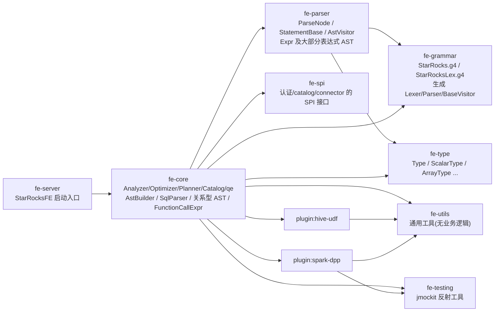
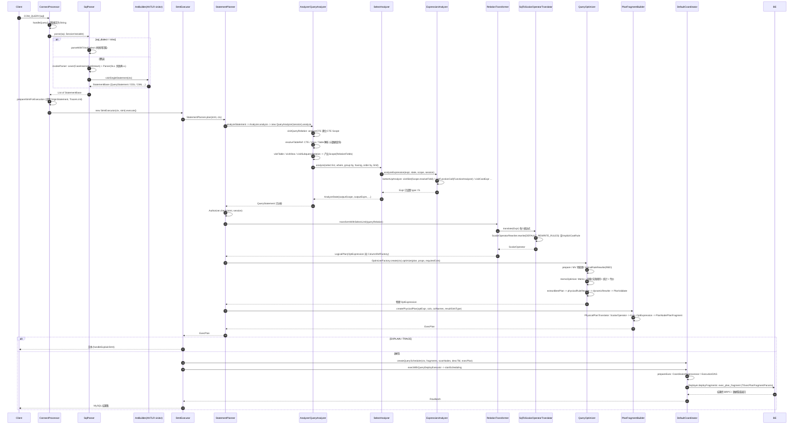
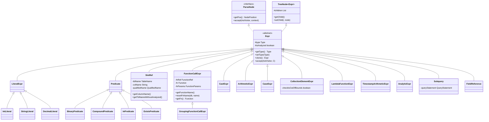
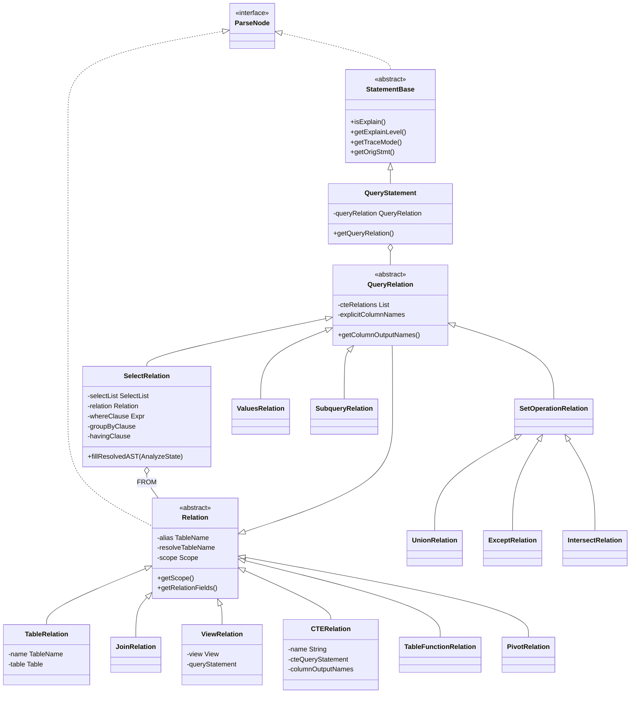

# FE 查询管线交接指南：从 SQL 文本到分布式计划

- Status: active
- Last Updated: 2026-11-05
- 适用项目：[Spark SQL 兼容](../README.md)（Spark dialect 解析器 / 函数适配层 / Spark 大小写策略）
- 读者：接手该项目的 FE 开发者

## 0. 阅读说明

本文只覆盖 FE（Java）里 **一条查询从 SQL 文本变成分布式执行计划** 的路径，目的是让接手的人知道“改哪里、从哪里下手、怎么验证”。设计层面的“为什么”请看 [01-architecture.md](../01-architecture.md) 及其后续文档，这里不重复。

必读的相邻文档（不在此复制其内容）：

- [`fe/AGENTS.md`](../../../../../fe/AGENTS.md)：构建命令、代码风格、Optimizer Rule Contract、FE 配置/指标规范、PR 清单。
- [`handbook/domains/frontend.md`](../../../../domains/frontend.md)：FE 命令与护栏（`run-fe-ut.sh`、可观测性触点）。
- 本项目设计文档：[01-architecture](../01-architecture.md)、[02-spark-dialect-parser](../02-spark-dialect-parser.md)、[03-function-adapter](../03-function-adapter.md)、[04-case-sensitivity](../04-case-sensitivity.md)。

约定：

- 路径以 `fe-core/...` 开头的都是相对 `fe/` 目录；省略的包前缀统一为 `fe-core/src/main/java/com/starrocks/`，下文简写为 `SR:`。例如 `SR:sql/StatementPlanner.java` 即 `fe/fe-core/src/main/java/com/starrocks/sql/StatementPlanner.java`。
- **行号取自 2026-11-05 的当前检出，会漂移**。引用形式是“类名.方法名 + 行号”，行号失效时请直接 grep 方法名。
- 标 **[未验证]** 的结论只来自读代码，没有在运行的 FE 上验证（本次调研未编译、未启动 FE）。
- EXPLAIN 样例取自仓库内测试资源（`fe/fe-core/src/test/resources/sql/...`），不是本次新跑的输出。

> 先看一个全局事实：**当前代码里还没有任何 Spark 方言代码**（对 `SparkAstBuilder|SparkParser|CaseSensitivityPolicy|sql_dialect=spark` 做过全仓 grep，无命中）。`sql_dialect` 目前只认 `trino`，见 2.2 节。

---

## 1. FE Gradle 模块布局

### 1.1 模块与依赖方向

`fe/settings.gradle.kts` 登记的模块：`fe-grammar`、`fe-type`、`fe-parser`、`fe-spi`、`fe-utils`、`fe-testing`、`plugin:spark-dpp`、`plugin:hive-udf`、`fe-core`、`fe-server`。同时保留 Maven（`fe/pom.xml` 的 `<module>` 列表与之相同），两套构建并行；见 `fe/README-gradle.md`。



依据（均来自各模块 `build.gradle.kts`）：

| 模块 | 依赖的内部模块 | 说明 |
|---|---|---|
| `fe-grammar` | 无 | 只有 ANTLR 插件；`generateGrammarSource` 以 `-visitor -package com.starrocks.sql.parser` 生成 `StarRocksLexer/StarRocksParser/StarRocksBaseVisitor`；ANTLR 版本 `4.9.3`（根 `build.gradle.kts` 的 `antlr.version`）。 |
| `fe-type` | 无 | `com.starrocks.type.*`：`Type`、`ScalarType`、`ArrayType`、`MapType`、`StructType`、`DecimalType`、`DateType`、`IntegerType`、`VarcharType` 等。 |
| `fe-parser` | `fe-grammar`、`fe-type` | `ParseNode`、`StatementBase`、`AstVisitor`（`fe-parser/.../sql/ast/`），`Expr` 及大部分表达式节点（`.../sql/ast/expression/`），`ParsingException`、`NodePosition`。 |
| `fe-spi` | 无 | `authentication`、`catalog`、`connector` 等包的 SPI。 |
| `fe-utils` | 无 | 通用工具。 |
| `fe-testing` | 无 | 实际内容只有 `com.starrocks.common.jmockit.*`（反射工具），**并不含** `PlanTestBase/UtFrameUtils/StarRocksAssert`，见 1.3。 |
| `fe-core` | 以上全部 + `plugin:hive-udf` + `plugin:spark-dpp` | 查询管线的主体都在这里；还依赖 `io.trino:trino-parser:385`（Trino 方言用）。 |
| `fe-server` | `fe-core` | 启动入口 `fe-server/src/main/java/com/starrocks/StarRocksFE.java`。 |

### 1.2 “connector”与“plugin”实际在哪

- `fe/connector/` **只有一个 README**，不是 Gradle 模块（不在 `settings.gradle.kts`）。内置 connector 实现在 `SR:connector/`（Hive/Iceberg/Paimon/…），元数据入口是 `MetadataMgr`。
- `fe/plugin/` 下有 `hive-udf`（Hive UDF 适配的 Java 侧基础，**与 03 文档的 L4 层相关**）与 `spark-dpp`（Spark 做导入预处理，和 Spark SQL 兼容无关，别混淆）。
- Trino 方言在 `SR:connector/parser/trino/`（`TrinoParserUtils`、`AstBuilder`、`Trino2SRFunctionCallTransformer`、`ComplexFunctionCallTransformer`…）。这是 Spark 方言最直接的模板。

### 1.3 对 Spark 项目的含义（以及与 AGENTS.md 的出入）

`fe/AGENTS.md` 的“Adding New SQL Syntax”写“在 `fe-parser` 加 AST、更新 parser visitor”。**按当前代码需要修正理解**：

1. `AstBuilder`（ANTLR 树 → AST 的 visitor）和 `SqlParser` 在 **fe-core**：`SR:sql/parser/AstBuilder.java`（约 1 万行）、`SR:sql/parser/SqlParser.java`。fe-parser 里的 `com.starrocks.sql.parser` 只有错误/位置类。
2. AST 被拆在两个模块、**同一个包名** `com.starrocks.sql.ast[.expression]`：
   - fe-parser：`Expr`、`LiteralExpr`、`Predicate`、`BinaryPredicate`、`CastExpr`、`ArithmeticExpr`、`CaseExpr`、`InPredicate`、`CollectionElementExpr`、`LambdaFunctionExpr`、`TimestampArithmeticExpr` 等 + 大量 `StatementBase` 子类（329 个文件）。
   - fe-core：`FunctionCallExpr`、`SlotRef`、`Subquery`、`AnalyticExpr`、`ExistsPredicate`、`DecimalLiteral`，以及全部 **Relation**（`Relation/QueryRelation/SelectRelation/TableRelation/JoinRelation/ViewRelation/CTERelation/...`）和 `QueryStatement`（110 个文件）。
   - 原则：依赖 catalog/function 等 fe-core 类型的节点（`FunctionCallExpr` 需要 `Function`、`SlotRef` 需要 `SlotDescriptor`）留在 fe-core。新增节点时如果不依赖 fe-core 类型可放 fe-parser，否则放 fe-core。
3. 语法文件路径是 `fe-grammar/src/main/antlr/com/starrocks/grammar/StarRocks.g4`（AGENTS.md 的 Key Files 表写的是 `fe-grammar/StarRocks.g4`）。
4. `PlanTestBase`、`UtFrameUtils`、`StarRocksAssert` 在 `fe-core/src/test/java/...`（见第 6 节），AGENTS.md 的 “Location: fe/fe-testing/...” 不准确。
5. AGENTS.md 强调 “AST 解析后不可变”。现实是 Analyzer 就地修改 AST（`FunctionCallExpr.resetFnName`、`Expr.setType/setFn`、`SelectRelation.setRelation`、`fillResolvedAST` 等）。新代码应尽量遵守“不新增 setter”的方向，但改写 Spark 函数时**不要期待 AST 在 Analyzer 阶段是只读的**。
6. 同样请记住 AGENTS.md 示例中的表 `t0 (c1)` 与 `PlanTestBase` 实际建的 `t0(v1,v2,v3)` 不一致，写测试以 `PlanTestBase` 为准。

---

## 2. 查询生命周期

### 2.1 总览表

| # | 阶段 | 入口类.方法（行号） | 输入 → 输出 |
|---|---|---|---|
| 1 | 协议层 | `SR:qe/ConnectProcessor.handleQuery`（718）→ `parseStatements`（558 附近，调用 `SqlParser.parse(originStmt, ctx.getSessionVariable())`） | MySQL COM_QUERY 报文 → SQL 字符串 |
| 2 | 解析 | `SR:sql/parser/SqlParser.parse(String, SessionVariable)`（80） | SQL → `List<StatementBase>` |
| 3 | 语法树转 AST | `SR:sql/parser/AstBuilder`：`visitSingleStatement`（691）、`visitQuerySpecification`（6381）、`visitSimpleFunctionCall`（8313）、`visitColumnReference`（9199） | ANTLR ParseTree → `QueryStatement`/`Expr`/`Relation` |
| 4 | 执行入口 | `SR:qe/ConnectProcessor.executeStmtWithAudit`（~645）→ `new StmtExecutor(ctx, stmt).execute()`（`StmtExecutor.execute` 967） | AST → 执行 |
| 5 | 语义分析 | `SR:sql/StatementPlanner.plan`（117/127）→ `analyzeStatement`（254）→ `Analyzer.analyze`（`SR:sql/analyzer/Analyzer.java` 201）→ `visitQueryStatement`（501）→ `new QueryAnalyzer(session).analyze(stmt)` | AST（未解析）→ AST（已填充 type/fn/scope） |
| 6 | 鉴权 | `StatementPlanner.plan` 内 `Authorizer.check(stmt, session)` | — |
| 7 | 逻辑计划 | `StatementPlanner.createQueryPlan`（643）→ `RelationTransformer.transformWithSelectLimit`（`SR:sql/optimizer/transformer/RelationTransformer.java` 205）+ `SqlToScalarOperatorTranslator.translate`（`.../SqlToScalarOperatorTranslator.java` 166/181） | Relation/Expr → `LogicalPlan`（`OptExpression` 树 + `ScalarOperator`） |
| 8 | 优化 | `OptimizerFactory.create`（`SR:sql/optimizer/OptimizerFactory.java` 57）→ `QueryOptimizer.optimize`（`QueryOptimizer.java` 204）→ `optimizeByCost`（258） | 逻辑 `OptExpression` → 物理 `OptExpression` |
| 9 | 物理计划→Fragment | `PlanFragmentBuilder.createPhysicalPlan`（`SR:sql/plan/PlanFragmentBuilder.java` 289），内部类 `PhysicalPlanTranslator`（480） | 物理 `OptExpression` → `ExecPlan`（`PlanFragment` + `PlanNode` + `Expr`） |
| 10 | 调度 | `StmtExecutor.handleQueryStmt`（2073）→ `DefaultCoordinator`（`SR:qe/DefaultCoordinator.java`：`startScheduling` 629，`prepareExec` 513，`deliverExecFragments` 757） | `ExecPlan` → 各 BE 实例 |
| 11 | 下发 | `SR:qe/scheduler/Deployer.deployFragments`（166）→ BRPC `exec_plan_fragment / exec_batch_plan_fragments`（`gensrc/proto/internal_service.proto` 795/796），载荷 `TExecPlanFragmentParams`（`gensrc/thrift/InternalService.thrift` 546） | Thrift → BE |

补充：

- 通过 `PrepareStmt/ExecuteStmt`（预编译）走 `PrepareStmtPlanner.plan`，普通 `SHOW` 先 `Analyzer.analyze` 再 `ShowStmtToSelectStmtConverter` 转成查询（`StmtExecutor` 855–910）。
- `EXPLAIN` 与 `TRACE` 都只是 `StatementBase` 上的标记（`setIsExplain/setIsTrace`，见 `AstBuilder` 2553–2563、2651），走同一条规划路径，只在 `StmtExecutor.handleQueryStmt`/`handleExplainExecPlan` 里提前返回文本。
- 在 `StatementPlanner.plan` 内，分析阶段持有库/表元数据锁（`PlannerMetaLocker`），分析完成后再取“规划快照”并释放锁——对 Spark 项目的含义：**所有名字解析（含大小写回退）发生在持锁的 Analyzer 阶段，别在后续阶段再去查元数据**。

### 2.2 方言开关：Trino 先例（Spark 方言要改的第一个点）

`SqlParser.parse(String, SessionVariable)`（80–90）现在是一个硬编码的 `if`：

```java
if (sessionVariable.getSqlDialect().equalsIgnoreCase("trino")) {
    return parseWithTrinoDialect(sql, sessionVariable);
} else {
    return parseWithStarRocksDialect(sql, sessionVariable);
}
```

Trino 路径（`parseWithTrinoDialect` 约 93–140）做了四件值得照抄的事：

1. 用 `StatementSplitter` 切分多语句，对每条调用 `TrinoParserUtils.toStatement`（`SR:connector/parser/trino/TrinoParserUtils.java` 41）；仅支持 `Query/Explain/ExplainAnalyze/CreateTableAsSelect/Insert/DropTable`，其余抛 `TrinoParserUnsupportedException`。
2. 成功后 `ConnectContext.get().setRelationAliasCaseInSensitive(true)`（`ConnectContext.java` 1403；字段 249）——**这是现有的“方言→大小写策略”钩子**，被 `Field.matchesPrefix`（`SR:sql/analyzer/Field.java` 218）读取，只影响“表别名前缀”匹配。
3. 失败回落：`rollbackStarRocksDialect` 先把标志复位为 false，再根据 `enable_dialect_downgrade`（`SessionVariable` 1030，默认 true）决定回落 StarRocks 解析器或抛异常。
4. 异常分类：`ParsingException`（AST 构造时内部错）、`io.trino.sql.parser.ParsingException`（语法不对）、`TrinoParserUnsupportedException`（语法对但不支持）、`UnsupportedException`（两边都不支持，直接抛）。

`sql_dialect` 会话变量：`SessionVariable.SQL_DIALECT = "sql_dialect"`（1027），字段默认 `"StarRocks"`（3271–3272），`getSqlDialect()`（6073）。

两个容易踩的旁路：

- `SqlParser.parse(String, long sqlMode)`（210，已 `@Deprecated`）内部 `new SessionVariable()`，因此**永远是默认方言**。`View.getQueryStatement`（`SR:catalog/View.java` 109–113）、`MaterializedView` 刷新、测试辅助 `UtFrameUtils.parseStmtWithNewParser` 等都走这个重载。这符合设计原则 P6（持久化对象只存 StarRocks SQL）；不要“顺手”把这些调用点改成会话方言。
- `ConnectorView.getQueryStatement`（`SR:catalog/ConnectorView.java` 50–61、64–68）会按**当前会话方言**解析外部（Hive/Iceberg）视图的 `inlineViewDef`，并在结束后恢复 `sqlDialect`。这对 Spark 项目反而是机会：Hive 视图往往是 Spark/Hive 方言文本，但要想清楚失败回落（`rollback` 钩子，默认返回 null）。**[未验证]** 各具体 ConnectorView 子类（Hive/Iceberg）是否覆盖了 `rollback`。

### 2.3 详细时序图



### 2.4 各阶段要点

**解析（2、3）**

- `SqlParser.invokeParser`（`SqlParser.java` 337 附近）：`CaseInsensitiveStream` 把输入按大写给词法器（关键字大小写不敏感），所以 **关键字不敏感是词法层事实**；标识符的大小写仍保留原文（`AstBuilder.visitUnquotedIdentifier` 9297）。先用 SLL + `StarRocksBailErrorStrategy` 快速解析，失败再回退 LL（`StarRocksDefaultErrorStrategy` 报错）。`PostProcessListener` 限制 token 数和表达式子节点数。
- 函数名在 AstBuilder 里被小写（`visitSimpleFunctionCall` 8313：`functionName = ....toLowerCase()`），`FunctionName` 构造时也小写（`SR:catalog/FunctionName.java` 40/45）。→ **函数名大小写不敏感已经满足，Spark 无需额外处理**。
- 列引用在 `visitColumnReference` 生成 `SlotRef(QualifiedName)`，保留用户写的大小写。
- 表名：`AstBuilder.normalizeName`（10307）仅在 `GlobalVariable.enableTableNameCaseInsensitive`（集群级、不可逆）时小写。设计文档 04 已决定不复用该开关，新增会话级策略。
- `SqlParser` 的 AstBuilder 通过 `GlobalStateMgr.getSqlParser().astBuilderFactory`（`GlobalStateMgr.java` 912、1208；`AstBuilder.AstBuilderFactory` 676）创建，`create(sqlMode, caseInsensitive, hintMap)`——这是个可替换的缝，但工厂构造器是 `protected`，且 `getInstance()` 是单例。

**分析（5）**：详见第 4 节。

**逻辑计划（7）**

- `RelationTransformer` 是 `Relation` 的 visitor：`visitSelect`（312）、`visitTable`（616）、`visitJoin`（1010）、`visitView`（909，注意：**默认不内联视图以外的逻辑，视图在 Analyzer 时已展开为 `ViewRelation` 内含 `QueryStatement`**）、`visitCTE`（831）、`visitSubqueryRelation`（882）、`visitUnion/Except/Intersect`（320/325/330）、`visitValues`（531）。
- 产出 `LogicalPlan`：`getRoot()` 是 `OptExpression`（`SR:sql/optimizer/OptExpression.java` 41），`getOutputColumn()` 是 `ColumnRefOperator` 列表。每个列在 `ColumnRefFactory` 里有全局唯一 id——EXPLAIN 里 `1: v1` 的 `1` 就是这个 id。
- `SqlToScalarOperatorTranslator.translate`（181）把 `Expr` → `ScalarOperator`（内部 `Visitor` 291）。**注意 206 行**：翻译完立即用 `ScalarOperatorRewriter.DEFAULT_REWRITE_RULES` 跑一轮标量改写，其中第一条 `ImplicitCastRule` 是“必需”的——**函数实参的隐式 CAST 就是在这里插入的**（见 4.4）。

**优化（8）**：详见第 5 节。

**物理计划（9）**

- `PlanFragmentBuilder.PhysicalPlanTranslator`（480）是 `OptExpressionVisitor<PlanFragment, ExecPlan>`：`visitPhysicalOlapScan`（1092）、`visitPhysicalProject`（809）、`visitPhysicalDistribution`（3209，产生 `ExchangeNode`/fragment 切分）、`visitPhysicalHashJoin`（3465）…；`ScalarOperator` 通过 `ScalarOperatorToExpr.buildExecExpression` 变回 **执行期 `Expr`**（带 `Function`，最终序列化为 `TExprNode`，`gensrc/thrift/Exprs.thrift` 199）。
- 产物 `ExecPlan`（`SR:sql/plan/ExecPlan.java`）：`getFragments()`、`getScanNodes()`、`getDescTbl()`、`getOutputExprs()`、`getColNames()`（列名即 Analyzer 的 `getColumnOutputNames()`，在 `StatementPlanner.createQueryPlan` 647 取得）。`PlanFragment.toThrift()`（`SR:planner/PlanFragment.java` 487）→ `TPlanFragment`（`Planner.thrift` 74），`PlanNode` → `TPlanNode`（`PlanNodes.thrift` 1706）。

**调度与下发（10、11）**

- `StmtExecutor.handleQueryStmt` 在 2146 附近选择 `FeExecuteCoordinator`（可在 FE 内直接算的查询）或 `getCoordinatorFactory().createQueryScheduler(...)`（`DefaultCoordinator.Factory`，2054）。`Coordinator.execWithQueryDeployExecutor`（`SR:qe/scheduler/Coordinator.java` 105）→ `startScheduling`（`DefaultCoordinator` 629）。
- 实例分配/依赖：`CoordinatorPreprocessor`（`SR:qe/CoordinatorPreprocessor.java`）、`qe/scheduler/dag/ExecutionDAG`、`assignment/*`。Spark 项目一般不碰这一层。

---

## 3. AST / Expr 类图

### 3.1 Expr 层次（节选）



文件位置：`Expr/LiteralExpr/Predicate/BinaryPredicate/CastExpr/ArithmeticExpr/CaseExpr/InPredicate/CompoundPredicate/CollectionElementExpr/LambdaFunctionExpr/TimestampArithmeticExpr` 在 `fe-parser/.../sql/ast/expression/`；`FunctionCallExpr/SlotRef/Subquery/AnalyticExpr/ExistsPredicate/DecimalLiteral/GroupingFunctionCallExpr` 在 `SR:sql/ast/expression/`。类声明行：`Expr` 36、`FunctionCallExpr` 53、`SlotRef` 59、`Subquery` 49、`AnalyticExpr` 69。（`TreeNode`、`FieldReference` 的具体位置 **[未验证]**，类图仅示意继承关系。）

### 3.2 Relation / Statement 层次



类声明行：`Relation` 30、`QueryRelation` 29、`SelectRelation` 29、`TableRelation` 34、`JoinRelation` 23、`ViewRelation` 21、`CTERelation` 22、`QueryStatement` 35（都在 `SR:sql/ast/`）。`TableFunctionRelation` 与 `JoinRelation` 的继承关系（`NormalizedTableFunctionRelation` 在 `QueryAnalyzer.visitNormalizedTableFunction` 里直接 `visitJoin(node, scope)`，2095）暗示后者是 `JoinRelation` 子类，具体父类 **[未验证]**。

### 3.3 访问者基础设施

- `AstVisitor<R,C>`（`fe-parser/.../sql/ast/AstVisitor.java` 89）：每种节点一个 `default visitXxx`，默认委托到 `visitExpression`（1247）/`visitNode`。`AstVisitorExtendInterface`（`SR:sql/ast/AstVisitorExtendInterface.java` 55）在 fe-core 里扩展出依赖 fe-core 节点的方法（`visitSlot`、`visitFunctionCall`、`visitTable`…）。
- 每个节点实现 `accept(AstVisitor, C)`，调用对应 `visitXxx`。
- 同一批 visitor 方法在多处各有一份实现，新增节点要全部补齐（见 6.1 的清单）：`ExpressionAnalyzer.Visitor`（分析）、`AST2StringVisitor`/`AST2SQLVisitor`（还原 SQL）、`ExprExplainVisitor`、`SqlToScalarOperatorTranslator.Visitor`（转 ScalarOperator）、`AggregationAnalyzer`、`ExprToThrift`（`SR:planner/expression/`）。

---

## 4. Analyzer 内部（与本项目最相关）

### 4.1 结构

- `Analyzer.analyze(StatementBase, ConnectContext)`（`SR:sql/analyzer/Analyzer.java` 201）→ `AnalyzerVisitor.visitQueryStatement`（501）→ `new QueryAnalyzer(session).analyze(stmt)`。其它语句有各自的 `XxxAnalyzer`（`ViewAnalyzer`、`MaterializedViewAnalyzer`、`InsertAnalyzer`…）。
- `QueryAnalyzer`（`SR:sql/analyzer/QueryAnalyzer.java` 149）内部类 `Visitor`（438）按 Relation 类型递归，返回 **`Scope`**：
  - `visitQueryRelation`（488）：先 `analyzeCTE`（493）建 CTE scope，再处理查询体。
  - `visitSelect`（640）→ `analyzeSelectRelation`（649）：`resolveTableRef`（FROM 里的 CTE/View/Table 解析）→ `process(from)` 得 `sourceScope` → `RewriteAliasVisitor` → `new SelectAnalyzer(session).analyze(...)`。
  - `visitTable`（1025）、`visitView`（1683）、`visitCTE`（1194）、`visitJoin`（1216）、`visitSubqueryRelation`（1613）、`visitUnion/Except/Intersect`（1765/1770/1778）、`visitValues`（1840）、`visitTableFunction`（1993）、`visitPivotRelation`（1882）。
- `SelectAnalyzer`（`SR:sql/analyzer/SelectAnalyzer.java`）`analyze`（78）依次：`analyzeWhere` → `analyzeSelect`（232，**决定输出列/列名**）→ `analyzeGroupBy`（626）→ `analyzeHaving`（787）→ `computeAndAssignOrderScope`（1001）→ `analyzeOrderBy`（461）→ `analyzeAggregations`（605）→ `analyzeWindowFunctions`（532）→ `analyzeLimit`（808）。表达式统一经 `analyzeExpression`（1032）→ `ExpressionAnalyzer.analyzeExpression`。
- `AnalyzeState`（`AnalyzeState.java` 38）是一个 query block 的累积结果，最后由 `SelectRelation.fillResolvedAST`（131）写回 AST。

### 4.2 名称解析

**数据结构**

- `Field`（`SR:sql/analyzer/Field.java`）：一列的元信息——`name`、`type`、`relationAlias`（`TableName`，限定名）、`originExpression`、`visible`、`isNullable`。
- `RelationFields`（`RelationFields.java` 30）：一个 relation 的 `Field` 列表 + 一个 **以 `name.toLowerCase()` 为 key 的 Multimap**（构造器 52–53：“sort fields by name to speedup resolve performance”）。含 struct 类型字段时不建 map（`resolveStruct`），走全量 `canResolve`。
- `Scope`（`Scope.java`）：`RelationFields` + `parent` + `cteQueries`（`LinkedHashMap<String, CTERelation>`，**大小写敏感的 key**，39）+ lambda 参数。

**解析流程（列引用）**

1. `ExpressionAnalyzer.Visitor.visitSlot`（`ExpressionAnalyzer.java` 518）调 `scope.resolveField(node)`。
2. `Scope.resolveField`（`Scope.java` 94/102）→ `relationFields.resolveFields(slotRef)`：
   - `RelationFields.resolveFields`（92）：先按 **小写列名** 取候选；无限定名时直接返回候选（`FULL OUTER JOIN USING` 有特殊处理，103–106）；有限定名时再对候选做 `Field.canResolve`。
   - 候选 > 1 抛 `Column '%s' is ambiguous`；==1 返回 `ResolvedField`；==0 时若有 `parent` 且不是外层关联边界则递归到父 scope（相关子查询只支持上溯一层，注释在 112）。
3. `Field.canResolve`（113）：有限定名要求 `relationAlias != null && matchesPrefix(...) && 列名equalsIgnoreCase`；无限定名只比列名 `equalsIgnoreCase`。**结论：列名匹配本来就是大小写不敏感的**（与 Spark 默认一致）。
4. `Field.matchesPrefix`（218）：catalog/db 部分用 `equals`（敏感），表别名部分取决于 `ConnectContext.isRelationAliasCaseInsensitive()`（这是 Trino 方言开的开关）。struct 路径匹配 `tryToMatch`（167–211）里表名受 `GlobalVariable.enableTableNameCaseInsensitive` 控制，其它段小写比较。
5. 命中后 `visitSlot` 回填 `type`、`tblName`、`nullable`；**非 struct 类型不会重置 `SlotRef.colName`**（struct 才 `setColumnName/setLabel`，527–533）。

**同类机制的其它入口（Spark 大小写策略要一并看）**

| 对象 | 解析位置 | 大小写现状 |
|---|---|---|
| 库/表 | `QueryAnalyzer.resolveTable`（2799）→ `TableName.normalization`（`SR:catalog/TableName.java` 126，调 `Util.normalizeName` 即 `GlobalVariable.enableTableNameCaseInsensitive`）→ `MetadataMgr.getDb/getTable` | 敏感，除非集群开关 |
| CTE 名 | `Scope.getCteQueries`（134）；`QueryAnalyzer.resolveTableRef`（822）仅当 `tableName.getDb()` 为空才查 CTE | `HashMap` key，**敏感** |
| 表别名 | `Field.matchesPrefix` | 方言开关 `relationAliasCaseInsensitive` |
| 列名 | `RelationFields.resolveFields` / `Field.canResolve` | 不敏感 |
| SELECT 别名在 GROUP BY/ORDER BY/HAVING 里的引用 | `SelectAnalyzer.RewriteAliasVisitor`（844）、`rewriteGroupByAlias`（776）、`analyzeOrderBy`（461） | **[未验证]** 比较时是否忽略大小写 |
| `SELECT * EXCLUDE` / `USING` 列 | `SelectAnalyzer` 272–289、1151–1172 | 小写比较 |
| 函数名 | AstBuilder 小写 + `FunctionName` 小写 | 不敏感 |

> 动手前建议用 `grep -rn "equalsIgnoreCase\|toLowerCase" fe-core/src/main/java/com/starrocks/sql/analyzer` 全量盘点一遍，作为 04 文档“Spark policy 触点清单”的基础。本次只盘点了上表中的点。

### 4.3 输出列名如何确定

`SelectAnalyzer.analyzeSelect`（232–340）逐个 `SelectListItem`：

- `SELECT *` / `t.*`：对 `scope.getRelationFields()` 的字段（过滤 `isVisible`、内部分区列）逐个生成 `FieldReference`，**输出 Field 直接复用源 Field**（`outputFields.addAll(fields)`，约 326），所以名字是 **元数据里的列名大小写**。
- 带别名：`name = item.getAlias()`（来自 `visitSelectSingle` 6492：用户写的标识符原样，或字符串字面量）。
- 无别名的 `SlotRef`：`name = ((SlotRef) expr).getColumnName()`（约 313）——这是 **解析时记录的用户输入文本**，且 `visitSlot` 不会为非 struct 类型改写（见 4.2 第 5 点）。按代码读推断：`SELECT ID FROM t`（表列为 `id`）输出名是 `ID`。**[未验证，需 UT 确认]**。
- 无别名的其它表达式：`AstToStringBuilder.getAliasName(expr, false, false)`（`SR:sql/analyzer/AstToStringBuilder.java` 80）= 用 `AST2StringVisitor`（`FormatOptions.allEnable()`）把表达式 **重新打印** 为 SQL 文本。因此函数名会以 **小写、StarRocks 规范形式** 出现，如 `sum(v1)`，并且经过 Analyzer 改写后的表达式（比如 Spark 函数被改写成 StarRocks 函数）会以改写后的文本出现。**这是 Spark 的“`select Upper(a)` 列名应为 `upper(a)`/原文”需求要处理的地方**。
- 最终列名链路：`Scope(outputScope).getRelationFields()` → `QueryRelation.getColumnOutputNames()`（`QueryRelation.java` 44，若有 `explicitColumnNames` 优先，如 CTE/视图的列别名列表）→ `StatementPlanner.createQueryPlan`（647）取 `colNames` → `ExecPlan.getColNames()` → 结果集元数据。

### 4.4 函数解析与隐式转换

**函数解析**（`ExpressionAnalyzer.Visitor.visitFunctionCall`，1053）

```
visitFunctionCall(node, scope)
  ├─ 特判改写：date_part(unit, x) -> year(x)/month(x)/...（1062-1127，用 node.resetFnName + clearChildren + addChild + 递归 visit）
  ├─ handleBackwardCompatibleParameterConversion（1256）
  ├─ checkFunction（1285）：按函数名的参数个数/类型的专有校验
  ├─ 命名参数分支（1141-1180）：FunctionAnalyzer.getAnalyzedFunctionForNamedArgs / reorderNamedArgAndAppendDefaults
  └─ 位置参数：fn = FunctionAnalyzer.getAnalyzedFunction(session, node, argumentTypes)（1186）
        -> node.setFn(fn); node.setType(fn.getReturnType()); FunctionAnalyzer.analyze(node)（1219-1222）
```

- 这个“`date_part` → 具体函数”的就地改写是 **Spark 类型感知改写（设计文档 L2b）的现成范式**，见 6.2。
- `FunctionAnalyzer.getAnalyzedFunction`（`SR:sql/analyzer/FunctionAnalyzer.java` 886）→ `getAnalyzedFunctionImpl`（私有，查找顺序）：
  1. `getAdjustedAnalyzedFunction`（对已知特殊函数的变体调整）；
  2. `getAdjustedAnalyzedAggregateFunction`（聚合函数规范化，如 count distinct、decimal 聚合）；
  3. `SPMFunctions.getSPMFunction`；
  4. `getAnalyzedBuiltInFunction`（1653）：decimal 参数走 `DecimalV3FunctionAnalyzer.getDecimalV3Function`，其余走 `ExprUtils.getBuiltinFunction(name, argTypes, CompareMode.IS_NONSTRICT_SUPERTYPE_OF)`（`SR:sql/ast/expression/ExprUtils.java` 442）→ `GlobalStateMgr.getFunction` → `FunctionSet.getFunction`（`SR:catalog/FunctionSet.java` 1235）；
  5. UDF：`AnalyzerUtils.getUdfFunction`（库内/全局 UDF）；
  6. `ScalarOperatorEvaluator.INSTANCE.getMetaFunction`。
  找到后再校验“实参类型能否转到形参”（919–937：`matchesType || TypeManager.canCastTo`），不满足抛 `No matching function with signature: ...`。
- **内置函数表是生成的**：`FunctionSet.init()`（1070）里 `VectorizedBuiltinFunctions.initBuiltins(this)`，该类由 `gensrc/script/gen_functions.py` 依据 `gensrc/script/functions.py` 生成（`gen_functions.py` 127、639）。新增 BE 内置函数（03 文档 L3）要改 `functions.py` + BE 实现，不是手写 Java 注册。

**隐式转换在哪里插入**（分两处，别搞混）

1. **Analyzer 阶段、针对特定节点**：二元谓词/算术/IN/CASE/数组字面量等在 `ExpressionAnalyzer` 里用 `TypeManager.getCompatibleTypeForBinary`（`SR:sql/common/TypeManager.java` 273）、`getCompatibleTypeForBetweenAndIn`（174）、`getCompatibleTypeForCaseWhen`（360）、`getCommonSuperType`（62/88）算出公共类型，再 `ExprCastFunction.castChild(node, targetType, idx)` 或 `TypeManager.addCastExpr`（158）直接包 `CastExpr`。例：`visitArrayExpr`（562/599）、`visitCollectionElementExpr` 的下标转 INT（645）。
2. **ScalarOperator 阶段、针对函数调用**：函数实参到形参的 CAST 由 `ImplicitCastRule.visitCall`（`SR:sql/optimizer/rewrite/scalar/ImplicitCastRule.java` 79 起）在 `ScalarOperatorRewriter.DEFAULT_REWRITE_RULES` 里插入——它遍历 `fn.getArgs()`，类型不匹配就 `addCastChild`。因此 **在 `EXPLAIN` 里看到的函数参数 `cast(x as ...)` 多数来自这条规则，而不是 Analyzer**。后续 `ReduceCastRule`（TopDown）会合并/消除冗余 CAST。

**类型规则（coercion）放哪里**

| 关注点 | 位置 |
|---|---|
| 类型定义 | `fe-type/src/main/java/com/starrocks/type/*`（`Type`、`ScalarType`、`DecimalType`…） |
| 可否转换 / 公共超类型 / 赋值兼容 | `SR:sql/common/TypeManager.java`：`canCastTo`（395）、`getAssignmentCompatibleType`（516/652）、`isImplicitlyCastable`（732/782）、`getCommonType`（523/538）、decimal：`getCommonTypeForDecimalV3`（748）、`getAssigmentCompatibleTypeOfDecimalV3`（561）。类注释说明“逐步把分散的类型管理收敛到此类”（58）。 |
| 函数匹配的候选兼容性 | `Function.CompareMode`（`SR:catalog/Function.java`）；`FunctionSet.getFunction(desc, mode)` |
| Decimal 运算/函数特殊规则 | `DecimalV3FunctionAnalyzer`（`rewriteDecimalOperation` 在 `ExpressionAnalyzer` 2124 被调用） |
| 字符串↔数值/日期转换的运行时语义 | 在 BE（`be/src/exprs/cast_expr*`），FE 常量折叠用 `ScalarOperatorFunctions`/`ScalarOperatorEvaluator`（`SR:sql/optimizer/rewrite/`） |

Spark 的 ANSI 与 legacy cast 规则（05 文档）应该通过会话变量门控这些方法的行为，而不是新建第二套类型系统。**[未验证]** `TypeManager` 里是否已有可复用的会话参数入口。

### 4.5 CTE 与视图展开

**CTE**

1. `AstBuilder` 把 `WITH` 子句解析成 `QueryRelation.cteRelations`（`CTERelation` 列表，内含 `cteQueryStatement`）。
2. `QueryAnalyzer.Visitor.analyzeCTE`（493）：新建 `cteScope`，以 `parent = 外层 scope`；检查重名（`ERR_NONUNIQ_TABLE`）；逐个 `processCteRelation`（递归 CTE 先走 `tryProcessRecursiveCte`）。结果 `cteScope.addCteQueries(name, cteRelation)`。
3. FROM 中的 `TableRelation` 在 `resolveTableRef`（779，CTE 分支约 820–875）里先查 `scope.getCteQueries(tbl)`：命中则 **复制一个新的 `CTERelation`**（新 `RelationId`，保证同一 CTE 多次引用的字段互不相同），字段 `relationAlias` 设为引用处的别名（`getResolveTableName`），再由 `visitCTE`（1194）得到 `Scope`。注意：CTE 名只在 **未带 db 限定** 时才会匹配。
4. 优化期 CTE 是否内联/复用由 `CTEContext`、`RuleSet.INLINE_CTE_RULES / COLLECT_CTE_RULES`、会话变量 `cbo_cte_reuse*` 决定（`QueryOptimizer.logicalRuleRewrite` 562 起的 `while (cteContext.hasInlineCTE())`）。Spark 项目一般不需要碰。

**视图**

1. `resolveTableRef` 解析到 `View`（910）：`view.getQueryStatement()`（`View.java` 109：**用保存的 `inlineViewDef` 字符串重新 `SqlParser.parse(inlineViewDef, sqlMode)`**，默认方言）→ 包成 `ViewRelation(tableName, view, queryStatement)`。`ConnectorView`（外部视图）走另一分支（924 起），用会话方言解析（见 2.2）。
2. `visitView`（1683）：循环依赖检测（`viewExpansionStack`，抛 `CyclicViewException`）→ 递归 `process(node.getQueryStatement(), scope)` 分析视图体 → 以 **视图的 schema 列名**（`view.getBaseSchema()`）和视图体输出 Field 的类型组合成新的 `Field`，`relationAlias` = 视图引用名。所以 **视图对外暴露的列名是建视图时记录的列名，而不是视图体当前输出名**（注释 1722–1729）。
3. 另有行级/列级安全策略：`SecurityPolicyRewriteRule.buildView`（958），把策略改写成视图。
4. Hive 视图会临时把 `relationAliasCaseInsensitive` 置 true（1692–1713）——又一个“按对象类型临时切换大小写策略”的先例。

### 4.6 AstToSQLBuilder / AstToStringBuilder：视图与 MV 的 SQL 持久化

- `SR:sql/analyzer/AstToSQLBuilder.java`：
  - `toSQL(ParseNode)`（47）：`AST2SQLVisitor.withOptions(FormatOptions.allEnable().setColumnSimplifyTableName(false).setEnableDigest(false))`。
  - `buildSimple`（39）：同库同 catalog 时省略限定名。
  - `toSQLWithCredential`（53）、`toSQLOrDefault`（64）、`toDigest`（82，用于 SQL digest/黑名单）。
- 具体打印逻辑在 `SR:sql/formatter/AST2StringVisitor.java`（1905 行；`visitSelect` 596、`visitFunctionCall` 1380、`visitSlot` 1545、`visitTable` 772…）和 `AST2SQLVisitor`（子类，722 行，覆盖 `visitSelect` 141、`visitCTE` 275、`visitView` 378、`visitTable` 399、`visitSlot` 504）。`AstToStringBuilder`（`SR:sql/analyzer/AstToStringBuilder.java`）是 DDL/展示语句的另一个入口，并提供 `getAliasName`（80）。
- 使用点：
  - `ViewAnalyzer`：创建视图 `AstToSQLBuilder.toSQLWithCredential(stmt.getQueryStatement())`（94），`ALTER VIEW`（146）→ 存为 `View.inlineViewDef`；
  - `MaterializedViewAnalyzer`：`setInlineViewDef(AstToSQLBuilder.toSQL(queryStatement))`（416）与 `setSimpleViewDef`（417）；
  - 其它：`Load`、`LoadLoadingTask`、`FilePipeSource`、`DataCacheSelectStatement`、`MVPCTRefreshProcessor`、Authorization 等。
- **关键推论**：因为输出是对 **已分析的 AST** 的重新打印，并且读回时一律按默认方言解析，所以
  1. Analyzer 阶段把 Spark 函数改写成 StarRocks 函数后，持久化的 SQL 天然是 StarRocks 方言（原则 P6 成立，前提是改写发生在打印前）；
  2. 如果某个 Spark 特性只在“解析期”被翻译成一个 **没有对应 SQL 文本形式** 的 AST 节点属性（比如只在节点上放 flag，而 `AST2StringVisitor` 不打印），持久化后会静默丢失语义。新增节点/属性时必须同时改 `AST2StringVisitor`（6.1 清单）。
  3. 测试里 `AnalyzeTestUtil.analyzeSuccess`（`SR` 测试目录，403）与 `UtFrameUtils.buildPlan` 的 `testView`（852）都会做“toSQL → 再 parse → 再 analyze”的往返，可以免费覆盖 2 与 3。

### 4.7 本项目在 Analyzer 阶段的钩子点汇总

| 需求（设计文档） | 推荐钩子 | 位置 |
|---|---|---|
| 方言切换/回落 | `SqlParser.parse` 的 dialect 分派 | `SqlParser.java` 80 |
| Spark 函数名别名（L1）、模板改写（L2a） | 方言 AstBuilder 构造 `FunctionCallExpr` 时 | 参照 `Trino2SRFunctionCallTransformer.convert`（`connector/parser/trino/AstBuilder.java` 806） |
| 类型感知改写（L2b） | `ExpressionAnalyzer.Visitor.visitFunctionCall` 开头，在 `getAnalyzedFunction` 之前 | `ExpressionAnalyzer.java` 1062–1127 的 `date_part` 先例 |
| 函数语义（L3） | `gensrc/script/functions.py` + BE | `FunctionSet.init` 1070 |
| Hive UDF 桥（L4） | UDF 查找 `AnalyzerUtils.getUdfFunction` | `FunctionAnalyzer.getAnalyzedFunctionImpl` 第 5 步 |
| 大小写：表别名 | `Field.matchesPrefix` | `Field.java` 218 |
| 大小写：CTE 名 | `Scope.addCteQueries/getCteQueries` | `Scope.java` 130–148 |
| 大小写：库表名 | `TableName.normalization` / `QueryAnalyzer.resolveTable` | `TableName.java` 126；`QueryAnalyzer.java` 2799 |
| 输出列名 | `SelectAnalyzer.analyzeSelect` | `SelectAnalyzer.java` 232–340 |
| ANSI/类型规则 | `TypeManager`、`ExpressionAnalyzer` 各 visitor | 4.4 表 |
| 视图/MV 持久化 | `AST2StringVisitor` | 4.6 |

---

## 5. Optimizer 必知

### 5.1 总流程

入口 `QueryOptimizer.optimize`（`SR:sql/optimizer/QueryOptimizer.java` 204）：

1. `prepare`（190）：建 `Memo`（194）。
2. `prepareMvRewrite`（350）、`TextMatchBasedRewriteRule`（MV 文本匹配改写）。
3. `optimizeByCost`（258），其中：
   - `RuleBaseOptimize`（Tracers 作用域名，268）= `logicalRuleRewrite`（537）：基于 `scheduler.rewriteIterative / rewriteOnce / rewriteAtMostOnce` 的一长串 **逻辑改写**：子查询去关联（`PUSH_DOWN_SUBQUERY_RULES`、`SUBQUERY_REWRITE_TO_JOIN_RULES`…）、谓词下推（`PUSH_DOWN_PREDICATE_RULES`）、列裁剪（`PRUNE_COLUMNS_RULES`）、聚合改写（`AGGREGATE_REWRITE_RULES`）、分区裁剪（`PARTITION_PRUNE_RULES`）、limit 合并（`MERGE_LIMIT_RULES`）、常量消除、CTE 内联/复用、MV 改写（Stage1/2）等。
   - 统计：`Utils.calculateStatistics(tree, ctx)`（595、665、762 等）→ `StatisticsCalculator`（`SR:sql/optimizer/statistics/`）。
   - `CostBaseOptimize`（289）= `memoOptimize`（1001）：把树拷入 `Memo`（`Memo.java`、`Group`、`GroupExpression`），用任务 `OptimizeGroupTask → ExploreGroupTask → OptimizeExpressionTask → ApplyRuleTask → DeriveStatsTask → EnforceAndCostTask`（`SR:sql/optimizer/task/`，`TaskScheduler`）做探索（join 重排、聚合两阶段拆分等 `transformRules`）+ 实现（逻辑算子→物理算子，`implementRules`），`CostModel`（`.../cost/CostModel.java`）选最优。
   - `extractBestPlan`（1139）→ `PhysicalRuleRewrite`（1057，包括 `ScalarOperatorsReuseRule` 公共子表达式复用等 `rule/tree/*` 的树形改写）→ `DynamicRewrite`（1114）→ `PlanValidate`。
4. 工厂：`OptimizerFactory.create`（57）：`ShortCircuitOptimizer`（点查）/`SPMOptimizer`/`QueryOptimizer`。

规则分两类，**位置不同**：

- 树级改写规则：`rule/transformation/*Rule`（继承 `TransformationRule`）用于 RBO 迭代（`scheduler.rewriteXxx`）和 Memo 探索；`rule/tree/*`（`TreeRewriteRule`）用于整树后处理。
- 实现规则：`rule/implementation/*ImplementationRule`。

### 5.2 规则在哪里注册

- `SR:sql/optimizer/rule/RuleSet.java`：
  - `ALL_IMPLEMENT_RULES`（195）：逻辑→物理的实现规则表；
  - 一批静态 `CombinationRule` 常量，如 `MERGE_LIMIT_RULES`（243，其中 `new EliminateLimitZeroRule()` 在 245）、`PARTITION_PRUNE_RULES`（256）、`PRUNE_COLUMNS_RULES`（267）、`PUSH_DOWN_PREDICATE_RULES`（288）、`ELIMINATE_OP_WITH_CONSTANT_RULES`（433）……由 `QueryOptimizer.logicalRuleRewrite` 通过 `scheduler.rewriteIterative(tree, ctx, RuleSet.XXX)` 引用；
  - 构造函数（466 起）把 CBO 探索规则加入 `transformRules`（`SplitTwoPhaseAggRule`、`JoinCommutativityRule`、`JoinAssociativityRule`…）。
- `SR:sql/optimizer/rule/RuleType.java`：每条规则需要一个枚举值；命名前缀约定：`TF_`（Transformation）、`IMP_`（Implementation）、`GP_`（Group/CombinationRule）。
- 单独、不放入 `RuleSet` 的规则可以在 `logicalRuleRewrite` 里 `scheduler.rewriteOnce(tree, ctx, new XxxRule())` 直接调用（如 `new ExtractRangePredicateFromScalarApplyRule()`、`new ConvertToEqualForNullRule()`）。
- 契约（`fe/AGENTS.md`“Optimizer Rule Contract”）：`transform` **只有在真的改变了输入时才返回非空列表**，否则返回空列表，不要返回结构相同的新计划，否则 `RewriteTreeTask` 会认为发生了变化而继续迭代。

### 5.3 标量改写（ScalarOperator rewrite）

- 接口 `ScalarOperatorRewriteRule`（`SR:sql/optimizer/rewrite/scalar/`）：`isBottomUp/isTopDown/isOnlyOnce`、`apply(root, ctx)`。基类 `BaseScalarOperatorRewriteRule`（继承 `ScalarOperatorVisitor`，`visit()` 默认原样返回）；`TopDownScalarOperatorRewriteRule`、`BottomUpScalarOperatorRewriteRule`、`OnlyOnceScalarOperatorRewriteRule`。
- 驱动 `ScalarOperatorRewriter.rewrite(root, ruleList)`（`.../rewrite/ScalarOperatorRewriter.java` 101）：对每条规则循环直到不再变化；**“变化”的判定是 `rule.apply` 返回了与入参不同的对象引用**（`op != operator` → `context.change()`），所以没改就必须原样返回同一个对象；超过 `Config.max_planner_scalar_rewrite_num` 抛异常。
- 规则列表：`DEFAULT_REWRITE_RULES`（47：`ImplicitCastRule`、`ReduceCastRule`、`NormalizePredicateRule`、`FoldConstantsRule`、`SimplifiedPredicateRule`、`SimplifiedDateColumnPredicateRule`、`ExtractCommonPredicateRule`、`ArithmeticCommutativeRule`、`ConsolidateLikesRule`）、`DEFAULT_TYPE_CAST_RULE`（44，仅隐式转换）、`FOLD_CONSTANT_RULES`、`DEFAULT_REWRITE_SCAN_PREDICATE_RULES`（76）、`MV_SCALAR_REWRITE_RULES`（91）。
- 使用点：`SqlToScalarOperatorTranslator.translate`（206，**表达式翻译后立即一轮**）、`RelationTransformer`（1294 等）、`JoinPredicatePushdown`、`OptOlapPartitionPruner`、`Utils` 等。
- FE 常量折叠：`FoldConstantsRule` → `ScalarOperatorEvaluator`，函数实现用 `@ConstantFunction` 注解标在 `ScalarOperatorFunctions`（`.../rewrite/ScalarOperatorFunctions.java`）。给 Spark 新增/改写的函数若要在 FE 折叠，需要在此补一个同语义实现，否则只会在 BE 求值，不会错但无法常量传播。**[未验证]** 具体注解签名。

### 5.4 读 EXPLAIN

三种输出级别对应 `ExecPlan.getExplainString(TExplainLevel)`（`SR:sql/plan/ExecPlan.java` 338）：

| 语句 | TExplainLevel | 内容 |
|---|---|---|
| `EXPLAIN` | `NORMAL` | 每个 `PLAN FRAGMENT i` 下的算子树，只有结构、谓词、`partitions=`、`cardinality=` |
| `EXPLAIN VERBOSE` | `VERBOSE` | 加上每个算子的 tuple/slot 信息、输出列类型 `[1: v1, BIGINT, true]`、`FragmentId` |
| `EXPLAIN COSTS` | `COSTS` | 在 VERBOSE 基础上加 `cardinality`、`column statistics`（`ESTIMATE/UNKNOWN`） |
| `EXPLAIN LOGICAL` | — | 物理计划的逻辑树（`Explain.toString(physicalPlan, outputColumns)`，351–352） |
| `EXPLAIN ANALYZE` / `EXPLAIN SCHEDULER` | — | 先执行/先调度，再把运行时 profile/调度结果并入文本 |

语法：`explainDesc : (DESC | DESCRIBE | EXPLAIN) (LOGICAL | ANALYZE | VERBOSE | COSTS | SCHEDULER)?`（`StarRocks.g4` 3047）。

**NORMAL 样例**（TPC-H Q6，取自 `fe/fe-core/src/test/resources/sql/tpchcost/q6.sql`）：

```
PLAN FRAGMENT 0
OUTPUT EXPRS:19: sum              <- 最终输出列：<ColumnRef id>: <名字>
PARTITION: UNPARTITIONED
RESULT SINK
4:AGGREGATE (merge finalize)      <- 前缀数字是 PlanNodeId
|  output: sum(19: sum)
3:EXCHANGE
PLAN FRAGMENT 1                   <- Fragment 之间靠 EXCHANGE/STREAM DATA SINK 衔接
PARTITION: RANDOM
STREAM DATA SINK
EXCHANGE ID: 03
2:AGGREGATE (update serialize)
|  output: sum(6: L_EXTENDEDPRICE * 7: L_DISCOUNT)
1:Project
0:OlapScanNode
TABLE: lineitem
PREAGGREGATION: ON
PREDICATES: 11: L_SHIPDATE >= '1995-01-01', ...
partitions=1/1
tabletRatio=20/20
cardinality=8142251
```

阅读要点：

1. 先看 `OUTPUT EXPRS`：确认 **输出列名** 与上游一致（Spark 大小写需求的验证点）。注意 `19: sum` 的名字来自 Analyzer 的 Field 名，不是 BE 的。
2. 从下往上读（`OlapScanNode` 在最下，Fragment 编号大的在下游）；`id: name` 里的 id 是 `ColumnRefFactory` 编号，同一 id 在不同算子里是同一列。
3. 函数与 CAST 直接出现在表达式里：看 Spark 函数改写后真正调用的 StarRocks 函数及 `cast(... as ...)` 位置是否符合预期；字面量类型（`'1995-01-01'` 是 DATE 被打印成字符串，`24.0` 说明 `L_QUANTITY < 24` 的 24 被隐式转成 DOUBLE/DECIMAL）。
4. 谓词的位置：`PREDICATES:` 在 scan 上表示已下推；在 `SELECT`/`Project` 上表示没能下推。
5. `AGGREGATE (update serialize)` + `AGGREGATE (merge finalize)` 表示两阶段聚合；`EXCHANGE` 类型看 `distribution type`（`GATHER`/`SHUFFLE`/`BROADCAST`）。

**COSTS 样例片段**（`tpch-histogram-cost/q15.sql`，真实输出格式）：

```
PLAN FRAGMENT 0(F08)
Output Exprs:1: S_SUPPKEY | 2: S_NAME | ... | 27: sum
...
21:SORT
|  order by: [1, INT, false] ASC
|  cardinality: 1
|  column statistics:
|  * S_SUPPKEY-->[1.0, 1000000.0, 0.0, 4.0, 1.072527529100353] ESTIMATE
```

`列-->[min, max, nullsFraction, averageRowSize, ndv] 来源`，来源 `ESTIMATE` 为推算、`UNKNOWN` 表示缺统计。join 重排和 `cardinality` 异常（过小/过大）是 CBO 问题最先看的地方。

> 本地小库没有统计时，`cardinality` 会是默认值（接近 1 或固定数），不要据此判断优化器行为。**[未验证]** 空表/新建表的默认基数值。

### 5.5 调试手段

**Optimizer trace**（只对查询或 `REFRESH MATERIALIZED VIEW`）：

```sql
TRACE LOGS OPTIMIZER SELECT ...;     -- 优化器日志：每阶段的 OptExpression、被应用的规则
TRACE TIMES SELECT ...;               -- 各阶段耗时（Parser / Analyzer / Transformer / Optimizer / ExecPlanBuild ...）
TRACE VALUES SELECT ...;              -- 记录的变量/计数
TRACE ALL SELECT ...;
TRACE REASON MV SELECT ...;           -- MV 改写失败原因
```

- 语法 `optimizerTrace : TRACE (ALL | LOGS | TIMES | VALUES | REASON) identifier?`（`StarRocks.g4` 3051），`identifier` 是模块名，对应 `Tracers.Module`（`NONE, ALL, BASE, OPTIMIZER, SCHEDULER, CLIENT, ANALYZE, MV, EXTERNAL, PARSER`）；AstBuilder 缺省模块为 `base`（2559）。模式对应 `Tracers.Mode`（`NONE, LOGS, VARS, TIMER, TIMING, REASON`）。**[未验证]** `TIMES`→`TIMER`、`VALUES`→`VARS` 的映射靠 `AstBuilder.getTraceMode`（6241 起）和 `Tracers.getTraceMode`，请先用 `TRACE TIMES` 实测一次。
- 输出由 `StmtExecutor.buildExplainString`（3005）按模式拼接 `Tracers.printScopeTimer/printVars/printTiming/printLogs`。
- 代码中打日志用 `OptimizerTraceUtil.log/logOptExpression`（`SR:sql/optimizer/OptimizerTraceUtil.java` 30/39）和 `Tracers.log(Module.OPTIMIZER, ...)`、`Tracers.watchScope("...")`（`SR:common/profile/Tracers.java`）。`QueryOptimizer`、`StatementPlanner` 已有的 `Tracers.watchScope("Transformer"/"Optimizer"/"ExecPlanBuild")` 就是 `TRACE TIMES` 的来源。新增一个耗时点 = 加一行 `try (Timer t = Tracers.watchScope("YourStage")) {...}`。
- 单测里取 trace：`PlanTestNoneDBBase.getFragmentPlan(sql, traceModule)`（290）→ `UtFrameUtils.getFragmentPlanWithTrace`（762）。

**其它常用开关**（`SessionVariable`）：`disable_join_reorder`（519）、`cbo_enable_dp_join_reorder`（577）、`enable_plan_validation`（1094）、`optimizer_execute_timeout`；做对照实验时先固定 `sql_dialect`，再逐个关掉相关开关。

**日志/其它**：规划失败时 `StmtExecutor.generateExecPlan`（845）会按配置输出优化器耗时；FE 日志在 `fe/log/fe.log`；`ConnectContext.shouldDumpQuery()` / `QueryDumpInfo` 可导出重放用 dump（`test/resources/sql/dump`、`QueryDumpRegressionTest`）。

---

## 6. Recipes

### 6.1 新增一个 AST 节点（含 Analyzer 支持）

以“新增一种 Expr 节点”为例。**最佳参考：`CollectionElementExpr`**（`checkIsOutOfBounds` 就是 Trino 方言引入的方言相关属性）。它的所有触点（grep `visitCollectionElementExpr` 得到）就是新增节点的 checklist：

| # | 步骤 | 位置（以 CollectionElementExpr 为例） |
|---|---|---|
| 1 | 定义节点类：继承 `Expr`，在构造器里 `children.add(...)`，实现 `clone()`（拷贝构造）与 `accept()` | `fe-parser/.../sql/ast/expression/CollectionElementExpr.java`（accept 在 58）；依赖 fe-core 类型的节点放 `SR:sql/ast/expression/` |
| 2 | 在 `AstVisitor` 增加 `default R visitXxx(Xxx node, C ctx) { return visitExpression(node, ctx); }` | `fe-parser/.../AstVisitor.java` 1307 |
| 3 | 语法：必要时改 `StarRocks.g4`（Spark 方言则放在独立 g4，见设计文档 02）；`AstBuilder` 加 `visitXxx` 构造节点（并带上 `createPos(context)` 位置信息，错误信息会用到） | `AstBuilder.java` |
| 4 | Analyzer：在 `ExpressionAnalyzer.Visitor` 覆盖 `visitXxx`：校验子表达式类型、必要时 `ExprCastFunction.castChild`、**最后一定 `node.setType(...)`** | `ExpressionAnalyzer.java` 636 |
| 5 | 聚合校验：`AggregationAnalyzer` 对 GROUP BY 场景的合法性 | `AggregationAnalyzer.java` 197 |
| 6 | 还原 SQL：`AST2StringVisitor.visitXxx`（影响列名、视图/MV 持久化、digest） | `AST2StringVisitor.java` 1269；`ExprExplainVisitor.java` 376 |
| 7 | 转 ScalarOperator：`SqlToScalarOperatorTranslator.Visitor.visitXxx`（需要对应的 `ScalarOperator` 子类 + `ScalarOperatorVisitor.visitXxx`） | `SqlToScalarOperatorTranslator.java` 406；`optimizer/operator/scalar/CollectionElementOperator.java` |
| 8 | 转执行期 Expr 与 Thrift：`ScalarOperatorToExpr`（`SR:sql/plan/ScalarOperatorToExpr.java`，**[未验证]** 路径）、`ExprToThrift.visitXxx`（需要 `Exprs.thrift` 新节点类型和 BE 实现时，是跨 FE/BE 的改动） | `SR:planner/expression/ExprToThrift.java` 364 |
| 9 | 测试：见 6.4；务必包含 `CREATE VIEW` 往返（`AnalyzeTestUtil.analyzeSuccess` 已包含） | — |

如果新节点 **只是语法糖**（能在 AstBuilder 或 Analyzer 里被改写为现有节点），强烈建议不新增节点，直接生成现有节点（`FunctionCallExpr`、`CaseExpr`、`CastExpr`），这样 5–8 步全部免做。Spark 方言绝大多数构造都应走这条路。

**新增语句（StatementBase）** 的触点另有：`Analyzer.AnalyzerVisitor.visitXxx`、`StmtExecutor`/`DDLStmtExecutor` 的执行分支、`Authorizer`；这超出本文范围，参考 `fe/AGENTS.md` 的 “Adding New SQL Syntax”。

### 6.2 在 ExpressionAnalyzer 里做标量改写（类型感知函数改写）

场景：Spark 的 `size(x)`，参数是 array 还是 map 取决于类型（设计文档 P4/L2b），解析期不知道类型，只能在分析期改写。

**先看先例**：`ExpressionAnalyzer.Visitor.visitFunctionCall` 1062–1127 的 `date_part`：

```java
if (fnName.equalsIgnoreCase("date_part")) {
    ... 校验参数个数/第一个参数是字符串字面量 ...
    // 选择 targetFunction（year/quarter/month/...）
    node.resetFnName("", targetFunction);   // 改函数名
    node.clearChildren();                   // 重置参数
    node.addChild(dateExpr);
    return visitFunctionCall(node, scope);  // 递归，按新名字走正常的函数解析
}
```

要点（此时 `bottomUpAnalyze` 已先分析完所有子表达式，**子节点的 `getType()` 可用**，这就是在此处改写能“类型感知”的原因）：

1. 在 `visitFunctionCall` 里、`handleBackwardCompatibleParameterConversion` 之前加一个分支（建议只加一行委托，逻辑放到独立类，如 `SparkFunctionRewriter.rewrite(node, session)`，返回是否已改写，以降低对 1 万行文件的侵入）。
2. **方言门控**：`session.getSessionVariable().getSqlDialect()`（或你们新增的 `spark_*` 变量）。默认方言必须零变化（设计原则 P2）。`ExpressionAnalyzer` 持有 `session`（`ExpressionAnalyzer(ConnectContext)`）。
3. 改写手段三选一：
   - 改名 + 重排参数：`node.resetFnName(db, name)` + `clearChildren/addChild`，再 `return visitFunctionCall(node, scope)`；
   - 替换成别的 `Expr`：`FunctionCallExpr` 是就地分析的，**不能在 visitor 里返回新节点**。需要整体替换时在 `Visitor` 外（父节点的 `setChild`）完成，或在 AstBuilder 阶段处理；或者让改写后的函数名带上全部语义（例如改写为内部 `spark_*` 函数，由 L3 实现）；
   - 在原节点外包 `CastExpr`：`ExprCastFunction.castChild(node, targetType, idx)` 只包子节点。
4. 改写后的文本会进入列名（`getAliasName`）与视图持久化（4.6）。如果希望列名保持用户原文（Spark 习惯），需要在 `analyzeSelect` 计算 `name` **之前**保存原文，或在节点上留 label（`Expr` 有 label 概念，如 `SlotRef.getLabel` 384；**[未验证]** 通用表达式的 label 机制）。
5. 非法/不确定语义必须 `throw new SemanticException(msg, node.getPos())`（设计原则：不静默返回不同结果）。

### 6.3 新增一条优化器规则

A. **Memo/RBO 树规则**（改写 `OptExpression` 结构）。以 `EliminateLimitZeroRule`（`SR:sql/optimizer/rule/transformation/EliminateLimitZeroRule.java`）为蓝本，骨架：

```java
public class MyRule extends TransformationRule {
    public MyRule() {
        super(RuleType.TF_MY_RULE,                                   // 1) RuleType 加枚举
              Pattern.create(OperatorType.LOGICAL_LIMIT)             // 2) 匹配模式：根 + 子
                     .addChildren(Pattern.create(OperatorType.PATTERN_LEAF)));
    }

    @Override
    public boolean check(OptExpression input, OptimizerContext ctx) {   // 3) 可选的前置条件
        return ((LogicalLimitOperator) input.getOp()).getLimit() == 0;
    }

    @Override
    public List<OptExpression> transform(OptExpression input, OptimizerContext ctx) {
        // 4) 构造新 OptExpression 返回；没有变化就返回 Collections.emptyList()（AGENTS.md 契约）
        return Lists.newArrayList(OptExpression.create(newOp));
    }
}
```

注册步骤：

1. `RuleType.java` 增加 `TF_MY_RULE`（放在同类前缀区段）。
2. 选择调用方式：
   - 放入 `RuleSet` 的某个 `CombinationRule` 常量（例如 `MERGE_LIMIT_RULES` 245 的写法 `new EliminateLimitZeroRule()`），由已有的 `scheduler.rewriteIterative(..., RuleSet.XXX)` 驱动；
   - 或在 `QueryOptimizer.logicalRuleRewrite` 的合适位置加 `scheduler.rewriteOnce(tree, rootTaskContext, new MyRule())`（顺序很重要：要在依赖的规则之后、被破坏的规则之前，如列裁剪之前/之后）；
   - 需要 CBO 代价选择的规则加到 `RuleSet` 构造函数的 `transformRules`（466 起）。
3. 新增会话变量门控（`SessionVariable` + 规则内 `check` 读取）以便线上关闭。
4. 测试用 6.4 的 `PlanTestBase` + `assertContains(plan, ...)`，并加一个“规则不适用时计划不变”的反例。

B. **标量改写规则**（改写 `ScalarOperator`）：

```java
public class MyScalarRule extends TopDownScalarOperatorRewriteRule {   // 或 BottomUp...
    @Override
    public ScalarOperator visitCall(CallOperator call, ScalarOperatorRewriteContext context) {
        if (!"my_fn".equals(call.getFnName())) {
            return call;                    // 不改就返回同一对象，驱动据此判断“无变化”
        }
        return newOperator;                 // 返回新对象 => 驱动会再迭代一轮
    }
}
```

然后把实例加入 `ScalarOperatorRewriter.DEFAULT_REWRITE_RULES`（47，注意 `ImplicitCastRule` 必须保持第一位——“required”）或在调用点用自定义 `List<ScalarOperatorRewriteRule>`。如果规则只想对特定场景生效（例如只给扫描谓词），加到 `DEFAULT_REWRITE_SCAN_PREDICATE_RULES`（76）。注意 `MV_SCALAR_REWRITE_RULES`（91）由前者派生。测试参考 `ImplicitCastRuleTest`（`fe-core/src/test/java/com/starrocks/sql/optimizer/rewrite/scalar/`）。

C. **选择提示**：Spark 兼容里的大多数“语义修正”应优先放在 Analyzer（6.2）而不是优化器——因为优化器之后 `AstToSQLBuilder` 不再参与，且 Analyzer 改写对视图持久化可见。只有“与类型/统计无关的纯代数化简”才适合做成优化器规则。

### 6.4 写一个分析/规划 FE 单测

测试基础设施（都在 `fe-core/src/test/java/com/starrocks/`）：

| 类 | 路径 | 作用 |
|---|---|---|
| `UtFrameUtils` | `utframe/UtFrameUtils.java` | `createMinStarRocksCluster()` 起一个内嵌最小 FE/元数据；`createDefaultCtx()`（283）；`getPlanAndFragment(ctx, sql)`（790，内部 `buildPlan`（705）：`SqlParser.parse` → `StatementPlanner.plan` → `testView` 往返 → 回调）；`getFragmentPlanWithTrace`（762）；`parseStmtWithNewParser`（296，**注意只用默认方言** 的 `SqlParser.parse(sql, sqlMode)`） |
| `StarRocksAssert` | `utframe/StarRocksAssert.java` | 链式建库建表建视图/MV：`withDatabase`（199）、`useDatabase`（254）、`withTable(sql)`（498）、`withFunction`（489）等；`query(sql)` 系列断言 |
| `PlanTestNoneDBBase` | `sql/plan/PlanTestNoneDBBase.java` | 静态 `connectContext`、`starRocksAssert`；`getFragmentPlan`（283）、`getVerboseExplain`（310）、`getCostExplain`（315）、`getLogicalFragmentPlan`（305）、`getExecPlan`（277）、`assertContains/assertNotContains`（111/253）、`runFileUnitTest`（362，对比 `test/resources/sql/**` 里的期望文件） |
| `PlanTestBase` | `sql/plan/PlanTestBase.java` | 继承上者，`@BeforeAll` 预建库 `test` 与表 `t0(v1,v2,v3)`、`t1(v4,v5,v6)`、`t2(v7,v8,v9)`…，多数计划测试直接继承它 |
| `AnalyzeTestUtil` | `sql/analyzer/AnalyzeTestUtil.java` | `init()`（50）、`analyzeSuccess(sql)`（403，含 toSQL→reparse→analyze 往返）、`analyzeFail(sql, msgSubstring)`（440）、`parseSql`（399） |
| `TrinoTestBase` | `connector/parser/trino/TrinoTestBase.java` | **方言测试模板**：自己建 ctx 和表，`connectContext.getSessionVariable().setSqlDialect("trino")`（154），用 `assertPlanContains` |

**最小例子 1：规划测试**（继承 `PlanTestBase`，表 `t0(v1 bigint, v2 bigint, v3 bigint)`）

```java
package com.starrocks.sql.plan;

import org.junit.jupiter.api.BeforeAll;
import org.junit.jupiter.api.Test;

public class MySparkPlanTest extends PlanTestBase {
    @BeforeAll
    public static void beforeClass() throws Exception {
        PlanTestBase.beforeClass();
        // 本测试专用的额外表、会话变量
        // connectContext.getSessionVariable().setSqlDialect("spark");   // 方言就绪后启用
    }

    @Test
    public void testSelectOutputExprs() throws Exception {
        String plan = getFragmentPlan("select V1, v2 + 1 as X from t0 where v3 > 1");
        assertContains(plan, "OUTPUT EXPRS:1: v1 | 4: expr", "PREDICATES: 3: v3 > 1");
    }

    @Test
    public void testVerbose() throws Exception {
        String plan = getVerboseExplain("select v1 from t0");
        assertContains(plan, "OlapScanNode");
    }
}
```

（期望字符串是示意，请先跑一次打印 `plan` 再固化；列名大小写是否保留 `V1` 正是 4.3 节标 [未验证] 的点。）

运行：`./run-fe-ut.sh --test com.starrocks.sql.plan.MySparkPlanTest`（`fe/AGENTS.md` “Testing”）。

**最小例子 2：仅分析（不规划），验证成功/失败**

```java
public class MySparkAnalyzeTest {
    @BeforeAll
    public static void beforeClass() throws Exception {
        AnalyzeTestUtil.init();                       // 建好 test 库 + 一批测试表
    }

    @Test
    public void testAnalyze() {
        AnalyzeTestUtil.analyzeSuccess("select v1 from t0");              // 含视图往返
        AnalyzeTestUtil.analyzeFail("select vx from t0", "Column 'vx' cannot be resolved");
    }
}
```

`AnalyzeTestUtil.init()` 创建的表名与 `PlanTestBase` 不同，使用前请先看 `AnalyzeTestUtil.java` 50 之后的建表语句。**[未验证]** 具体库表清单。

**最小例子 3：解析器单测，不起集群**

```java
StatementBase stmt = SqlParser.parse("select 1", new SessionVariable()).get(0);   // 默认方言
String sql = AstToSQLBuilder.toSQL(stmt);                                          // 还原 SQL，验证往返
```

`ParserTest`（`fe-core/src/test/java/com/starrocks/sql/parser/ParserTest.java`）、`TrinoQueryTest`/`TrinoFunctionTransformTest`（`.../connector/parser/trino/`）是现成的参考。

**方言类测试的注意点**

- 测试类共享静态 `connectContext`，设置 `sql_dialect` 后要在 `@AfterAll`/`@AfterEach` 复位，避免污染同 JVM 的其它测试（Trino 测试类通过独立基类、`beforeClass` 里设置，见 `TrinoTestBase` 154）。
- 计划期望文件（`runFileUnitTest`）适合批量回归，格式见 `test/resources/sql/**` 下的 `[sql]/[result]/[end]` 块；改动优化器行为时会批量变化，评审要看 diff。
- 同步补充 SQL 集成测试 `test/sql/`（`fe/AGENTS.md` 的 PR 清单要求）。

---

## 7. 速查与待办

### 7.1 “改 X 去哪里”速查

| 想做的事 | 去哪里 |
|---|---|
| 让 `SET sql_dialect='spark'` 生效 | `SqlParser.parse`（80）；参考 `parseWithTrinoDialect` / `rollbackStarRocksDialect` |
| 新增 Spark 语法 | 新 g4（`fe-grammar`）+ 新 AstBuilder（参考 `SR:connector/parser/trino/AstBuilder.java`） |
| 函数别名 / 模板改写 | `Trino2SRFunctionCallTransformer` 的写法 |
| 类型感知函数改写 | `ExpressionAnalyzer.visitFunctionCall`（1053） |
| 新增 BE 内置函数 | `gensrc/script/functions.py` + BE |
| 表别名/CTE/库表名大小写 | `Field.matchesPrefix`、`Scope.addCteQueries`、`TableName.normalization` |
| 输出列名 | `SelectAnalyzer.analyzeSelect`（232）、`AstToStringBuilder.getAliasName`（80） |
| 视图/MV 存什么 SQL | `AstToSQLBuilder`、`AST2StringVisitor`、`ViewAnalyzer`（94）、`MaterializedViewAnalyzer`（416） |
| 隐式 CAST 行为 | `TypeManager`、`ImplicitCastRule` |
| 看计划 | `EXPLAIN [VERBOSE|COSTS]`、`TRACE LOGS OPTIMIZER ...` |

### 7.2 本文未验证项汇总

1. 非 struct 列无别名时输出列名是否保留用户输入大小写（4.3）——需 UT 实测。
2. `SelectAnalyzer` 对 SELECT 别名在 GROUP BY/ORDER BY/HAVING 引用的大小写比较（4.2 表）。
3. 各 `ConnectorView` 子类是否覆盖 `rollback`（2.2）。
4. `TypeManager` 是否已有会话参数入口（4.4）；`@ConstantFunction` 注解签名（5.3）。
5. `TRACE TIMES/VALUES` 与 `Tracers.Mode` 的精确映射（5.5）。
6. `TreeNode`、`FieldReference`、`ScalarOperatorToExpr` 的确切路径与 `TableFunctionRelation` 的父类（3.1、3.2、6.1）。
7. `AnalyzeTestUtil.init()` 创建的库表清单（6.4）；空表默认基数（5.4）。
8. 全文未编译、未启动 FE：所有“运行时行为”的断言都基于读代码与仓库内测试资源。

### 7.3 建议的第一周动作

1. 在本地按 `fe/AGENTS.md` 构建 FE，跑通 `./run-fe-ut.sh --test com.starrocks.connector.parser.trino.TrinoQueryTest`，打断点跟一遍 `SqlParser.parseWithTrinoDialect → AstBuilder → QueryAnalyzer → StatementPlanner`。
2. 写 6.4 的例子 1，把 4.3 / 4.2 中所有 [未验证] 的大小写行为变成断言，作为 04 文档的基线用例。
3. 盘点 `sql/analyzer` 下所有 `equalsIgnoreCase/toLowerCase/equals` 的大小写触点，补充 4.2 表。
4. 阅读 `Trino2SRFunctionCallTransformer` 与 `ComplexFunctionCallTransformer`，决定 Spark L1/L2a 是否复用其框架。
