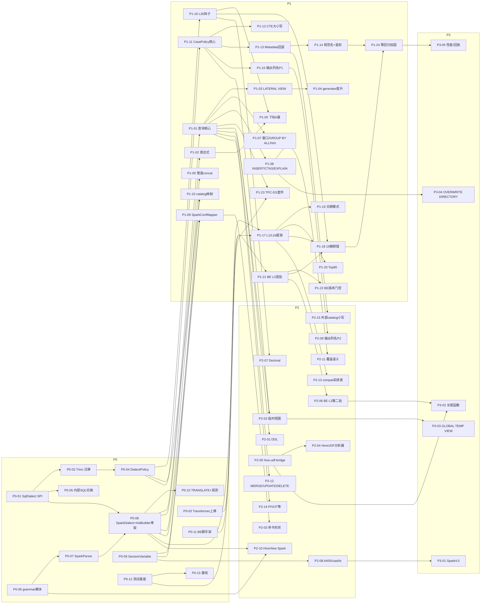

# Spark SQL 兼容 · 代码级实施地图（Implementation Map）

- 基线：`/home/user/starrocks` HEAD `485ef510`（fork of StarRocks），所有行号均为该提交下实测，改动前请先 `git grep` 复核（行号会随 rebase 漂移）。
- 配套设计：`../01-architecture.md` … `../07-roadmap-cost-benefit.md`。本文是**执行视角**：逐 ticket 给出文件、锚点、改法、依赖、规模、风险、测试。
- 规模：S=0.5–2 人天，M=3–6，L=7+（人天 pd）。标注 **[未验证]** 的是未能在本次读码中确认的点，开工前先做 spike。
- 路径缩写：`FE=fe/fe-core/src/main/java/com/starrocks`，`FT=fe/fe-core/src/test/java/com/starrocks`，`PARSER=fe/fe-parser/src/main/java/com/starrocks`。

---

## 0. 读码后对设计文档的修订（必读）

下列发现与设计文档的假设**不一致或设计未覆盖**，已折算进各 ticket：

| # | 发现 | 证据 | 影响/处理 |
|---|---|---|---|
| D1 | **fe-grammar 构建把 `-package com.starrocks.sql.parser` 与 `-lib <grammarDir>` 作为全局参数**，Maven 同理（`<sourceDirectory>src/main/antlr/com/starrocks/grammar</sourceDirectory>` + 全局 `-package`）。Spark 的 lexer/parser 分文件且用 `options{tokenVocab=...}`，package 必须不同 | `fe/fe-grammar/build.gradle.kts` L36-L42；`fe/fe-grammar/pom.xml` L35-L52 | 不能简单"追加 spark/ 子目录"。P0-06 改为**新模块 `fe-grammar-spark`**（推荐）；备选 Gradle 新 sourceSet |
| D2 | `ExpressionAnalyzer` 是**自底向上**（`bottomUpAnalyze` L422：先递归子节点再 `visitor.visit(expression)`）；`date_part` 改写是**原地改节点**（`node.resetFnName` + `clearChildren/addChild` 再递归 `visitFunctionCall`），不存在设计里的 `replaceInParent` | `ExpressionAnalyzer.java` L1053-L1130 | L2b 只能原地改写成"函数调用"（root 仍为 `FunctionCallExpr`）；需要换根节点类型（如外包 `CAST`）的改写必须放 L2a（解析期） |
| D3 | 大小写 policy 的触点**远多于设计表**：`PlannerMetaLocker.TableCollector.resolveTable`（锁集合在 analyze **之前**用原始名查元数据，L422-L451）、`AnalyzerUtils.TableCollector`、`QueryAnalyzer.ExternalTablesOnlyVisitor.visitTable`（L2411-L2490，预解析外表）、`QueryAnalyzer` `aliasSet` 判重（L883、L973）、递归 CTE 栈（L852-L866）、`MetaUtils.getSessionAwareTable`、analyzer 目录下 29 处 `metadataMgr.getTable/getDb` | grep 结果 | **在 `MetadataMgr.getDb/getTable` 单点做 policy 回退**（P1-13），否则锁集合与分析结果不一致 → 未加锁读表。设计文档的"analyzer 层 resolve"改为"MetadataMgr 层 + QueryAnalyzer 规范名回写" |
| D4 | `StatementBase` 在 **fe-parser 模块**，不能引用 fe-core 的 `DialectPolicy`/`ConnectContext` | `fe/fe-parser/.../StatementBase.java` | 在 fe-parser 增加 `ParsedDialect` 枚举，fe-core 在 `StatementPlanner.plan` / `Analyzer.analyze` 入口把枚举映射成 `DialectPolicy` 绑定到 `ConnectContext`（P0-04） |
| D5 | 当前 Trino 的 `relationAliasCaseInsensitive` 是**会话级可变位，由 parse 副作用写入**（`SqlParser` L111/L143），并被 `QueryAnalyzer.visitView` 临时覆盖（L1692-L1713）。任何内部 `SqlParser.parse(…, 用户 sessionVariable)` 都会改写它 | 见 P0-04 | 迁移为"按语句标记 + 入口绑定/恢复"，不再在 parse 中写 ConnectContext |
| D6 | `unnest` 只有 `ANY_ARRAY` 一个签名（`TableFunction.initBuiltins` L106-L108），**`explode(map)` 解析期无法翻译**（需知道参数类型） | `catalog/TableFunction.java` L106 | `LATERAL VIEW explode` 的 map 分支放到 `QueryAnalyzer.visitTableFunction`（L1993）里按类型改写成 `unnest(map_keys(m), map_values(m))`（P1-03） |
| D7 | 数组下标：SR 已有 Trino 先例——`CollectionElementExpr` 带 `checkIsOutOfBounds` 方言标志（fe-parser）。比新增 `SparkSubscriptExpr` 节点**少改** `AST2StringVisitor`/`ExprExplainVisitor`/`SqlToScalarOperatorTranslator`/`ExprToThrift`/`AggregationAnalyzer`/`ScalarOperatorToExpr` 共 6 处 visitor | `CollectionElementExpr.java`；grep 见 P1-05 | 采用"CollectionElementExpr 增加 `zeroBasedSubscript` 标志"，不新增节点类型 |
| D8 | Spark `SET spark.sql.x=y` 在 SR 语法里**无法解析**（`setVar: varType? identifier '=' …`，identifier 不含 `.`）；且 `SET` 属于 `preservesDiagnosticsArea`（`StmtExecutor` L982），warning 必须在**执行期**加到 `ConnectContext.addWarning`，不能在 parse 期 | `StarRocks.g4` L2312-L2322；`StmtExecutor.java` L967-L990 | P1-09：翻译在 `SparkAstBuilder`，warning 挂在 `SetStmt` 上由 `SetExecutor.execute` 注入 |
| D9 | `gensrc/script/gen_functions.py` `generate_cpp` 里 **`modules` 列表是硬编码**（L526 起），函数的 `backend fn` 字符串必须包含其中某个模块名，否则被归入 "Unknown"；每个模块的 `.inc` 还要列进 `gensrc/script/Makefile` 的 `GEN_FUNCTIONS_OUTPUT`，并由对应 cpp `#include "gen_cpp/opcode/<Module>.inc"`（例 `http_request_functions.cpp:786`） | 见 P0-11 | 新增 `SparkFunctions` 模块需改 3 处 |
| D10 | `TranslateExecutor` 直接 `sessionVariable.setSqlDialect(dialect)` 改的是**活的会话变量**（`ConnectContext.getSessionVariableOrDefault()`），`TranslateAnalyzer` 只放行 trino | `TranslateExecutor.java` L35；`TranslateAnalyzer.java` L35 | P0-10：支持 `TRANSLATE spark …`（天然的 golden 翻译对拍入口），同时修掉会话污染 |
| D11 | `ConnectorView/HiveView.doGetQueryStatement` 用**用户会话的 SessionVariable** 解析 Hive 视图文本（HiveView 仅对 Trino 视图临时改 dialect）。Spark 会话下 Hive 视图会**被当作 Spark 文本解析**（对 Spark 建的视图是对的，对 Hive 建的视图未必） | `ConnectorView.java` L53-L55；`HiveView.java` L42-L58 | P2-10 必须显式区分 `HiveView.Type.Spark/Hive`，其余情况强制 SR/Hive 解析；P0-05 先保证不被会话 dialect 误伤 |
| D12 | SR 没有"临时函数"概念（`CreateFunctionStmt` 无 temporary 字段）；没有 no-op Statement 类 | grep | P2-04 需新增会话级函数 registry；no-op 用空 `SetStmt(emptyList)` + warning |
| D13 | BE 已能拿到方言：`TQueryOptions.sql_dialect`（thrift `InternalService.thrift` L327，FE `SessionVariable.toThrift` L6996 写入），`RuntimeState::get_sql_dialect()`，先例 `be/src/exprs/time_functions.cpp` L2553 | grep | BE 侧 Spark 行为差异可直接读方言，无需新增 thrift 字段 |
| D14 | `View`/`MV` 持久化的 `inlineViewDef` 来自**分析后 AST 反序列化**（`ViewAnalyzer` L94 `AstToSQLBuilder.toSQLWithCredential`），设计原则 P6 成立；但同处 L97-L101 还保存 `originalViewDefineSql = origStmt.originStmt.substring(queryStartIndex, queryStopIndex)`（用户原文，Spark 文本） | `ViewAnalyzer.java` L94-L101 | P2-01：Spark 建视图要么设置 start/stop index，要么置空，避免之后把 Spark 原文当 SR SQL 重放 [未验证其使用点] |
| D15 | 设计表中的几个行号有偏差：`Database.getTable` 实为 L416（L250 是 dropTable 内部 `nameToTable.get`）；`CatalogMgr` 精确匹配点是 L257 `catalogs.containsKey`、L414 `getCatalogByName`、`ConnectorMgr.getConnector` L99（`isInternalCatalog` L273 已是 `equalsIgnoreCase`） | 实测 | 以本文为准 |

设计文档中**已核对无误**的锚点：`SqlParser.parse` L80-L91；`Field.matchesPrefix` L218-L233；`SelectAnalyzer` L315；`QueryAnalyzer.visitView` L1683/L1692-L1713；`ExpressionAnalyzer.visitFunctionCall` L1053；`LocalMetastore.getDb` L3080；`Scope` L39/L130-L146；`QueryAnalyzer.analyzeCTE` L493-L506；`StmtExecutor` L3225；`ConnectProcessor` L1436-L1445；ANTLR 4.9.3（`fe/pom.xml` L64、`fe/build.gradle.kts` L42）。

---

## 1. Ticket 总览

| ID | Phase | 标题 | 规模(pd) | 依赖 | 风险 |
|---|---|---|---|---|---|
| P0-01 | P0 | SqlDialect SPI + SqlParser 委托 | M 3 | — | 低 |
| P0-02 | P0 | Trino 迁移为 TrinoDialect + downgrade 泛化 | M 3 | P0-01 | 中 |
| P0-03 | P0 | FunctionCallTransformer/PlaceholderExpr 上移 common | S 1 | — | 低 |
| P0-04 | P0 | ParsedDialect + DialectPolicy 取代 relationAliasCaseInsensitive | M 4 | P0-01, P0-02 | 中 |
| P0-05 | P0 | 内部 SQL 调用点切换 parseOneWithStarRocksDialect | M 3 | P0-01 | 中 |
| P0-06 | P0 | fe-grammar-spark 模块 + vendoring + Gradle/Maven | M 4 | — | **高(构建)** |
| P0-07 | P0 | SparkParser 运行时 | M 4 | P0-06 | 中 |
| P0-08 | P0 | SparkDialect + SparkAstBuilder 骨架 | M 4 | P0-01, P0-07 | 中 |
| P0-09 | P0 | SessionVariable 新增 spark_* | S 2 | — | 低 |
| P0-10 | P0 | TRANSLATE spark + 可观测性 | S 2 | P0-08 | 低 |
| P0-11 | P0 | BE/gensrc 脚手架（SparkFunctions 模块、fn_id 段） | S 2 | — | 低 |
| P0-12 | P0 | 测试基座（SparkTestBase、golden runner） | L 8 | — | 中 |
| P0-13 | P0 | 基线测量 | M 4 | P0-12 | 低 |
| P1-01 | P1 | SparkAstBuilder 查询核心 | L 12 | P0-08 | 中 |
| P1-02 | P1 | 表达式/字面量/类型/INTERVAL/lambda | L 10 | P0-08 | 中 |
| P1-03 | P1 | LATERAL VIEW → Join+TableFunction | M 6 | P1-01 | 中 |
| P1-04 | P1 | SELECT 列表 generator 提升 | M 3 | P1-03 | 低 |
| P1-05 | P1 | 数组下标 0 基 | M 3 | P1-02, P1-16 | **高(静默错)** |
| P1-06 | P1 | `\|\|`→concat 与回落语句 sql_mode | S 1 | P0-08 | 低 |
| P1-07 | P1 | WINDOW/GROUP BY ALL/DISTRIBUTE/SORT/HINT | M 6 | P1-01 | 中 |
| P1-08 | P1 | INSERT [OVERWRITE] PARTITION / CTAS / EXPLAIN | M 4 | P1-01 | 中 |
| P1-09 | P1 | SparkConfMapper + SET/RESET/USE/CACHE | M 5 | P0-08, P0-09 | 中 |
| P1-10 | P1 | catalog 映射 | M 3 | P0-04, P0-09 | 中 |
| P1-11 | P1 | CaseSensitivityPolicy 核心 + Field/别名 | M 4 | P0-04 | 中 |
| P1-12 | P1 | CTE 大小写 | M 3 | P1-11 | 中 |
| P1-13 | P1 | MetadataMgr 不敏感回退 | L 8 | P1-11 | **高** |
| P1-14 | P1 | 规范名回写 + 鉴权 + 权限测试 | M 4 | P1-13 | **高(安全)** |
| P1-15 | P1 | 输出列名 Phase 1 | S 2 | P0-04, P1-11 | 中 |
| P1-16 | P1 | L2b 钩子 + Spark 节点标记 | M 3 | P0-04 | 中 |
| P1-17 | P1 | L1/L2a 框架 + CSV 生成器 | M 5 | P0-03, P0-08 | 低 |
| P1-18 | P1 | 19 个静默错误函数 | L 14 | P1-16, P1-17, P1-21 | **高** |
| P1-19 | P1 | JavaDateTimePatternTranslator | M 4 | P1-17 | 中 |
| P1-20 | P1 | Top80 函数（FE 改写） | L 10 | P1-17 | 中 |
| P1-21 | P1 | BE L3 首批 spark_* | L 14 | P0-11 | 中 |
| P1-22 | P1 | BE 最低版本门控 | S 2 | P1-21 | 中 |
| P1-23 | P1 | TPC-DS 99 正确性套件 | M 6 | P0-12, P1-01 | 低 |
| P1-24 | P1 | 默认方言零回归加固 | M 4 | 全部 P1 FE | 低 |
| P2-01 | P2 | DDL 翻译（CREATE TABLE USING/STORED AS/VIEW/ALTER/DROP） | L 8 | P1-01 | 中 |
| P2-02 | P2 | 临时视图 SparkTempViewRegistry | M 6 | P1-01, P1-11 | 中 |
| P2-03 | P2 | REFRESH/MSCK/ANALYZE/ADD JAR/SHOW/DESCRIBE 形状 | M 6 | P1-09 | 低 |
| P2-04 | P2 | CreateFunctionAnalyzer type=HiveUDF + 临时函数 | M 5 | P2-05 | 中 |
| P2-05 | P2 | hive-udf-bridge 模块 | L 25 | — | **高** |
| P2-06 | P2 | BE L3 第二批（聚合/窗口/长尾标量） | L 30 | P1-21 | 中 |
| P2-07 | P2 | Decimal 精度规则 | L 10 | P1-16 | **高** |
| P2-08 | P2 | ANSI/cast/timestamp 语义 | L 12 | P0-09 | **高** |
| P2-09 | P2 | 输出列名 Phase 2 | M 8 | P1-15 | 中 |
| P2-10 | P2 | HiveView 读 Spark 视图文本 | M 3 | P0-06, P0-08 | 低 |
| P2-11 | P2 | partitionOverwriteMode 语义 | M 5 | P1-08 | 中 |
| P2-12 | P2 | MERGE/UPDATE/DELETE | M 5 | P1-01 | 中 |
| P2-13 | P2 | spark_function_compat 系统表 + SHOW FUNCTIONS | M 3 | P1-17 | 低 |
| P2-14 | P2 | PIVOT/UNPIVOT/TABLESAMPLE/EXCEPT 列 | M 4 | P1-01 | 低 |
| P2-15 | P2 | 外部 catalog 入口统一小写 | M 4 | P1-13 | 中 |
| P3-01 | P3 | Spark 4.0 语法 diff + ANSI 默认 | L 10 | P2-08 | 中 |
| P3-02 | P3 | 长尾函数（from_json、xpath→L4） | L 12 | P2-05, P2-06 | 中 |
| P3-03 | P3 | GLOBAL TEMP VIEW | S 2 | P2-02 | 低 |
| P3-04 | P3 | INSERT OVERWRITE DIRECTORY | M 3 | P1-08 | 低 |
| P3-05 | P3 | 性能回归 + 生产 SQL 回放 | L 10 | P1-24 | 中 |
| P3-06 | P3 | 文档/NOTICE/观测完善 | M 4 | — | 低 |

合计 **58 个 ticket**：P0=13（44 pd）、P1=24（136 pd）、P2=15（约 134 pd）、P3=6（约 41 pd）。P0+P1=180 pd，对应 5 人 × 11 周（含 30% 会议/评审/返工折损）。

---

## 2. P0 · 基础（3 周）

### P0-01 SqlDialect SPI + SqlParser 委托
- **文件**：改 `FE/sql/parser/SqlParser.java`；新建 `FE/sql/parser/dialect/{SqlDialect,SqlDialectRegistry,StarRocksDialect}.java`。
- **现状锚点**：`SqlParser.parse(String, SessionVariable)` L80-L91
  ```java
  if (sessionVariable.getSqlDialect().equalsIgnoreCase("trino")) { return parseWithTrinoDialect(sql, sessionVariable); }
  else { return parseWithStarRocksDialect(sql, sessionVariable); }
  ```
  `parseWithStarRocksDialect` L168-L195（`private static`，`invokeParser` L337）；`parseOneWithStarRocksDialect` L232 已是 public。
- **改动**：
  ```java
  public interface SqlDialect {
      String name();                    // "starrocks"/"trino"/"spark"
      String displayName();             // 错误文案用 "Trino"/"Spark"
      List<StatementBase> parse(String sql, SessionVariable sv);   // 不支持时抛 DialectFallbackException(extends RuntimeException)
      default boolean supportsDowngrade() { return true; }
  }
  // SqlParser.parse:
  SqlDialect d = SqlDialectRegistry.get(sessionVariable.getSqlDialect());   // 未知名字 => StarRocksDialect（保持现有宽松行为）
  return d.parse(sql, sessionVariable);
  ```
  `parseWithStarRocksDialect` 改为 package-private/`public static` 供 `StarRocksDialect` 与 downgrade 调用；保留 `OutOfMemoryError` 日志（L87-L90）。
- **依赖**：无。**规模** M 3pd。**风险**：低；所有 SQL 都过此入口，必须字节级保持默认方言行为。
- **测试**：新建 `FT/sql/parser/SqlDialectRegistryTest.java`（大小写不敏感、未知名回落 SR、OOM 透传）；回归 `FT/sql/parser/ParserTest.java`。

### P0-02 Trino 迁移为 TrinoDialect + downgrade 泛化
- **文件**：新建 `FE/connector/parser/trino/TrinoDialect.java`、`FE/sql/parser/dialect/DialectDowngradePolicy.java`；改 `SqlParser.java`。
- **现状锚点**：`parseWithTrinoDialect` L93-L138（`StatementSplitter` 切句 + `TrinoParserUtils.toStatement` + 4 种 catch）、`rollbackStarRocksDialect` L140-L149、`tryParseWithStarRocksDialect` L151-L166（错误文案写死 `"Trino parser parse sql error: [%s], and StarRocks parser also can not parse: [%s]"`，L158/L162）。
- **改动**：
  - 把 L93-L138 原样搬入 `TrinoDialect.parse`（4 个 catch 改为：`ParsingException`/`io.trino…ParsingException`/`TrinoParserUnsupportedException` → `return DialectDowngradePolicy.rollback(this, sql, sv, e)`；`UnsupportedException` 仍直接抛）。
  - `DialectDowngradePolicy.rollback(SqlDialect d, String sql, SessionVariable sv, RuntimeException e)`：`if (sv.isEnableDialectDowngrade()) return tryParseWithStarRocksDialect(...) else throw e`；文案改 `String.format("%s parser parse sql error: [%s], and StarRocks parser also can not parse: [%s]", d.displayName(), ...)`（Trino 的 displayName="Trino"，文本不变）。
  - **去掉 `ConnectContext.get().setRelationAliasCaseInSensitive(true/false)`（L110-L112、L142-L144）**，交给 P0-04 的 `ParsedDialect` 标记。
- **依赖**：P0-01。**规模** M 3pd。**风险**：中，需保证 `TrinoDialectDowngradeTest` 全绿。
- **测试**：`FT/connector/parser/trino/TrinoDialectDowngradeTest.java`（L44-L112 三个用例断言 `connectContext.isRelationAliasCaseInsensitive()`，P0-04 同步改）、`TrinoQueryTest`、`TrinoTPCDSTest`、`TrinoTPCHTest` 全量跑。

### P0-03 FunctionCallTransformer / PlaceholderExpr 上移 common
- **文件**：`git mv FE/connector/parser/trino/{FunctionCallTransformer,PlaceholderExpr}.java FE/connector/parser/common/`；改 package 声明；改 import：`FE/sql/ast/AstVisitorExtendInterface.java` L17（`import com.starrocks.connector.parser.trino.PlaceholderExpr;`，`visitPlaceholderExpr` 在 L652）、`trino/{AstBuilder,ComplexFunctionCallTransformer,Trino2SRFunctionCallTransformer}.java`。
- **现状锚点**：`FunctionCallTransformer` 仅依赖 `AstVisitorExtendInterface`/`Expr`/`FunctionCallExpr`，**无 Trino 专有依赖**（实测 L15-L151），可直接移动。`SPMPlaceholderBuilder` 里的 `PlaceholderExpr` 是同名 record，无关，勿改。
- **依赖**：无。**规模** S 1pd。**风险**：低（纯机械重构）。
- **测试**：`FT/connector/parser/trino/TrinoFunctionTransformTest.java` 全绿即可。

### P0-04 ParsedDialect + DialectPolicy 取代 relationAliasCaseInsensitive
- **文件**：新建 `PARSER/sql/ast/ParsedDialect.java`（枚举 STARROCKS/TRINO/SPARK）、`FE/sql/analyzer/policy/DialectPolicy.java`；改 `PARSER/sql/ast/StatementBase.java`（加 `parsedDialect` 字段，默认 STARROCKS，位于 L60-L76 字段区）、`FE/qe/ConnectContext.java`、`FE/sql/analyzer/Field.java`、`FE/sql/analyzer/QueryAnalyzer.java`、`FE/sql/StatementPlanner.java`、`FE/sql/analyzer/Analyzer.java`；`TrinoDialect`/`SparkDialect` 在 parse 成功后 `stmt.setParsedDialect(...)`。
- **`relationAliasCaseInsensitive` 的全部用法（实测）**：
  | 位置 | 行 | 性质 |
  |---|---|---|
  | `ConnectContext` | L249 字段；L1403 `setRelationAliasCaseInSensitive`；L1407 `isRelationAliasCaseInsensitive` | 定义 |
  | `SqlParser` | L111（Trino 解析成功置 true）、L143（rollback 置 false） | 写 |
  | `QueryAnalyzer.visitView` | L1692-L1697、L1713（Hive 视图临时置 true，finally 恢复） | 读/写 |
  | `Field.matchesPrefix` | L228（唯一读取点） | 读 |
  | 测试 | `FT/connector/parser/trino/TrinoDialectDowngradeTest.java` L44-L112 | 读/写 |
- **改动**：
  ```java
  // fe-core
  public final class DialectPolicy {
      public static final DialectPolicy STARROCKS = new DialectPolicy(CaseSensitivityPolicy.LEGACY, false);
      public static final DialectPolicy TRINO = ...(LEGACY, /*aliasInsensitive*/true);
      public static final DialectPolicy SPARK = ...(SPARK_INSENSITIVE, true);       // P1-11 之后启用
      CaseSensitivityPolicy casePolicy(); boolean aliasInsensitive(); boolean sparkFunctionRewrite();
      public static DialectPolicy of(ParsedDialect d) {...}
  }
  // ConnectContext: replace L249 field with `private volatile DialectPolicy dialectPolicy = DialectPolicy.STARROCKS;`
  //   get/setDialectPolicy; 保留 isRelationAliasCaseInsensitive() 为 @Deprecated 委托 dialectPolicy.aliasInsensitive()
  // 绑定点（按语句，try-with-resources 恢复）：
  //   StatementPlanner.plan(...) L128 之后、L148 `new PlannerMetaLocker` 之前
  //   Analyzer.analyze(...) L200（直接调用 analyze 的路径，如 UT / MV 刷新）
  try (var ignored = DialectPolicy.bind(session, stmt.getParsedDialect())) {...}
  // Field.matchesPrefix L228:
  if (ConnectContext.get() != null && ConnectContext.get().getDialectPolicy().aliasInsensitive()) {...}
  // QueryAnalyzer.visitView L1692-1713: save = ctx.getDialectPolicy(); if hive view ctx.setDialectPolicy(save.withAliasInsensitive(true)); finally ctx.setDialectPolicy(save)
  ```
  **关键语义**：回落到 SR 解析器的语句 `parsedDialect=STARROCKS` 但仍应使用 Spark **大小写**策略（会话方言）；设计 01 §6 末段已说明。实现方式：`DialectPolicy.bind(session, stmtDialect)` 取 `casePolicy` 来自**会话 `sql_dialect`**，`sparkFunctionRewrite` 来自**语句 parsedDialect**。
- **依赖**：P0-01、P0-02。**规模** M 4pd。**风险**：中——ConnectContext 在 MV 刷新/Task 中被复制，需确认 `ConnectContext` 复制构造/`parent` 链是否要继承 policy [未验证]。
- **测试**：改 `FT/connector/parser/trino/TrinoDialectDowngradeTest.java`（用新 API 断言）；新增 `FT/sql/analyzer/DialectPolicyBindTest.java`（嵌套绑定恢复、视图展开恢复、异常路径恢复）。

### P0-05 内部 SQL 调用点切换 parseOneWithStarRocksDialect
- **目标**：Spark 会话下，**内部生成/持久化的 SR SQL** 绝不能走用户方言。`SqlParser.parse(…, long sqlMode)` 与 `new SessionVariable()` 版本天然是 SR（默认 dialect="StarRocks"）。
- **全量调用点（grep `SqlParser.parse` 于 `fe-core/src/main`，含跨行写法）与处置**：
  | # | 位置 | 内容 | 处置 |
  |---|---|---|---|
  | 1 | `alter/AlterJobMgr.java:431` | 重建 MV `createMvSql` | **切换** |
  | 2 | `backup/mv/MVRestoreUpdater.java:87` | 恢复 MV define sql | **切换** |
  | 3 | `catalog/ConnectorView.java:67` | 外部视图文本（用用户 sv） | 先强制 SR，P2-10 再按视图类型选方言（D11） |
  | 4 | `catalog/HiveView.java:56` | Trino 视图 rollback（已 set starrocks） | **切换**（去掉 set/restore hack） |
  | 5 | `catalog/DictionaryMgr.java:663` | 内部生成 SQL | **切换** |
  | 6 | `http/rest/TableQueryPlanAction.java:232` | Spark/Flink connector 发来的 SR SQL | **切换** |
  | 7 | `load/DeleteMgr.java:336` | 拼接的 `SELECT * FROM … WHERE …` | **切换** |
  | 8 | `qe/ConnectContext.java:1758` `executeSql` | 内部调度 SQL（Task postRun、DataCache、MVActiveChecker） | **切换** |
  | 9 | `qe/SimpleExecutor.java:251` | 内部 DDL | **切换**（同文件 L101/L226 已是 StarRocks 版） |
  | 10 | `qe/StmtExecutor.java:3225` | `SHOW EXPORT …` 拼接 | **切换** |
  | 11 | `scheduler/SqlTaskRunProcessor.java:50` | Task `definition` | 待产品决策：Task 存的是创建者原文，建议**按 Task 属性 `sql_dialect`**，缺省 SR [未验证 Task 是否持久化 dialect] |
  | 12 | `scheduler/mv/MVRefreshProcessor.java:517` | MV 定义 | **切换** |
  | 13 | `scheduler/mv/MVRefreshSchemaChecker.java:147` | `selectSql` | **切换** |
  | 14 | `sql/analyzer/mv/IvmRefreshDefinition.java:48,93` | MV 定义/frozen sql | **切换** |
  | 15 | `sql/analyzer/MaterializedViewAnalyzer.java:443` | `inlineViewDef` | **切换** |
  | 16 | `sql/ast/CreateRoutineLoadStmt.java:485` | 持久化 origStmt | **切换** |
  | 17 | `sql/common/SqlWithIdUtils.java:110` | 生成 SQL | **切换** |
  | 18 | `sql/optimizer/rule/transformation/materialization/MvUtils.java:554,1469` | MV 改写 | **切换** |
  | 19 | `sql/spm/SPMPlanner.java:145,153` | 存储的 baseline bind/plan SQL | **切换** |
  | 20 | `sql/spm/SPMAutoCapturer.java:121` | 历史 `originSQL`（用户原文，方言未知） | 非 SR 方言查询**跳过捕获** |
  | 21 | `connector/iceberg/IcebergRewriteDataJob.java:169,172`（跨行 `SqlParser\n.parse`） | 生成 SQL | **切换** |
  | 22 | `service/arrow/flight/sql/ArrowFlightSqlConnectProcessor.java:328`、`ArrowFlightSqlServiceImpl.java:922` | 用户 SQL | **保持**（用户方言） |
  | 23 | `qe/ConnectProcessor.java:560`（`parseStatements`）、`:1445`（follower→leader `proxyExecute`） | 用户 SQL | **保持**；注意 L1436-L1437 的 `parseSingleStatement(modified_variables_sql, sqlMode)` 必须保持 SR（见 P1-09） |
  | 24 | `http/rest/ExecuteSqlAction.java:210`（跨行） | HTTP 用户 SQL | **保持** |
  | 25 | `qe/ExecuteExceptionHandler.java:173`、`sql/optimizer/dump/QueryDumper.java:88` | 重试/dump 用户 SQL | **保持**（dump 回放需带 sql_dialect [未验证]） |
  | 26 | `qe/TranslateExecutor.java:36` | 显式方言 | 见 P0-10 |
  | 27 | `load/pipe/FilePipeSource.java:239`、`DesensitizedSQLBuilder.java:623`、`View.java:113,186`、`MetaUtils.java:161`、`BulkLoadJob.java:373`、`AstBuilder.java:9772`(PREPARE 内层)、`ConnectProcessor.java:1436` | 已用 `new SessionVariable()` / `long sqlMode` 重载 | **无需改**（默认 SR）；PREPARE 内层在 Spark 会话下按 SR 解析，作为已知限制记录 |
  已有 `parseOneWithStarRocksDialect` 用户（无需改）：`CreateTableLikeAnalyzer:71`、`MetadataExecutor:39`、`StatisticsCollectJob:349`、`StatisticExecutor:511/1072/1097`、`LakeOnlineRewriteJobBase:1201`、`OnlineOptimizeJobV2:1032`、`SimpleExecutor:101/226`。
- **改动**：机械替换为 `SqlParser.parseOneWithStarRocksDialect(sql, sv)`；需要多语句的（#8 虽取 `.get(0)`，#9 遍历 list）新增 `SqlParser.parseWithStarRocksDialect` public 重载。加一条守卫测试：用 ArchUnit/简单源码扫描禁止 `fe-core/src/main` 除白名单外出现 `SqlParser.parse(` 搭配 `getSessionVariable()`。
- **依赖**：P0-01。**规模** M 3pd。**风险**：中，改动面广但每处极小；#11 需产品确认。
- **测试**：`FT/sql/parser/InternalSqlDialectGuardTest.java`（新，源码扫描白名单）；`FT/scheduler/` 下 MV 刷新相关 UT 在 `SET sql_dialect='spark'` 的 ConnectContext 下跑一遍（参数化）。

### P0-06 fe-grammar-spark 模块 + vendoring + Gradle/Maven
- **现状**：
  - Gradle `fe/fe-grammar/build.gradle.kts` L28-L42：`tasks.generateGrammarSource { arguments = listOf("-visitor","-package","com.starrocks.sql.parser","-lib", grammarDir.absolutePath) }`（**一个任务、一个 package**），`compileJava dependsOn generateGrammarSource`。
  - Maven `fe/fe-grammar/pom.xml` L35-L52：antlr4-maven-plugin 单个 execution，`sourceDirectory=src/main/antlr/com/starrocks/grammar`，`-package com.starrocks.sql.parser`。
  - 消费方：`fe/settings.gradle.kts` L18 `include("fe-grammar", …)`、`fe/pom.xml` L32 `<module>fe-grammar</module>` + L208-L211 dependencyManagement、`fe/fe-core/build.gradle.kts` L50 `implementation(project(":fe-grammar"))`、`fe/fe-core/pom.xml` L147-L150、`fe/fe-parser/build.gradle.kts` L28。
- **方案（推荐）新模块 `fe/fe-grammar-spark`**（package `com.starrocks.sql.parser.spark.gen`），与 `fe-grammar` 完全同构，互不影响 StarRocks.g4 的生成参数，增量编译独立：
  1. 新建 `fe/fe-grammar-spark/{build.gradle.kts,pom.xml,src/main/antlr/…/SparkSqlBaseLexer.g4,SparkSqlBaseParser.g4}`；build 文件复制 fe-grammar 的并改 package/`-lib`。
  2. `settings.gradle.kts` 追加 `"fe-grammar-spark"`；`fe/pom.xml` 加 `<module>` 与 dependencyManagement；`fe-core/build.gradle.kts` L50 后加 `implementation(project(":fe-grammar-spark"))`；`fe-core/pom.xml` L147 后加 dependency。
  3. **tokenVocab 风险**：Spark 3.5 的 `SqlBaseParser.g4` 为 `options { tokenVocab = SqlBaseLexer; }`（与 StarRocks 的 `import` 组合式不同），需 `-lib` 指向 lexer 的 `.tokens` 输出目录；Gradle 需把 `-lib` 设为 `layout.buildDirectory.dir("generated-src/antlr/main")` 并保证 lexer 先生成 [未验证，P0-06 第一天做 spike；Maven 插件会自行按 tokenVocab 排序]。备选：把两个 g4 合并成一个 combined grammar（`import` 方式），但会偏离上游，升级 4.0 时 diff 变难。
  4. Vendor 来源：`apache/spark@branch-3.5` `sql/api/src/main/antlr4/org/apache/spark/sql/catalyst/parser/SqlBase{Lexer,Parser}.g4`（**路径需核对**：3.5 中该文件位于 `sql/api` 还是 `sql/catalyst` [未验证]）。改名 `SparkSqlBase*`、保留 Apache-2.0 头；`NOTICE.txt` 登记；`licenses-binary` 无需变（grammar 非二进制依赖）。
  5. 备选（不推荐）：在 `fe-grammar` 内加 Gradle `sourceSet("spark")` + 独立 `generateSparkGrammarSource`；Maven 加第二个 `<execution>`（不同 sourceDirectory/`-package`）。
- **依赖**：无（但 P0-07 依赖）。**规模** M 4pd（含 spike）。**风险**：**高（构建系统）**，两套构建（Gradle+Maven）都要通；CI 内存：`maxHeapSize=512m` 对 Spark 语法（SqlBaseParser ~2k 行）可能不够，建议 1g [未验证]。
- **测试**：新建 `fe/fe-grammar-spark/src/test`（可选）或在 `FT/connector/parser/spark/SparkGrammarSmokeTest.java` 里 `new SparkSqlBaseLexer(...)` 解析 20 条样例；CI 两套构建各跑一次。

### P0-07 SparkParser 运行时
- **文件**：新建 `FE/connector/parser/spark/{SparkParser,SparkParserUtils,SparkPostProcessListener,SparkParseOptions}.java`。
- **参照**：`SqlParser.invokeParser` L337-L387（`CaseInsensitiveStream` 大写化 `LA()` ✓ 满足 Spark 词法的大写假设；SLL+`StarRocksBailErrorStrategy` → LL+`StarRocksDefaultErrorStrategy` 两阶段；`ErrorHandler`、两个 ErrorStrategy 对 `StarRocksParser` **无引用**（grep=0），可直接复用；`PostProcessListener` 继承 `StarRocksBaseListener`，**不可复用**，需 `SparkPostProcessListener` 实现 token/expr 限制）。
- **改动**：
  - `SparkParser.parse(String sql, SessionVariable sv)`：Lexer 用 `new CaseInsensitiveStream(CharStreams.fromString(sql))`；`Config.enable_concurrent_parse_optimization` 分支（L343-L361，含 L363 的 `enable_parser_context_cache` 分支）同样为 Spark 的 `_ATN` 建独立 DFA；
  - Spark 语法中的开关字段（`legacy_setops_precedence_enabled`、`legacy_exponent_literal_as_decimal_enabled`、`SQL_standard_keyword_behavior`、`double_quoted_identifiers`）在 3.5 里是 `@members` 里的 public 字段，由 `SparkParseOptions` 在构造后注入（默认=Spark 3.5 默认）[字段名以 vendored 文件为准，未验证]；
  - 多语句切分：Spark 的 `singleStatement` 只吃一句，使用 `;` token 扫描切分（避开字符串/注释内分号，参照 Trino 用 `StatementSplitter`）。
- **依赖**：P0-06。**规模** M 4pd。**风险**：中（FE 内存：Spark ATN 常驻 [待验证 20–50MB]）。
- **测试**：`FT/connector/parser/spark/SparkParserTest.java`（SLL 失败转 LL、多语句、注释、大小写、token 上限）。

### P0-08 SparkDialect + SparkAstBuilder 骨架
- **文件**：新建 `FE/connector/parser/spark/{SparkDialect,SparkAstBuilder,SparkUnsupportedException}.java`、`FE/connector/parser/spark/function/` 空包；在 `SqlDialectRegistry` 注册 `"spark"`。
- **骨架**（沿用设计 02 §7，补充实测约束）：
  ```java
  public class SparkAstBuilder extends SparkSqlBaseParserBaseVisitor<ParseNode> {
      private final long sqlMode;   // 仅用于需要 sqlMode 的 SR AST 构造；"||" 在 Spark 词法里是独立 token，直接译 concat，不依赖 PIPES_AS_CONCAT
      @Override public ParseNode visitSingleStatement(...) { ParseNode n = visit(ctx.statement());
          if (!(n instanceof StatementBase)) throw new SparkUnsupportedException(...); return n; }
      @Override protected ParseNode defaultResult()/visitChildren → 未实现规则抛 SparkUnsupportedException（触发回落）
  }
  ```
  `SparkDialect.parse`：`SparkParser.parse` → 逐句 `SparkAstBuilder.visit` → `stmt.setOrigStmt(new OriginStatement(sql, idx))`、`stmt.setParsedDialect(SPARK)`；`SparkUnsupportedException`/`ParsingException` → `DialectDowngradePolicy.rollback`（回落语句 `parsedDialect=STARROCKS`）。
- **与 Trino 对照**：`TrinoParserUtils.toStatement` 只放行 Query/Explain/CTAS/Insert/DropTable，其余 `throw trinoParserUnsupportedException`（`TrinoParserUtils.java` L32-L45）——Spark 同样用白名单。
- **依赖**：P0-01、P0-07。**规模** M 4pd。**风险**：中。
- **测试**：新建 `FT/connector/parser/spark/SparkTestBase.java`（拷贝 `TrinoTestBase` 的 `createMinStarRocksCluster()`/`StarRocksAssert` 初始化，`sql_dialect=spark`），`SparkDialectDowngradeTest`（SHOW/ADMIN 回落、关闭 downgrade 报 Spark 错误）。

### P0-09 SessionVariable 新增 spark_*
- **文件**：`FE/qe/SessionVariable.java`；`FE/sql/analyzer/SetStmtAnalyzer.java`。
- **既有模式（实测，以 `sql_dialect`/`enable_dialect_downgrade` 为样板）**：
  ```java
  // L1027  public static final String SQL_DIALECT = "sql_dialect";
  // L1030  public static final String ENABLE_DIALECT_DOWNGRADE = "enable_dialect_downgrade";
  // L3271  @VarAttr(name = SQL_DIALECT)                 private String sqlDialect = "StarRocks";
  // L3274  @VarAttr(name = ENABLE_DIALECT_DOWNGRADE)    private boolean enableDialectDowngrade = true;
  // L6073-6086 getSqlDialect/setSqlDialect/isEnableDialectDowngrade/setEnableDialectDowngrade
  // L6996  tResult.setSql_dialect(sqlDialect.toLowerCase());     // toThrift()
  ```
  `@VarAttr` 属性：`name`（必填）、`alias`、`show`、`flag`（`VariableMgr.SESSION/GLOBAL/SESSION_ONLY/READ_ONLY/INVISIBLE/DISABLE_FORWARD_TO_LEADER`，`VariableMgr.java` L131-L141）。变量由反射扫描 `@VarAttr` 自动登记，**无需额外注册**。
- **改动**（9 个变量，名称/默认值见设计 05 §2）：常量放在 L1030 后；字段放在 L3275 后；getter/setter 放在 L6086 后。示例：
  ```java
  public static final String SPARK_VERSION = "spark_version";                 // String "3.5"
  public static final String SPARK_ANSI_ENABLED = "spark_ansi_enabled";       // boolean false
  public static final String SPARK_CASE_SENSITIVE = "spark_case_sensitive";   // boolean false；=true 在 SetStmtAnalyzer 报 unsupported
  public static final String SPARK_LEGACY_SIZE_OF_NULL = "spark_legacy_size_of_null"; // true
  public static final String SPARK_DEFAULT_CATALOG = "spark_default_catalog"; // "default_catalog"
  public static final String SPARK_PARTITION_OVERWRITE_MODE = "spark_partition_overwrite_mode"; // "static"
  public static final String SPARK_STRICT_CONF = "spark_strict_conf";         // false
  public static final String SPARK_UNSUPPORTED_BEHAVIOR = "spark_unsupported_behavior"; // "error"
  @VarAttr(name = SPARK_LEGACY_SIZE_OF_NULL) private boolean sparkLegacySizeOfNull = true;
  public boolean isSparkLegacySizeOfNull() { return sparkLegacySizeOfNull; }
  ```
  需要进 BE 的变量（目前仅 ANSI 相关，P2-08）才在 `toThrift()`（约 L6990-L7130）加 `tResult.setXxx`；其余 FE-only。
  `SetStmtAnalyzer.analyzeSystemVariable`（L90-L200；未知变量报错在 **L103-L106** `containsVariable` + `ERR_UNKNOWN_SYSTEM_VARIABLE`）新增枚举校验（仿 `prefer_join_method` L128-L133）：`spark_version∈{3.5,4.0}`、`spark_partition_overwrite_mode∈{static,dynamic}`、`spark_unsupported_behavior∈{error,downgrade}`、`spark_case_sensitive=true` → `SemanticException("spark.sql.caseSensitive=true is not supported")`；`sql_dialect` 取值校验采用**宽松**：已知集合外仅 warning，不报错（现网可能有任意值，[未验证]）。
- **依赖**：无。**规模** S 2pd。**风险**：低。
- **测试**：`FT/qe/SessionVariableTest.java`（默认值、`SHOW VARIABLES LIKE 'spark_%'`）、`FT/sql/analyzer/AnalyzeSetVariableTest.java`（非法值、`spark_case_sensitive=true`）。

### P0-10 TRANSLATE spark + 可观测性基础
- **文件**：`FE/sql/analyzer/TranslateAnalyzer.java` L35、`FE/qe/TranslateExecutor.java` L33-L36、`FE/qe/StmtExecutor.java` L482、`FE/metric/MetricRepo.java`（L1028 附近同模式）、`FE/plugin/AuditEvent.java`、`FE/http/action/QueryProfileAction.java` L133。
- **改动**：
  - `TranslateAnalyzer`: `!dialect.equalsIgnoreCase("trino")` → `!SqlDialectRegistry.contains(dialect) || "starrocks".equals(...)`，文案去掉 "only support trino"。
  - `TranslateExecutor`：不再 `sessionVariable.setSqlDialect(dialect)`（D10，会污染活会话）；改为 `SqlDialectRegistry.get(dialect).parse(sql, sv)`；输出仍 `AstToSQLBuilder.toSQL`。`TRANSLATE spark <sql>` 即为**翻译结果可视化入口**，供 golden/差分直接比对。
  - Profile：`StmtExecutor` L482 已写 `SQL_DIALECT`，补写 `Parsed Dialect`（是否回落）[需在 `ProfileKeyDictionary` L49/L281 登记新 key]；`QueryProfileAction.getFormattedSql` L133 对 `spark` 选择 spark formatter（`com.github.vertical_blank.sqlformatter` 支持 `SqlFormatter.of("spark")` [未验证]）。
  - Metrics：`MetricRepo` 新增 `spark_dialect_parse_total{result=ok|downgrade|error}`（`LongCounterMetric` + `addLabel(new MetricLabel("result", …))`，范式见 L464/L610），在 `SparkDialect.parse` 三条出口递增；`spark_function_rewrite_total{fn}` 留到 P1-17 接入（标签基数控制：仅 Top-N 函数名）。
  - Audit：`AuditEvent` 加 `@AuditField("Dialect")` 与 builder `setDialect`（范式 L83-L107），`ConnectProcessor` L267/L388 `setStmt` 旁写入 `sessionVariable.getSqlDialect()`；`rewritten_sql` 可选字段默认关闭（隐私/体积）。
- **依赖**：P0-08。**规模** S 2pd。**风险**：低（审计字段增加会影响第三方 audit 插件的列顺序 [未验证]，用 `ignore_empty=true`）。
- **测试**：`FT/qe/TranslateExecutorTest.java`（新；trino 与 spark 各 1 条）、`FT/sql/analyzer/AnalyzeSetVariableTest` 不动。

### P0-11 BE / gensrc 脚手架
- **fn_id 空闲段核实**：解析 `gensrc/script/functions.py` 共 1017 条，ID 分布 `10010–304590`、`701100–704102`、`1501681–1501683`；**`400000–699999` 与 `800000–1500000` 完全空闲**。采用设计建议 `400000–409999` 作 Spark 段（`add_function` 对重复 id 直接 `exit(1)`，gen_functions.py L174，可在 CI 提前发现冲突）。
- **改动（3 处同步，见 D9）**：
  1. `gensrc/script/gen_functions.py` `generate_cpp` 的 `modules` 列表（L526 起）追加 `"SparkFunctions"`；
  2. `gensrc/script/Makefile` `GEN_FUNCTIONS_OUTPUT`（L29-L50 一带）追加 `${BUILD_DIR}/gen_cpp/opcode/SparkFunctions.inc \`；
  3. 新建 `be/src/exprs/spark/spark_functions.{h,cpp}`，cpp 末尾 `#include "gen_cpp/opcode/SparkFunctions.inc"`（范式 `be/src/exprs/http_request_functions.cpp:786`）；`be/src/exprs/CMakeLists.txt` 的 `EXPR_FILES`（L24 起，显式文件清单，`ai/ai_function_call_expr.cpp` L53 是子目录先例）追加 `spark/spark_functions.cpp`；测试 `be/test/exprs/spark/spark_functions_test.cpp`，并加入 `be/test/CMakeLists.txt`（`./exprs/time_functions_test.cpp` L89 为范式，另有 `be/test/exprs/CMakeLists.txt` [未验证两处是否都需要]）。
  4. `functions.py` 先加一个 `spark_greatest` 的 smoke 条目验证流水线（`[400010, "spark_greatest", True, False, "BIGINT", ["BIGINT","..."], "SparkFunctions::greatest_bigint"]`，格式见 functions.py L26-L30 注释）。
- **依赖**：无。**规模** S 2pd。**风险**：低；FE 侧自动由 `generate_fe` 生成 `VectorizedBuiltinFunctions.java`，无需手改 FE。
- **测试**：BE UT `be/test/exprs/spark/spark_functions_test.cpp`（`run-be-ut.sh`）；FE `FunctionSetTest`-类用例确认新函数可见 [文件名未验证]。

### P0-12 测试基座
- **文件**：`FT/connector/parser/spark/SparkTestBase.java`（见 P0-08）；`tools/spark-compat/{run_golden.py,diff_runner.py,gen_function_registry.py}`；`test/sql/test_spark_dialect/{T,R}/`（SQL-tester 目录布局参照 `test/sql/test_agg/`）。
- **内容**：Spark `sql-tests` golden 解析 → 经 `TRANSLATE spark` 取翻译 SQL → 在 SR 执行 → 与 Spark 结果 diff；输出通过率/分类报告。详见 `../06-testing-strategy.md`（本次未逐字评审）。
- **依赖**：无。**规模** L 8pd。**风险**：中（Spark 参考环境搭建、结果归一化）。
- **测试**：harness 自测（5 条用例）。

### P0-13 基线测量
- 用 sqlglot(spark→starrocks)+现有 SR 跑 golden，量化真实缺口，校正设计里全部 [待验证] 项（decimal、timestamp、NaN、整数溢出等）；输出 `../research/baseline-<date>.md`。**依赖** P0-12；**规模** M 4pd；**风险**低。

---

## 3. P1 · MVP（8 周）

### P1-01 SparkAstBuilder 查询核心
- **文件**：`FE/connector/parser/spark/SparkAstBuilder.java`（建议拆 `SparkQueryVisitor` 子 visitor，类内 >2k 行难评审）。
- **目标 AST（均在 fe-core `sql/ast` 或 fe-parser）**：`QueryStatement`/`SelectRelation`/`SelectList`/`SelectListItem`/`TableRelation`/`SubqueryRelation`/`JoinRelation`(`JoinOperator` 含 `LEFT_SEMI/ANTI`)/`UnionRelation` 等/`CTERelation`/`ValuesRelation`。参照 SR 的实现位置：`AstBuilder.visitJoinRelation` `sql/parser/AstBuilder.java` L6817-L6890（`new JoinRelation(joinType, left, right, predicate, context.LATERAL() != null, pos)`；左关系为 null，由 `visitRelation` 回填——Spark 版自行组装即可）。
- **规则要点**：`TABLE t` → `SELECT * FROM t`；`FROM t SELECT …`；`NATURAL JOIN`/`USING` → `setUsingColNames`；集合运算优先级按 Spark 3.5（`INTERSECT` 高于 `UNION/EXCEPT`，除非 `legacy_setops_precedence_enabled`）。
- **依赖**：P0-08。**规模** L 12pd。**风险**：中。**测试**：`FT/connector/parser/spark/SparkQueryTest.java`、`SparkTPCDSTest.java`（参照 `FT/connector/parser/trino/TrinoTPCDSTest.java`，99 条仅做 parse+analyze+plan）。

### P1-02 表达式 / 字面量 / 类型 / INTERVAL / lambda
- **目标 AST**：`LiteralExprFactory`/`IntLiteral`/`DecimalLiteral`/`StringLiteral`/`DateLiteral`、`CastExpr`、`TimestampArithmeticExpr`、`ArrayExpr`/`MapExpr`、`LambdaFunctionExpr`、`CaseExpr`、`InPredicate`、`LikePredicate`（`ILIKE` 参照 `SyntaxSugars.java` L37/L65）。
- **改动要点**：`SparkTypeMapper`（STRING→`StringType.STRING`、BINARY→`VARBINARY`、TIMESTAMP/TIMESTAMP_NTZ→DATETIME、`DECIMAL` 缺省 (10,0)）；数值后缀字面量 `1L/1S/1Y/1D/1BD`；`SparkIntervalParser` 把多单位 `INTERVAL 1 DAY 2 HOURS` 拆为 `TimestampArithmeticExpr` 链，interval 作为列类型 → `SparkUnsupportedException`；`map(k1,v1,…)` 变参 → `MapExpr`；`x -> x+1` → `LambdaFunctionExpr`（高阶函数名参数重排属 P1-18 的 transform）。
- **依赖**：P0-08。**规模** L 10pd。**风险**：中。**测试**：`SparkExpressionTest`、`SparkIntervalTest`、`SparkLiteralTest`。

### P1-03 LATERAL VIEW → JoinRelation + TableFunctionRelation
- **SR 现状（实测）**：SR 语法无 `LATERAL VIEW`，只有 `[CROSS] JOIN LATERAL tbl_func(...)`，AST 为 `JoinRelation(joinOp, left, TableFunctionRelation, onPredicate, isLateral=true)`（`AstBuilder.visitJoinRelation` L6875 构造；`visitTableFunction` L6947 构造 `TableFunctionRelation(new FunctionCallExpr(name, params))`，别名 `setAlias(new TableName(null, id))`，列别名 `setColumnOutputNames(...)`）。Analyzer：`QueryAnalyzer.visitJoin` L1216-L1253——右侧是 `TableFunctionRelation` 或 `isLateral()` 时按相关子查询处理；**非 inner/cross 仅 `unnest` 可用，且 LEFT 必须 `ON true`**（L1224-L1245，`setIsLeftJoin(true)`）。
- **改动**（`SparkAstBuilder.visitLateralView`，在构造 FROM 时左折叠）：
  ```java
  Relation left = <fromRelation>;
  for (LateralViewContext lv : ctx.lateralView()) {
      FunctionCallExpr gen = translateGenerator(lv.qualifiedName(), args);   // explode/posexplode/inline/json_tuple/stack
      TableFunctionRelation tf = new TableFunctionRelation(gen);
      tf.setAlias(new TableName(null, lv.tblName != null ? lv.tblName.getText() : genSyntheticAlias()));
      tf.setColumnOutputNames(lv.colName list);                              // 可空
      JoinOperator op = lv.OUTER() != null ? LEFT_OUTER_JOIN : CROSS_JOIN;
      left = new JoinRelation(op, left, tf, lv.OUTER()!=null ? new BoolLiteral(true) : null, /*isLateral*/true, pos);
  }
  ```
  - `explode(arr)` → `unnest(arr)`；`posexplode(arr)` → `unnest(arr, generate_series(0, array_length(arr)-1))`（pos 0 基，需确认 `unnest` 多参并行语义 [未验证]）；`inline(arr<struct>)` → unnest + struct 字段展开（可延后）。
  - **D6**：`explode(map)` 无法在解析期判型 → 产出带标记的 `TableFunctionRelation`（如函数名 `__spark_explode`），在 `QueryAnalyzer.visitTableFunction`（L1993，参数分析后、取 fn 之前）按实参类型改写：ARRAY→`unnest`，MAP→`unnest(map_keys(m), map_values(m))` 且默认列名 `key,value`。注意 L2058 `unnest` 默认列名全是 `"unnest"`，Spark 默认列名 `col`（array）/`key,value`（map）/`pos,col`（posexplode），需在此处补 `setColumnOutputNames`。
- **依赖**：P1-01。**规模** M 6pd。**风险**：中。**测试**：`FT/connector/parser/spark/SparkLateralViewTest.java`（explode/OUTER/posexplode/多个 LATERAL VIEW/map）。

### P1-04 SELECT 列表中的 generator 提升
- Spark 允许 `SELECT explode(a), b FROM t`（每个 SELECT 至多一个 generator）。`SparkGeneratorExtractor`：在 `visitSelectClause` 扫描 `FunctionCallExpr` 为 generator 者，替换为引用列并追加 lateral join（复用 P1-03）。**依赖** P1-03；**规模** M 3pd；**风险**低；测试 `SparkGeneratorExtractTest`。

### P1-05 数组下标 0 基（静默错结果，最高优先级）
- **现状**：SR `AstBuilder.visitCollectionSubscript` L9109-L9113 → `new CollectionElementExpr(value, index, false)`；分析 `ExpressionAnalyzer.visitCollectionElementExpr` L636-L681（ARRAY/MAP/STRUCT 三分支）；`CollectionElementExpr`（fe-parser）带 `checkIsOutOfBounds`（Trino 先例），拷贝构造 L45。
- **改动（偏离设计 02 §7 的 `SparkSubscriptExpr`，见 D7）**：
  ```java
  // CollectionElementExpr: 新增字段与构造
  private final boolean zeroBasedSubscript;     // 拷贝构造/clone 必须带上
  // SparkAstBuilder.visitSubscript:
  return new CollectionElementExpr(base, idx, /*checkIsOutOfBounds*/false, /*zeroBased*/true);
  // ExpressionAnalyzer.visitCollectionElementExpr, ARRAY 分支 L639 之内：
  if (node.isZeroBasedSubscript()) {
      Expr one = new ArithmeticExpr(ADD, subscript, new IntLiteral(1)); // 常量下标直接折叠 IntLiteral(v+1)
      node.setChild(1, one); analyze(one) via visit(); subscript = node.getChild(1);
      node.clearZeroBased();  // 幂等
  }
  // MAP 分支：不改；STRUCT 分支：Spark 不支持 struct[i]，抛 SemanticException
  ```
  原地 +1 后，`AstToSQLBuilder`（视图持久化，D14）输出的就是 SR 1 基语义，满足设计原则 P6。负下标：Spark `arr[-1]` 返回 NULL（非 ANSI）而 SR 负下标语义 [未验证]，需单测锁定。
- **依赖**：P1-02、P1-16。**规模** M 3pd。**风险**：**高**（静默错结果）。
- **测试**：`FT/connector/parser/spark/SparkSubscriptTest.java`（`arr[0]`、`arr[i]`、`m[1]`/`m['k']`、嵌套、视图序列化往返、ARRAY<ARRAY>）；`test/sql/test_spark_dialect/T/test_subscript`。

### P1-06 `||` → concat 与回落语句的 sql_mode
- **实测**：`||` 的 PIPES_AS_CONCAT 在 **SR 词法器**里处理（`StarRocksLex.g4` L551 `LOGICAL_OR: '||' {setType((sqlMode & (1L << 1)) == 0 ? LOGICAL_OR : StarRocksParser.CONCAT);}`；`invokeParser` L342 `lexer.setSqlMode(sessionVariable.getSqlMode())`）。Spark 词法器无此依赖——`SparkAstBuilder` 对 `||` 直接产出 `FunctionCallExpr("concat", …)`（语义：Spark `a||b` 任一 NULL → NULL，与 SR `concat` 一致 [未验证，需 golden 确认]）。
- **回落语句**：为避免 `||` 变成逻辑 OR，`DialectDowngradePolicy.tryParseWithStarRocksDialect` 回落 SR 解析时临时用 `sqlMode | SqlModeHelper.MODE_PIPES_AS_CONCAT`（`SqlModeHelper` L62）。**不要修改会话 `sql_mode`**。实现：`parseWithStarRocksDialect(sql, sv, long sqlModeOverride)` 重载，`invokeParser` 增参，`lexer.setSqlMode(override)`（L342），`GlobalStateMgr…astBuilderFactory.create(sqlModeOverride, …)`（L180-L183 处同值）。
- **依赖**：P0-08。**规模** S 1pd。**测试**：`SparkConcatPipeTest`（Spark 解析 + 回落两条路径）。

### P1-07 WINDOW / GROUP BY ALL / DISTRIBUTE·SORT·CLUSTER BY / HINT
- `WINDOW w AS (…)` + `OVER w` 内联展开为 `AnalyticExpr` 的 window；`GROUP BY ALL`（3.4+）展开为非聚合 select 项；GROUP BY 别名：Spark 方言启用 `enable_groupby_use_output_alias` 语义——**不要改会话变量**，改读 `DialectPolicy`，在 `QueryAnalyzer` L3003 与 `SelectAnalyzer` L874 的判断处 `getEnableGroupbyUseOutputAlias() || policy.groupByUseOutputAlias()`（`QueryAnalyzer` L673 有"临时开启"先例）；`DISTRIBUTE BY` 忽略；`SORT BY`/`CLUSTER BY` 最外层→`ORDER BY` 并 `addWarning`；`SparkHintTranslator`：`BROADCAST/SHUFFLE_HASH` → `JoinRelation.setJoinHint("BROADCAST"/"SHUFFLE")`（范式 `visitJoinRelation` L6880-L6883），其余忽略。
- **依赖**：P1-01。**规模** M 6pd。**风险**：中。**测试**：`SparkWindowClauseTest`、`SparkGroupByAllTest`、`SparkHintTest`。

### P1-08 INSERT [OVERWRITE] [TABLE] PARTITION / CTAS / EXPLAIN
- **实测**：SR 语法 `INSERT (INTO|OVERWRITE) qualifiedName writeBranch? partitionNames? …`（`StarRocks.g4` L1361-L1365，**不含 `TABLE` 关键字**，故 Spark 的 `INSERT OVERWRITE TABLE t` 必须走 Spark 语法）。`partitionNames` 已含 `keyPartitions: PARTITION '(' k=literal,… ')'`（L2716-L2724）→ `PartitionRef(partitionNames, isTemp, partitionColNames, partitionColValues, pos)`（`PARSER/sql/ast/PartitionRef.java` L34-L38）。**即静态分区无需改写成谓词**，直接构造 `PartitionRef(null,false,cols,values)` + `InsertStmt(tableRef, partitionRef, label, cols, queryStmt, isOverwrite, props, pos)`（`InsertStmt` L128-L137）。动态分区列（`PARTITION(p)` 无值）→ 仅 `partitionColNames`。
- EXPLAIN 级别映射：`EXTENDED/FORMATTED/COST` → `ExplainLevel`；CTAS → `CreateTableAsSelectStmt`（`FE/sql/ast/CreateTableAsSelectStmt.java`）。
- **依赖**：P1-01。**规模** M 4pd。**测试**：`SparkInsertTest`（对照 `FT/connector/parser/trino/TrinoInsertTest.java`）、`SparkCtasTest`。

### P1-09 SparkConfMapper + SET/RESET/USE/CACHE
- **SET 分析/执行链（实测）**：解析 `StarRocks.g4` L2308-L2322（`SET setVar` → `#setSystemVar`，`identifier '=' …`，不含点号，**`SET spark.sql.x=1` 在 SR 解析器直接语法错误**，D8）→ AST `SetStmt(List<SetListItem>)`、`SystemVariable(SetType, name, Expr)`（fe-parser）→ `Analyzer.visitSetStatement` L470 → `SetStmtAnalyzer.analyze` L80（`analyzeSystemVariable` 校验存在性 L103-L106）→ `StmtExecutor.handleSetStmt` L2028 → `SetExecutor.execute` → `ConnectContext.modifySystemVariable` → `VariableMgr.setSystemVariable`（未知变量 `ERR_UNKNOWN_SYSTEM_VARIABLE`：`VariableMgr.java` L359、L558、L623、L833）。Follower→Leader 转发时 `LeaderOpExecutor` L364 `params.setModified_variables_sql(AstToSQLBuilder.toSQL(setStmt))`，Leader 在 `ConnectProcessor` L1436 用 `parseSingleStatement(…, sqlMode)`（SR 解析）执行——**因此翻译后的 `SetStmt` 必须只含真实 SR 变量名**，不能含 `spark.*` 键。
- **改动**：
  - 新建 `FE/qe/SparkConfMapper.java`：`static Result map(String key, String value)`，`Result{List<SystemVariable> vars; List<String> warnings; Action {MAP, ABSORB, REJECT}}`；规则表 = 设计 05 §1（映射/吸收/拒绝三类，吸收正则：`spark.executor.*`、`spark.sql.adaptive.*`、`spark.sql.files.*`、`hive.exec.dynamic.partition*`、`mapreduce.*`）。示例：`spark.sql.session.timeZone`→`time_zone`；`spark.sql.autoBroadcastJoinThreshold`→`broadcast_row_limit`（-1→禁用广播的具体值 [未验证变量语义]）；`spark.sql.ansi.enabled`→`spark_ansi_enabled`。
  - `SparkCommandTranslator.visitSetConfiguration`：产出 `new SetStmt(vars)`；全吸收时 `new SetStmt(Collections.emptyList())`，warning 写入 `SetStmt` 新增的 `List<String> warnings`（fe-parser 内纯字符串），**由 `SetExecutor.execute()` 开头 `ctx.addWarning(new QueryWarning("Warning", "SPARK_CONF_IGNORED", msg))`**（`ConnectContext.addWarning` L2089；`QueryWarning(level, code, message)`）。原因见 D8。
  - `SET`/`SET -v` 无参、`RESET [key]` → 结果集形状：`ShowResultSet`（两列 key,value）——可能需新增 `ShowSparkConfStmt` 或复用 `ShowVariablesStmt` + 改名列 [待设计]；P1 先做 `RESET`→`SET var=DEFAULT`、无参 SET 抛 unsupported 回落。
  - `USE db`/`USE cat.db` → `UseDbStmt`/`SetCatalogStmt`（均在 fe-parser）；`CACHE/UNCACHE/CLEAR CACHE` → 空 `SetStmt` + warning。
- **依赖**：P0-08、P0-09。**规模** M 5pd。**风险**：中。**测试**：新建 `FT/qe/SparkConfMapperTest.java`（表驱动）、`FT/connector/parser/spark/SparkSetTest.java`（follower 转发 `AstToSQLBuilder.toSQL` 往返）、`FT/qe/SetExecutorTest.java`（warning 可由 `SHOW WARNINGS` 读到）。

### P1-10 catalog 映射
- **锚点**：`TableName.normalization(ConnectContext)` `FE/catalog/TableName.java` L126-L144（空 catalog → `connectContext.getCurrentCatalog()`）；`QueryAnalyzer.resolveTableRef` L881 `resolveTableName.normalization(session)`；`QueryAnalyzer.resolveTable` L2799-L2803；`ExternalTablesOnlyVisitor.visitTable` L2411-L2435（自行用 `session.getCurrentCatalog()` 补全，**须同步**）；`PlannerMetaLocker.qualify(session, tableName)`（定义 L399，调用 L425）。
- **改动**：新增 `CatalogResolver.qualify(ctx, TableName)`：规则=设计 05 §3 流程图（3 段且首段 `spark_catalog` → `spark_default_catalog`；2 段 `db.t` → `spark_default_catalog.db.t`；1 段 → 当前 catalog+db）；仅当 `DialectPolicy.sparkCatalogMapping()` 为真启用；以上 3 个 qualify 点统一调用它（否则锁集合与分析结果 catalog 不一致，同 D3）。`USE db`（P1-09）在 `spark_default_catalog` 非 default 时等价 `SET CATALOG x; USE db`。
- **依赖**：P0-04、P0-09。**规模** M 3pd。**风险**：中。**测试**：`FT/sql/analyzer/SparkCatalogResolveTest.java`（Hive mock catalog，参照 `FT/connector/hive/` 既有 mock）。

### P1-11 CaseSensitivityPolicy 核心 + Field / 别名
- **文件**：新建 `FE/sql/analyzer/policy/{CaseSensitivityPolicy,IdentKind,LegacyPolicy,SparkPolicy}.java`；改 `FE/sql/analyzer/Field.java`。
- **现状锚点（Field.java）**：
  - `matchesPrefix` L218-L233：catalog/db 用 `!tableName.getCatalog().equals(relationAlias.getCatalog())`、`!tableName.getDb().equals(relationAlias.getDb())`（**敏感**），表别名依 `relationAliasCaseInsensitive` 选 `equalsIgnoreCase`（L228）。
  - `tryToMatch` L159-L203：struct 限定名匹配，`index != 2` 的 catalog/db 部分先 `toLowerCase()`；表名部分 `!GlobalVariable.enableTableNameCaseInsensitive ? part.equals(comparedPart) : part.equalsIgnoreCase(comparedPart)`（L178）。
  - 列名 `canResolve` L108-L125 已用 `equalsIgnoreCase`，无需改。
- **改动**：
  ```java
  // matchesPrefix
  CaseSensitivityPolicy p = CaseSensitivityPolicy.current();           // ConnectContext.get()==null → LEGACY
  if (tableName.getCatalog()!=null && relationAlias.getCatalog()!=null && !p.nameEquals(CATALOG, tableName.getCatalog(), relationAlias.getCatalog())) return false;
  if (tableName.getDb()!=null && !p.nameEquals(DATABASE, tableName.getDb(), relationAlias.getDb())) return false;
  return p.nameEquals(RELATION_ALIAS, tableName.getTbl(), relationAlias.getTbl());
  // LegacyPolicy.nameEquals: CATALOG/DATABASE → equals；RELATION_ALIAS → ctx.dialectPolicy.aliasInsensitive()? equalsIgnoreCase : equals   ← 精确复刻现状（含 Trino）
  // tryToMatch L178: boolean matches = p.nameEquals(index==2?TABLE:..., part, comparedPart)  （LEGACY 内部继续读 GlobalVariable.enableTableNameCaseInsensitive）
  ```
  `Field` 为热点类，`current()` 每次取 `ConnectContext.get()`（ThreadLocal），可在 `RelationFields.resolveFields*`（L94/L112/L126）外层取一次传入以减少开销 [可选优化]。
- **依赖**：P0-04。**规模** M 4pd。**风险**：中（LEGACY 必须精确复刻）。
- **测试**：新建 `FT/sql/analyzer/CaseSensitivityPolicyTest.java`（参数化 LEGACY vs SPARK：`SELECT T.A FROM DB.T`、别名前缀、`s.F` struct）；回归 `FT/sql/analyzer/TableObjectCaseInsensitiveTest.java`、`AnalyzeCTETest`（默认方言零变化）。

### P1-12 CTE 大小写
- **触点（全部精确匹配，需统一 `policy.key(CTE, name)`）**：
  | 位置 | 行 | 内容 |
  |---|---|---|
  | `Scope.java` | L39 `Map<String,CTERelation> cteQueries = Maps.newLinkedHashMap()`；L130 `addCteQueries`；L134-L143 `getCteQueries`（`containsKey`+`parent` 递归）；L146 `containsCTE` | 存取 key |
  | `QueryAnalyzer.analyzeCTE` | L493-L506：`Set<String> cteNames = Sets.newHashSet(); if (cteNames.contains(cteName)) reportSemanticException(ERR_NONUNIQ_TABLE…)` | **重复 CTE 检测**（Spark `WITH a AS (…), A AS (…)` 应报重复） |
  | `QueryAnalyzer` | L560/L636 `cteScope.addCteQueries(cteName, …)`；L566/L591 `recursiveCteAnalysisPath().add/remove(cteName)`；L822 `scope.getCteQueries(tableName.getTbl())`；L852-L866 `recursiveCteStack.contains(tableName.getTbl())`/`.equals(recursiveCteStack.peek())`/`recursiveCteAnalysisPath().contains` | 引用解析/递归检测 |
  | `QueryAnalyzer.ExternalTablesOnlyVisitor` | L2661 `collectCteNames`、L2671 `isCteName` | 预解析时判断是否 CTE |
  | `PlannerMetaLocker.TableCollector` | L647 `cteNames.stream().anyMatch(names -> names.contains(name.getTbl()))` | 锁集合中排除 CTE |
  | `AnalyzerUtils` | L943 `cteNames.contains(tableNameWithoutDb)`（`isUnresolvedCteReference`） | 表收集排除 CTE |
- **改动**：以上字符串 key 全部经 `CaseSensitivityPolicy.current().key(CTE, name)`（SPARK=`toLowerCase(Locale.ROOT)`，LEGACY=原样）；`CTERelation.getName()` 本身保留用户写法（输出/EXPLAIN 用）。**漏改任何一处会出现"分析期找到 CTE、加锁期当成真表"的不一致**，建议用 `CteNames` 小工具类封装 `Set`/`Map` 访问。
- **依赖**：P1-11。**规模** M 3pd。**风险**：中。**测试**：`FT/sql/analyzer/AnalyzeCTETest.java` 扩展参数化；`SparkCteCaseTest`（`WITH X AS (…) SELECT * FROM x`、嵌套/递归/重复 CTE）。

### P1-13 MetadataMgr 不敏感回退（库/表/catalog）
- **现状锚点**：
  - `MetadataMgr.getDb(ConnectContext, catalog, db)` L266-L274；`getTable(ConnectContext, catalog, db, tbl)` L527-L550；`getOptionalMetadata` L201-L218（`connectorMgr.getConnector(catalogName)`）。
  - `LocalMetastore.getDb(String)` L3080-L3099：`fullNameToDb.containsKey(name)`（`ConcurrentHashMap`，L310；修改点 L335/L341/L460/L545/L596/L627/L923-L924/L6308）；`getTable(String db, String tbl)` L3151。
  - `Database.nameToTable`（`ConcurrentHashMap`，L108/L142）；`getTable(String)` L415；修改点 `registerTableUnlocked` L213/L229、drop L241/L340/L349、`LocalMetastore.renameTable` L4095。
  - `CatalogMgr.catalogExists` L250-L270（L257 `catalogs.containsKey`）、`getCatalogByName` L414、`ConnectorMgr.getConnector` L96-L104（`connectors.get`）。
  - `QueryAnalyzer.resolveTable` L2799 已走 `metadataMgr.getDb/getTemporaryTable/getTable`，PlannerMetaLocker L446/L451 与 `ExternalTablesOnlyVisitor` L2455 同样走它们——**因此回退放在 MetadataMgr 一处即覆盖 29 个 analyzer 调用点**（D3）。
- **改动**：
  ```java
  // MetadataMgr.getDb
  Database db = ...exact...;
  if (db == null) {
      CaseSensitivityPolicy p = CaseSensitivityPolicy.of(context);              // context 为空则 ConnectContext.get()，再空 → LEGACY
      if (p.isMetadataFallbackEnabled()) db = fallbackDb(context, catalogName, dbName, p);
  }
  // fallbackDb: internal → LocalMetastore.getDbInsensitive(name)；external → 先 name.toLowerCase(Locale.ROOT) 精确重试（HMS/Glue/Iceberg-HMS 语义，P2-15），再 listDbNames 不敏感匹配
  // 候选 >1 且无精确命中 → throw new SemanticException(AMBIGUOUS) （ErrorCode 新增 ERR_AMBIGUOUS_NAME）
  ```
  - `LocalMetastore`：`private volatile Map<String, List<String>> lowerDbIndex`（null=失效）；在上述 fullNameToDb 变更点调用 `invalidateDbIndex()`；`Database` 同理 `lowerTableIndex`，在 `registerTableUnlocked`/drop/rename 失效。**仅 miss 路径构建**，命中路径零开销（设计 04 §3.3 第 5 点）。
  - `CatalogMgr.catalogExists`（L257）、`getCatalogByName`（L414）、`ConnectorMgr.getConnector`（L99）：精确 → 不敏感回退（`default_catalog` 的 `equalsIgnoreCase` 已存在 L251/L273）。
  - `information_schema`/`sys` 的特殊处理（`LocalMetastore.getDb` L3086-L3093）保留。
- **依赖**：P1-11。**规模** L 8pd。**风险**：**高**：热路径、并发（索引失效与 DDL 竞态）、外部 catalog `list*Names` 的 RPC 成本、PlannerMetaLocker 以 id 加锁需保证 fallback 取到同一 Database/Table 对象。
- **测试**：新建 `FT/server/MetadataMgrCaseFallbackTest.java`（并发 DDL+查询、歧义、information_schema）；`FT/catalog/DatabaseTableIndexTest.java`；微基准（miss 路径）；外部 catalog 用 `FT/connector/hive/` mock。

### P1-14 规范名回写 + 鉴权 + 权限测试（安全关键）
- **现状**：鉴权在分析**之后**，按 AST 里的 `TableName` 收集（`authorization/ColumnPrivilege.check` L63-L100 经 `TableNameCollector`），DML 目标在 `AuthorizerStmtVisitor` L369-L441 `Authorizer.checkTableAction(context, tableName, …)`。若 AST 里仍是用户写法 `DB.T`，授权会以错误名字比对或被绕过。
- **改动**：在 `QueryAnalyzer.resolveTableRef` 的 `TableRelation` 分支，`resolveTable(tableRelation)`（L2799）返回后（约 L892-L899，注意"外表预解析"分支只调用 `tableName.normalization(session)`，也要补回写），当 `policy.isMetadataFallbackEnabled()`：
  ```java
  tableName.setCatalog(canonicalCatalog); tableName.setDb(db.getFullName()); tableName.setTbl(table.getName());   // TableName.setDb/setCatalog/setTbl L150-L167
  ```
  同时 `InsertAnalyzer/UpdateAnalyzer/DeleteAnalyzer` 对 `TableRef`（DML 目标）做同样回写（文件 `FE/sql/analyzer/{Insert,Update,Delete}Analyzer.java`，入口函数名 [未验证]）。回写后 `aliasSet`（L883/L973）判重、`MV 依赖`、`plan cache`、审计日志均用规范名。
- **安全测试矩阵**：用户只被授予 `db.t` 的 SELECT：① `SELECT * FROM DB.T` 通过；② 无权限用户用 `DB.T` 被拒；③ 授权给 `t`，同库存在 `T` 与 `t` 且无精确命中 → 歧义报错而非任选其一；④ 视图/MV 依赖记录规范名；⑤ audit `Stmt` 保留原文、`Db/Catalog` 为规范名。
- **依赖**：P1-13。**规模** M 4pd。**风险**：**高（权限绕过）**，必须安全评审。
- **测试**：新建 `FT/authorization/SparkCaseInsensitiveAuthTest.java`（参照 `FT/authorization/` 既有 RBAC UT 基座，具体基类 [未验证]）。

### P1-15 输出列名 Phase 1
- **现状锚点**：`SelectAnalyzer.java` L313-L319（else 分支内）：
  ```java
  String name;
  if (item.getExpr() instanceof SlotRef) {
      name = item.getAlias() == null ? ((SlotRef) item.getExpr()).getColumnName() : item.getAlias();   // L315：用户写法
  } else {
      name = item.getAlias() == null ? AstToStringBuilder.getAliasName(item.getExpr(), false, false) : item.getAlias();
  }
  analyzeExpression(item.getExpr(), analyzeState, scope);      // L321：此时才解析出 Field
  ```
  `ExpressionAnalyzer.visitSlot` L518-L539 通过 `scope.resolveField(node)` 得到 `ResolvedField`（含 `Field.getName()` = 表定义名）；struct 类型已在 L526-L529 回写 `node.setColumnName(field.getName())`。
- **改动**：在 L321 之后（`analyzeExpression` 返回后，`outputFields.add(new Field(name, …))` L325 之前）：
  ```java
  if (DialectPolicy.current().sparkOutputNaming() && item.getAlias() == null && item.getExpr() instanceof SlotRef s) {
      name = scope.resolveField(s).getField().getName();       // ID → id（表定义名）
  }
  ```
  `SparkOutputNaming` 其余规则（`(a + 1)`、`count(1)`、`CAST(a AS STRING)`、常量去引号）为 P2-09。注意 `*` 展开分支（L296-L309，EXCLUDE 处理 L294）本来就用 `Field.getName()`，无需改。
- **依赖**：P0-04、P1-11。**规模** S 2pd。**风险**：中（影响 CTAS/视图列名）。**测试**：`FT/sql/analyzer/SparkOutputNamingTest.java`（含 MySQL 协议 `ResultSetMetaData` 断言 [结果集列名断言工具 [未验证]]）。

### P1-16 L2b 钩子 + Spark 节点标记
- **锚点**：`ExpressionAnalyzer.Visitor.visitFunctionCall` L1053；`date_part` 改写 L1058-L1130（**原地**：`node.resetFnName("", targetFunction); node.clearChildren(); node.addChild(dateExpr); return visitFunctionCall(node, scope);`）；随后 `handleBackwardCompatibleParameterConversion` L1132、`checkFunction` L1136（此时 `argumentTypes` 已就绪）。
- **改动**：
  1. `FunctionCallExpr`（fe-core，`sql/ast/expression/FunctionCallExpr.java` 字段区 L55-L66）加 `private boolean sparkDialect;` + getter/setter，**拷贝构造 L210-L230 与 `clone()` L257 必须复制**（否则 `Expr.clone` 后丢标记）。由 `SparkAstBuilder.visitFunctionCall` / L2a transformer 产出的所有 `FunctionCallExpr` 置位。
  2. 钩子（紧接 `date_part` 分支后、`handleBackwardCompatibleParameterConversion` 前）：
  ```java
  if (node.isSparkDialect()) {
      Type[] argTypes = node.getChildren().stream().map(Expr::getType).toArray(Type[]::new);  // 子节点已自底向上分析完
      if (SparkFunctionRewriter.rewriteInPlace(node, argTypes, session)) {   // 原地 resetFnName/clearChildren/addChild；新增子表达式需先 visit()
          return visitFunctionCall(node, scope);                              // 与 date_part 相同的递归方式
      }
  }
  ```
  **标记按节点而非按会话**（D2/D5）：Spark 会话下展开的**视图体**（SR SQL）内的函数不带标记，不会被误改写；回落语句亦然。
  3. 不能原地表达的改写（如 `CAST` 外包）→ L2a；L2b 只允许"`FunctionCallExpr` 变 `FunctionCallExpr`"（含嵌套函数，嵌套新节点在 `node.addChild(newChild)` 后用 `visit(newChild, scope)` 分析，范式见命名参数分支 L1156-L1162）。
- **依赖**：P0-04。**规模** M 3pd。**风险**：中（`FunctionCallExpr` 是核心类，改动需保持 `equals/hashCode/toSql` 不受影响——标记不参与 equals，避免计划缓存键变化 [需确认]）。
- **测试**：`FT/connector/parser/spark/function/SparkFunctionRewriterTest.java`；`FT/sql/analyzer/AnalyzeExprTest`-类回归 [文件名未验证]；视图体不被改写用例。

### P1-17 L1 / L2a 框架 + CSV 生成器
- **文件**：新建 `FE/connector/parser/spark/function/{SparkFunctionAliasRegistry,Spark2SRFunctionCallTransformer,SparkComplexFunctionTransformer,SparkFunctionCatalog}.java`；`tools/spark-compat/gen_function_registry.py`（读 `../func_mapping.csv`）。
- **复用**：`FE/connector/parser/common/FunctionCallTransformer`（P0-03 上移）的 `match(sourceArguments)`/`transform(sourceArguments)`；注册范式 `Trino2SRFunctionCallTransformer.registerFunctionTransformer(name, argNum, FunctionCallExpr)`（L395-L444，`TRANSFORMER_MAP`），PlaceholderExpr 按 1 基下标占位，变参用 `registerFunctionTransformerWithVarArgs`。
- **关键细节**：`FunctionCallTransformer.match` 按**实参的 Expr 子类**匹配（`placeholder.getClazz().isAssignableFrom(argClass)`）——解析期只有字面量/列引用等语法类，**无类型**（设计原则 P4）；类型相关的一律不放这里。
- **改动**：`SparkAstBuilder.visitFunctionCall` 调用 `Spark2SRFunctionCallTransformer.convert(name, args)`：别名 → 模板 → Complex → `SparkFunctionCatalog.isUnsupported(name)` 抛 `SparkUnsupportedException`（回落）或 `SemanticException`（`spark_unsupported_behavior=error`）。所有产出节点置 `sparkDialect=true`（P1-16）。接入指标 `spark_function_rewrite_total{fn}`。
- **依赖**：P0-03、P0-08。**规模** M 5pd。**风险**：低。**测试**：`FT/connector/parser/spark/function/SparkFunctionTransformTest.java`（参照 `FT/connector/parser/trino/TrinoFunctionTransformTest.java`）；CSV↔注册表一致性测试（每个 A/B/C/D-S 行都有对应注册或显式例外）。

### P1-18 19 个静默错误函数（设计 03 §1.1）
- 按设计表逐项实现并**每项一个正反例单测**。分层落点（D2 约束）：
  - L1 别名：`stddev/std→stddev_samp`、`variance→var_samp`、`length→char_length`。
  - L2a（需外包/补参/重排）：`date_add/date_sub/add_months`→`CAST(… AS DATE)`；`regexp_extract(s,p)` 补第 3 参 1；`substring(s,0,n)`→`if(pos=0,1,pos)`；`transform/filter/exists` 参数重排为 `array_map(lambda, arr)`；`collect_list`→`array_agg(x) FILTER (WHERE x IS NOT NULL)`（SR 聚合 FILTER 子句支持度 [未验证]，否则 `array_filter(array_agg(x), v -> v is not null)`）；`trunc(date, fmt)`→`CAST(date_trunc(unit, d) AS DATE)`；`||`（P1-06）。
  - L2b（类型感知）：`size`（`array_length`/`map_size`，`spark_legacy_size_of_null` 默认 true → `ifnull(…,-1)`）、`concat(array)`→`array_concat`、`element_at(arr,-1)`、`round(DOUBLE)` 结果 cast、`greatest/least`→`spark_greatest/least`（BE，P1-21）。
  - L3：`hash/xxhash64`（P1-21）、`split(s,re,limit)`（先 `regexp_split`+`array_slice`，RE2 差异显式报错）、`array_sort/sort_array` NULL 序、`rand(seed)`（文档声明）。
- **依赖**：P1-16、P1-17、P1-21。**规模** L 14pd。**风险**：**高**。验收：`func_mapping.csv` 中 B 类 19 项在 `spark_unsupported_behavior=error` 下**不存在静默分歧**。
- **测试**：`FT/connector/parser/spark/function/SparkSilentErrorFunctionsTest.java`（19 项）+ `test/sql/test_spark_dialect/T/test_silent_error_fns`（带 Spark 期望结果 R 文件）。

### P1-19 JavaDateTimePatternTranslator
- 新建 `FE/connector/parser/spark/function/JavaDateTimePatternTranslator.java`：映射表见设计 03 §3.1；常量模式 → MySQL 格式串（`%` 字面量转义）；含无对应符号（`u w Q VV XXX Z …`）或非常量 → 改写为 `spark_date_format`（P1-21）。目标函数：`date_format/from_unixtime/unix_timestamp/to_date/to_timestamp/to_unix_timestamp`。BE 仅特判 3–5 种格式的事实见设计；Trino 也有时间格式陷阱：`be/src/exprs/time_functions.cpp` L2553 先例。
- **依赖**：P1-17。**规模** M 4pd。**风险**：中。**测试**：`JavaDateTimePatternTranslatorTest`（≥60 个模式，含 `yyyy-MM-dd'T'HH:mm:ss.SSS`、`EEE`、`a`、转义）。

### P1-20 Top80 函数（FE 改写）
- 依据 `func_mapping.csv` 的 A/C/D-S 行，用 P1-17 框架批量注册；按 TPC-DS 99 与 `sql-tests` 出现频次排序取前 80。**依赖**：P1-17。**规模** L 10pd。**风险**：中。**测试**：生成式 `SparkFunctionTransformTest`（CSV 驱动）。

### P1-21 BE L3 首批 spark_*（hash / xxhash64 / greatest / least / date_format / to_timestamp / unix_timestamp / split）
- **文件**：`gensrc/script/functions.py`（新段 `400000–409999`，**核实空闲**，见 P0-11）、`be/src/exprs/spark/spark_{string,time,hash,math}.cpp`、`be/test/exprs/spark/*_test.cpp`。
- **行格式**：`[id, "name", exception_safe, check_overflow, "RET", ["ARG",…], "Module::fn"(, prepare, close)]`（functions.py L26-L30；变参 `"..."`）。FE 侧由 `gen_functions.py generate_fe` 自动生成 `VectorizedBuiltinFunctions.java`，**无需手写 FE 注册**。名字用 `spark_` 前缀（Decision Log），不覆盖同名 SR 函数。
- **要点**：`spark_hash` = Murmur3_x86_32 seed 42，按 Spark 类型规则逐列链式（可参考 `be/src/util/` 已有 murmur 实现 [路径未验证]）；`spark_xxhash64` seed 42；`spark_greatest/least` 跳过 NULL；`spark_date_format` 以 Java `DateTimeFormatter` 子集实现，读 `context->state()->get_sql_dialect()`（D13）不必要——函数名已区分语义。
- **依赖**：P0-11。**规模** L 14pd。**风险**：中（浮点/时区/UTF-8 边界）。**测试**：BE UT `be/test/exprs/spark/spark_hash_test.cpp` 等，期望值取自 Spark 3.5 实跑（入库 golden）。

### P1-22 BE 最低版本门控
- 混部期旧 BE 不含 L3 fn_id：L2/L2b 选择 `spark_*` 目标前检查集群 BE 最低版本。落点：`SparkFunctionRewriter`/transformer 内通过 `GlobalStateMgr.getCurrentState().getNodeMgr().getClusterInfo()` 取全体 backend 版本 [接口名未验证]，低于门槛抛 `SemanticException("function X requires BE upgrade")`。**依赖** P1-21；**规模** S 2pd；**风险**中（版本号来源）。测试：`SparkBeVersionGateTest`（mock backend 版本）。

### P1-23 TPC-DS 99 Spark dialect 正确性套件
- Spark 版 99 条 SQL → `SET sql_dialect='spark'` → parse/analyze/plan 全绿（FE，`SparkTPCDSTest`，复用 `FT/planner/…TPCDS` 的表 DDL 与 `MockTPCDSStatisticStorage`）；结果对拍走 SQL-tester（`test/sql/test_spark_dialect/T/tpcds_q*`）+ `tools/spark-compat`。MVP 门槛：90/99。**依赖** P0-12；**规模** M 6pd；**风险**低。

### P1-24 默认方言零回归加固
- 全量 `./run-fe-ut.sh` 的 analyzer/planner/parser 包 + SQL-tester 现有用例在 `LEGACY` 下零差异；性能：`ParserBench`（`FT/sql/parser/ParserBench.java`）解析吞吐不下降（SqlParser 间接层）；`Field.matchesPrefix` 微基准。**依赖**：全部 P1 FE ticket；**规模** M 4pd；**风险**低。

---

## 4. P2 · 完整（8 周）

### P2-01 DDL 翻译
- **文件**：`FE/connector/parser/spark/SparkDdlTranslator.java`。`CREATE TABLE … USING parquet|orc|delta|iceberg [PARTITIONED BY] [LOCATION] [TBLPROPERTIES]` / `STORED AS` → 目标 catalog 为 Hive/Iceberg 走外表 DDL，内表补 `DUPLICATE KEY` + `DISTRIBUTED BY RANDOM` + 分区（`CreateTableStmt`）；`CREATE [OR REPLACE] VIEW`（`FE/sql/ast/CreateViewStmt.java`，D14：设置/清空 `queryStartIndex/StopIndex` 以免 `ViewAnalyzer` L97-L101 `substring` 越界）；`DROP TABLE|VIEW [PURGE]`、`ALTER TABLE ADD COLUMNS|RENAME|SET TBLPROPERTIES`。CTAS/LIKE 已在 P1-08。大小写：内表保留写法存储并做不敏感冲突检测（设计 04 §3.3.7，落 `CreateTableAnalyzer` 前置检查，[未验证类名]）。
- **依赖**：P1-01。**规模** L 8pd。**风险**：中。**测试**：`FT/connector/parser/spark/SparkDdlTest.java`。

### P2-02 临时视图 SparkTempViewRegistry
- **挂接点（实测）**：`QueryAnalyzer.resolveTableRef` 的 `TableRelation` 分支，**CTE 查找之后（L820-L879）、`resolveTableName.normalization(session)`（L881）之前**插入：
  ```java
  if (policy.sparkTempView() && isOneOrTwoPart(tableName)) {
      View tv = session.getSparkTempViewRegistry().lookup(policy.key(TEMP_VIEW, name));   // 同名遮蔽真实表（Spark 语义）
      if (tv != null) return new ViewRelation(tableName, tv, reparse(tv));                // 走现有 visitView（含环检测 L1683-L1690）
  }
  ```
  同时在预解析（`ExternalTablesOnlyVisitor.visitTable` L2411）与锁收集（`PlannerMetaLocker.TableCollector`、`AnalyzerUtils.TableCollector`）处**跳过临时视图名**，否则会去元数据里找一个不存在的表（与 CTE 同理）。
- **存储**：建议存 **SR SQL 文本 + 列名**（`AstToSQLBuilder` 输出，设计原则 P6），引用时 `parseOneWithStarRocksDialect` 重解析（避免 `QueryStatement` 深拷贝问题 [AST 是否可安全复用 [未验证]]），封装成合成 `View`（id 为负，范式 `QueryAnalyzer` L925-L940 对 `ConnectorView` 构造 `new View(id, name, schema, type)` + `setInlineViewDefWithSqlMode`）。需确认合成 `View` 不触发 `Authorizer` 视图鉴权 [未验证]。
- **文件**：新建 `FE/qe/SparkTempViewRegistry.java`；`ConnectContext` 加字段与 getter。`CREATE [OR REPLACE] TEMP VIEW` 由 `SparkCommandTranslator` 产出自定义 `CreateTempViewStmt`（需新增 AST 类 + `AnalyzerVisitor`/`StmtExecutor` 分发 [参照 `SetStmt` 路径]）。持久化 View/MV 引用临时视图 → 报错（Spark 一致）。
- **依赖**：P1-01、P1-11。**规模** M 6pd。**风险**：中。**测试**：`FT/sql/analyzer/SparkTempViewTest.java`。

### P2-03 命令：REFRESH / MSCK / ANALYZE / ADD JAR / SHOW / DESCRIBE
- 映射：`REFRESH TABLE`→`RefreshTableStmt`（fe-parser）；`ANALYZE TABLE … COMPUTE STATISTICS`→`AnalyzeStmt`；`ADD JAR`→会话 jar 列表（供 P2-04）；`SHOW TABLES/DATABASES/COLUMNS/PARTITIONS/FUNCTIONS`、`DESCRIBE [EXTENDED]` → SR SHOW + **结果集列名/形状适配**（`ShowResultSetMetaData`，范式 `TranslateExecutor` L28）。**依赖** P1-09；**规模** M 6pd；**风险**低。测试 `SparkCommandTest`。

### P2-04 CreateFunctionAnalyzer type=HiveUDF + 临时函数
- **锚点**：`CreateFunctionAnalyzer.analyze` L85-L108：`langType = stmt.getLangType()`，`TYPE_STARROCKS_JAR`("StarrocksJar") / `TYPE_STARROCKS_PYTHON`("Python") 二选一，否则 `unknown lang type`（`CreateFunctionStmt` L33/L41-L42）。Java UDF 路径 `analyzeJavaUDFClass` 用 `UDFInternalClassLoader` + `TFunctionBinaryType.SRJAR`（L449/L583/L642）；thrift `TFunctionBinaryType` 已有未实现的 `HIVE`（`gensrc/thrift/Types.thrift` L330）。
- **改动**：新增 `TYPE_HIVE_UDF = "HiveUDF"` 分支 → `analyzeHiveUDF(stmt, ctx)`：隔离加载类 → 判定 `UDF/GenericUDF/UDAF/UDTF` → 调 `HiveUDFAdapter.initialize(OI[])` 推导返回类型（动态签名）→ 构造 `ScalarFunction` 且 `binaryType=SRJAR`、`symbol=HiveUDFAdapter`、`hive_class` 作为属性（复用 BE JavaFunctionCallExpr）。**旧 FE 回放未知 type**：EditLog 回放需版本门控（设计 01 §7）。
- **临时函数**（D12）：`ConnectContext` 增 `Map<String, Function> sessionFunctions`；`FunctionSet.getFunction`/`FunctionAnalyzer` 的查找链在 DB UDF 前先查会话函数。`CREATE [TEMPORARY] FUNCTION f AS 'cls' USING JAR '…'` 由 `SparkDdlTranslator` 翻译；`CREATE FUNCTION f(x) RETURN expr`（SQL UDF）可直接映射 `CreateFunctionStmt` 的 build-function 模式（`analyze` L93 `isBuildFunctionMode`）。
- **依赖**：P2-05（接口）；**规模** M 5pd；**风险**中。测试 `FT/sql/analyzer/CreateFunctionStmtAnalyzerTest.java` 扩展。

### P2-05 hive-udf-bridge 模块
- 新建 `java-extensions/hive-udf-bridge`，登记 `java-extensions/pom.xml` `<modules>`（L12-L26 列表）；类：`HiveUDFAdapter`/`HiveUDAFAdapter`/`HiveUDTFAdapter`/`SimpleUDFBridge`/`OIConverter`（设计 03 §6.1）。shaded `hive-exec-core` 最小依赖；与 BE 现有 JNI UDF 框架对接（`java-extensions/udf-extensions`）。性能 2–5× 慢，仅长尾兼容。**依赖**：无；**规模** L 25pd；**风险高**（依赖冲突、沙箱、`enable_udf`）。测试：`java-extensions/hive-udf-bridge/src/test/…`（`run-java-exts-ut.sh`）。

### P2-06 BE L3 第二批
- 聚合/窗口：`skewness/kurtosis/mode/median/bool_and/every/bit_*/regr_*/nth_value`（`FunctionSet` + `be/src/exprs/agg/factory/aggregate_resolver_*.cpp`，显式在 `be/src/exprs/CMakeLists.txt` L26-L49 文件清单）；标量长尾 `months_between/bround/rint/nanvl/sha1/levenshtein/soundex/format_number/printf/mask/monotonically_increasing_id` 等。**依赖**：P1-21；**规模** L 30pd；**风险**中。

### P2-07 Decimal 精度规则
- Spark `adjustPrecisionScale` 与 SR 精度推导差异：在 `ExpressionAnalyzer` 的 `visitArithmeticExpr` 及 `FunctionAnalyzer`（sum/avg 返回类型）加 Spark 分支，受 `DialectPolicy.sparkDecimal()` 门控（具体方法名 [未验证]）。溢出：非 ANSI → NULL（对应 `ERROR_IF_OVERFLOW` 位关）。**依赖**：P1-16；**规模** L 10pd；**风险高**。测试：`SparkDecimalRuleTest` + SQL-tester golden。

### P2-08 ANSI / cast / timestamp 语义
- ANSI 开关 → `SqlModeHelper` 位联动（`MODE_ERROR_IF_OVERFLOW` L94、`MODE_ERROR_FOR_DIVISION_BY_ZERO` L85；`SessionVariable.toThrift` L7021-L7026 已下发 `overflow_mode`/`error_for_division_by_zero`）：`SparkConfMapper` 设 `spark.sql.ansi.enabled` 时，在**执行期**为 Spark 语句计算有效 sqlMode（不改用户 `sql_mode`）；严格 cast 需 BE `cast_strict`；timestamp 时区语义逐项实测（基线 P0-13 校正）。**依赖**：P0-09；**规模** L 12pd；**风险高**。

### P2-09 输出列名 Phase 2
- `SparkOutputNaming`：表达式文本按 Spark `toPrettySQL`（`(a + 1)`、`count(1)`、`CAST(a AS STRING)`、函数名小写、常量去引号）；入口仍是 `SelectAnalyzer` L315 附近，对 `AstToStringBuilder.getAliasName(expr, false, false)` 的调用点加分派。**依赖** P1-15；**规模** M 8pd；golden 锁定。

### P2-10 HiveView 读 Spark 视图文本
- **锚点**：`HiveView.Type {Trino, Hive}`（`catalog/HiveView.java` L28-L31）；`HiveView.doGetQueryStatement` L42-L49（Trino 才改 dialect）；`rollback` L51-L58；`HiveMetastoreApiConverter.toHiveView` L301-L329（以 `viewOriginalText` 的 `/* Presto View: … */` 前缀判 Trino；否则 `HiveView.Type.Hive` 用 `viewExpandedText`）；`ConnectorView.getQueryStatement` L50-L70。
- **改动**：新增 `Type.Spark`：`toHiveView` 增加识别（Spark 建的 Hive 视图在 HMS 表属性中带 `spark.sql.create.version`/`view.*` 前缀 [未验证具体键名，需 Spark 3.5 + HMS 实测抓取]）；`doGetQueryStatement` 对 `Spark` 型设置 `sessionVariable.setSqlDialect("spark")`（`ConnectorView.getQueryStatement` 会还原，L53-L55），并 `rollback` 回 Hive/SR 解析。**价值**：不开 Spark 方言也能读 Spark 视图（设计 05 §3）。注意 `toHiveView` L322 会立刻 `getQueryStatement()` 校验——此时 ConnectContext 可能为空，走 `new SessionVariable()`（`ConnectorView` L50-L52）。
- **依赖**：P0-06、P0-08；**规模** M 3pd；**风险**低。测试：`FT/catalog/HiveViewTest.java`（已有）扩展、`FT/connector/hive/HiveViewTest.java`。

### P2-11 partitionOverwriteMode 语义
- `spark_partition_overwrite_mode=static`（默认）+ 动态分区：Spark 清空**整表**再写；SR `INSERT OVERWRITE` 分区级覆盖。`InsertAnalyzer`/`InsertStmt.isOverwrite()`（L192）上增加：Spark 语句且 `static` 且无静态分区值 → 生成全表覆盖（`TRUNCATE`-语义/`INSERT OVERWRITE` 全分区），`dynamic` 走分区级覆盖。**依赖** P1-08；**规模** M 5pd；**风险**中（数据丢失敏感，需 dry-run 提示）。

### P2-12 MERGE / UPDATE / DELETE
- 主键表 → SR `UpdateStmt`/`DeleteStmt`（`AuthorizerStmtVisitor` L369-L441 已有 DML 鉴权）；`MERGE INTO`（`PlannerMetaLocker.visitRawDmlClauses` 提及 MERGE INTO 已存在）；非主键表/Hive → 显式 unsupported。**依赖**：P1-01；**规模** M 5pd。

### P2-13 spark_function_compat 系统表 + SHOW FUNCTIONS
- `information_schema.spark_function_compat(name,class,status,notes)` 由 `SparkFunctionCatalog`（CSV 生成）提供；系统表注册路径参照 `FE/catalog/system/information/*`（新增 `SparkFunctionCompatSystemTable`，[具体基类 [未验证]]）。**依赖** P1-17；**规模** M 3pd。

### P2-14 PIVOT / UNPIVOT / TABLESAMPLE / SELECT * EXCEPT
- `PIVOT`→SR `pivotClause`；`UNPIVOT`→`UNION ALL`/unnest 展开；`TABLESAMPLE` ROWS→`LIMIT`、PERCENT→`rand()<p` 谓词（结果随机，不进 golden）；`* EXCEPT(c)`→`SelectListItem` 的 exclude（SR 已有，见 `SelectAnalyzer` L286-L295 `EXCLUDE clause`）。**依赖** P1-01；**规模** M 4pd。

### P2-15 外部 catalog 入口统一小写
- 设计 04 §2：`HiveMetastoreApiConverter.toDatabase`(L154 `dbName.toLowerCase()`)、`IcebergMetadata`(L841 对 HIVE/GLUE 类型 lower)。梳理 Hive/Glue/Iceberg-HMS/DLF 在 `MetadataMgr.getTable` 入口统一 `toLowerCase(Locale.ROOT)`（Spark 策略下），Paimon/JDBC/Delta/Hudi 先精确再回退。`CachingHiveMetastore` 按原始大小写做 key 会造成缓存分裂，入口小写后避免。**依赖** P1-13；**规模** M 4pd；风险中。测试：`FT/connector/hive/` 混合大小写 mock。

---

## 5. P3 · 加固 / GA（6 周）

| ID | 内容与锚点 | 规模 | 测试 |
|---|---|---|---|
| P3-01 | Spark 4.0 语法 diff 合入 `fe-grammar-spark`（新规则默认抛 `SparkUnsupportedException`）；`spark_version=4.0` 时 `spark_ansi_enabled` 默认 true（`SessionVariable` 默认值需改为"版本推导"，不能是静态字段初值——在 `DialectPolicy` 里解析） | L 10 | `SparkV4GrammarTest` |
| P3-02 | `from_json`(schema 字符串→STRUCT)、sketch、`xpath*` 走 L4 | L 12 | BE UT + SQL-tester |
| P3-03 | `GLOBAL TEMP VIEW`（`global_temp.v`）：FE 进程级 registry，不持久化 | S 2 | `SparkGlobalTempViewTest` |
| P3-04 | `INSERT OVERWRITE [LOCAL] DIRECTORY` → `INSERT INTO FILES()` | M 3 | `SparkInsertDirectoryTest` |
| P3-05 | 性能回归（Spark ATN 内存 20–50MB 实测、`ParserBench`）、生产 SQL 回放（`tools/spark-compat`） | L 10 | 回放报告 |
| P3-06 | 文档（`docs/` 三语）、`NOTICE.txt`（Spark grammar Apache-2.0）、观测完善（Grafana 看板、`rewritten_sql` 审计字段） | M 4 | — |

---

## 6. 依赖图（ticket 级）



**关键路径**：P0-06 → P0-07 → P0-08 → P1-01 → P1-03/P1-07 → P1-23（MVP 验收）；并行次关键路径：P0-04 → P1-11 → P1-13 → P1-14（安全评审周期长，需提前排期）。

---

## 7. P0 + P1 Sprint 计划（5 人 × 11 周，2 周一个 Sprint，共 5.5 个 Sprint）

**角色**：A=FE 解析负责人；B=FE 解析/AST；C=FE 分析/元数据（策略、鉴权 owner）；D=BE/函数（含 gensrc，兼 P0-05 机械改动）；E=测试/工具（兼 L1/L2a 函数改写）。
**产能口径**：每人每 Sprint 名义 10 pd，计划装载 ≤ 8 pd（≈75%，其余为评审/会议/返工）；pd 为理想人天，括号内为该 Sprint 在该 ticket 上的投入。P0+P1 合计 **180 pd**，名义产能 5.5×50=275 pd，余量 ≈ 95 pd，覆盖 20% 风险缓冲并为 P2 提前量留空间。

| Sprint | 周 | A (FE 解析) | B (FE 解析/AST) | C (FE 分析/元数据) | D (BE/函数) | E (测试/工具) | 装载 pd |
|---|---|---|---|---|---|---|---|
| S1 | W1-2 | P0-01(3) P0-02(3) P0-03(1) | P0-06(4) P0-07(4) | P0-04(4) P0-09(2) | P0-11(2) P0-05(3) | P0-12(5) | 31 |
| S2 | W3-4 | P0-08(4) P0-10(2) P1-06(1) | P1-01(7) | P1-11(4) P1-16(3) | P1-21(8) | P0-12(3) P0-13(4) P1-17(1) | 37 |
| S3 | W5-6 | P1-01(5) P1-03(3) | P1-02(8) | P1-10(3) P1-12(3) P1-13(2) | P1-21(6) P1-22(2) | P1-17(4) P1-19(4) | 40 |
| S4 | W7-8 | P1-03(3) P1-04(3) P1-08(2) | P1-02(2) P1-05(3) P1-07(3) | P1-13(6) P1-15(2) | P1-18(7，BE 侧：split/hash/greatest 接线) | P1-18(7，FE 侧) | 38 |
| S5 | W9-10 | P1-08(2) P1-07(3) P1-09(2) | P1-09(3) P1-20(4) | P1-14(4) P1-24(2) | P1-20(3) | P1-20(3) P1-23(4) | 30 |
| S6 | W11 | 缺陷修复 | 缺陷修复 | P1-24(2) | 缺陷修复 | P1-23(2) 验收报告 | 4 + 缓冲 |

**出口标准**
- S1：默认方言 FE UT 全绿；**D1 构建 spike 结论**（Gradle 与 Maven 均能生成 Spark parser；`tokenVocab`、堆内存）。
- S2：`TRANSLATE spark …` 可用；baseline 报告出（P0-13）；P0 全部关闭。
- S3：TPC-DS 前 60 条 parse+analyze 通过；`spark_hash`/`greatest` 等 BE 首批合入。
- S4：LATERAL VIEW、下标、19 静默错函数全部有测试；**P1-13 并发/性能评审**。
- S5：**P1-14 安全评审**（权限矩阵，见该 ticket）；TPC-DS ≥ 90/99。
- S6（MVP 验收）：TPC-DS 90/99、golden 解析 70% / 结果 60%、无未报告的 WRONG_RESULT、默认方言零回归。

**风险前置**：① S1 前两天做 D1 构建 spike；② S2 提前做 P1-14 的权限设计评审（只设计）；③ S2 实测 Spark ATN 内存，决定 `SparkParser` 是否懒加载；④ S3 起每周跑 `ParserBench` 与默认方言回归，监控 `Field.matchesPrefix`/`MetadataMgr` 的热路径开销；⑤ 若 S2/S3 超载，P1-20（Top80）压缩为 Top50，余量顺延 P2 开头，不动关键路径。

---

## 8. 其它交叉事项

- **回滚/开关**：新行为全部以 `sql_dialect='spark'` 或 `spark_*` 门控；P1-13 的 `MetadataMgr` 回退仅在 `CaseSensitivityPolicy.isMetadataFallbackEnabled()` 为真时执行，LEGACY 路径不引入额外分支外开销。
- **代码评审清单**：任何 PR 触及 `Field.java`、`Scope.java`、`QueryAnalyzer.java`、`ExpressionAnalyzer.java`、`MetadataMgr.java`、`SqlParser.java` 必须附"LEGACY 路径零变化"说明与对应回归测试名。
- **未验证项汇总**（开工前 spike）：Spark 3.5 grammar 路径与 `tokenVocab` 构建（P0-06）；`ConnectContext` 复制时 policy 继承（P0-04）；`unnest` 多参并行/`generate_series` 语义（P1-03）；SR 聚合 `FILTER` 子句（P1-18）；Hive 中 Spark 视图的表属性键（P2-10）；合成 `View` 的鉴权行为（P2-02）；`InsertAnalyzer` 等 DML 目标回写位置（P1-14）；BE 最低版本取数接口（P1-22）；Task 是否持久化 `sql_dialect`（P0-05 #11）。
