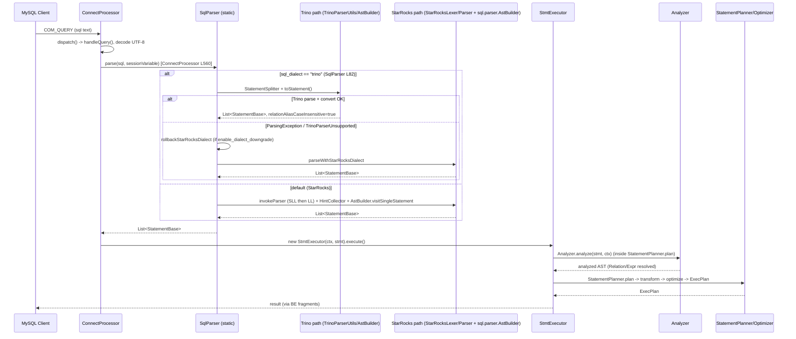

# R1: StarRocks FE SQL dialect / parser pipeline 调研 (for Spark dialect)

所有路径相对 `/home/user/starrocks/fe`。

## 1. `sql_dialect` 与调用链

### 1.1 Session variable
- `fe-core/src/main/java/com/starrocks/qe/SessionVariable.java`
  - L1027 `SQL_DIALECT = "sql_dialect"`;L3271-3272 `@VarAttr(name=SQL_DIALECT) private String sqlDialect = "StarRocks"`(**纯 String,无枚举/校验**,任意值均可 SET)。
  - L1030 `ENABLE_DIALECT_DOWNGRADE="enable_dialect_downgrade"`,L3274-3275 默认 `true`;getter `isEnableDialectDowngrade()` L6081。
  - getter/setter L6073-6078;L6996 `tResult.setSql_dialect(sqlDialect.toLowerCase())` 下发到 BE (TQueryOptions)。
- 其它读取点(整个 fe-core/main 仅 4 处):
  - `sql/parser/SqlParser.java` L82:`sessionVariable.getSqlDialect().equalsIgnoreCase("trino")` —— **唯一的分发点**。
  - `qe/StmtExecutor.java` L482:仅写 profile (`ProfileManager.SQL_DIALECT`)。
  - `catalog/ConnectorView.java` L53-55:解析 connector view 定义时保存并恢复 dialect(view 定义是 Trino 方言文本,经 `SqlParser.parse(inlineViewDef, sessionVariable)` 解析,L68 附近)。
  - 另有 `ConnectContext.setRelationAliasCaseInSensitive`(Trino 专用 hack,见 1.3)。

### 1.2 调用链
MySQL 协议 `COM_QUERY` -> `ConnectProcessor.dispatch()` (qe/ConnectProcessor.java L1134) -> `handleQuery()` (L718;UTF-8 解码 packet,L738 `parseStatements(originStmt)`,L558 -> L560 `SqlParser.parse(originStmt, ctx.getSessionVariable())`) -> `executeQueryAttempt` -> `executeStmtWithAudit` (L650 `new StmtExecutor(ctx, parsedStmt)`, L668 `executor.execute()`) -> `StmtExecutor.execute()` (L967) -> `StmtExecutor.execute` 内部 plan 步骤 (L855-906):`Analyzer.analyze(parsedStmt, ctx)`(ShowStmt/ExecuteStmt)或 `StatementPlanner.plan(parsedStmt, ctx)` (sql/StatementPlanner.java L117,内部 L347/L843 `Analyzer.analyze`) -> 优化器 -> ExecPlan -> `handleQueryStmt`/`handleDMLStmt` 下发 BE。
- Follower 转发场景:`ConnectProcessor.proxyExecute` (L1445) 同样走 `SqlParser.parse(request.getSql(), ctx.getSessionVariable())`,session var 通过 `modified_variables_sql` 先 SET(L1436)—— 注意这里 `parseSingleStatement(sql, sqlMode)` 用的是 **旧的 sqlMode 重载,会 `new SessionVariable()`,即始终 StarRocks 方言**(SET 本身必须能被 SR 方言解析)。
- StmtExecutor L3225 `SqlParser.parse(showStmt, ...)`(内部构造的 SHOW 语句也走 dispatch,Spark 模式下需要降级/或显式用 `parseOneWithStarRocksDialect`)。
- 其它走 `SqlParser.parse(..., SessionVariable)` 的地方:ConnectorView(view 展开)、MV/view 定义(多数使用 `parseOneWithStarRocksDialect`)、InsertOverwrite 内部 SQL 等,须确认内部生成的 SQL 不被方言劫持(Trino 已有同样风险)。

### 1.3 SqlParser 分发细节 (`sql/parser/SqlParser.java`)
- `parse(String, SessionVariable)` L80-91:Trino -> `parseWithTrinoDialect`,否则 `parseWithStarRocksDialect`。
- `parseWithTrinoDialect` L93-140:
  1. Trino `StatementSplitter` 切分多语句;逐条 `TrinoParserUtils.toStatement(sql, sqlMode)`;设 `OriginStatement(sql, idx)`;
  2. 成功后 `ConnectContext.setRelationAliasCaseInSensitive(true)`(Trino 别名大小写不敏感;QueryAnalyzer L1692-1713 读取并在子查询里保存/恢复);
  3. 异常策略:`ParsingException`(SR 自己的,AstBuilder 内抛) / `io.trino.sql.parser.ParsingException`(语法不是 Trino) / `TrinoParserUnsupportedException`(Trino 语法对,但 SR 不支持的语句类型) -> `rollbackStarRocksDialect`;`UnsupportedException` 直接抛出(两边都不能支持);空结果或有 null -> 回落 SR 方言。
- `rollbackStarRocksDialect` L142-151:重置 `relationAliasCaseInSensitive=false`;若 `enable_dialect_downgrade`=true 则 `tryParseWithStarRocksDialect`(L153-):SR 解析也失败时抛合并错误信息 `"Trino parser parse sql error: [...], and StarRocks parser also can not parse: [...]"`;未开启则抛原异常。
- `parseWithStarRocksDialect` L168-:`invokeParser(sql, sv, StarRocksParser::sqlStatements)` -> 每条 `singleStatement` 用 `HintCollector` 收集 `/*+ */` hint -> `GlobalStateMgr.getSqlParser().astBuilderFactory.create(sqlMode, enableTableNameCaseInsensitive, hintMap)` -> `astBuilder.visitSingleStatement` -> 若有 `?` 参数则包装 `PrepareStmt` 否则 `setOrigStmt`。
- `invokeParser` 末尾:`StarRocksLexer(new CaseInsensitiveStream(...))` + `lexer.setSqlMode(sqlMode)`;`PostProcessListener(tokenLimit, exprLimit)`;**两阶段 SLL(BailErrorStrategy) -> LL(DefaultErrorStrategy)**;`Config.enable_concurrent_parse_optimization` 时每次新建 DFA。
- 其它入口:`parseExpression`、`parseSqlToExpr(s)`、`parseImportColumns`、`parseFilesSchema`、`parseOneWithStarRocksDialect`(明确绕过方言)。
- `GlobalStateMgr` L912 `this.sqlParser = new SqlParser(AstBuilder.getInstance())`;`AstBuilder.AstBuilderFactory` (sql/parser/AstBuilder.java L670-677) 是为 enterprise/扩展保留的工厂,**只替换 SR 语法的 AstBuilder,不是方言扩展点**。

### 1.4 Mermaid 序列图(当前解析路径)


## 2. 现有 Trino 方言

### 2.1 实现位置与规模
`fe-core/src/main/java/com/starrocks/connector/parser/trino/` (总计 2564 LOC)
| 文件 | LOC | 作用 |
|---|---|---|
| AstBuilder.java | 1627 | `extends AstVisitor<ParseNode, ParseTreeContext>`(Trino 的 `io.trino.sql.tree.AstVisitor`),Trino AST -> SR AST。覆盖 Query/QuerySpecification/Join/Table/Values/Union/With/Window/Case/Cast/Literal/Interval/Insert/CTAS/DropTable/Explain/Lambda/Array/Map/Row/Subquery/Extract/Json 等 visitXxx |
| Trino2SRFunctionCallTransformer.java | 444 | 静态 `TRANSFORMER_MAP`;`convert(fnName, args)` = 先 `convertRegisterFn`(声明式 pattern)再 `ComplexFunctionCallTransformer`;约 101 处 register,按 aggregate/array/date/string/regexp/json/url/bitwise/math/... 分组 |
| FunctionCallTransformer.java | 151 | 声明式模板:`targetCall` 里用 `PlaceholderExpr(index, clazz)` 作占位,`match(args)` 校验数量/类型,`transform` 用 `FunctionCallRewriter` 替换占位 |
| ComplexFunctionCallTransformer.java | 143 | 需要代码逻辑的改写(如 date_add/format_datetime 等 switch) |
| PlaceholderExpr.java | 44 | 占位 Expr |
| TrinoParserUtils.java | 107 | `toStatement`(只接受 Query/Explain/ExplainAnalyze/CTAS/Insert/DropTable,其余抛 `TrinoParserUnsupportedException`)、日期类型对齐(`alignWithInputDatetimeType`) |
| TrinoParser.java | 30 | 封装 `io.trino.sql.parser.SqlParser.createStatement` |
| ParseTreeContext.java | 18 | 空 context |
另有 `connector/trino/`:`TrinoParserUnsupportedException`、`TrinoViewColumnTypeConverter`、`TrinoViewDefinition`(Trino view 元数据)。
依赖:`fe-core/build.gradle.kts` L156 `implementation("io.trino:trino-parser:385")`(**直接用 Trino 官方 parser jar,仓库里没有 Trino 的 .g4**)。

### 2.2 机制要点
- **Trino 解析器 + 自写 visitor**:AST 到 AST 转换(非 SQL 文本改写),产出 SR 的 `QueryStatement/SelectRelation/...`,之后与 SR 方言共用 Analyzer。
- 函数转换:`FunctionCallTransformer` 模式(声明式)+ `ComplexFunctionCallTransformer`(命令式);AstBuilder `visitFunctionCall` (L801-) 先 `Trino2SRFunctionCallTransformer.convert`,再处理 information function、聚合(FILTER -> `xxx_if`)等。
- 语义差异 hack:`relationAliasCaseInSensitive` 标志;date/interval 类型对齐;`ParseTreeContext`。
- **只支持部分语句**(Query/CTAS/INSERT/DROP TABLE/EXPLAIN),其余(SET/USE/SHOW/DDL)靠 downgrade 回落 SR 解析 —— 对 Spark 同样关键。
- 失败回落:见 1.3,由 `enable_dialect_downgrade` 控制;错误信息合并。

### 2.3 测试 (`fe-core/src/test/java/com/starrocks/connector/parser/trino/`,共 3638 LOC)
TrinoTestBase 341(`UtFrameUtils.createMinStarRocksCluster` 建表 t0/t1... + 工具方法 `analyzeSuccess/getFragmentPlan`)、TrinoQueryTest 1268、TrinoTPCDSTest 543、TrinoFunctionTransformTest 522、TrinoTimestampWithTimeZoneTest 206、TrinoTimeTravelTest 172、TrinoCtasTest 121、TrinoParserNotSupportTest 116、TrinoDialectDowngradeTest 115、TrinoInsertTest 90、TrinoTPCHTest 89、TrinoDropTableTest 55。另外 `sql/parser/ParserTest.java` L265-292 有 `setSqlDialect("trino"/"sr")` 用例,`AnalyzeTranslateTest`、`ExplainAnalyzeStmtTest` 等也引用。

### 2.4 其它“方言/语法”模块
- 仅有两个 ANTLR 文件:`fe-grammar/src/main/antlr/com/starrocks/grammar/StarRocks.g4` (3448 行) 与 `StarRocksLex.g4` (649 行);`fe-grammar/build.gradle.kts` 用 `antlr` 插件(`-visitor`,package `com.starrocks.sql.parser`,生成 `StarRocksParser/Lexer/BaseVisitor`)。Lexer 有 `setSqlMode(long)` 成员(StarRocksLex.g4 L19)用于 `||` -> CONCAT 等模式切换(L551)。
- `fe-parser` 模块:放 AST (`com.starrocks.sql.ast.*`)、`ParsingException`、`NodePosition`(**AST 类在 fe-parser,而 `sql/parser/AstBuilder` 10336 行、`SqlParser` 在 fe-core**)。
- 没有其它方言(无 Hive/Spark/MySQL 专用解析器)。

## 3. 如何接入 `SparkParser`

### 3.1 具体扩展点
1. `SqlParser.parse` L80-91 增加 `else if ("spark".equalsIgnoreCase(dialect)) return parseWithSparkDialect(...)`;建议顺手把 dialect 抽成 `enum SqlDialect`/`SqlDialectParser` 接口(Trino/Spark/StarRocks 各实现 `List<StatementBase> parse(String, SessionVariable)`),并抽出 `rollbackStarRocksDialect` 通用化(现错误文案硬编码 "Trino parser")。
2. `SessionVariable.sqlDialect` 无校验,可加 `@VarAttr(... checker=)` 或保持字符串;`ConnectorView` 保存/恢复逻辑无需改动。
3. `ConnectContext` 可加类似 `relationAliasCaseInSensitive` 的 Spark 语义开关(Spark 默认列/别名大小写不敏感,`spark.sql.caseSensitive=false`)。
4. Analyzer / FunctionSet 层:Spark 函数语义差异(`size`, `explode`, `date_format`, `to_date`, `concat_ws`, `collect_list`, `nvl`, `substr`, `datediff`, `/` 整数除法返回 double 等)可在 AstBuilder 转换时处理,与 Trino2SR 同构。
5. 内部语句须使用 `parseOneWithStarRocksDialect`,避免 Spark 方言劫持元数据 SQL。
6. 注意 `proxyExecute` L1436 用旧 `sqlMode` 重载解析 SET —— 保持 SET 能被 SR 解析即可。

### 3.2 建议包布局
```
fe-core/src/main/java/com/starrocks/connector/parser/spark/   (与 trino 并列)
    SparkParser.java                 // ANTLR lexer/parser 包装 (SLL->LL, 大小写不敏感 stream)
    SparkParserUtils.java            // toStatement(sql, sqlMode)
    AstBuilder.java                  // SqlBaseParserBaseVisitor<ParseNode> -> SR AST
    Spark2SRFunctionCallTransformer.java
    SparkComplexFunctionCallTransformer.java (可复用 trino 的 FunctionCallTransformer/PlaceholderExpr -> 抽到公共包)
    SparkParserUnsupportedException (或复用泛化的 DialectUnsupportedException)
fe-grammar/src/main/antlr/com/starrocks/grammar/spark/SqlBaseLexer.g4 / SqlBaseParser.g4  (新 package com.starrocks.sql.parser.spark,避免与 StarRocksParser 冲突)
fe-core/src/test/java/com/starrocks/connector/parser/spark/*  (参照 TrinoTestBase, TPCDS/TPCH, 函数转换, downgrade, not-support 测试)
```
`FunctionCallTransformer`/`PlaceholderExpr` 现与 Trino 包耦合(无 Trino 类型依赖,仅 SR Expr),可上移到 `connector/parser/common` 复用。

### 3.3 方案评估
**(a) Apache Spark SqlBaseLexer.g4/SqlBaseParser.g4 + 自写 AstBuilder**(推荐主路径)
- 优点:语法覆盖最完整,与 Spark 版本一致(Apache 2.0 许可,可 vendor);StarRocks 已有 ANTLR 构建/SLL-LL/错误处理/测试基础设施,Trino 路径可作为模板;按语句类型渐进支持,不支持的降级到 SR 解析;语义转换在 AST 层精确可控(别名、类型、函数)。
- 缺点:Spark 的 SqlBaseParser.g4 很大(约 2000+ 行,且依赖若干 Java 语义谓词 `legacy_*_enabled`、`SQL_standard_keyword_behavior` 等需处理/stub);要写大量 visitor(量级对标 Trino AstBuilder 1627 行,甚至更大);随 Spark 版本升级需手动同步;生成的 parser 增大 jar 与启动内存(ATN)。需把 Lexer 做大小写不敏感(Spark 用 `UpperCaseCharStream`,SR 有 `CaseInsensitiveStream` 可复用)。
**(b) 在 StarRocks.g4 中增加 Spark 专有语法(受 dialect 保护)**
- 优点:单一 parser,AstBuilder 复用 10k 行已有转换,不需要新模块。
- 缺点:语法冲突严重(`CLUSTER BY`, `SORT BY`, `PARTITIONED BY`, `USING`, `LATERAL VIEW`, `TABLESAMPLE` 与现有关键字/规则相互影响;SR 的 `nonReserved` 列表已很长,Lexer 是 dialect 无关的,不能按 dialect 切换 token(只有 `sqlMode` 一个 long 可条件化,如 `||`);ANTLR 语法 dialect 守卫只能用语义谓词,会拖慢/破坏 SLL 预测;污染默认方言的歧义与性能;Spark 双引号是字符串但 SR 语法中 `DOUBLE_QUOTED_TEXT` 也是 string 已兼容,小处可行。适合作为 **补缺口的小补丁**(如 `INSERT OVERWRITE TABLE`),不适合承载整个方言。
**(c) 外部 transpiler(sqlglot)**
- 优点:几乎零 FE 代码,sqlglot 有 spark->starrocks 方言,迭代快。
- 缺点:Python 进程,FE 是 JVM,需要额外服务/sidecar,延迟、部署、HA、安全与错误位置信息(NodePosition)丢失;文本级改写不了解 StarRocks catalog/类型;无法与 Analyzer 协作(别名大小写、隐式 cast);Java 侧无 sqlglot 等价物(Jython/GraalPy 不现实);开源社区 FE 难以接受外部依赖。可作为**离线迁移工具**或用于生成函数映射表/测试预期,不作为 FE 内置。

结论:以 (a) 为主,(b) 补充少量共享语法缺口,(c) 仅用作对拍测试/映射参考。

## 4. StarRocks.g4 对 Spark 语法的支持矩阵(已 grep 验证)
行号对应 `fe-grammar/src/main/antlr/com/starrocks/grammar/StarRocks.g4`(Lex 为 StarRocksLex.g4)。

| Spark 语法 | 状态 | 依据 |
|---|---|---|
| `LATERAL VIEW explode(...) t AS c` | 缺失 | 仅有 `LATERAL relation`(L2604, L2671-2673)与 `TABLE(unnest(..))` 式 table function (`relationPrimary#tableFunction` L2615);无 `LATERAL VIEW [OUTER]` 子句,需 AstBuilder 改写成 lateral join + unnest/ table function |
| 反引号标识符 | 支持 | Lex `BACKQUOTED_IDENTIFIER` L606;g4 L3356 |
| `INSERT OVERWRITE TABLE t` | 部分 | `INSERT (INTO \| OVERWRITE)` L1362 支持 `INSERT OVERWRITE t`,**不接受可选 `TABLE` 关键字**;动态分区 `PARTITION (a=1, b)` 仅 `partitionNames` 形式,无 `PARTITION(col=val)` 静态分区语法;`INSERT OVERWRITE DIRECTORY` 缺失 |
| `DISTRIBUTE BY / SORT BY / CLUSTER BY`(查询级) | 缺失 | grep 无;SR 的 `DISTRIBUTED BY HASH` 是 DDL。可 parse 后忽略/转 ORDER BY(语义放宽) |
| `CACHE TABLE / UNCACHE TABLE` | 缺失 | `CACHE` 仅用于 `DROP DICTIONARY ... CACHE`、DATACACHE;建议 no-op 处理 |
| `CREATE TABLE ... USING parquet` | 缺失 | `USING` 仅 index/dictionary/delete using(L611, L958, L1383);`createTableStatement` L460 要求 `'(' columnDesc ')'` 且无 `USING`、`PARTITIONED BY`(SR 用 `partitionDesc`),CTAS 另有规则 |
| `PARTITIONED BY (col)` | 缺失(SR 为 `PARTITION BY`) | grep 无 PARTITIONED |
| `/*+ BROADCAST(t) */` 等 hint | 部分 | Lex L636 `OPTIMIZER_HINT '/*+' ... '*/' -> channel(2)`;`HintCollector`/`HintFactory` 解析 SET_VAR/SET_USER_VARIABLE/用户 hint,**Spark 的 BROADCAST/MERGE/SHUFFLE_HASH/REPARTITION/COALESCE 未识别**;SR 另有 join hint `[BROADCAST]`(bracketHint L2698) |
| `TABLESAMPLE (10 PERCENT)/(n ROWS)` | 缺失 | 只有 `sampleClause: SAMPLE propertyList?` L2631 附近(非 Spark 语法) |
| `PIVOT` | 部分 | `pivotClause` L2628:`PIVOT (agg FOR col IN (...))` 位置在 `FROM relations` 之后,形式接近 Spark;`UNPIVOT` 缺失 |
| `QUALIFY` | 受限 | L2565 仅支持 `QUALIFY selectItem cmp INTEGER`(如 `row_number() over(...) = 1`),非任意表达式。(Spark 3.x 不支持 QUALIFY,Databricks 支持) |
| `WINDOW w AS (...)` 命名窗口 | 缺失 | `over` L3003 只支持内联;无 `WINDOW` 子句,`OVER w` 亦不支持 |
| `TRANSFORM (...) USING 'script'` | 缺失 | 无 |
| `SELECT * EXCEPT (c)` | 支持 | `excludeClause: (EXCEPT\|EXCLUDE) '(' identifier,... ')'` L2600;Spark 本身是 `* EXCEPT`(Databricks)/ `EXCLUDE`;OK |
| `LEFT SEMI JOIN / LEFT ANTI JOIN` | 支持 | L2692-2693;另有 `ANTI` 非保留。但 `LEFT SEMI` 要求 `joinCriteria`(L2673 无括号 optional) |
| `NULLS FIRST/LAST` | 支持 | sortItem L2546-2547;默认 nulls 顺序同 Spark(ASC nulls first)与 SR 一致 |
| `<=>` | 支持 | Lex `EQ_FOR_NULL: '<=>'` L542,`comparisonOperator` L3236 |
| `RLIKE` / `REGEXP` | 支持 | L2826;还有 `RLIKE(...)` 函数 L2970 |
| `DIV` | 支持 | Lex `INT_DIV: 'DIV'` L555;valueExpression L2836 |
| 双引号字符串 | 支持(语义依 sqlMode) | Lex `DOUBLE_QUOTED_TEXT` L586;g4 `string` L3226-3227,AstBuilder L8997;`MODE_ANSI_QUOTES` 未见 |
| `\|\|` | 部分 | 默认 `LOGICAL_OR`;`sqlMode & MODE_PIPES_AS_CONCAT` 时转 CONCAT(Lex L551,g4 L2859 `#concat`)。Spark 需要 CONCAT 语义,spark 方言路径应强制该 mode |
| INTERVAL 字面量 | 部分 | g4 L3250 `INTERVAL expr unit`(MySQL 风格,`INTERVAL 1 DAY`);Spark 的 `INTERVAL '1' DAY`、`INTERVAL 1 DAY 2 HOUR`、`INTERVAL '1-2' YEAR TO MONTH` 多单位/ TO 形式缺失 |
| 类型字面量 `DATE'..'` | 支持 | `(DATE\|DATETIME) string` L2889;`TIMESTAMP '..'` 无(DATETIME 才行),`X'..'` 支持 (`binary` L3231, Lex L590);`INTERVAL`/`DECIMAL '..'` 字面量缺失 |
| `struct(...)`, `named_struct`, `map(...)`, `array(...)` | 部分 | 函数层:`FunctionSet.STRUCT/ROW/NAMED_STRUCT`(FunctionSet L613-615)作为普通函数调用;`array(..)`/`map(k,v,..)` 为函数(SR 有 `array(..)`/`map_from_arrays`,`map(k,v...)`参数形式与 SR `MAP{k:v}` 不同,需 AstBuilder 改写成 `MapExpr`);`ARRAY[..]`/`[..]`/`MAP{..}` 语法存在(L2869-2871) |
| lambda `x -> x+1` / `(x,y) -> ..` | 支持 | `lambdaFunctionExpr` L2875-2876 |
| `a.b` 结构体字段 | 支持 | `dereference` L2855 |
| `a[0]`、`m['k']` | 支持 | `collectionSubscript` L2872(下标 SR 数组从 **1** 开始,Spark 从 **0**;需语义改写!),另有 slice |
| 其它备忘 | | `ILIKE` 缺失;`::` cast 支持 (`DOUBLE_COLON`);`CAST(x AS STRING)` 类型名需检查 `type` 规则;窗口 frame 仅 ROWS/RANGE(`over` L3003-3020,缺 `GROUPS`);`FROM x` 无 SELECT;`EXPLAIN`、`SHOW`、`DESCRIBE`、`USE`、`SET` 需沿用 SR 语法(Spark 的 `SET k=v` / `SHOW TABLES IN db` / `DESCRIBE EXTENDED` 差异) |

## 5. 建议与风险
1. 先做 dialect 抽象 + 回落通用化;`sql_dialect='spark'` 最初只接管 Query/INSERT/CTAS/EXPLAIN,其余降级。
2. Spark 方言须强制:`sqlMode |= MODE_PIPES_AS_CONCAT`,别名/列名大小写不敏感(复用 `relationAliasCaseInSensitive` 机制),数组下标 0 基 -> 1 基改写(`a[i]` -> `element_at`/`a[i+1]`),整数除法 `/` 返回 double 与 `DIV`,`size()`/`explode`/`collect_list`/`date_format`/`from_unixtime` 等函数映射,`STRING` 类型。
3. 内部元数据 SQL、MV/view 定义一律使用 `parseOneWithStarRocksDialect`。
4. 测试照搬 Trino 套件结构(TPC-DS/TPC-H Spark 版本 + 函数转换 + downgrade + not-support)。
