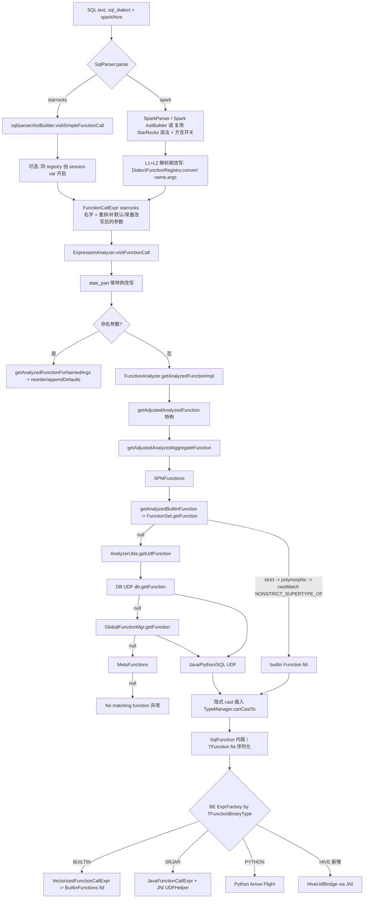

# R2: StarRocks 函数解析与 UDF 基础设施调研

仓库: /home/user/starrocks (只读)。路径相对仓库根。FE 根 = `fe/fe-core/src/main/java/com/starrocks`。

## 1. Builtin 函数注册与解析

### 1.1 单一来源: gensrc/script/functions.py
- `gensrc/script/functions.py:44` `vectorized_functions = [...]`, 约 1077 条签名 (460 个唯一名字)。每行格式:
  `[fn_id, "name", exception_safe, check_overflow, "RET", ["ARG",...], "BE::symbol"(, prepare, close)]`, 末尾可带 dict (`named_args`, `ai`)。
  id 按段分配 (10xxx math, 30xxx string, 120xxx geo ...), fn_id 全局唯一, `ret#name#(args)` 签名也必须唯一 (`gen_functions.py:172-197` 会 exit(1))。
- **别名就是同一 BE symbol 的多行**, 没有独立 alias 表。例: `ceil/ceiling/dceil` 都指向 `MathFunctions::ceil` (functions.py:10110-10112); `pow/power/dpow/fpow`; `log/ln/dlog1`。
- 生成器 `gensrc/script/gen_functions.py`:
  - `generate_fe()` (:379) 用 `java_template` (:51) 生成 `com.starrocks.builtins.VectorizedBuiltinFunctions.initBuiltins(FunctionSet)` (每条 -> `addVectorizedScalarBuiltin(fid, name, varArgs, ret, args...)`)。输出到 FE_TARGET_DIR (Makefile `gensrc/script/Makefile:52-53`)。
  - `generate_cpp()` (:491) 生成 BE 的 `__attribute__((constructor))` 初始化, 向 `BuiltinFunctions` 注册 `{fid, {name, nargs, fn_ptr, [prepare, close], exception_safe, check_overflow, ret, {args}}}` (`be/src/exprs/builtin_functions.h:73`, 查找 `BuiltinFunctions::find_builtin_function(fid)` 见 `be/src/exprs/function_call_expr.cpp:67`)。
  - FE 与 BE 通过 **fn_id** 对齐 (TFunction.fid), 不是名字。加新 builtin = 改 functions.py 一处 + 写 C++ 实现, 两端自动生成。
- **聚合/窗口/表函数不在 functions.py**, 在 FE 手写:
  - `catalog/FunctionSet.java`: 常量 (~490 个 String 常量), `FunctionSet.init()` 里 `addBuiltin(AggregateFunction.createBuiltin(...))` / `createAnalyticBuiltin(...)` (约 :1365-1730, 窗口 :1636-1712)。BE 侧聚合实现在 `be/src/exprs/agg/*` 及 `be/src/exec/aggregator` 通过 agg factory 按名字 + 类型分派。
  - `catalog/TableFunction.java:initBuiltins` : unnest, unnest_bitmap, json_each, subdivide_bitmap, generate_series, list_rowsets。
  - `FunctionSet` 构造(:1009-1073) 里 `vectorizedFunctions: Map<String,List<Function>>` 是唯一 builtin 表, `VectorizedBuiltinFunctions.initBuiltins(this)` (:1073) 填标量, 随后 agg/`TableFunction.initBuiltins(this)` (:1072)。函数名小写为 key。进程启动时一次性构建, 无热加载。

### 1.2 查找路径
`FunctionSet.getFunction(desc, mode)` (:1235): 取同名 list -> (1) 非多态函数 `matchStrictFunction` -> (2) 多态 (ANY_ARRAY 等) `matchPolymorphicFunction` -> (3) `matchCastFunction`(隐式 cast 兜底)。`GlobalStateMgr.getFunction` (server/GlobalStateMgr.java:3453) 只是代理。
`Function.CompareMode` (catalog/Function.java:86): IS_IDENTICAL < IS_INDISTINGUISHABLE < IS_SUPERTYPE_OF(严格隐式 cast) < IS_NONSTRICT_SUPERTYPE_OF(允许精度损失, 如 decimal->float)。`Function.getFunction(fns, desc, mode)` (:875) 按此逐级放宽。SQL 函数调用默认用 `IS_NONSTRICT_SUPERTYPE_OF`。

### 1.3 FE 分析入口
`sql/analyzer/ExpressionAnalyzer.visitFunctionCall` (:1053):
1. 特例改写: `date_part(unit, x)` 被就地改写成 `year(x)/week_iso(x)...` 并递归 (:1060-1130, **这是 FE 内最接近“函数重写”的现成点**)。
2. 命名参数路径 (`FunctionAnalyzer.getAnalyzedFunctionForNamedArgs` :1690, `reorderNamedArgAndAppendDefaults`) — 已支持 `f(a => 1)` 与默认参数补全, 由 functions.py 的 `named_args` 元数据驱动。
3. 位置参数路径 `FunctionAnalyzer.getAnalyzedFunction` (:886) -> `getAnalyzedFunctionImpl` (:985), 顺序:
   a. `getAdjustedAnalyzedFunction` (:1036) 一批硬编码特殊函数 (typeof, st_coverage_simplify, if/array_* 等的参数类型调整);
   b. `getAdjustedAnalyzedAggregateFunction` (聚合特例, 如 sum/avg decimal);
   c. `SPMFunctions.getSPMFunction`;
   d. `getAnalyzedBuiltInFunction` (:1653) -> decimal 专用 (`DecimalV3FunctionAnalyzer`) 或 `ExprUtils.getBuiltinFunction(name, argTypes, IS_NONSTRICT_SUPERTYPE_OF)` -> `FunctionSet.getFunction`;
   e. `AnalyzerUtils.getUdfFunction` (sql/analyzer/AnalyzerUtils.java:318): 先 **DB 级** `getDBUdfFunction`(:271, 用 `db.getFunction`, 检查 USAGE 权限) 再 **全局** `getGlobalUdfFunction`(:300, `GlobalFunctionMgr.getFunction`); 需要 `Config.enable_udf=true`;
   f. `ScalarOperatorEvaluator.INSTANCE.getMetaFunction` (meta functions, 常量折叠函数)。
   注意: **builtin 优先于 UDF**, 用户无法用 UDF 覆盖同名 builtin 的同签名; 但能补 builtin 没有的名字 / 签名(匹配不到 builtin 时才落到 UDF)。
4. 参数类型校验后 (`FunctionAnalyzer.java:905-938`) 通过 `TypeManager.canCastTo` 插入隐式 cast (cast 由 `ImplicitCastRule`/`ExpressionAnalyzer` 后续补)。`SqlFunction` 在此被 `analyzeSqlFunction`(:946) 展开: 用 `SqlParser.parseExpression(fn.getSql())` 重新解析并把形参 SlotRef 绑定类型。
5. 最后 `FunctionAnalyzer.analyze(node)` 做函数专属语义校验。
6. 优化器: `SqlToScalarOperatorTranslator.visitSqlFunctionCall` (sql/optimizer/transformer/SqlToScalarOperatorTranslator.java:748-762) 把 SqlFunction 内联展开成 ScalarOperator 树。

### 1.4 Trino 方言的函数改写 (可直接借鉴)
- `connector/parser/trino/Trino2SRFunctionCallTransformer.java` (444 行): 静态 `TRANSFORMER_MAP: Map<String, List<FunctionCallTransformer>>`, `registerAllFunctionTransformer()` 分 aggregate/array/date/string/regexp/json/url/bitwise/unicode/map/binary/hll/math 注册。`convert(fnName, children)`: 先查表 (`convertRegisterFn` 按参数个数 + 参数 Expr 子类 `match`), 失败再走 `ComplexFunctionCallTransformer.transform` (代码式, 如 date_add(unit,n,d) -> TimestampArithmeticExpr, json_format 等)。
- `FunctionCallTransformer`: 用 `PlaceholderExpr`(`$1,$2`) 描述目标 AST 模板, `transform()` 克隆模板并把占位符替换成实参。也支持变长 (`variableArgument`)。例: `registerFunctionTransformer("from_unixtime", 2, ...)`, `("to_date", 2, "to_tera_date", ...)`, `("approx_percentile",2,...)`。
- 触发点: `connector/parser/trino/AstBuilder.visitFunctionCall` (:803-806) 在 **解析阶段** (AST 构建) 改写, 即在 FE analyzer 之前。方言选择: `SessionVariable.sql_dialect` (SessionVariable.java:1027) -> `sql/parser/SqlParser.parse` (:80-84) `"trino"` 走 `parseWithTrinoDialect`, 解析失败/不支持则 `rollbackStarRocksDialect` 回退 StarRocks 语法 (`enable_dialect_downgrade`)。**目前只有 trino 方言, 没有 spark/hive 方言。**
- StarRocks 原生 AstBuilder 的函数入口: `sql/parser/AstBuilder.visitSimpleFunctionCall` (:8313) 内也有按名字特判 (array_generate, time_slice/date_slice interval 参数改写), 以及 `visitAggregationFunctionCall` (:8560), `visitWindowFunction` (:8695), `visitExtract` (:8735)。

## 2. UDF 框架

| 类型 | 声明 | FE 代码 | BE 代码 |
|---|---|---|---|
| Java scalar / UDAF / UDTF / window | `CREATE [GLOBAL] [AGGREGATE\|TABLE] FUNCTION f(args) RETURNS t PROPERTIES("symbol"="cls","type"="StarrocksJar","file"="http://...jar","md5"?,"isolation"?,"analytic"?)` | `sql/ast/CreateFunctionStmt.java` (常量 :30-70, TYPE_STARROCKS_JAR), `sql/analyzer/CreateFunctionAnalyzer.java:85-110` (`analyzeJavaUDFClass`, 反射校验 evaluate/create/update/merge/serialize/finalize/windowUpdate/process 方法, 类型映射 `PRIMITIVE_TYPE_TO_JAVA_CLASS_TYPE`) | `be/src/exprs/java_function_call_expr.cpp`, `be/src/exprs/udf/java/{java_udf,java_udf_context,java_data_converter,java_udf_reflection,arrow_udf_jni}.*`, JNI 通过 `runtime/java/jvm_class.h`; jar 下载 `be/src/platform/udf_downloader.cpp` |
| Java helper (在 JVM 内) | - | - | `java-extensions/udf-extensions/src/main/java/com/starrocks/udf/`: `UDFHelper`(批量 evaluate 桥, 列 <-> Java 数组)、`CallStubGenerator`(ASM 生成 call stub)、`UDFClassLoader`、`UDFClassAnalyzer`、`UDFSecurityManager`、`FunctionStates`、`ArrowUDFHelper` |
| Arrow 批处理 Java UDF | `PROPERTIES("input"="arrow")` | `INPUT_TYPE_ARROW` | `arrow_udf_jni.cpp`, 示例 `java-extensions/udf-examples/.../ArrowSum.java, UDFArrowAdd.java, UDTFArrowRepeat.java` |
| Python UDF (v3.4+) | `type="Python"`, 可选 `service_url` (外部 Arrow Flight worker) | `CreateFunctionAnalyzer.analyzePython` (:1153) | `be/src/exprs/udf/python/{env,callstub}.*`, `expr_factory.cpp:157` `TFunctionBinaryType::PYTHON`; 文档 `docs/en/sql-reference/sql-functions/Python_UDF.md` |
| SQL UDF (v4.1) | `CREATE FUNCTION f(a int) RETURNS int AS <expr>` (build-function mode, `stmt.isBuildFunctionMode()`) | `catalog/SqlFunction.java`, `CreateFunctionAnalyzer.analyzeExpression` (:112) 序列化为 SQL 文本; 调用时重新解析并内联; 文档 `SQL_UDF.md` | 无 (FE 内联, 无 BE 代码) |

BE 分派: `be/src/exprs/expr_factory.cpp:149-160` 按 `TFunctionBinaryType` (gensrc/thrift/Types.thrift:324: BUILTIN, HIVE, NATIVE, IR, SRJAR, PYTHON, AI) 选 `JavaFunctionCallExpr` / Python expr / AI expr / `VectorizedFunctionCallExpr`。`HIVE/NATIVE/IR` 是 Impala 遗留枚举, **StarRocks 未实现**。

### fe/hive-udf 是什么
`fe/hive-udf` (及 `fe/plugin/hive-udf`: UDAFBitmapAgg/UDFBitmapOr/And/Xor/Count/FromString/ToString/Base64ToBitmap 等, 类 `com.starrocks.hive.udf.*`) 是**反向**: 一组继承 Hive `GenericUDF`/`UDAF` 的类, 打成 jar 放进 **Hive** 里使用, 用于在 Hive 里生成/解析 StarRocks 兼容的 Bitmap 格式 (`docs/en/sql-reference/sql-functions/hive_bitmap_udf.md`)。它依赖 hive-exec 但**不在 StarRocks 中执行**。
结论: **StarRocks 目前不支持在查询中运行原生 Hive UDF (GenericUDF / UDF / UDAF)**。`fe/fe-core/.../connector/hive/glue/util/ExpressionHelper.java` 命中 GenericUDF 仅是 Hive 分区表达式处理。Java UDF 约定 (evaluate(…) 方法 + 基本类型) 与 Hive GenericUDF (ObjectInspector + DeferredObject) 不兼容, 需要写桥。

## 3. 全局函数 vs DB 函数、缓存、如何装载“方言函数包”
- 存储: DB 函数 `Database.functions` (name -> list), 全局函数 `catalog/GlobalFunctionMgr.java` (`name2Function: Map<String, ImmutableList<Function>>`, `userAddFunction`, `replayAddFunction`, image/EditLog 持久化, 分配 id `assignIdToUserDefinedFunction`)。名字 `GLOBAL_UDF_DB` 通过 `FunctionRefAnalyzer.resolveFunctionName`。权限: `Authorizer.checkGlobalFunctionAction` / `checkFunctionAction` (USAGE)。
- Builtin 表是进程内静态, UDF 表走元数据持久化, 查询时直接查 map (无额外 FE 缓存); BE 侧有 UDF jar 下载缓存 (`udf_downloader`) 与 `JavaUdfClassLoader` 缓存、context 按 fragment 创建。
- 因此“Spark 兼容函数包”有三种装载方式:
  1. **编译期**: 改 functions.py / FunctionSet (builtin, 需要重编, 性能最好)。
  2. **启动期 (推荐, 方言层)**: 类似 `TRANSFORMER_MAP` 的静态注册表, 在 AstBuilder/analyzer 前置改写 (无元数据, 无需 CREATE FUNCTION)。
  3. **运行期**: 在 `GlobalFunctionMgr` 里预置 `SqlFunction` (global SQL UDF) 或 Java UDF; 需 bootstrap 脚本 (`CREATE GLOBAL FUNCTION`) 或 FE 启动时 `replayAddFunction`; 缺点是 builtin 同名同签名优先, 且受 `enable_udf` 和权限约束, 且会写入 image。

## 4. 函数数量 (近似)
完整列表: `/tmp/claude-0/-home-user/26eaf88c-2924-5019-8bd6-ec9f29be9b81/scratchpad/sr_functions.txt` (595 个唯一小写名字 = functions.py 460 名 ∪ FunctionSet 字符串常量 (排除 `_union/_merge/_if` 等 state 后缀) ∪ 6 个表函数)。该列表是近似: 可能含少量非函数常量 (如 `add/subtract/divide` 算术算子) 及 `degress` 等拼写原样, 个别仅在 FunctionSet 里用字面量注册的聚合可能漏掉。
- 标量: 约 1077 个签名 / 460 名 (含 math, string, date, json, array, map, bitmap, hll, geo, encryption 等)。
- 聚合: 约 110-130 个名字 (FunctionSet, 另有 `_if/_state/_merge/_union` combinator, 见 `AGG_STATE_IF_SUFFIX`)。
- 窗口 (analytic): rank, dense_rank, row_number, ntile, cume_dist, percent_rank, lead, lag, first_value, last_value, session_number (+ 所有聚合可作窗口)。
- 表函数: 6 (unnest, unnest_bitmap, json_each, subdivide_bitmap, generate_series, list_rowsets)。

按名字抽查 Spark 常用函数, **缺失**: nvl, nvl2, size, explode/posexplode/inline/stack (用 `unnest`), collect_list/collect_set (用 array_agg / array_unique_agg), sort_array, from_json, first/last (agg), aggregate/zip_with, map_from_entries, flatten(=array_flatten), isnan/nanvl, format_number, base64(=to_base64), hash/xxhash64(=xx_hash3_64 / murmur_hash3_32 语义不同), bround, factorial, shiftleft(=bit_shift_left), array_union(≈array_distinct(array_concat)), months_between, trunc, to_timestamp, from/to_utc_timestamp, chr(=char), bit_length/octet_length, levenshtein, soundex, rlike(=regexp), overlay, sha1/sha, skewness/kurtosis, bool_and/every/any/some, median, mode, reflect, input_file_name。
**已存在且名字相同**: percentile_approx, date_format, to_date, unix_timestamp, split, instr, locate, datediff, date_add, concat_ws, substring, left, array_contains, element_at, get_json_object, regexp_extract/replace, str_to_map, named_struct, transform, translate, lpad/rpad, ltrim, add_months, next_day, last_day, pmod, cbrt, crc32, uuid, max_by/min_by, approx_count_distinct, stddev/std, corr, covar_pop, bool_or, current_timezone, cardinality, date_trunc。

语义差异清单 (名字一样但行为不同, 适配层必须处理):
- `split(str, delim)`: SR 是字面量分隔 (`StringFunctions::split`), Spark 是 regex (+limit); SR 有 `regexp_split`(2/3 参)。-> 重写成 `regexp_split`, limit 语义需核对 (Spark limit<=0 无限)。
- `date_format(ts, fmt)`: SR = MySQL 模式 (%Y-%m-%d), Spark = Java SimpleDateFormat (yyyy-MM-dd); SR 已有 `jodatime_format` (Trino 用), Joda 与 Java 模式相近但不完全一致 (如 `u`, `E` 细节), 对常量 fmt 可在 FE 做 pattern 翻译成 MySQL 格式。
- `unix_timestamp(str, fmt)` / `from_unixtime(n, fmt)` / `to_date(str, fmt)` / `to_timestamp`: 同上 fmt 翻译; `to_date(x, fmt)` -> `str_to_date`+`date` ; Spark 的 `to_date(ts)` 即 `date(ts)`。
- `substring(s, pos, len)`: pos 1 基, 负数从尾, pos=0 视作 1 (Spark) — SR 对 pos=0 返回空串, 需 `if(pos=0,1,pos)` 包装。
- `datediff(end, start)`: 顺序与 SR 相同 (end - start), 但 Spark 3 的 `datediff(end,start)` 返回 int, SR 返回 INT; OK。`date_add(d, n)` 与 SR `date_add(d, INT)` 同天数语义 (SR 另支持 INTERVAL); 但 Spark `date_add` 对 string 入参的隐式转换需 cast。
- `size(x)`: Spark 对 NULL 返回 -1 (legacy, `spark.sql.legacy.sizeOfNull`) 或 NULL (ANSI), 对 map/array 皆可 -> `ifnull(array_length(x), -1)` / `map_size`; 类型相关重写需 FE 知道参数类型 (analyzer 后期, 非解析期)。
- `concat_ws(sep, array|str...)`: Spark 跳过 NULL 且接受 array<string>; SR concat_ws 遇 NULL 参数的行为需核对, 数组需展开 `array_join`。
- `nvl(a,b)` -> `ifnull`; `nvl2(a,b,c)` -> `if(a is not null, b, c)`; `instr/locate` 参数顺序同 MySQL, 一致 (locate 的 pos 参数 1 基一致)。
- `collect_list(x)` -> `array_agg(x)` (会含 NULL? Spark 忽略 NULL, SR array_agg 保留 NULL, 需 `array_agg(x) filter / if(x is not null,..)`); `collect_set` -> `array_unique_agg`。
- `percentile_approx(col, p[, acc])`: SR 接受 (expr, DOUBLE[, compression]); Spark p 可为数组 -> 需展开成多个调用+`array`。
- `explode/posexplode/inline`: 表函数 `unnest` 仅在 FROM/LATERAL 位置; Spark 在 SELECT 列表使用 -> 需转成 `FROM t, LATERAL unnest(arr)` 的 relation 重写 (AST 级, 非函数级); posexplode 可用 `unnest(arr, generate_series(1, array_length))` 多参数 unnest (SR unnest 支持多数组并行)。

## 5. 设计建议: 四层适配

### L1 名字别名 (a)
- 最干净: 在 `gensrc/script/functions.py` 为纯同义函数新增行 (同一 BE symbol, 新 fn_id, 新 name), 零运行期成本、FE/BE 自动生成, EXPLAIN 显示 Spark 名。适用: `nvl`->ifnull 同签名(需分别对各类型 ifnull 签名重复登记; ifnull 在 FunctionSet 用 `IF_NULL` 特殊处理, 需先确认), `chr`->char, `shiftleft/shiftright`, `base64/unbase64`, `sha1`(需新实现), `rlike`, `every/some/bool_and`(agg 需 FunctionSet 登记)。缺点: 污染全局 builtin 命名空间, 对所有方言可见, 可能与用户 UDF 同名冲突 (builtin 优先)。
- 方言限定的别名: 新建 `connector/parser/spark/SparkFunctionAliasRegistry` (Map<String,String>), 在 AST 构建时对 FunctionCallExpr 名字替换。仅 spark 会话生效, 不动 FunctionSet。

### L2 参数重排 / 默认值 / 常量改写 (b)
- 新建 `DialectFunctionTransformer` 包 (如 `fe/fe-core/.../connector/parser/spark/`), **直接复用** Trino 的 `FunctionCallTransformer` + `PlaceholderExpr` 模板机制 (`Trino2SRFunctionCallTransformer` 的 `registerFunctionTransformer(name, argc, targetTemplate, argClasses)`) 作为 Spark 的 `Spark2SRFunctionCallTransformer`, 并保留 `ComplexFunctionCallTransformer` 式代码分支处理: date_format 模式串翻译(常量 StringLiteral 时在 FE 把 Java 模式转 MySQL 模式; 非常量则回落到 `jodatime_format`), split->regexp_split, substring pos=0, concat_ws 数组展开, nvl2, size, collect_list 的 NULL 过滤, percentile_approx 数组 p。
- 需要类型信息的重写 (size(array) vs size(map), to_date(str) vs to_date(ts)) 不能放在解析期。放在 `ExpressionAnalyzer.visitFunctionCall` 起始处, 与 `date_part` 同级的钩子: `if (session.isSparkDialect()) node = DialectFunctionRewriter.rewrite(node, argumentTypes)`; 参考 `date_part` 的 `node.resetFnName` + `clearChildren/addChild` 再递归 `visitFunctionCall`。
- 也可用已存在的 **命名参数 + 默认值** 机制 (functions.py `named_args` 元数据, `FunctionAnalyzer.reorderNamedArgAndAppendDefaults`) 表达“缺省参数”类差异, 但它不改变语义。
- 轻量替代: 用预置的全局 `SqlFunction` (如 `CREATE GLOBAL FUNCTION nvl2(a any...)` 受限于类型声明, 不支持泛型 ANY, 所以只适合固定类型); 不推荐作为主机制。
- 表函数类 (explode/posexplode/inline/stack, LATERAL VIEW) 需要 Spark 语法层 (AstBuilder) 把 `LATERAL VIEW explode(x) t AS c` 转成 `TableFunctionRelation`(`unnest`), 属于方言解析器范围, 非函数表。

### L3 新增 C++ native builtin (c)
放在: `gensrc/script/functions.py` (新条目, 选未用 id 段) + `be/src/exprs/{string,math,time,array,...}_functions.{h,cpp}` 实现, 并加 BE UT (`be/test/exprs`)。适用于 L2 无法等价表达或性能关键者: Spark 语义的 `date_format(ts, java_pattern)` (运行期非常量 pattern)、`months_between`、`levenshtein`、`soundex`、`format_number`、`bround`、`sha1`、`factorial`、`to_utc_timestamp/from_utc_timestamp`、`skewness/kurtosis`、`sort_array`、`hash`(Murmur3 Spark 兼容)/`xxhash64`(Spark 种子 42)。聚合: FunctionSet 登记 + `be/src/exprs/agg/` 新 AggregateFunction。命名冲突时可采用 `spark_` 前缀 (`spark_split`, `spark_date_format`) 供 L2 改写目标使用, 既不污染 Spark 名字空间也不改变现有 SR 行为。

### L4 Hive UDF JNI 桥 (d, 兜底)
现状 JNI 链路 (`CreateFunctionAnalyzer` -> TFunction(SRJAR) -> `JavaFunctionCallExpr` -> `UDFHelper`/`CallStubGenerator`) 以 `evaluate` 方法反射为主。建议在 `java-extensions/udf-extensions` 新增 `HiveUDFAdapter`(`com.starrocks.udf.hive`):
- 实现 StarRocks UDF 约定的 `evaluate(...)`/UDAF `State` 类, 内部构造 Hive `GenericUDF`、`ObjectInspector[]`(由 SQL 签名推导), `DeferredJavaObject`; 老式 `UDF` 类用 `GenericUDFBridge` 语义(反射 evaluate)。
- FE: `CreateFunctionAnalyzer` 增加 `type="HiveUDF"`(或 `PROPERTIES("hive_class"=..)`), 在 `analyzeJavaUDFClass` 之前把 symbol 包装为适配器; UDAF 映射 Hive `GenericUDAFEvaluator` (PARTIAL1/PARTIAL2/FINAL) 到 create/update/merge/serialize/finalize。
- 依赖 hive-exec/hive-serde 需放进隔离 classloader (`UDFClassLoader`) — 注意 `UDFSecurityManager` 限制。
- 仅作为 L1-L3 没覆盖时的回退; 用户通过 `CREATE FUNCTION` 注册并指定 jar, 与 Hive `CREATE FUNCTION ... AS 'class' USING JAR` 语法在 Spark 方言解析器里做一对一转换。

### 层间优先级与落点汇总
| 层 | 位置 | 生效范围 | 备注 |
|---|---|---|---|
| L1 别名 | functions.py / `FunctionSet.init`；或 spark registry | 全局/会话 | 零成本；方言限定走 registry |
| L2 重写 | 新 `connector/parser/spark/*` (解析期) + `ExpressionAnalyzer.visitFunctionCall` 钩子(类型相关) | `sql_dialect=spark` | 复用 `FunctionCallTransformer` |
| L3 native | functions.py + `be/src/exprs/*` + FunctionSet(agg) | 全局 | 命名 `spark_*` 避免语义冲突 |
| L4 Hive bridge | `java-extensions/udf-extensions` + `CreateFunctionAnalyzer` | 用户显式 CREATE FUNCTION | 回退 |
| 方言开关 | `SqlParser.parse` (:80) 增分支, `SessionVariable.sql_dialect`, 失败回退 `rollbackStarRocksDialect` | 会话 | 沿用 Trino 的降级策略 |

风险/注意:
- builtin 优先于 UDF; 若 L1 登记与 UDF 同名会静默覆盖。
- FE/BE 滚动升级: 新增 fn_id 在旧 BE 不存在 -> 需要 FE 版本门控 (参考已有 `FunctionSet` 里按 `Config`/version 的条件注册)。
- fn_id 与签名唯一性由 `gen_functions.py` 校验, 新增时避免冲突。
- 解析期改写看不到类型; 类型相关语义必须放 analyzer 钩子, 且需保证 `AstToSQLBuilder` 反解析(视图/物化视图存储)仍可重放: Trino 方式存储的是改写后的 StarRocks AST, 视图定义保存的是 StarRocks SQL, 这点对 Spark 同样成立且是优点。
